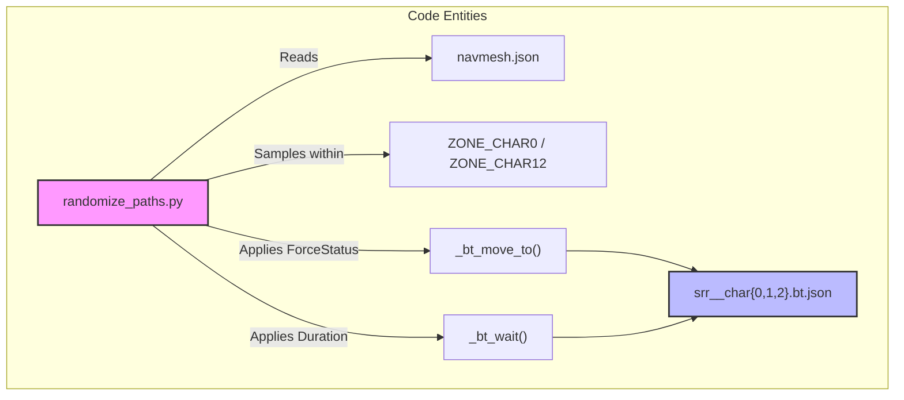
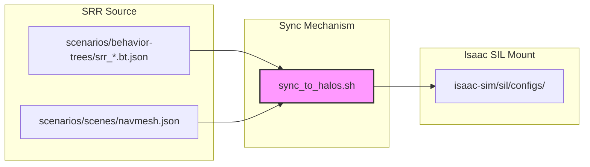

<!-- source: DeepWiki mcp.deepwiki.com · repo NVIDIA/halos-outside-in-safety · page 6.1 Scenario Orchestration · fetched 2026-11-09 -->

# Scenario Orchestration

<details>
<summary>Relevant source files</summary>

The following files were used as context for generating this wiki page:

- [closed-loop-testing/regression-reporter/.env.example](closed-loop-testing/regression-reporter/.env.example)
- [closed-loop-testing/regression-reporter/halos-integration/README.md](closed-loop-testing/regression-reporter/halos-integration/README.md)
- [closed-loop-testing/regression-reporter/halos-integration/sync_to_halos.sh](closed-loop-testing/regression-reporter/halos-integration/sync_to_halos.sh)
- [closed-loop-testing/regression-reporter/scenarios/README.md](closed-loop-testing/regression-reporter/scenarios/README.md)
- [closed-loop-testing/regression-reporter/scenarios/isaac-scripts/README.md](closed-loop-testing/regression-reporter/scenarios/isaac-scripts/README.md)
- [closed-loop-testing/regression-reporter/scenarios/isaac-scripts/srr_pubs/check_srr_prereqs.py](closed-loop-testing/regression-reporter/scenarios/isaac-scripts/srr_pubs/check_srr_prereqs.py)
- [closed-loop-testing/regression-reporter/scenarios/tools/README.md](closed-loop-testing/regression-reporter/scenarios/tools/README.md)
- [closed-loop-testing/regression-reporter/scenarios/tools/randomize_paths.py](closed-loop-testing/regression-reporter/scenarios/tools/randomize_paths.py)
- [closed-loop-testing/regression-reporter/scripts/run_multi.sh](closed-loop-testing/regression-reporter/scripts/run_multi.sh)
- [closed-loop-testing/regression-reporter/scripts/snapshot_pss.sh](closed-loop-testing/regression-reporter/scripts/snapshot_pss.sh)
- [closed-loop-testing/regression-reporter/srr-service/docker-compose.yml](closed-loop-testing/regression-reporter/srr-service/docker-compose.yml)
- [docs/testing/srr/scenarios.mdx](docs/testing/srr/scenarios.mdx)
- [skills/hoisa-deploy-profile/references/calibration_3d.md](skills/hoisa-deploy-profile/references/calibration_3d.md)
- [skills/hoisa-deploy-profile/references/ngc_artifacts.md](skills/hoisa-deploy-profile/references/ngc_artifacts.md)

</details>


## Purpose and Scope
This page details the scenario orchestration subsystem within the Halos Outside-In Safety (HOISA) Regression Testing Reporter (SRR). It covers the end-to-end lifecycle of multi-scenario sweeps managed by `run_multi.sh`, the generation and structure of IRA 1.7 behavior trees via `randomize_paths.py`, environment configuration, path validation, and the synchronization glue (`sync_to_halos.sh`) that links canonical test artifacts into the Isaac Sim Software-in-the-Loop (SIL) container tree.

---

## 1. Environment Configuration and Workspace Setup

The regression-reporter pipeline relies on a unified root directory structure anchored by `HOISA_ROOT_PATH`. Environment variables are initialized via template configuration files located at `closed-loop-testing/regression-reporter/.env.example` and are supplemented by deployment profiles under `deployments/profiles/`.

Key environment parameters governing execution paths, vision backend selection, and Kafka broker topics include:
- `HOISA_ROOT_PATH`: Absolute path to the main repository root.
- `VSS_ROOT_PATH`: Root directory of the Video Search and Summarization (VSS) perception backend checkout.
- `ENV_VSS_PATH`: Path to the VSS build override environment file, determining mode (`2d`, `3d`, or `mv3dt`).
- `CALIBRATION_JSON`: Host path to the camera calibration file consumed by aggregators for Region of Interest (ROI) polygons and tripwires.
- `SENSORS`: Comma-separated list of active camera sensor names matching scene topology (e.g., `Camera,Camera_01,Camera_02`).
- `KAFKA_TOPIC`: Primary message bus topic (`mdx-events`) streamed from perception to safety core monitors.

```bash
# Example environment setup mapping
HOISA_ROOT_PATH=/opt/nvidia/halos-outside-in-safety
VSS_ROOT_PATH=/opt/nvidia/video-search-and-summarization
ENV_VSS_PATH=${VSS_ROOT_PATH}/_builds/default/override.env
CALIBRATION_JSON=${VSS_ROOT_PATH}/deploy/docker/industry-profiles/warehouse-operations/warehouse-2d-app/calibration/sample-data/warehouse-loading-dock-3cams-synthetic/calibration.json
SENSORS=Camera,Camera_01,Camera_02
KAFKA_TOPIC=mdx-events
```

Sources: `closed-loop-testing/regression-reporter/.env.example:1-66`()

---

## 2. Scenario Definitions and Behavior Trees

The SRR harness defines five canonical randomized test scenarios alongside an opt-in deterministic baseline. Each scenario uses the stock warehouse USD scene (`indicator_warehouse_20x20_layout_overflow_test.usd`) and shares identical calibration parameters, differing exclusively in the character movement scripts governed by Isaac Sim Behavior Trees.

| Scenario | Default Duration | Stress Focus & Behavior Characteristics |
| :--- | :--- | :--- |
| `in-roi` | 5 min | Person stays inside work zone constantly — constant presence stress on the Safety Core. |
| `psf-edge` | 5 min | Person sits directly on the ROI boundary — exercises hysteresis and debounce logic. |
| `psf-clear` | 5 min | Person operates clearly inside or outside boundaries — clean A/B verification partner. |
| `balanced` | 10 min | Mixed activity — standard baseline performance test. |
| `fast` | 20 min | Low idle duration, high motion intensity — tests cumulative drift over extended runs. |
| `fixed` | 5 min | Hand-authored deterministic baseline (opt-in; excluded from `all`/`full` automatic sweeps). |

With Isaac Sim 6.1 and Isaac Robot Architecture (IRA) 1.7, legacy text-based command files have been deprecated. Pedestrian locomotion is fully defined by JSON behavior trees (`srr_<name>_char{0,1,2}.bt.json`) adhering to schema version `2.0.0`.

Sources: `closed-loop-testing/regression-reporter/scenarios/README.md:1-69`(), `docs/testing/srr/scenarios.mdx:1-39`()

---

## 3. Path Randomization and Validation Tooling

Test fixtures are generated via host-side Python utilities housed in `closed-loop-testing/regression-reporter/scenarios/tools/`. The primary generator, `randomize_paths.py`, samples navigation nodes across per-character polygon boundaries (`ZONE_CHAR0` and `ZONE_CHAR12`) while validating against baked NavMesh geometry.


Sources: `closed-loop-testing/regression-reporter/scenarios/tools/README.md:1-125`(), `closed-loop-testing/regression-reporter/scenarios/tools/randomize_paths.py:1-118`()

### Behavior Tree Node Construction
The generator produces node trees utilizing `omni.behavior.tree.core` and `omni.anim.behavior.tree`. Each `MoveTo` directive is wrapped in a `ForceStatus` modifier to ensure that navigation failures (such as temporary path blockages) return success instead of aborting execution sequences, preventing character freezing:

```python
def _bt_move_to(idx, x, y, z):
    return {
        "type": "MoveTo",
        "source": "omni.anim.behavior.tree",
        "name": f"n{idx}_MoveTo",
        "portOverrides": {"target": {"type": "carb::Float3", "value": [x, y, z]}},
        "modifiers": [
            {
                "type": "ForceStatus",
                "source": "omni.behavior.tree.core",
                "name": f"n{idx}_MoveTo_ForceSuccess",
            }
        ],
    }
```
Sources: `closed-loop-testing/regression-reporter/scenarios/tools/randomize_paths.py:41-60`()

---

## 4. Halos Integration and Sync Pipeline

Because SRR fixtures reside within `closed-loop-testing/regression-reporter/scenarios/`, a synchronization step is required to populate the Isaac Sim SIL execution tree (`closed-loop-testing/isaac-sim/sil/configs/`) prior to container bring-up.

### Integration Pattern A (Sync at Deploy Time)
The synchronization script `sync_to_halos.sh` copies canonical trees and configuration templates into the runtime container mount directory:
- `scenarios/behavior-trees/srr_*.bt.json` $\rightarrow$ `$SIL/configs/`
- `scenarios/scenes/navmesh.json` $\rightarrow$ `$SIL/configs/`
- `scenarios/isaac-scripts/**/*.py` $\rightarrow$ `$SIL/scripts/isaac/`
- `default_config_ros.yaml.template` $\rightarrow$ `$SIL/configs/default_config_ros.yaml`


Sources: `closed-loop-testing/regression-reporter/halos-integration/README.md:1-85`()

---

## 5. Multi-Scenario Orchestration Lifecycle (`run_multi.sh`)

Sequential execution of regression test suites is driven by `closed-loop-testing/regression-reporter/scripts/run_multi.sh`. The orchestrator processes scenario tokens, manages Video Streaming Toolkit (VST) sensor purgation to prevent stale registration leaks, copies active behavior trees, and coordinates state preservation via `snapshot_pss.sh`.

```mermaid
graph TD
    START["run_multi.sh <tokens>"] --> PARSE["expand_tokens()"]
    PARSE --> ITERATE{"For Each Scenario"}
    
    ITERATE --> PURGE["phase_vst_purge()"]
    PURGE --> COPY["Copy srr_<name>_char*.bt.json to srr_char*.bt.json"]
    COPY --> LAUNCH["docker compose up (Isaac + Safety Core)"]
    LAUNCH --> WAIT["Sleep Scenario Duration (Default 300s)"]
    WAIT --> SNAP["snapshot_pss.sh --per-scn"]
    SNAP --> TEARDOWN["docker compose down"]
    TEARDOWN --> CHECK_MORE{"More Scenarios?"}
    CHECK_MORE -->|Yes| ITERATE
    CHECK_MORE -->|No| FINISH["Rollup & Exit"]

    subgraph "Execution Flow"
        START
        PARSE
        ITERATE
        PURGE
        COPY
        LAUNCH
        WAIT
        SNAP
        TEARDOWN
        CHECK_MORE
        FINISH
    end

    style START fill:#f9f,stroke:#333,stroke-width:2px
    style SNAP fill:#bbf,stroke:#333,stroke-width:2px
```


Sources: `closed-loop-testing/regression-reporter/scripts/run_multi.sh:1-157`(), `closed-loop-testing/regression-reporter/scripts/snapshot_pss.sh:1-133`()

### Key Orchestration Phases
1. **Token Expansion (`expand_tokens`)**: Parses user arguments supporting explicit durations (`name:seconds`), presets (`all`), and full sweeps (`full`), defaulting to 300 seconds per test.
2. **VST Sensor Purgation (`phase_vst_purge`)**: Purges stale VST sensor registrations between container restart cycles. Because Isaac Sim re-registers sensors with new identifiers on startup, clearing old registrations ensures perception modules bind cleanly without inactive source pileups.
3. **Behavior Tree Activation**: Maps the selected scenario's canonical tree files onto the fixed active file names (`srr_char{0,1,2}.bt.json`) expected by `default_config_ros.yaml`.
4. **Safety Core Logging Snapshots (`snapshot_pss.sh`)**: Captures host bind-mount safety logs (`pss.log`) immediately after recording stops to prevent truncation during subsequent compose resets.

Sources: `closed-loop-testing/regression-reporter/scripts/run_multi.sh:1-157`(), `closed-loop-testing/regression-reporter/scripts/snapshot_pss.sh:1-133`()

---

