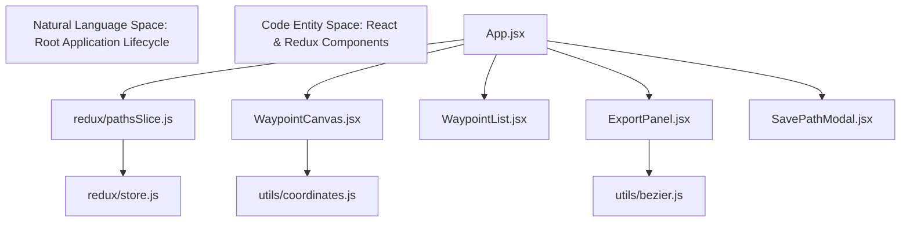
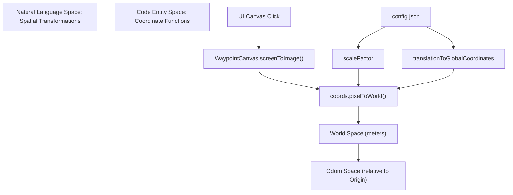

<!-- source: DeepWiki mcp.deepwiki.com · repo NVIDIA/halos-outside-in-safety · page 7.1 Waypoint Generator · fetched 2026-11-09 -->

# Waypoint Generator

<details>
<summary>Relevant source files</summary>

The following files were used as context for generating this wiki page:

- [LICENSE-3rd-party.txt](LICENSE-3rd-party.txt)
- [tools/waypoint-generator/.gitignore](tools/waypoint-generator/.gitignore)
- [tools/waypoint-generator/3rdParty_Licenses.txt](tools/waypoint-generator/3rdParty_Licenses.txt)
- [tools/waypoint-generator/assets/path-manager.png](tools/waypoint-generator/assets/path-manager.png)
- [tools/waypoint-generator/assets/waypoint-generator.png](tools/waypoint-generator/assets/waypoint-generator.png)
- [tools/waypoint-generator/eslint.config.js](tools/waypoint-generator/eslint.config.js)
- [tools/waypoint-generator/index.html](tools/waypoint-generator/index.html)
- [tools/waypoint-generator/package-lock.json](tools/waypoint-generator/package-lock.json)
- [tools/waypoint-generator/package.json](tools/waypoint-generator/package.json)
- [tools/waypoint-generator/public/maps/maps.json](tools/waypoint-generator/public/maps/maps.json)
- [tools/waypoint-generator/public/maps/warehouse_20x20/config.json](tools/waypoint-generator/public/maps/warehouse_20x20/config.json)
- [tools/waypoint-generator/public/maps/warehouse_20x20/map.png](tools/waypoint-generator/public/maps/warehouse_20x20/map.png)
- [tools/waypoint-generator/public/maps/warehouse_40x20/config.json](tools/waypoint-generator/public/maps/warehouse_40x20/config.json)
- [tools/waypoint-generator/public/maps/warehouse_40x20/map.png](tools/waypoint-generator/public/maps/warehouse_40x20/map.png)
- [tools/waypoint-generator/src/App.css](tools/waypoint-generator/src/App.css)
- [tools/waypoint-generator/src/App.jsx](tools/waypoint-generator/src/App.jsx)
- [tools/waypoint-generator/src/components/ExportPanel.jsx](tools/waypoint-generator/src/components/ExportPanel.jsx)
- [tools/waypoint-generator/src/components/PathManager.css](tools/waypoint-generator/src/components/PathManager.css)
- [tools/waypoint-generator/src/components/PathManager.jsx](tools/waypoint-generator/src/components/PathManager.jsx)
- [tools/waypoint-generator/src/components/SavePathModal.jsx](tools/waypoint-generator/src/components/SavePathModal.jsx)
- [tools/waypoint-generator/src/components/WaypointCanvas.jsx](tools/waypoint-generator/src/components/WaypointCanvas.jsx)
- [tools/waypoint-generator/src/components/WaypointList.jsx](tools/waypoint-generator/src/components/WaypointList.jsx)
- [tools/waypoint-generator/src/maps/loadMaps.js](tools/waypoint-generator/src/maps/loadMaps.js)
- [tools/waypoint-generator/src/redux/pathsSlice.js](tools/waypoint-generator/src/redux/pathsSlice.js)
- [tools/waypoint-generator/src/redux/store.js](tools/waypoint-generator/src/redux/store.js)
- [tools/waypoint-generator/src/utils/coordinates.js](tools/waypoint-generator/src/utils/coordinates.js)
- [tools/waypoint-generator/test/pathsPersistence.test.js](tools/waypoint-generator/test/pathsPersistence.test.js)

</details>


The Waypoint Generator is a developer-facing web application located in `tools/waypoint-generator/` designed to visually create, edit, and export robot navigation paths and safety calibration maps for HOISA simulated warehouses (such as `warehouse_20x20` and `warehouse_40x20`). It provides a React/Redux frontend running on Vite, supporting interactive canvas-based waypoint placement, heading adjustment, coordinate transformation between pixel, world, and odom spaces, and JSON/YAML export for the forklift controller.

Sources: `tools/waypoint-generator/package.json:1-36`

---

## 1. Application Architecture & React/Redux Structure

The application is structured around a single-page React architecture utilizing Redux Toolkit for state management. The main entry point `App.jsx` coordinates active map selection, mode switching (`origin`, `waypoint`, `view`), and synchronization with Redux storage.

### Component Hierarchy and State Flow
The user interacts with specialized sub-components for canvas rendering, sidebar list management, and export handling:
- `App.jsx`: Root component managing application modes, active map configurations, and global event handlers [tools/waypoint-generator/src/App.jsx:26-194]().
- `WaypointCanvas.jsx`: HTML5 canvas component handling pan/zoom, background warehouse image rendering, grid overlays, and mouse-based waypoint/origin dragging [tools/waypoint-generator/src/components/WaypointCanvas.jsx:17-30]().
- `WaypointList.jsx`: Sidebar component rendering waypoint sequences, reordering (drag-and-drop or up/down buttons), and inline editing [tools/waypoint-generator/src/components/WaypointList.jsx:10-18]().
- `ExportPanel.jsx`: Generates and exports curve-interpolated JSON paths or imports existing waypoint files [tools/waypoint-generator/src/components/ExportPanel.jsx:11-199]().
- `SavePathModal.jsx`: Modal dialog for naming, creating, or updating saved paths in Redux [tools/waypoint-generator/src/components/SavePathModal.jsx:11-136]().


*Figure 1: Waypoint Generator component architecture bridging UI interactions to Redux state and utility modules.*

Sources: `tools/waypoint-generator/src/App.jsx:1-194`, `tools/waypoint-generator/src/redux/pathsSlice.js:1-185`, `tools/waypoint-generator/src/redux/store.js:1-38`, `tools/waypoint-generator/src/components/WaypointCanvas.jsx:17-30`

---

## 2. Coordinate Systems & Map Configurations

The Waypoint Generator bridges three distinct coordinate spaces to map user interactions on a 2D image to 3D simulation/robot frames:

1. **Pixel Space**: Image coordinates `(pixelX, pixelY)` relative to the warehouse plan view image (`map.png`).
2. **World Space**: Global simulation/USD world coordinates `(world_x, world_y)` measured in meters.
3. **Odom Space**: Local path-relative coordinates `(x, y)` measured in meters relative to the user-defined `origin` point.

### Map Configuration Schema
Each warehouse map is defined by a `config.json` file specifying scale factors, translation offsets, and default forklift spawn properties [tools/waypoint-generator/public/maps/warehouse_20x20/config.json:1-27]().

| Field | Type | Description |
| :--- | :--- | :--- |
| `name` | string | Human-readable warehouse identifier [tools/waypoint-generator/public/maps/warehouse_20x20/config.json:2]() |
| `scene` | string | Path to the Isaac Sim USD scene file [tools/waypoint-generator/public/maps/warehouse_20x20/config.json:3]() |
| `image` | string | Filename of the 2D plan view image [tools/waypoint-generator/public/maps/warehouse_20x20/config.json:4]() |
| `scaleFactor` | number | Pixels per meter scaling factor (`scale`) [tools/waypoint-generator/public/maps/warehouse_20x20/config.json:5]() |
| `translationToGlobalCoordinates` | object | Offset `{ x, y }` used to shift world origins to pixel coordinates [tools/waypoint-generator/public/maps/warehouse_20x20/config.json:6-9]() |
| `defaultForkliftStart` | object | Default spawn pose `{ world_x, world_y, theta_deg }` [tools/waypoint-generator/public/maps/warehouse_20x20/config.json:14-18]() |

### Transformation Formulas
Conversions between World Space and Pixel Space are implemented using the map config parameters:
- `pixelX = (worldX + transX) * scale` [tools/waypoint-generator/public/maps/warehouse_20x20/config.json:26]()
- `pixelY = (-worldY + transY) * scale` [tools/waypoint-generator/public/maps/warehouse_20x20/config.json:26]()


*Figure 2: Coordinate transformation pipeline mapping pixel interactions through map calibration parameters.*

Sources: `tools/waypoint-generator/public/maps/warehouse_20x20/config.json:1-28`, `tools/waypoint-generator/src/components/WaypointCanvas.jsx:55-61`

---

## 3. Path Generation & Export JSON Schema

When exporting paths, `ExportPanel.jsx` compiles the user-defined waypoints and origin point into a structured JSON payload [tools/waypoint-generator/src/components/ExportPanel.jsx:15-87](). It invokes `generateCurvedPath` from `tools/waypoint-generator/src/utils/bezier.js` to interpolate intermediate poses and segment metadata for path-following controllers [tools/waypoint-generator/src/components/ExportPanel.jsx:35-38]().

### Export JSON Structure
The exported schema contains map metadata, origin reference, discrete waypoints (in both odom and world frames), and dense interpolated poses:

```json
{
  "map": {
    "id": "warehouse_20x20",
    "scene": "sil/scenes/indicator_warehouse_20x20_layout_overflow_test.usd"
  },
  "origin": {
    "world_x": 1.0,
    "world_y": -13.39,
    "theta_deg": 180
  },
  "waypoints": [
    {
      "x": 2.0,
      "y": 0.0,
      "theta_deg": 0,
      "reverse": false,
      "world_x": 3.0,
      "world_y": -13.39,
      "velocity": 0.5,
      "note": "Waypoint 1"
    }
  ],
  "poses": [
    { "x": 1.0, "y": -13.39, "theta": 3.1416 }
  ],
  "segments": [
    { "from_waypoint": 0, "to_waypoint": 1, "reverse": false, "pose_count": 20 }
  ]
}
```

Sources: `tools/waypoint-generator/src/components/ExportPanel.jsx:15-87`

---

## 4. State Management, Persistence & Testing

### Redux Persistence Layer
State persistence across browser reloads is handled by `store.js`, which subscribes to store updates and writes the paths array into `localStorage` using `PATHS_STORAGE_KEY` [tools/waypoint-generator/src/redux/store.js:18-32](). The Redux slice (`pathsSlice.js`) manages actions such as `createPath`, `openPath`, `savePath`, `updateCurrentPath`, and `loadPaths` [tools/waypoint-generator/src/redux/pathsSlice.js:27-167]().

### Automated Regression Testing
Persistence logic and slice reducers are thoroughly tested using Node's native test runner (`node --test`) [tools/waypoint-generator/package.json:15](). The test suite in `pathsPersistence.test.js` simulates page reloads across browser sessions and verifies path creation, updates, renames, and deletions [tools/waypoint-generator/test/pathsPersistence.test.js:4-123]().

Sources: `tools/waypoint-generator/src/redux/store.js:18-32`, `tools/waypoint-generator/src/redux/pathsSlice.js:27-167`, `tools/waypoint-generator/test/pathsPersistence.test.js:4-124`

---

