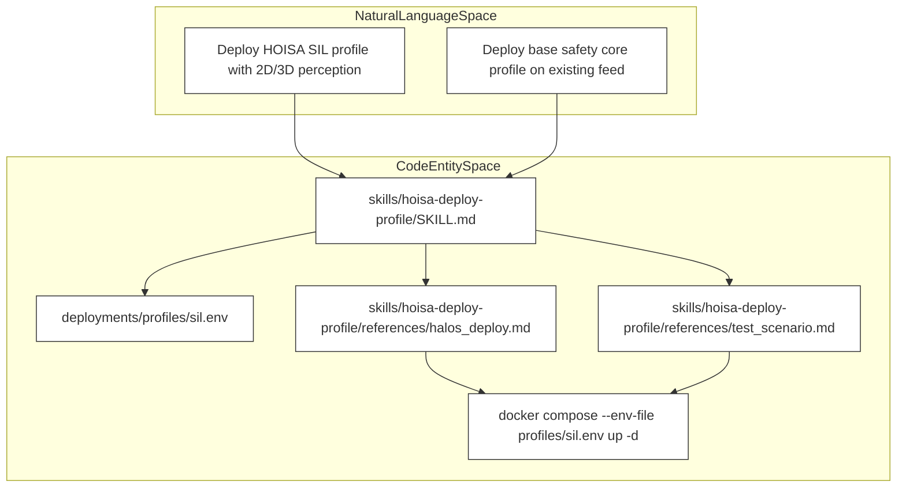
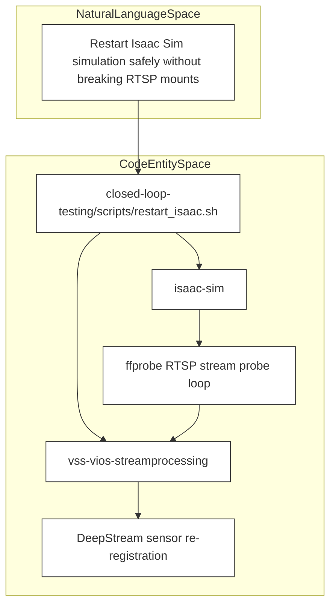

<!-- source: DeepWiki mcp.deepwiki.com · repo NVIDIA/halos-outside-in-safety · page 7.3 Agentic Deployment Skills · fetched 2026-11-09 -->

# Agentic Deployment Skills

Relevant source files

The following files were used as context for generating this wiki page:

- [closed-loop-testing/scripts/restart_isaac.sh](closed-loop-testing/scripts/restart_isaac.sh)
- [docs/getting-started/agentic-deployment.mdx](docs/getting-started/agentic-deployment.mdx)
- [docs/getting-started/index.mdx](docs/getting-started/index.mdx)
- [docs/getting-started/inference-pipeline.mdx](docs/getting-started/inference-pipeline.mdx)
- [docs/getting-started/prerequisites.mdx](docs/getting-started/prerequisites.mdx)
- [docs/index.mdx](docs/index.mdx)
- [docs/integration/components/ai-monitor.mdx](docs/integration/components/ai-monitor.mdx)
- [docs/integration/components/event-integrator.mdx](docs/integration/components/event-integrator.mdx)
- [docs/integration/components/perception-monitor.mdx](docs/integration/components/perception-monitor.mdx)
- [skills/hoisa-deploy-profile/SKILL.md](skills/hoisa-deploy-profile/SKILL.md)
- [skills/hoisa-deploy-profile/references/halos_deploy.md](skills/hoisa-deploy-profile/references/halos_deploy.md)
- [skills/hoisa-deploy-profile/references/test_scenario.md](skills/hoisa-deploy-profile/references/test_scenario.md)
- [skills/hoisa-deploy-profile/references/troubleshooting.md](skills/hoisa-deploy-profile/references/troubleshooting.md)
- [skills/hoisa-generate-regression-report/SKILL.md](skills/hoisa-generate-regression-report/SKILL.md)
- [skills/hoisa-generate-regression-report/references/01_test_plan.md](skills/hoisa-generate-regression-report/references/01_test_plan.md)
- [skills/hoisa-generate-regression-report/references/02_launch.md](skills/hoisa-generate-regression-report/references/02_launch.md)

## Purpose and Scope

This page details the implementation, architecture, reference documents, prompt templates, and execution workflows for the agentic deployment skills provided within the Halos Outside-In Safety (HOISA) codebase: `skills/hoisa-deploy-profile` and `skills/hoisa-generate-regression-report`. Built in accordance with the `agentskills.io` specification `[docs/getting-started/agentic-deployment.mdx:1-7]`, these skills allow autonomous coding agents (such as Claude Code, Codex, or Cursor) to orchestrate closed-loop safety deployments, configure perception profiles, execute multi-scenario test plans, and manage simulation recovery routines without human intervention.

---

## 1. Structure of `hoisa-deploy-profile`

The `hoisa-deploy-profile` skill manages deployment configurations, profile selection (`base`, `sil`, `hil`), artifact validation, and stack bring-up sequence rules `[skills/hoisa-deploy-profile/SKILL.md:1-25]`. 

### SKILL.md Architecture and Agent Autonomy Rules
The skill package is structured around a core metadata manifest (`SKILL.md`) and a suite of reference documentation files governing troubleshooting, test execution, and deployment specifications. When invoked autonomously, the agent operates under strict operational guardrails designed to prevent premature readiness claims and cascading configuration errors `[skills/hoisa-deploy-profile/SKILL.md:78-99]`:
- **Phase Gates over Timers**: Readiness must be validated via specific system state checks (e.g., container FPS counters, Kafka consumers, and log files) rather than static time-based sleep delays `[skills/hoisa-deploy-profile/SKILL.md:85-87]`.
- **Non-Blocking Polling**: Blocking commands such as `docker logs -f` are strictly prohibited during autonomous execution loops `[skills/hoisa-deploy-profile/SKILL.md:88-89]`.
- **Two-Stack Bring-up Ordering**: The VSS Warehouse perception backend (Stack 1) must be deployed, fully healthy, and verified *before* initiating the Halos safety stack (Stack 2) `[skills/hoisa-deploy-profile/SKILL.md:21-23, 72-75]`.

*Diagram 1: Bridging Natural Language deployment requests to underlying SKILL.md configurations, profile environment variables, and Docker Compose commands.*

Sources: `[skills/hoisa-deploy-profile/SKILL.md:1-50]`, `[docs/getting-started/agentic-deployment.mdx:1-45]`

---

## 2. Deployment Profiles and Operational Workflows

The skill supports three primary deployment profiles (`base`, `sil`, `hil`) configured via environment files in `deployments/profiles/` `[skills/hoisa-deploy-profile/SKILL.md:27-36]`:

| Profile | Target Services | Description / Use Case |
|---|---|---|
| `base` | `safety-core` | Runs Safety Core on an existing VSS perception feed without Isaac Sim; renders MUTE/UNMUTE decisions as the VST `halo_safety` overlay `[skills/hoisa-deploy-profile/SKILL.md:33]` |
| `sil` | `safety-core`, `comm-layer`, `isaac-sim`, `forklift-controller` (+ `forklift-controller-b2` for multi-robot) | Full single-host closed loop: Isaac Sim stimulus feeds VSS perception, which passes events to PSF, translating to ROS commands back to the forklift `[skills/hoisa-deploy-profile/SKILL.md:34]` |
| `hil` | `comm-layer`, `isaac-sim`, `forklift-controller` | Two-host split closed loop: x86 stimulus host running simulation communicating with an IGX Thor target hosting VSS perception and Safety Core `[skills/hoisa-deploy-profile/SKILL.md:35]` |

### Calibration Validation and Safety App Modes
Before starting the safety stack, calibration files must define restricted object types (e.g., `restrictedObjectTypes: ["Person"]`) for regions of interest (ROIs) `[skills/hoisa-deploy-profile/references/halos_deploy.md:15-38]`. The `PSF_APP` parameter determines which decision maker (SDM) is active:
- `atl`: Automatic Trailer Loading decision logic (MUTE/UNMUTE) `[skills/hoisa-deploy-profile/SKILL.md:67-69]`, `[skills/hoisa-deploy-profile/references/halos_deploy.md:84-89]`.
- `pxc`: Proximity-based decision logic (`NORMAL`, `REDUCE`, `STOP`) evaluated via `closed-loop-testing/safety-core/configs/proximity_event_mapping.pb.txt` `[skills/hoisa-deploy-profile/references/halos_deploy.md:84-94]`.
- `both`: Runs both ATL and Proximity modules concurrently within the safety container `[skills/hoisa-deploy-profile/references/halos_deploy.md:84-89]`.

### Troubleshooting and Scenario Recovery (`restart_isaac.sh`)
When cold-starting Isaac Sim on heavy scenes, in-process RTSP streaming servers can experience concurrent `DESCRIBE` races resulting in `stream has no caps` or `could not create SDP` errors `[skills/hoisa-deploy-profile/references/troubleshooting.md:112-148]`. The helper script `closed-loop-testing/scripts/restart_isaac.sh` automates safe recovery by temporarily pausing the VST stream processing container to halt descriptor churn during the boot window `[closed-loop-testing/scripts/restart_isaac.sh:5-11]`:

*Diagram 2: Flow of `restart_isaac.sh` coordinating container suspension, Isaac Sim driver reboot, stream verification, and DeepStream reconnection.*

Sources: `[skills/hoisa-deploy-profile/references/troubleshooting.md:1-164]`, `[skills/hoisa-deploy-profile/references/test_scenario.md:1-126]`, `[closed-loop-testing/scripts/restart_isaac.sh:1-143]`

---

## 3. Structure of `hoisa-generate-regression-report`

The `hoisa-generate-regression-report` (`srr`) skill coordinates multi-scenario test orchestration, automated scenario recording, perception event stream consumption, and metric aggregation `[skills/hoisa-generate-regression-report/SKILL.md:1-29]`.

### Six Pre-Built Test Cases
The SRR pipeline defines 6 standard test scenarios running against the stock scene `indicator_warehouse_20x20_layout_overflow_test.usd` `[skills/hoisa-generate-regression-report/SKILL.md:53-64]`:
1. `in-roi`: 5 minutes; person remains continuously inside the work zone to stress constant-presence safety logic `[skills/hoisa-generate-regression-report/SKILL.md:59]`.
2. `psf-edge`: 5 minutes; person sits directly on the ROI boundary to evaluate hysteresis and debounce logic `[skills/hoisa-generate-regression-report/SKILL.md:60]`.
3. `psf-clear`: 5 minutes; person alternates clearly inside and outside zones as a clean A/B regression pair `[skills/hoisa-generate-regression-report/SKILL.md:61]`.
4. `balanced`: 10 minutes; mixed activity baseline profile `[skills/hoisa-generate-regression-report/SKILL.md:62]`.
5. `fast`: 20 minutes; motion-heavy scenario testing cumulative drift over extended runtimes `[skills/hoisa-generate-regression-report/SKILL.md:63]`.
6. `fixed`: 5 minutes (opt-in, excluded from `all`/`full` suites); deterministic hand-authored waypoints for regression anchors and unmute-direction verification `[skills/hoisa-generate-regression-report/SKILL.md:64, 67-69]`.

Behavior trees for these scenarios are managed via Isaac Sim IRA 1.7 formats located at `${HOISA_ROOT_PATH}/closed-loop-testing/isaac-sim/sil/configs/` generated via `scenarios/tools/randomize_paths.py` `[skills/hoisa-generate-regression-report/SKILL.md:71-82]`.

Sources: `[skills/hoisa-generate-regression-report/SKILL.md:1-84]`, `[skills/hoisa-generate-regression-report/references/01_test_plan.md:1-106]`

---

## 4. SRR Execution Workflows and Validation

Executing a regression report run follows a strict phase-gated lifecycle managed by the SRR agent skill `[skills/hoisa-generate-regression-report/references/01_test_plan.md:1-85]`, `[skills/hoisa-generate-regression-report/references/02_launch.md:1-131]`:

- **Phase 1 (Test Plan Generation)**: Parses user specifications (`all`, comma-separated list, or single scenario), verifies directory mounts, checks VST API endpoint health (`/v1/record/streams` returning HTTP 200), and outputs a JSON run plan to `/tmp/srr-skill-plan.json` `[skills/hoisa-generate-regression-report/references/01_test_plan.md:7-105]`.
- **Phase 2 (Container Freshness & Fixture Sync)**: Verifies that SRR container scripts match host sources (preventing stale `clip_logs.py` or metric aggregator code execution) `[skills/hoisa-generate-regression-report/references/02_launch.md:20-53]`. Ensures canonical behavior trees and NavMesh JSON assets are synchronized into the Isaac SIL directory via `closed-loop-testing/regression-reporter/halos-integration/sync_to_halos.sh` `[skills/hoisa-generate-regression-report/SKILL.md:27]`, `[skills/hoisa-generate-regression-report/references/02_launch.md:95-128]`.
- **Phase 3 (Per-Scenario Execution)**: Cleans datalogs between distinct scenario runs (while respecting the `SETUP_BEFORE_UP` mandate to avoid wiping active run evidence prematurely) `[skills/hoisa-generate-regression-report/SKILL.md:31-48]`, records 30 Hz parquet data streams combining Ground Truth, Safety Core state, and Kafka perception events, and subsequently triggers clip splitting, metric aggregation, and MP4 generation `[skills/hoisa-generate-regression-report/SKILL.md:7-12]`.

Sources: `[skills/hoisa-generate-regression-report/SKILL.md:1-84]`, `[skills/hoisa-generate-regression-report/references/01_test_plan.md:1-106]`, `[skills/hoisa-generate-regression-report/references/02_launch.md:1-131]`

---

