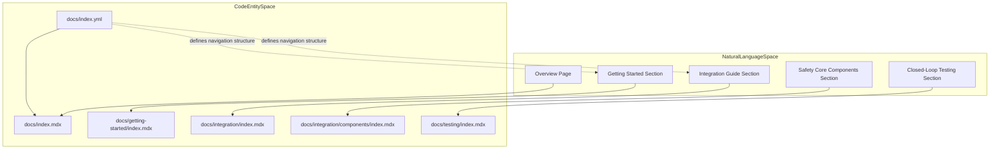
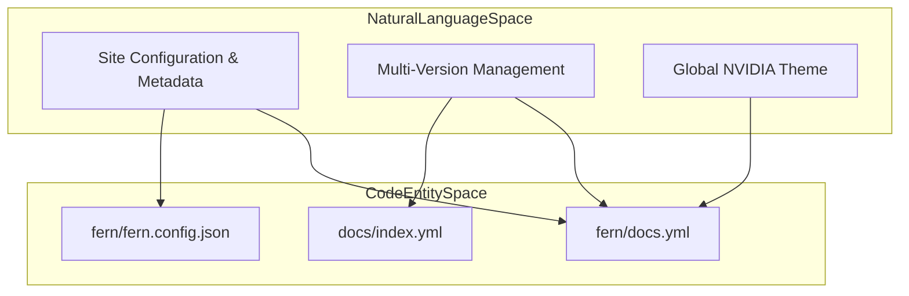

<!-- source: DeepWiki mcp.deepwiki.com · repo NVIDIA/halos-outside-in-safety · page 8.1 Fern Docs Structure · fetched 2026-11-09 -->

# Fern Docs Structure

Relevant source files

The following files were used as context for generating this wiki page:

- [docs/getting-started/safety-core.mdx](docs/getting-started/safety-core.mdx)
- [docs/index.yml](docs/index.yml)
- [docs/integration/components/decision-maker.mdx](docs/integration/components/decision-maker.mdx)
- [docs/integration/index.mdx](docs/integration/index.mdx)
- [docs/reference/event-mapping-configuration.mdx](docs/reference/event-mapping-configuration.mdx)
- [fern/assets/images/safety-core/safety-core-overview.svg](fern/assets/images/safety-core/safety-core-overview.svg)
- [fern/docs.yml](fern/docs.yml)
- [fern/fern.config.json](fern/fern.config.json)
- [fern/redirects.yml](fern/redirects.yml)

## Purpose and Scope

This page describes the technical structure of the Fern-based documentation site for the NVIDIA Halos Outside-In Safety (HOISA) blueprint. It covers the configuration of navigation hierarchies via `docs/index.yml` [docs/index.yml:1-180](), global site properties and multi-version setups in `fern/docs.yml` [fern/docs.yml:1-27](), URL redirection mapping in `fern/redirects.yml` [fern/redirects.yml:1-95](), and the organization of MDX source content and image assets. 

---

## 1. Navigation and `docs/index.yml` Organization

The documentation site navigation is declared centrally in `docs/index.yml` [docs/index.yml:1-180](). The file defines a tree of sections, pages, file paths, and URL slugs. Sections use `skip-slug: true` to act as logical groupings without generating intermediate URL segments, while individual leaf pages bind specific Markdown Extended (`.mdx`) files to explicit URL slugs under the version root.

The following diagram bridges the natural language section names presented to documentation readers to their underlying code entities and file paths in the repository:

*Figure 1: Mapping documentation sections and pages to underlying MDX files and configuration entries.*

Sources: [docs/index.yml:1-180]()

---

## 2. Instance, Theme, and Configuration

Global site behavior, multi-source instances, and theme properties are defined in `fern/docs.yml` [fern/docs.yml:1-27]() and `fern/fern.config.json` [fern/fern.config.json:1-4](). 

`fern/docs.yml` defines the instance URL (`nvidia-halos.docs.buildwithfern.com/halos/outside-in-safety`), custom domain mappings (`docs.nvidia.com/halos/outside-in-safety`), multi-source support, document title, global theme (`nvidia`), navbar links pointing to the GitHub repository, and branding properties [fern/docs.yml:1-21](). Versioning is explicitly declared by mapping version slugs to navigation files (e.g., version `1.4.0` points to `../docs/index.yml`) [fern/docs.yml:22-26]().

The configuration schema version and organization namespace are managed in `fern/fern.config.json` [fern/fern.config.json:1-4]().

*Figure 2: Architecture of site configuration files and multi-version binding.*

Sources: [fern/docs.yml:1-27](), [fern/fern.config.json:1-4]()

---

## 3. Redirect Rules (`fern/redirects.yml`)

To maintain backwards compatibility with legacy Sphinx documentation and earlier blueprint releases (such as version `1.2.1`), `fern/redirects.yml` [fern/redirects.yml:1-95]() specifies comprehensive pattern-matching redirect rules. 

The redirect engine processes source pattern regexes against incoming requests and rewrites them to modern Fern slugs. Rules handle renamed guides, reference pages, component paths, SIL/HIL test documentation paths, and raw Doxygen HTML files, mapping them to their modern MDX counterparts or API documentation slugs [fern/redirects.yml:13-95]().

Sources: [fern/redirects.yml:1-95]()

---

## 4. MDX Content Organization and Image Assets

Documentation content is authored using MDX (`.mdx`) format, located within the `docs/` directory hierarchy. Each major functional module of the HOISA codebase corresponds to a dedicated subdirectory:
- `docs/getting-started/`: Prerequisites, inference pipelines, and bring-up guides [docs/index.yml:17-37]()
- `docs/deployment/`: Deployment guides, custom configurations, and troubleshooting [docs/index.yml:42-59]()
- `docs/integration/`: Integration guides, component architectures, and API explanations [docs/index.yml:64-112]()
- `docs/testing/`: SIL, HIL, and Simulation Regression Reporter (SRR) guides [docs/index.yml:118-176]()
- `docs/reference/`: Reference materials, logs, and glossary

Static assets, including architectural diagrams and system flow schematics (e.g., `safety-core-overview.svg`), are stored under `fern/assets/images/` and referenced directly within MDX pages using standard Markdown image syntax or HTML tags [docs/integration/index.mdx:14]().

Sources: [docs/index.yml:1-180](), [docs/integration/index.mdx:1-14]()

---

