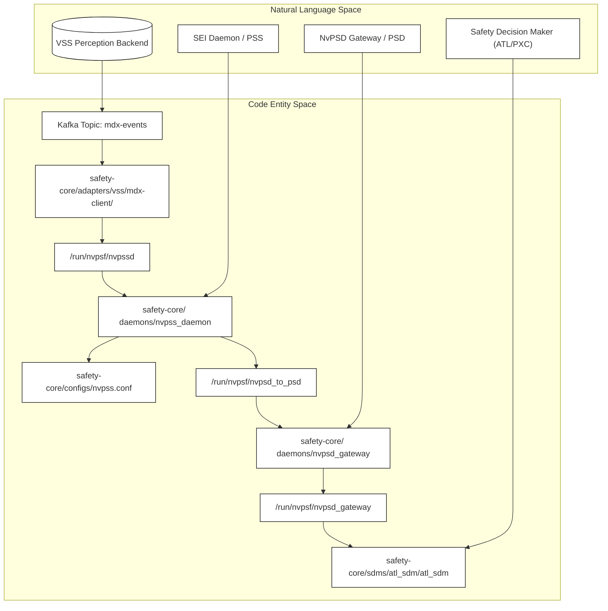
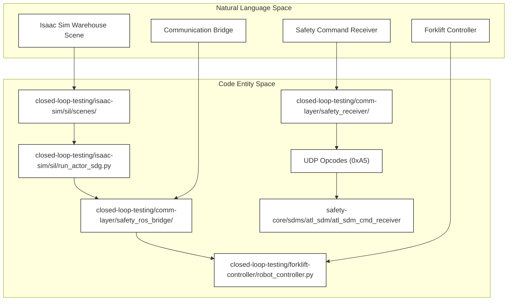

<!-- source: DeepWiki mcp.deepwiki.com · repo NVIDIA/halos-outside-in-safety · page 9 Glossary · fetched 2026-11-09 -->

# Glossary

Relevant source files

The following files were used as context for generating this wiki page:

- [CHANGELOG.md](CHANGELOG.md)
- [README.md](README.md)
- [ai-perception/README.md](ai-perception/README.md)
- [docs/reference/causes-and-records.mdx](docs/reference/causes-and-records.mdx)
- [docs/reference/glossary.mdx](docs/reference/glossary.mdx)
- [skills/README.md](skills/README.md)
- [tools/waypoint-generator/README.md](tools/waypoint-generator/README.md)

## Purpose and Scope

This page provides formal technical definitions for domain-specific terms, architectural abstractions, component abbreviations, and message schemas used across the NVIDIA Halos Outside-In Safety (HOISA) Blueprint codebase and its underlying Safety Core (OISF/PSF) engine. Each entry includes direct code pointers to relevant source files, configuration files, and daemon implementations.

---

## Architectural & System Terminology

### HOISA
**NVIDIA Halos Outside-In Safety Blueprint**: A reference architecture that extends robot perception beyond on-board sensors using external infrastructure cameras, AI perception, and dedicated safety logic. Formerly referred to as PSF (Proactive Safety Framework).
- Sources: `README.md:20-25`, `docs/reference/glossary.mdx:106-111`

### OISF / PSF
**Outside-In Safety Framework / Proactive Safety Foundation**: The internal C/C++ safety engine and middleware stack located in `safety-core/`. It handles event integration, safety decision-making, and fault-safe command transport.
- Sources: `README.md:34-35`, `docs/reference/glossary.mdx:106-111`

### SIL / HIL
**Software-in-the-Loop** and **Hardware-in-the-Loop**: Testing methodologies. SIL runs the complete simulation, perception proxy, and Safety Core locally in Docker containers (`deployments/compose.yaml`). HIL runs the Safety Core on target edge hardware (such as NVIDIA IGX Thor) while receiving sensor stimulus from an external host.
- Sources: `README.md:45-50`, `docs/reference/glossary.mdx:101-105`

### MUTE / UNMUTE
The fundamental safety actuation states emitted by the Safety Core. `MUTE` commands a fault-safe lockout (stopping the forklift), whereas `UNMUTE` releases the safety lock when the zone is verified clear.
- Sources: `README.md:47`

---

## Safety Core Components & Daemons

### PSS (`nvpss_daemon`)
**Perception & Safety Server (SEI Daemon)**: The core C daemon (`nvpss_daemon`) responsible for ingesting perception events, enforcing timing/heartbeat budgets, executing event fusion (`enableFusion`), and distributing validated safety requests to decision gateways. Configured via `nvpss.conf`.
- Sources: `CHANGELOG.md:29-32`, `docs/reference/glossary.mdx:153-156`

### PSD (`nvpsd_gateway`)
**NvPSD Gateway**: The inter-process communication router (`nvpsd_gateway`) sitting between the SEI daemon and individual Safety Decision Makers (SDMs). It manages sequenced envelopes (`DecisionRequestEnvelope`), supervises SDM heartbeats, and isolates fault propagation.
- Sources: `docs/reference/glossary.mdx:145-152`

### PSB (`libnvpsb`)
**Safety Black Box Library**: The logging and audit subsystem (`libnvpsb`) that records immutable safety state transitions, decision requests, and fault logs to persistent storage.
- Sources: `README.md:34`

### SDM
**Safety Decision Maker**: A safety application binary (e.g., `atl_sdm`, `pxc_sdm`) that subscribes to filtered safety events through the NvPSD Gateway, evaluates fault-safe logic, manages lockout latches, and issues UDP command packets to downstream actuators.
- Sources: `CHANGELOG.md:27-35`, `docs/reference/glossary.mdx:13-16`

### SAIM
**Safety AI Monitor**: A safety monitor daemon responsible for validating camera stream continuity, detecting frame drops, and monitoring hardware video decoders (NVDEC). Emits `SENSOR_INVALID` or `SENSOR_VALID` events.
- Sources: `docs/reference/causes-and-records.mdx:46-51`, `docs/reference/glossary.mdx:132-134`

### PCM (`nv_perception_monitor`)
**Perception Container Monitor**: A monitoring service (`nv_perception_monitor`) that supervises perception container health via the Docker Engine and inspects data frames through the Data Validation Monitor (DVM), issuing `AI_PIPELINE_VALID` or `AI_PIPELINE_INVALID` verdicts.
- Sources: `docs/reference/glossary.mdx:136-138`, `docs/reference/glossary.mdx:157-164`

---

## Application & Decision Logic

### ATL
**Automated Trailer Loading**: The reference safety application and SDM (`atl_sdm`) that monitors loading dock zones to determine when it is safe for an autonomous forklift to enter a docked trailer.
- Sources: `docs/reference/glossary.mdx:13-16`

### PXC
**Proximity Detection Safety Monitor**: The safety decision maker (`pxc_sdm`) focused on real-time pedestrian and obstacle proximity alerts within warehouse aisles and junctions.
- Sources: `CHANGELOG.md:11`, `CHANGELOG.md:35`

---

## Perception, Simulation & Infrastructure

### VSS
**Video Search and Summarization**: The reference NVIDIA Metropolis Blueprint perception backend (`ai-perception/`) providing AI-powered video analytics, object detection, and multi-camera tracking.
- Sources: `ai-perception/README.md:4-10`

### VST
**Video Streaming Toolkit**: A streaming and recording utility integrated with VSS that manages RTSP camera ingest and renders visual safety overlays (such as `halo_safety`) back to operators.
- Sources: `README.md:47`, `CHANGELOG.md:14`

### IRA
<b>Isaac Sim Robot Architecture Configuration</b>: The robot configuration blueprint (`default_config_ros.yaml`) used by Isaac Sim to configure ROS2 bridges, sensor publication rates, and action graphs.
- Sources: `CHANGELOG.md:17`

### SDG
**Scenario Data Generator**: The simulation orchestration framework (`run_actor_sdg.py`) managing scenario lifecycles, forklift path spawning, and dynamic anomaly injection inside Isaac Sim.
- Sources: `CHANGELOG.md:16-21`

### SRR
**Simulation Regression Reporter**: An automated test harness (`skills/hoisa-generate-regression-report/`) that orchestrates multi-scenario runs, records 30Hz ground truth and Safety Core states, splits clips on tripwire crossings, and generates quantitative evaluation reports.
- Sources: `skills/README.md:14`

### BEV
**Bird's-Eye View**: A 3D perception fusion representation where multiple camera feeds are spatially calibrated and projected into a unified overhead coordinate frame.
- Sources: `docs/reference/glossary.mdx:18-21`

### ROI
**Region of Interest**: A geometrically defined spatial boundary within a camera view or BEV grid configured for targeted safety monitoring (e.g., trailer interiors).
- Sources: `CHANGELOG.md:19`

### Tripwire
A virtual boundary line crossing in a warehouse map or camera view. When traversed by an entity (forklift or worker), it triggers specific safety state evaluations and clip-splitting events in SRR.
- Sources: `CHANGELOG.md:19`

---

## Communication, Topics & Events

### mdx-events & mdx-frames
The primary Kafka topic family used by VSS to stream perception outputs (`mdx-events` for ROI/tripwire behavioral alerts; `mdx-frames` for frame-level analysis metadata) consumed by the Safety Core's `mdx_client`.
- Sources: `ai-perception/README.md:14-16`, `docs/reference/glossary.mdx:122-125`

### ROS2 / DDS Topics
Robot Operating System communication channels used by the forklift controller and bridge nodes (e.g., `/forklift_b/cmd_vel`, `/forklift_b/odom`, `/safety/is_muted`).
- Sources: `CHANGELOG.md:52-53`

---

## Natural Language to Code Entity Mapping

The following diagrams bridge high-level domain terminology (Natural Language Space) to exact underlying executable binaries, configuration files, and socket paths (Code Entity Space).

### Diagram 1: Perception & Safety Core Ingestion Pipeline

*Sources: `ai-perception/README.md:14-16`, `docs/reference/glossary.mdx:145-156`*

### Diagram 2: Closed-Loop Simulation & Actuation Bridge

*Sources: `README.md:35`, `docs/reference/glossary.mdx:34-40`*