# Page: Overview

# Overview

<details>
<summary>Relevant source files</summary>

The following files were used as context for generating this wiki page:

- [CHANGELOG.md](CHANGELOG.md)
- [README.md](README.md)
- [ai-perception/README.md](ai-perception/README.md)
- [closed-loop-testing/3rdParty_Licenses.txt](closed-loop-testing/3rdParty_Licenses.txt)
- [closed-loop-testing/regression-reporter/README.md](closed-loop-testing/regression-reporter/README.md)
- [skills/README.md](skills/README.md)
- [skills/hoisa-generate-regression-report/references/03_monitor.md](skills/hoisa-generate-regression-report/references/03_monitor.md)
- [tools/srr-debug-viewer/docs/architecture.md](tools/srr-debug-viewer/docs/architecture.md)
- [tools/srr-debug-viewer/docs/data-schema.md](tools/srr-debug-viewer/docs/data-schema.md)
- [tools/waypoint-generator/README.md](tools/waypoint-generator/README.md)
- [whitepaper/halos-outside-in-safety.md](whitepaper/halos-outside-in-safety.md)

</details>


The purpose of this document is to provide a high-level overview of the **NVIDIA Halos Outside-In Safety (HOISA)** codebase, detailing its end-to-end closed-loop architecture, repository organization, and links to detailed child pages. HOISA serves as a reference architecture and open-source on-ramp for physical AI safety, extending robot perception beyond onboard sensors by utilizing fixed infrastructure cameras, AI perception, and dedicated safety logic `[README.md:1-25]`, `[whitepaper/halos-outside-in-safety.md:9-18]()`.

---

## 1. The Perception → Safety → Actuation Closed Loop

Halos Outside-In Safety operates through an end-to-end closed-loop pipeline that integrates vision-based AI perception, deterministic safety decision-making, and robot actuation control `[README.md:37-41]`, `[whitepaper/halos-outside-in-safety.md:53-74]()`. 

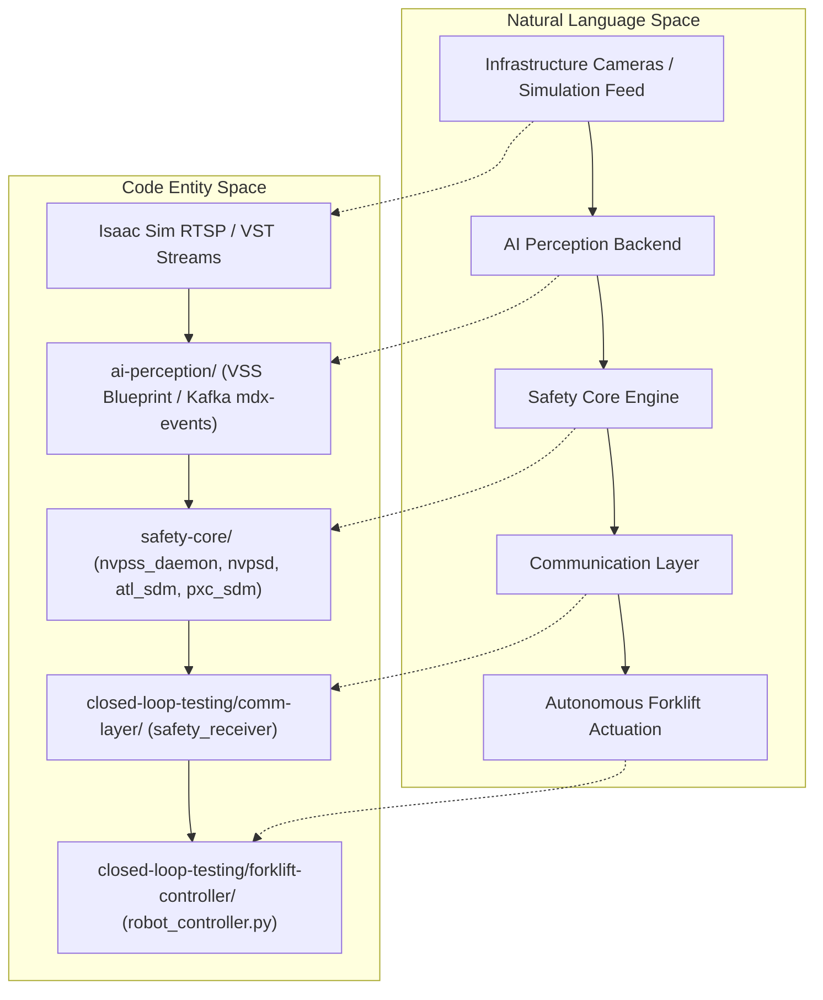
**Figure 1**: Mapping natural language components to code entities across the perception-safety-actuation loop.

Sources: `[README.md:37-41]`, `[ai-perception/README.md:8-17]`, `[safety-core/]`

---

## 2. Repository Layout

The repository is partitioned into distinct functional modules supporting runtime safety execution, simulation testing, deployments, developer tools, and agentic skills `[README.md:53-64]()`.

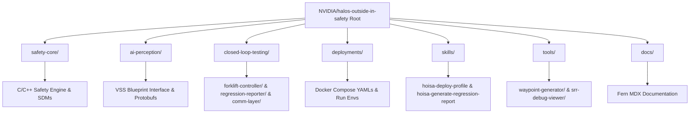
**Figure 2**: Repository layout mapping top-level directories to their internal sub-components.

- **`safety-core/`**: The C/C++ safety engine containing core daemon components (`nvpss_daemon`), decision gateways (`nvpsd`), safety decision makers (`atl_sdm`, `pxc_sdm`), and protocol adapters `[README.md:58]()`.
- **`ai-perception/`**: Perception integration contracts, pointer references to the NVIDIA VSS Blueprint backend, and message codecs `[README.md:57]`, `[ai-perception/README.md:8-17]()`.
- **`closed-loop-testing/`**: Software-in-the-Loop (SIL) and Hardware-in-the-Loop (HIL) harnesses, including Isaac Sim configurations, the communication bridge layer, and the Simulation Regression Reporter (`regression-reporter`) `[README.md:59]`, `[closed-loop-testing/regression-reporter/README.md:1-10]()`.
- **`deployments/`**: Docker Compose configurations (`compose.yaml`), deployment profile environment variable files (`base.env`, `sil.env`, `hil.env`), and cloud launch scripts `[README.md:61]()`.
- **`skills/`**: Agentic deployment and testing skills complying with the `agentskills.io` specification (`hoisa-deploy-profile`, `hoisa-generate-regression-report`) `[skills/README.md:1-15]()`.
- **`tools/`**: Developer tools including the React-based forklift waypoint generator (`waypoint-generator`) and the zero-dependency debug viewer (`srr-debug-viewer`) `[tools/waypoint-generator/README.md:1-15]`, `[tools/srr-debug-viewer/docs/architecture.md:1-15]()`.
- **`docs/`**: Fern-based documentation files in MDX format `[README.md:65-69]()`.

Sources: `[README.md:53-64]`, `[skills/README.md:1-15]`, `[tools/waypoint-generator/README.md:1-15]`

---

## 3. Child Pages and Detailed Topics

For more in-depth documentation, refer to the following child pages:

- **[System Architecture and Data Flow](#1.1)** — Detailed end-to-end flow spanning camera RTSP streams, VSS perception, Kafka `mdx-events`, Safety Core processing (`PSS`/`PSD`/`PSB`), UDP communication, ROS2/OPC UA bridging, and forklift actuation. Covers multi-stack bring-up ordering and component interactions `[CHANGELOG.md:12-43]`, `[ai-perception/README.md:12-17]()`.
- **[Getting Started](#1.2)** — Host prerequisites, NGC artifact access credentials, quick deployment guides, NVIDIA Brev virtual machine setup, and instructions for executing your first Software-in-the-Loop (SIL) run `[README.md:71-100]()`.
- **[Release History and Versioning](#1.3)** — CHANGELOG highlights, `release_metadata.yaml` configurations, known platform limitations, and critical safety/security notices `[CHANGELOG.md:1-48]`, `[README.md:3-5]()`.

Sources: `[CHANGELOG.md:1-48]`, `[README.md:3-100]`, `[ai-perception/README.md:12-17]`

---

# Page: System Architecture and Data Flow

# System Architecture and Data Flow

<details>
<summary>Relevant source files</summary>

The following files were used as context for generating this wiki page:

- [README.md](README.md)
- [ai-perception/README.md](ai-perception/README.md)
- [assets/sil_warehouse_architecture.png](assets/sil_warehouse_architecture.png)
- [closed-loop-testing/scripts/restart_isaac.sh](closed-loop-testing/scripts/restart_isaac.sh)
- [deployments/scripts/deploy_hoisa_launchable.ipynb](deployments/scripts/deploy_hoisa_launchable.ipynb)
- [skills/README.md](skills/README.md)
- [skills/hoisa-deploy-profile/SKILL.md](skills/hoisa-deploy-profile/SKILL.md)
- [skills/hoisa-deploy-profile/references/halos_deploy.md](skills/hoisa-deploy-profile/references/halos_deploy.md)
- [skills/hoisa-deploy-profile/references/halos_hil.md](skills/hoisa-deploy-profile/references/halos_hil.md)
- [skills/hoisa-deploy-profile/references/test_scenario.md](skills/hoisa-deploy-profile/references/test_scenario.md)
- [skills/hoisa-deploy-profile/references/troubleshooting.md](skills/hoisa-deploy-profile/references/troubleshooting.md)
- [tools/waypoint-generator/README.md](tools/waypoint-generator/README.md)

</details>


This page details the end-to-end architecture and data flow of the Halos Outside-In Safety (HOISA) reference system. It covers the complete pipeline from simulated or physical sensor acquisition through AI perception, safety core decision evaluation, communication translation, and robotic actuation, alongside the mandatory two-stack bring-up ordering sequence.

---

## 1. Overview of the Closed Loop

The HOISA architecture implements a closed-loop safety system where external infrastructure cameras monitor a workspace (such as a warehouse loading dock), AI perception detects objects and spatial interactions, the Safety Core computes safety verdicts (e.g., `MUTE` or `UNMUTE`, `NORMAL`, `REDUCE`, `STOP`), and the communication layer relays these commands via UDP and ROS2 to actuate autonomous equipment like forklifts [README.md:20-36]().

### End-to-End Architectural Flow

```mermaid
graph TD
    subgraph "Simulation / Sensors"
      A["Isaac Sim" / "Hardware RTSP"] -->|"RTSP H264 :8554-8556"| B["VSS Warehouse Perception" / "vss-rtvi-cv"]
    end
    subgraph "Perception Event Bus"
      B -->|"Kafka mdx-events"| C["Safety Core (PSF)" / "nvpss_daemon"]
    end
    subgraph "Safety Decision & Comm"
      C -->|"UDP Port 12346"| D["Communication Layer" / "comm-layer"]
      D -->|"ROS2 /safety/is_muted"| E["Forklift Controller" / "robot_controller.py"]
      E -->|"Isaac Sim Action Graph"| F["Simulated Forklift Actuation"]
    end
```

**Sources:** `README.md`, `skills/hoisa-deploy-profile/SKILL.md`

---

## 2. Component Mapping: Natural Language to Code Entity Space

To facilitate debugging and code navigation, the following diagram maps high-level system components to their corresponding directories, binaries, and code artifacts within the repository structure.

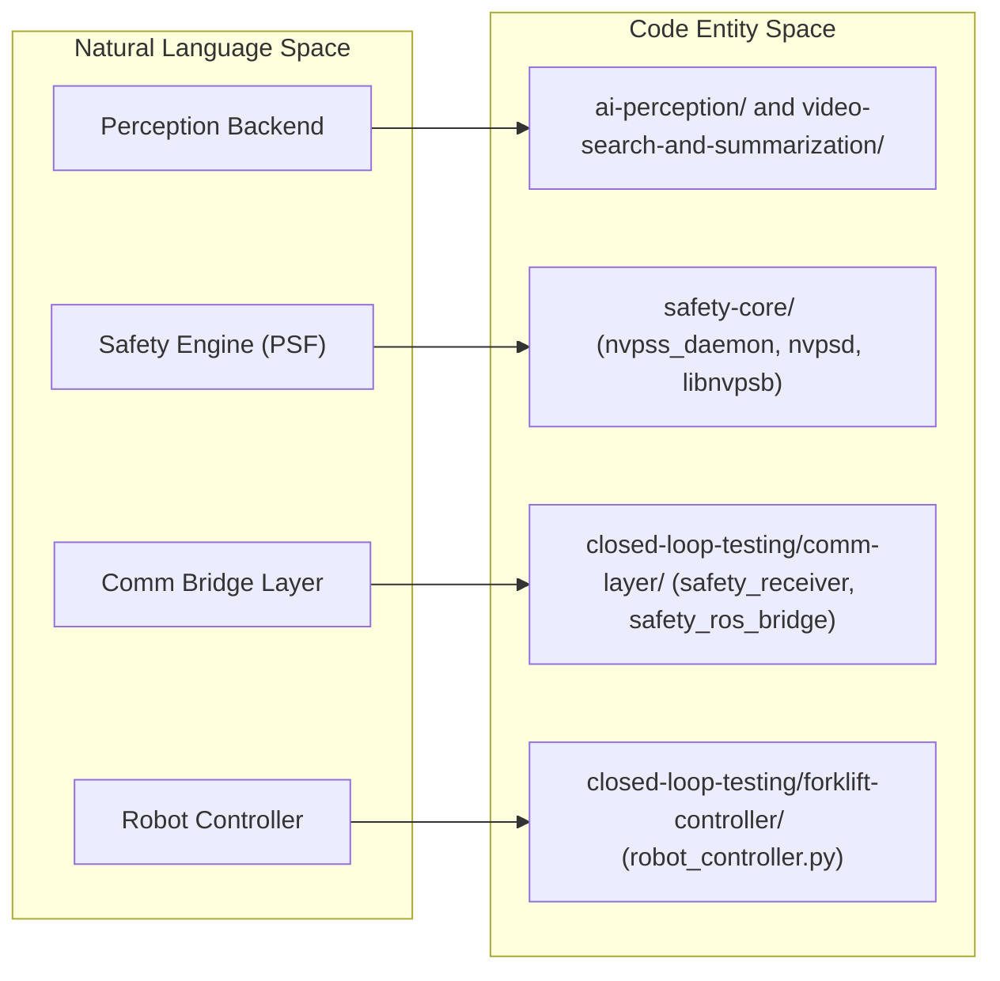

**Sources:** `README.md`, `ai-perception/README.md`, `skills/hoisa-deploy-profile/SKILL.md`

---

## 3. Detailed Data Flow Pipeline

The end-to-end data flow operates across four sequential processing stages, transforming raw video frames into deterministic safety actuations.

### Stage 1: Sensor Ingestion & RTSP Streaming
* **Source Entity**: Isaac Sim simulation harness or physical IP cameras (`closed-loop-testing/`).
* **Implementation**: Isaac Sim self-hosts RTSP streams per camera (H.264 encoded) on ports `8554`, `8555`, and `8556` [skills/hoisa-deploy-profile/references/test_scenario.md:85-91]().
* **Data Flow**: Video feeds are exposed over RTSP (`rtsp://localhost:8554/camera`) and consumed by the perception backend.

### Stage 2: AI Perception & Kafka Event Bus
* **Source Entity**: VSS Warehouse Perception (`ai-perception/`, `video-search-and-summarization`).
* **Implementation**: Containers such as `vss-rtvi-cv` (object detection and tracking) and `vss-behavior-analytics` (ROI and tripwire analytics) process the RTSP streams [skills/hoisa-deploy-profile/SKILL.md:57-59]().
* **Data Flow**: Spatial events and zone incursions are serialized into Metropolis MDX protobuf messages and published to the Kafka event bus under the topic `mdx-events` [ai-perception/README.md:12-16]().

### Stage 3: Safety Core (PSF) Evaluation
* **Source Entity**: Safety Core engine (`safety-core/`).
* **Implementation**: 
  * The event integrator (`nvpss_daemon`) ingests Kafka messages using the MDX message codec (`safety-core/adapters/vss/mdx-msg-codec/`) and client (`safety-core/adapters/vss/mdx-client/`) [ai-perception/README.md:14-16]().
  * The decision gateway (`nvpsd`) evaluates rules defined in configuration files like `nvpss.conf` [skills/hoisa-deploy-profile/references/troubleshooting.md:31-32]().
  * Safety Decision Makers (SDMs), such as Automated Trailer Loading (`atl`) or Proximity Monitoring (`pxc`), compute verdicts [skills/hoisa-deploy-profile/references/halos_deploy.md:84-90]().
* **Data Flow**: Computed safety decisions are dispatched via POSIX IPC (`safecomm`) and packed into 64-byte UDP safety command packets directed to the communication layer [skills/hoisa-deploy-profile/references/halos_hil.md:14]().

### Stage 4: Communication Layer & Robotic Actuation
* **Source Entity**: Communication layer and Forklift Controller (`closed-loop-testing/comm-layer/` and `closed-loop-testing/forklift-controller/`).
* **Implementation**: 
  * The safety receiver (`safety_receiver`) decodes incoming UDP packets (e.g., 0xA5 proximity opcodes).
  * The ROS bridge (`safety_ros_bridge`) publishes state changes to the ROS2 topic `/safety/is_muted`.
  * The robot controller (`robot_controller.py`) consumes the topic and adjusts waypoint path execution, velocity scaling, or emergency stops [skills/hoisa-deploy-profile/references/test_scenario.md:86-89]().
* **Data Flow**: Isaac Sim Action Graphs receive the ROS2 signals, updating the simulated forklift's safety display disc and halting movement when required [skills/hoisa-deploy-profile/references/test_scenario.md:86-89]().

**Sources:** `ai-perception/README.md`, `skills/hoisa-deploy-profile/SKILL.md`, `skills/hoisa-deploy-profile/references/test_scenario.md`, `skills/hoisa-deploy-profile/references/halos_hil.md`

---

## 4. Two-Stack Bring-Up Ordering

Deploying HOISA requires strict adherence to a two-stack bring-up sequence. Attempting to start Stack 2 before Stack 1 is fully initialized and healthy results in connection failures, dropped messages, or cold-start race conditions [skills/hoisa-deploy-profile/references/troubleshooting.md:7-24]().

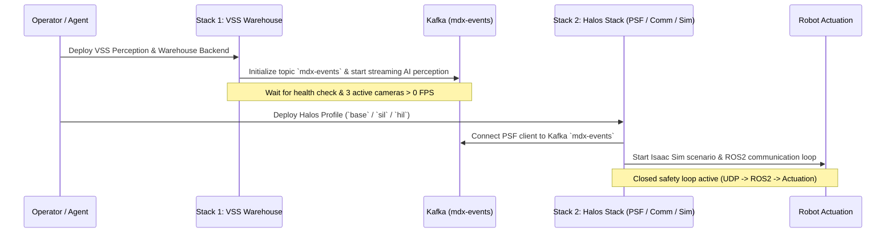

### Bring-Up Rules
1. **Stack 1 (Perception Backend)**: Must be deployed, started, and verified healthy first. Kafka must be active and serving the `mdx-events` topic, and DeepStream must report active camera sources with current FPS > 0 [skills/hoisa-deploy-profile/SKILL.md:105-110]().
2. **Stack 2 (Halos Safety & Simulation Stack)**: Launched only after Stack 1 health checks pass. This ensures the Safety Core (`safety-core`) can establish its Kafka connection without encountering connection timeouts or stale bootstrap states [skills/hoisa-deploy-profile/references/troubleshooting.md:7-23]().

**Sources:** `skills/hoisa-deploy-profile/SKILL.md`, `skills/hoisa-deploy-profile/references/troubleshooting.md`

---

# Page: Getting Started

# Getting Started

<details>
<summary>Relevant source files</summary>

The following files were used as context for generating this wiki page:

- [deployments/scripts/brev_setup.sh](deployments/scripts/brev_setup.sh)
- [docs/deployment/prerequisites.mdx](docs/deployment/prerequisites.mdx)
- [docs/deployment/quick-deployment.mdx](docs/deployment/quick-deployment.mdx)
- [docs/getting-started/agentic-deployment.mdx](docs/getting-started/agentic-deployment.mdx)
- [docs/getting-started/index.mdx](docs/getting-started/index.mdx)
- [docs/getting-started/inference-pipeline.mdx](docs/getting-started/inference-pipeline.mdx)
- [docs/getting-started/prerequisites.mdx](docs/getting-started/prerequisites.mdx)
- [docs/index.mdx](docs/index.mdx)
- [docs/integration/components/ai-monitor.mdx](docs/integration/components/ai-monitor.mdx)
- [docs/integration/components/event-integrator.mdx](docs/integration/components/event-integrator.mdx)
- [docs/integration/components/perception-monitor.mdx](docs/integration/components/perception-monitor.mdx)

</details>


## Purpose and Scope

This page provides full technical details for bringing up the **Halos Outside-In Safety (HOISA)** system from scratch. It covers prerequisites, authentication and downloading of NVIDIA GPU Cloud (NGC) artifacts, rapid virtual machine provisioning via NVIDIA Brev, quick deployment workflows, and executing a first Software-in-the-Loop (SIL) test run.

Sources: `[docs/getting-started/index.mdx:1-22]()`, `[deployments/scripts/brev_setup.sh:1-14]()`

---

## Prerequisites and NGC Artifacts

Before deploying HOISA, the target host must meet specific hardware, software, and container registry access requirements. HOISA depends on NGC artifacts, including the core safety engine containers and Debian packaging resources.

### System Requirements Summary
* **Operating System**: Ubuntu 24.04 (x86-64) or Jetson Linux BSP Rel 38.5 (IGX Thor) `[docs/getting-started/prerequisites.mdx:116-121]()`.
* **Container Runtime**: Docker Engine version 28.3.3 or later (strictly below 29.5.0 to prevent NGC image pull formatting errors) equipped with the NVIDIA Container Toolkit `[docs/getting-started/prerequisites.mdx:124-126]()`, `[docs/getting-started/prerequisites.mdx:140-144]()`.
* **Hardware**: Dedicated NVIDIA GPU with RT cores (e.g., RTX 5090, RTX PRO 6000 Blackwell) when running Isaac Sim in SIL mode, or an NVIDIA IGX Thor platform for hardware-in-the-loop (HIL) / base deployments `[docs/getting-started/prerequisites.mdx:21-75]()`.

### NGC Authentication & Artifact Retrieval
To pull public PSF images and Debian archives (`nvidia/halos-outside-in`), you must authenticate Docker and the NGC CLI using an API key with accepted terms of service:

```bash
docker login nvcr.io -u '$oauthtoken' -p "$NGC_CLI_API_KEY"
ngc config set
```

Sources: `[docs/getting-started/agentic-deployment.mdx:27-42]`, `[docs/deployment/prerequisites.mdx:77-104]()`

---

## NVIDIA Brev VM Setup

For rapid evaluation or when local hardware constraints prevent native bring-up, the automated setup script `deployments/scripts/brev_setup.sh` provisions a cloud GPU instance. It ensures that both the `halos-outside-in-safety` repository and the `video-search-and-summarization` (VSS) perception backend repository are correctly cloned and synchronized.

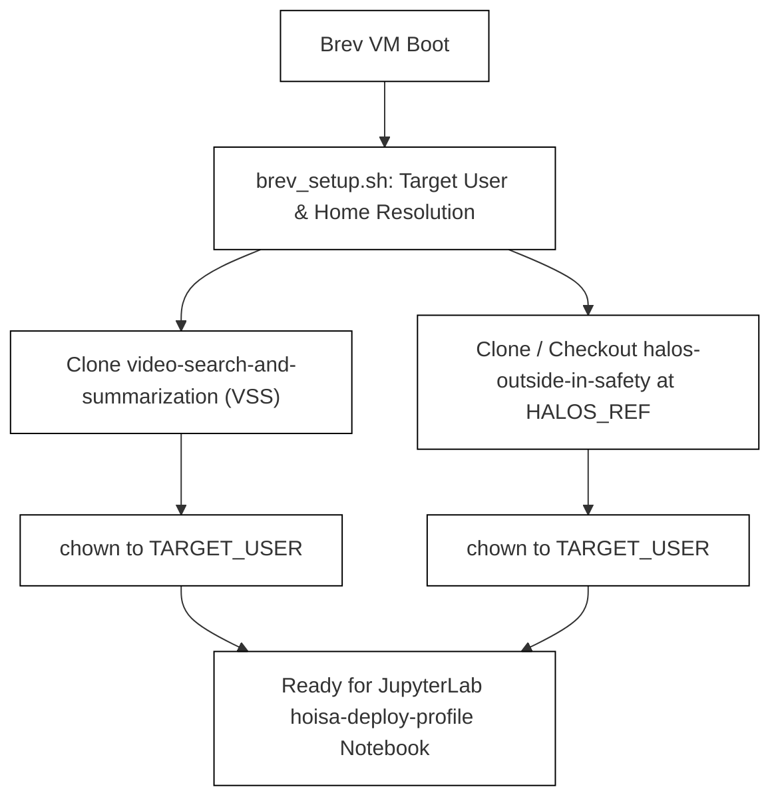
*Figure 1: Brev VM provisioning workflow executed by `brev_setup.sh`.*

Sources: `[deployments/scripts/brev_setup.sh:1-62]()`

### Implementation Details of Brev Setup
* **User Resolution**: The script determines the non-root interactive user (`$SUDO_USER` or `/home` scan) to ensure permissions are assigned correctly `[deployments/scripts/brev_setup.sh:22-29]()`.
* **Repository Synchronization**: Clones the VSS perception backend into `${TARGET_HOME}/video-search-and-summarization` `[deployments/scripts/brev_setup.sh:34-42]()`.
* **Ref Handling**: Forces the Halos repository to check out the branch defined by `HALOS_REF` (defaulting to `develop`), preventing detached HEAD states or default-branch mismatches `[deployments/scripts/brev_setup.sh:16-20]`, `[deployments/scripts/brev_setup.sh:45-58]()`.

Sources: `[deployments/scripts/brev_setup.sh:1-62]()`

---

## Quick Deployment and Configuration

The quick deployment workflow mounts camera sensor configurations, provisions log pipes, learns environmental baselines, and runs the core safety container (`nv-psf`) alongside AI Perception `[docs/deployment/quick-deployment.mdx:1-136]()`.

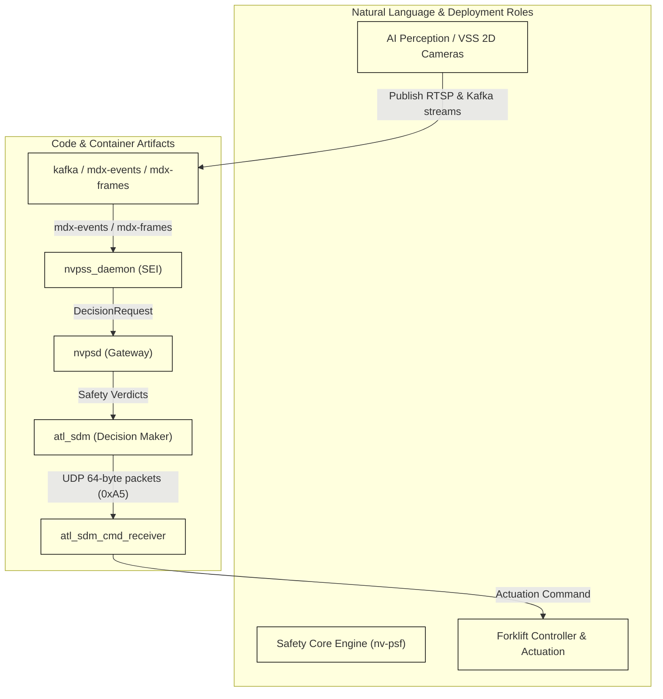
*Figure 2: System architecture bridging natural language concepts to concrete execution code entities during deployment.*

### Execution Pipeline Steps
1. **Debian Package Installation**: Downloads the architecture-specific package from NGC and installs host-side command receivers (`atl_sdm_cmd_receiver`) `[docs/deployment/quick-deployment.mdx:28-35]()`.
2. **Sensor Configuration Generation**: Queries VST via REST (`http://127.0.0.1:30888/vst/api/v1`) to construct `sensor_config.conf` mapping `pipelineId`, `sensorName`, and active RTSP stream URLs `[docs/deployment/quick-deployment.mdx:51-88]()`.
3. **Log Directory Preparation**: Pre-creates host bind-mount log files (`psf.log`, `saim.log`, `pcm.log`, `atl_sdm.log`) under `/var/log/psf` with permissive access for the container user `nvidia` `[docs/deployment/quick-deployment.mdx:102-114]()`.
4. **Baseline Learning**: Executes the container with `--saim-mode learn --pcm-mode learn` to capture camera and event normal baselines before active monitoring `[docs/deployment/quick-deployment.mdx:116-136]()`.

Sources: `[docs/deployment/quick-deployment.mdx:1-136]()`

---

## First SIL Run

Software-in-the-Loop (SIL) executes the entire perception-to-safety-to-actuation closed loop on a single host without physical cameras or forklifts, leveraging NVIDIA Isaac Sim `[docs/getting-started/index.mdx:16]`, `[docs/getting-started/agentic-deployment.mdx:14-16]()`.

### Launching SIL Profiles
You can initialize SIL via automated agentic prompts or standard Jupyter notebooks (`deploy_hoisa_launchable.ipynb`) `[deployments/scripts/brev_setup.sh:60-62]`, `[docs/getting-started/agentic-deployment.mdx:90-105]()`:
* **2D SIL Profile**: Uses standard 2D detection and tracking backends paired with the `atl` decision maker `[docs/getting-started/agentic-deployment.mdx:90-96]()`.
* **3D SIL Profile**: Deploys sparse 3D perception applications (e.g., Sparse4D) requiring specialized 3D configuration mounts (`deploymentMode = 3D`) `[docs/getting-started/agentic-deployment.mdx:98-105]`, `[docs/integration/components/event-integrator.mdx:30-31]()`.

Sources: `[docs/getting-started/agentic-deployment.mdx:80-116]`, `[docs/integration/components/event-integrator.mdx:29-32]()`

---
Sources: `[docs/getting-started/index.mdx:1-23]`, `[deployments/scripts/brev_setup.sh:1-63]`, `[docs/getting-started/agentic-deployment.mdx:1-117]`, `[docs/getting-started/prerequisites.mdx:1-152]`, `[docs/deployment/quick-deployment.mdx:1-136]`, `[docs/integration/components/event-integrator.mdx:1-108]`

---

# Page: Release History and Versioning

# Release History and Versioning

<details>
<summary>Relevant source files</summary>

The following files were used as context for generating this wiki page:

- [CHANGELOG.md](CHANGELOG.md)
- [SECURITY.md](SECURITY.md)
- [docs/known-limitations.mdx](docs/known-limitations.mdx)
- [release_metadata.yaml](release_metadata.yaml)

</details>


This page details the release versioning metadata, historical changelog highlights, known behavioural limitations across the Safety Core components and simulation harnesses, and product security/safety reporting guidelines for the HOISA codebase.

---

## 1. Release Metadata and Versioning Scheme

The repository tracks its active build and version tag via configuration metadata located at the repository root. The current active version tag for this release is specified as `1.3-26.07.5`.

- **Release Tag Specification**: `release_metadata.yaml:1-1`
- **Versioning Policy**: Semantic versioning combined with build-date/component lineage identifiers linking the Safety Core binaries (`nvpss_daemon`, `libnvpsb`) with simulation and deployment profiles.

### Diagram: Release Artifact Dependency Flow

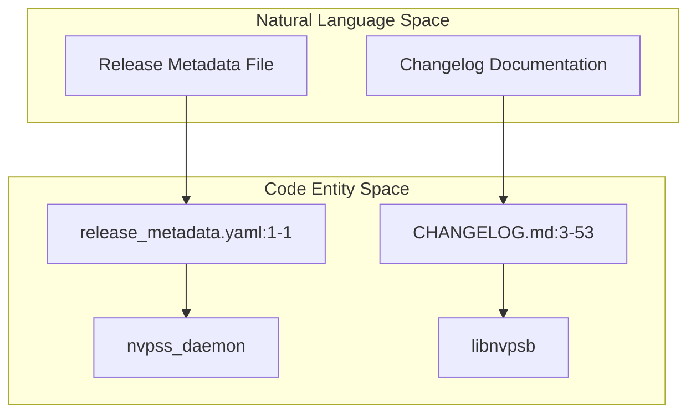
*Sources: release_metadata.yaml:1-1, CHANGELOG.md:3-53*

---

## 2. Changelog Highlights

Recent development cycles have introduced significant updates spanning VSS integration, Safety Decision Maker (SDM) configurations, multi-zone Automated Trailer Loading (ATL), and namespaced ROS communication surfaces.

### VSS Warehouse 3.3 Integration
- **Profile Targeting**: `hoisa-deploy-profile` targets VSS 3.3.0, deployed via the VSS repository's `vss-build-vision-ai` skill (`CHANGELOG.md:5-7`).
- **Authentication**: Requires explicit `docker login nvcr.io` utilizing an NGC key since `nvcr.io/nvidia/vss-core` 3.3.0 images do not support anonymous pulling (`CHANGELOG.md:8`).
- **Calibration & Models**: Ships with the Sparse4D model and native loading-dock BEV calibration routines (`CHANGELOG.md:10`).

### PSF 1.4 and SDM Configuration Changes
- **Launcher Requirements**: `sil` and `base` configurations target the PSF 1.4 image (`nv-psf-halos-1.4-6b92731`), where the runtime launcher rejects SDMs lacking an explicit event binding (`CHANGELOG.md:25-27`).
- **Configuration Files**: `--sdm-config configs/<PSF_APP>_sdm.conf` mounts `sensor_pipelines_config.conf` (`CHANGELOG.md:29`). The configuration explicitly defines `deploymentMode = 2D` and `enableFusion = true` inside `nvpss.conf` (`CHANGELOG.md:30`).
- **Proximity Event Mapping**: Proximity events have migrated from `EVENT_8/9/10` to `EVENT_12/13/14`, preserving `EVENT_0..11` exclusively for ATL (`CHANGELOG.md:33`).

### Multi-Zone ATL Support
- **Dual-Bay Configuration**: `atl-dual-override.yaml` executes the safety core as `--app atl_dual`, deploying one ATL SDM per trailer bay (`CHANGELOG.md:38-40`).
- **Zone 2 Processing**: Zone 2 operates on `EVENT_6..11` using `configs/atl_sdm_zone2.conf` over port `COMM_UDP_PORT_ZONE2` (`CHANGELOG.md:40`). The communication bridge maps these into specific OPC UA nodes (`Zone2IsMuted`, `Zone2StateJson`) (`CHANGELOG.md:41`).

### ROS Topic Namespacing
- **Topic Renaming**: Multi-forklift support namespaces topics, TF frames, and node names relative to individual vehicle IDs (e.g., `/cmd_vel` is now prefixed as `/forklift_b/cmd_vel`) (`CHANGELOG.md:46-53`).

### Diagram: Changelog Deployment Architecture

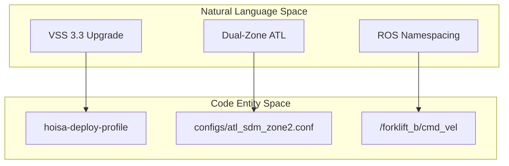
*Sources: CHANGELOG.md:5-7, CHANGELOG.md:38-40, CHANGELOG.md:46-53*

---

## 3. Known Limitations and Behavioural Constraints

The Safety Core, launcher scripts, and closed-loop testing harness exhibit specific operational constraints that require defined workarounds.

### Automated Trailer Loading (ATL) Control Model
- **Single-Forklift Limit**: The ATL reference application is engineered strictly for a single forklift operating inside the monitored loading dock ROI (`docs/known-limitations.mdx:10-12`). Concurrent multi-forklift entry into the same ROI can disrupt safety command association (`docs/known-limitations.mdx:13-14`).

### Event Type Coverage
- **MDX Event Translation**: The MDX client translates incoming `mdx-events` and `mdx-frames` into Safety Core events (`docs/known-limitations.mdx:17-22`). However, perception metadata outside of tripwire crossings, restricted-area violations, and object-pair distances is ignored by default decision logic (`docs/known-limitations.mdx:23-24`).
- **Unsupported Types**: `alert_type: "empty_roi"` rules never match because the MDX client maps empty ROIs to an `roi` clear status (`docs/known-limitations.mdx:25-26`).

### Isaac Sim Upstream Streaming Issues
- **RTSP / VST Anomalies**: Upstream Omniverse/Isaac Sim streaming behaviours require specific configuration workarounds:
  - *Bug 6477478*: UDP delivery halts silently over time. *Workaround*: Ingest via TCP by setting `"rtsp_streaming_over_tcp": true` in `vst_config.json` (`docs/known-limitations.mdx:37`).
  - *Bug 6478845*: `has no caps` RTSP responses during cold bind windows. *Workaround*: Handled via render-warm gates and `closed-loop-testing/scripts/restart_isaac.sh` (`docs/known-limitations.mdx:38`).
  - *Bug 6478903*: Sensor deletions leak live RTSP clients (zombies). *Workaround*: Restart `vss-vios-streamprocessing` via `restart_isaac.sh` (`docs/known-limitations.mdx:39`).
  - *Bug 6478175*: NVENC encode session leaks during windowed multi-camera replay. *Workaround*: Execute headless (`docs/known-limitations.mdx:40`).

### Safety AI Monitor (SAIM) Constraints
- **Docker GPU Visibility**: With `launch_hoisa.sh --runtime docker`, passing `--gpu <n>` is restricted to `n = 0` because the runtime exposes a single isolated GPU context to the container (`docs/known-limitations.mdx:54-60`).
- **Frame Size Restrictions**: SAIM divides frames into a strict 15×15 grid and rejects incompatible dimensions (such as 1280×720 or 2560×1440), logging a `[QA]` size error (`docs/known-limitations.mdx:78-84`).

### Diagram: SAIM and Perception Pipeline Flow

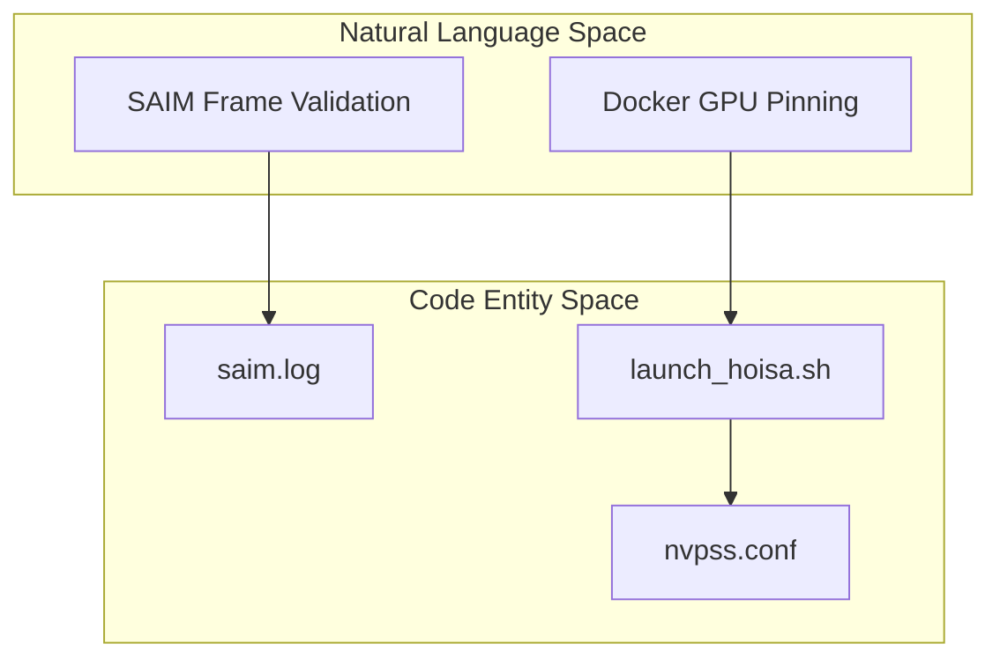
*Sources: docs/known-limitations.mdx:46-50, docs/known-limitations.mdx:54-61, docs/known-limitations.mdx:78-85*

---

## 4. Security and Safety Notices

NVIDIA maintains strict protocols regarding software product security and vulnerability reporting.

### Vulnerability Reporting Policy
- **Reporting Channel**: Security vulnerabilities must not be reported via public GitHub issues or pull requests (`SECURITY.md:5`).
- **Contact Points**:
  - Web Submission: [Security Vulnerability Submission Form](https://www.nvidia.com/object/submit-security-vulnerability.html) (`SECURITY.md:10`)
  - Email: `psirt@nvidia.com` (utilizing the NVIDIA public PGP key for secure communications) (`SECURITY.md:11-12`)
- **Required Disclosure Information**: Submissions should include product/driver names, version branches, vulnerability classifications (e.g., buffer overflow, denial of service), and reproduction instructions or proof-of-concept code (`SECURITY.md:13-18`).

### Sources
- `CHANGELOG.md:1-53`
- `docs/known-limitations.mdx:1-99`
- `release_metadata.yaml:1-1`
- `SECURITY.md:1-25`

---

# Page: Safety Core (OISF/PSF)

# Safety Core (OISF/PSF)

<details>
<summary>Relevant source files</summary>

The following files were used as context for generating this wiki page:

- [SAFETY_NOTICE.md](SAFETY_NOTICE.md)
- [docs/getting-started/safety-core.mdx](docs/getting-started/safety-core.mdx)
- [docs/integration/components/decision-maker.mdx](docs/integration/components/decision-maker.mdx)
- [docs/integration/index.mdx](docs/integration/index.mdx)
- [docs/reference/event-mapping-configuration.mdx](docs/reference/event-mapping-configuration.mdx)
- [safety-core/BUILD.md](safety-core/BUILD.md)
- [safety-core/CMakeLists.txt](safety-core/CMakeLists.txt)
- [safety-core/adapters/vss/event-mappings/atl_proximity/event_mapping_atl_proximity.pb.txt](safety-core/adapters/vss/event-mappings/atl_proximity/event_mapping_atl_proximity.pb.txt)
- [safety-core/adapters/vss/mdx-client/README.md](safety-core/adapters/vss/mdx-client/README.md)
- [safety-core/components/event-integrator/daemon/include/NvPSSSafetyEventManager.hpp](safety-core/components/event-integrator/daemon/include/NvPSSSafetyEventManager.hpp)
- [safety-core/components/event-integrator/daemon/include/pss_protocol.h](safety-core/components/event-integrator/daemon/include/pss_protocol.h)
- [tools/srr-debug-viewer/README.md](tools/srr-debug-viewer/README.md)

</details>


The Safety Core is a robust C/C++ safety engine located in `safety-core/` that acts as the deterministic decision-making backbone for the NVIDIA Halos Outside-In Safety (HOISA) blueprint [safety-core/BUILD.md:6-8](). It bridges upstream perception output from AI pipelines with physical field actuators, continuously validating sensor integrity, supervising internal subsystem health, fusing multi-source telemetry, and enforcing fail-safe states.

For detailed integration instructions, see the [Integration Guide](/integration) and the child pages linked below.

## 2.1 Core Components

The Safety Core comprises several modular daemons and shared libraries that handle event integration, gateway routing, black-box logging, AI monitoring, and perception pipeline validation [docs/integration/index.mdx:16-25](). The event integrator (`nvpss_daemon`) ingests sanitized events, while the decision gateway (`nvpsd_gateway`) securely dispatches decision requests to isolated Safety Decision Makers (SDMs). System health is continuously evaluated by the Safety AI Monitor (`safety_monitor`) and the Perception Monitor (`nv_perception_monitor`), backed by the black-box logging library (`libnvpsb.so`) and `safecomm` IPC primitives.

For full architectural details, component interactions, and protocol specifications, see [Core Components](#2.1).

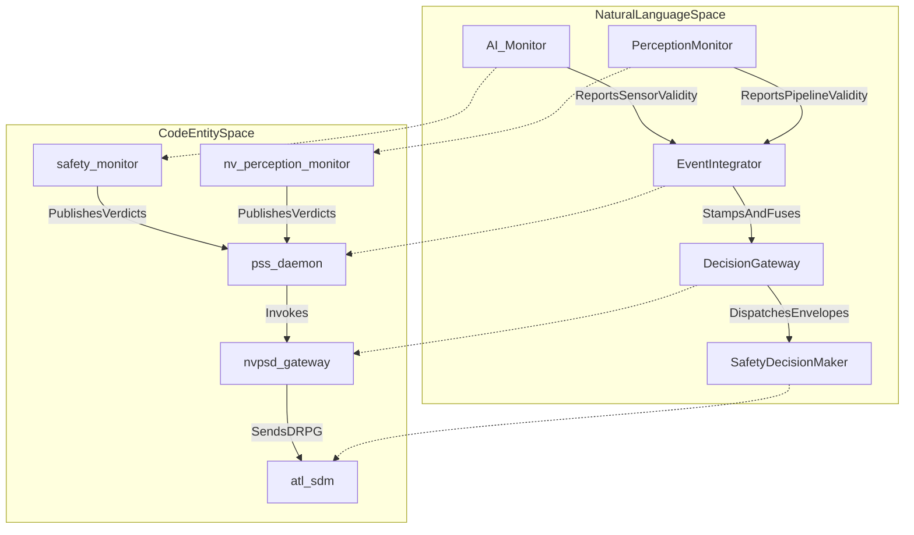

Sources: [docs/integration/index.mdx:16-46](), [docs/getting-started/safety-core.mdx:16-50](), [safety-core/CMakeLists.txt:129]()

---

## 2.2 Decision Makers (SDMs)

Safety Decision Makers (SDMs) consume validated `DecisionRequest` payloads from the NvPSD Gateway and translate them into deterministic 64-byte UDP control commands for PLCs, robotic controllers, or reference command receivers [docs/integration/components/decision-maker.mdx:5-10](). The Safety Core ships with reference SDMs including `atl_sdm` (forklift safety function), `proximity_sdm` (proximity monitoring), combined `atl_proximity_sdm`, and `crossing_junction_safety_monitor_sdm` [safety-core/CMakeLists.txt:129](). When any path fault, dropped heartbeat, or sensor failure occurs, the SDM immediately latches a safe state that requires explicit operator intervention to release [docs/integration/components/decision-maker.mdx:8-13]().

For detailed configuration parameters, command packet schemas, and guide on writing custom decision makers, see [Decision Makers (SDMs)](#2.2).

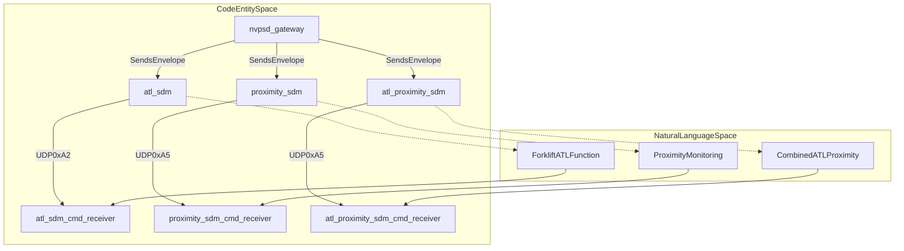

Sources: [docs/integration/components/decision-maker.mdx:5-34](), [safety-core/CMakeLists.txt:129]()

---

## 2.3 Perception Adapters and Event Mapping

The perception adapter layer bridges upstream computer vision pipelines with the Safety Core via Kafka messaging. The `mdx_client` executable consumes `mdx-events` and `mdx-frames` topics, parsing Protobuf messages and matching them against user-defined rule configurations (`event_mapping.proto`) [docs/reference/event-mapping-configuration.mdx:5-15](). It resolves individual camera feeds or 3D Bird's-Eye View (BEV) pipeline identifiers to emit standardized `SafetyEvent` reports into the safety daemon [safety-core/adapters/vss/mdx-client/README.md:6-36]().

For detailed configuration structures, violation filters, proximity-pair rules, and custom event ingestion, see [Perception Adapters and Event Mapping](#2.3).

Sources: [docs/reference/event-mapping-configuration.mdx:5-43](), [safety-core/adapters/vss/mdx-client/README.md:6-36]()

---

## 2.4 Building and Packaging

The Safety Core uses CMake to orchestrate multi-component builds supporting both `x86_64` and `aarch64` architectures [safety-core/BUILD.md:6-10](). It incorporates dependency link stubs (`safety-core/cmake/stubs`) and third-party NVDEC headers (`safety-core/cmake/third-party-headers`) to maintain consistent cross-compilation flows without requiring target-specific runtime libraries at build time [safety-core/BUILD.md:28-35](). Build targets generate Debian runtime and development packages (`psf-desktop.deb`, `psf-tegra.deb`) as well as standalone Docker image archives under `<build-dir>/packages` [safety-core/BUILD.md:73-126]().

For step-by-step compilation instructions, toolchain configuration files, and packaging targets, see [Building and Packaging](#2.4).

Sources: [safety-core/BUILD.md:6-126](), [safety-core/CMakeLists.txt:4-116]()

---

## 2.5 Safety Core Runtime Configuration

Runtime behavior across the safety engine is controlled by text configuration files and deployment scripts. Key configuration assets include `nvpss.conf` for daemon supervision, sensor pipeline definitions (`sensor_config.conf` for 2D, `sensor_pipelines_config.conf` for 3D/BEV), and specific decision maker configurations (`atl_sdm_zone1.conf`, `pxc_sdm_forklift.conf`) [docs/integration/components/decision-maker.mdx:30-32](), [safety-core/adapters/vss/mdx-client/README.md:23-24](). These files establish operational thresholds, heartbeat intervals, timeout limits, and subscription maps.

For comprehensive configuration file schemas, zone setups, and override mechanisms, see [Safety Core Runtime Configuration](#2.5).

Sources: [docs/integration/components/decision-maker.mdx:30-34](), [safety-core/adapters/vss/mdx-client/README.md:23-24]()

---

# Page: Core Components

# Core Components

<details>
<summary>Relevant source files</summary>

The following files were used as context for generating this wiki page:

- [docs/integration/components/black-box.mdx](docs/integration/components/black-box.mdx)
- [docs/integration/components/gateway.mdx](docs/integration/components/gateway.mdx)
- [docs/integration/components/index.mdx](docs/integration/components/index.mdx)
- [docs/integration/components/sensor-input-pipeline.mdx](docs/integration/components/sensor-input-pipeline.mdx)
- [safety-core/CMakeLists.txt](safety-core/CMakeLists.txt)
- [safety-core/adapters/vss/event-mappings/atl_proximity/event_mapping_atl_proximity.pb.txt](safety-core/adapters/vss/event-mappings/atl_proximity/event_mapping_atl_proximity.pb.txt)
- [safety-core/components/event-integrator/daemon/include/NvPSSSafetyEventManager.hpp](safety-core/components/event-integrator/daemon/include/NvPSSSafetyEventManager.hpp)
- [safety-core/components/event-integrator/daemon/include/pss_protocol.h](safety-core/components/event-integrator/daemon/include/pss_protocol.h)

</details>


## Purpose and Scope

This page details the implementation, data flow, architecture, and key code entities of the core components inside `safety-core/`. The Safety Core forms the deterministic safety-critical engine that interfaces between the perception pipelines (SIPP / MDX client) and machine controllers (SDMs / PLC command receivers). It guarantees fail-safe behavior through runtime event validation, trust aggregation, sequence gating, and standardized inter-process communication (IPC) protocols.

Sources: `docs/integration/components/index.mdx:5-10`, `safety-core/CMakeLists.txt:1-55`

---

## 1. Event Integrator (`nvpss_daemon` and `libnvpssd_interface.so`)

The Safety Event Integrator (SEI), executed as `nvpss_daemon`, acts as the central hub of the Safety Core [docs/integration/components/index.mdx:19](). It ingests raw safety events via `libnvpssd_interface.so`, validates message schemas, applies trust verdicts based on sensor health, fuses multi-source inputs, and emits sequenced `DecisionRequest` payloads.

### Implementation and Key Classes

The daemon enforces protocol schema validation [safety-core/components/event-integrator/daemon/include/pss_protocol.h:34](), utilizing state management structures such as `NvPSSFusionHealthLatch` to monitor background loop health and track sustained failures [safety-core/components/event-integrator/daemon/include/NvPSSSafetyEventManager.hpp:127-142]().

```text
+-----------------------+     SafetyEvent      +-------------------------+
| Client / MDX Pipeline | -------------------> | nvpss_daemon (SEI)      |
+-----------------------+                      |                         |
                                               | - validateSafetyEvent() |
                                               | - NvPSSFusionHealthLatch|
                                               | - DecisionRequest       |
                                               +-------------------------+
```

### Diagram: SEI Event Ingestion and Fusion Flow
```mermaid
graph TD
    subcode["Code Entity Space"]
        Client["libnvpssd_interface.so"] -->|SendSafetyEvent| Daemon["nvpss_daemon"]
        Daemon --> Valid["validateSafetyEvent()"]
        Valid --> Latch["NvPSSFusionHealthLatch"]
        Latch --> Fused["DecisionRequest (pss_protocol.h)"]
    end

    classDef default fill:none,stroke:#000,stroke-width:1px;
```

Sources: `safety-core/components/event-integrator/daemon/include/pss_protocol.h:18-35`, `safety-core/components/event-integrator/daemon/include/NvPSSSafetyEventManager.hpp:127-145`, `docs/integration/components/index.mdx:15-20`

---

## 2. NvPSD Gateway (`nvpsd_gateway` and `libnvpsd.so`)

The NvPSD Gateway (`nvpsd_gateway`) manages communication between the SEI daemon and registered Safety Decision Makers (SDMs) [docs/integration/components/gateway.mdx:1-10](). It operates exclusively over `AF_UNIX` `SOCK_SEQPACKET` sockets located under `/run/nvpsf` [docs/integration/components/gateway.mdx:18-20]().

### Gateway Operations & Security

* **Credential Verification**: Validates peer credentials via `SO_PEERCRED`, requiring identical primary GIDs [docs/integration/components/gateway.mdx:28-32]().
* **Sequence Validation**: Detects sequence gaps, duplicates, and invalid request IDs, injecting synthetic `SW_FAIL` packets when discontinuities occur [docs/integration/components/gateway.mdx:86-94]().
* **Heartbeat Supervision**: Supervises SDM connectivity and drops unregistered or stalled clients exceeding `--max_hb_failures` [docs/integration/components/gateway.mdx:46-46]().

### Diagram: Gateway Request Fan-Out Architecture
```mermaid
graph TD
    subcode["Code Entity Space"]
        SEI["nvpss_daemon"] -->|"/run/nvpsf/nvpssd_to_psd"| Gateway["nvpsd_gateway"]
        Gateway --> Val["Validate Request ID / CRC"]
        Val --> CheckSeq["Check Sequence Gap"]
        CheckSeq --> FanOut["/run/nvpsf/nvpsd_gateway"]
        FanOut --> SDM1["atl_sdm"]
        FanOut --> SDM2["proximity_sdm"]
    end

    classDef default fill:none,stroke:#000,stroke-width:1px;
```

Sources: `docs/integration/components/gateway.mdx:1-35`, `docs/integration/components/gateway.mdx:80-100`, `safety-core/CMakeLists.txt:47-50`

---

## 3. Safety Black Box (`libnvpsb.so`)

The Safety Black Box (`libnvpsb.so`) provides an audit trail by channeling component error logs, fault decisions, and safety traces into the Linux syslog facility [docs/integration/components/black-box.mdx:5-8]().

### Syslog Tags and Endpoints

| Syslog Tag | Component Role | Recorded Information |
| --- | --- | --- |
| `NVPSB_PSS_DAEMON` | SEI Daemon (`nvpss_daemon`) | Source loss, rejection streaks, delivery failures, fusion health [docs/integration/components/black-box.mdx:15]() |
| `nvpsd_gateway`, `NVPSB_PSD_CLIENT` | NvPSD Gateway (`nvpsd_gateway`) | Inbound requests, synthetic faults, recovery records, SDM registrations [docs/integration/components/black-box.mdx:16]() |
| `nv_mdx_client` | MDX Client (`mdx_client`) | Mapping loads, event reporting counts, drop logs, heartbeats [docs/integration/components/black-box.mdx:17]() |

### Core Library Functions

* `NvPSBInitialize(ident, endpoint)`: Opens syslog with the specified tag and registers the endpoint role [docs/integration/components/black-box.mdx:66]().
* `NvPSBWriteData(level, data, additionalInfo)`: Submits an audit log record [docs/integration/components/black-box.mdx:67]().
* `NvPSBExit()`: Closes the syslog connection [docs/integration/components/black-box.mdx:68]().

Sources: `docs/integration/components/black-box.mdx:1-76`

---

## 4. Safety AI Monitor (SAIM) and Perception Container Monitor (PCM)

The monitoring modules continuously verify the health of the underlying vision pipelines and containerized inference components.

* **Safety AI Monitor (SAIM)** (`safety_monitor`): Inspects incoming camera streams and reports camera validity (`SENSOR_VALID` / `SENSOR_INVALID`) [docs/integration/components/index.mdx:17]().
* **Perception Container Monitor (PCM)** (`nv_perception_monitor`): Monitors perception container outputs and pipeline availability (`AI_PIPELINE_VALID` / `AI_PIPELINE_INVALID`) [docs/integration/components/index.mdx:18]().

Both monitors communicate status updates directly to the SEI daemon to trigger fail-safe behaviors when anomalies or stream disconnects occur.

Sources: `docs/integration/components/index.mdx:11-20`, `safety-core/CMakeLists.txt:24-26,45-46`

---

## 5. Protocols and Safecomm POSIX IPC

The communication subsystem uses specialized libraries to handle safe, low-latency inter-process messaging across the system boundary.

* `libnvpsf_transport.so`: Base transport abstractions [safety-core/CMakeLists.txt:54]().
* `libnvpss_socket_comms.so`: POSIX socket communications implementation [safety-core/CMakeLists.txt:53]().
* `libnvpss_msg_que.so`: POSIX message queue implementation [safety-core/CMakeLists.txt:52]().

Wire protocols and enumerations are defined centrally in header files, where strict payload layout definitions (`#pragma pack(push, 1)`) guarantee compatibility between binaries [safety-core/components/event-integrator/daemon/include/pss_protocol.h:34-36]().

Sources: `safety-core/CMakeLists.txt:51-55`, `safety-core/components/event-integrator/daemon/include/pss_protocol.h:30-45`

---

## 6. Perception Adapters and MDX Client (`mdx_client`)

The MDX client (`mdx_client`) bridges Metropolis MDX perception payloads from Kafka to the SEI daemon [docs/integration/components/sensor-input-pipeline.mdx:39-65]().

### Rule Matching and Parsing

The client loads binary or text-format protobuf event mapping configurations at startup [docs/integration/components/sensor-input-pipeline.mdx:85-88](). It consumes `mdx-events` (tripwire alerts) and `mdx-frames` (ROI and proximity alerts), converting them into normalized `SafetyEvent` structures forwarded through `libnvpssd_interface.so` [docs/integration/components/sensor-input-pipeline.mdx:48-62]().

```text
Kafka Topics (mdx-events / mdx-frames) 
    --> mdx_client (Rule Matching & Parsing) 
    --> libnvpssd_interface.so 
    --> nvpss_daemon
```

Sources: `docs/integration/components/sensor-input-pipeline.mdx:35-110`, `safety-core/adapters/vss/event-mappings/atl_proximity/event_mapping_atl_proximity.pb.txt:1-40`

---

# Page: Decision Makers (SDMs)

# Decision Makers (SDMs)

<details>
<summary>Relevant source files</summary>

The following files were used as context for generating this wiki page:

- [docs/integration/safe-state-model.mdx](docs/integration/safe-state-model.mdx)
- [docs/integration/writing-a-decision-maker.mdx](docs/integration/writing-a-decision-maker.mdx)
- [safety-core/components/event-integrator/daemon/src/NvPSSSafetyEventManager.cpp](safety-core/components/event-integrator/daemon/src/NvPSSSafetyEventManager.cpp)
- [safety-core/components/safecomm/posix_msg_que/include/posix_msg_que.h](safety-core/components/safecomm/posix_msg_que/include/posix_msg_que.h)
- [safety-core/decision-makers/CMakeLists.txt](safety-core/decision-makers/CMakeLists.txt)
- [safety-core/decision-makers/atl_proximity/CMakeLists.txt](safety-core/decision-makers/atl_proximity/CMakeLists.txt)
- [safety-core/decision-makers/atl_proximity/README.md](safety-core/decision-makers/atl_proximity/README.md)
- [safety-core/decision-makers/atl_proximity/atl_proximity_sdm.cmake](safety-core/decision-makers/atl_proximity/atl_proximity_sdm.cmake)

</details>


## Purpose and Scope
This page details the Safety Decision Makers (SDMs) within the HOISA `safety-core/decision-makers/` subsystem [safety-core/decision-makers/CMakeLists.txt:1-20](). It covers the reference implementations—Access Traffic Light (`atl_sdm`), Proximity Monitoring (`proximity_sdm`), Combined (`atl_proximity_sdm`), and Crossing-Junction Safety Monitor—alongside the core safe-state latching model and the architectural contract required to implement a custom SDM.

---

## Reference Safety Decision Makers

HOISA features four primary decision-making modules that process fused safety events from the `nvpsd` gateway and command downstream actuators (PLCs or robot controllers via UDP/POSIX queues).

| SDM Binary / Module | Source Directory | Target Use Case / Function | Command Output | Sources |
|---|---|---|---|---|
| `atl_sdm` | `safety-core/decision-makers/atl` | Forklift Access Traffic Light (ATL) zone/tripwire safety [safety-core/decision-makers/CMakeLists.txt:4-5]() | `CMD_UNMUTE`, `CMD_SW_ERROR` [docs/integration/safe-state-model.mdx:25-25]() | `[safety-core/decision-makers/CMakeLists.txt:4-5](), [docs/integration/safe-state-model.mdx:25-25]()` |
| `proximity_sdm` | `safety-core/decision-makers/proximity` | Standalone proximity monitoring (PXC) [safety-core/decision-makers/CMakeLists.txt:8-10]() | `CMD_STOP`, `CMD_SW_ERROR` [docs/integration/safe-state-model.mdx:26-26]() | `[safety-core/decision-makers/CMakeLists.txt:8-10](), [docs/integration/safe-state-model.mdx:26-26]()` |
| `atl_proximity_sdm` | `safety-core/decision-makers/atl_proximity` | Combined ATL and forklift-to-person proximity [safety-core/decision-makers/atl_proximity/atl_proximity.cmake:30-34]() | Worst-tier command aggregation (`CMD_STOP`, `CMD_REDUCE`, `CMD_NORMAL`) [safety-core/decision-makers/atl_proximity/README.md:62-71]() | `[safety-core/decision-makers/atl_proximity/atl_proximity.cmake:30-34](), [safety-core/decision-makers/atl_proximity/README.md:62-71]()` |
| Crossing-Junction | `safety-core/decision-makers/crossing-junction-safety-monitor` | Junction collision avoidance & cross-traffic monitoring [safety-core/decision-makers/CMakeLists.txt:18-20]() | Junction-specific interlock signals | `[safety-core/decision-makers/CMakeLists.txt:18-20]()` |

The `atl_proximity_sdm` implementation relies on specific C++ source modules:
- `AtlProximity.cpp` [safety-core/decision-makers/atl_proximity/atl_proximity.cmake:30-31]()
- `AtlProximityControl.cpp` [safety-core/decision-makers/atl_proximity/atl_proximity.cmake:32-32]()
- `sensor_config_parser.cpp` [safety-core/decision-makers/atl_proximity/atl_proximity.cmake:33-33]()

Sources: `[safety-core/decision-makers/CMakeLists.txt:1-20](), [safety-core/decision-makers/atl_proximity/atl_proximity.cmake:30-34](), [docs/integration/safe-state-model.mdx:23-27](), [safety-core/decision-makers/atl_proximity/README.md:62-71]()`

---

## Safe-State Model and Latch Architecture

Every reference SDM adheres to a strict safe-state model governing fault detection, latch assertion, and operator/PLC release protocols [docs/integration/safe-state-model.mdx:6-10]().

### Core Mechanics
1. **Causes**: Fault conditions (e.g., sensor loss, communication gaps, sequence errors) are evaluated independently. Each cause is strictly binary (active or inactive) [docs/integration/safe-state-model.mdx:16-17]().
2. **The Latch**: Raising any latching fault sets an internal flag in the SDM process. While set, the SDM overrides its operational decision and continuously outputs its designated safe state (`CMD_STOP` or `CMD_UNMUTE`) [docs/integration/safe-state-model.mdx:18-20]().
3. **The Release**: Clearing underlying physical faults *does not* clear the latch. The SDM retains its safe output until it accepts an explicit release request packet from the PLC, which is permitted *only when zero fault causes remain active* [docs/integration/safe-state-model.mdx:21-22]().

### Diagram: SDM Cause-to-Latch Data Flow (Code Entity Space)

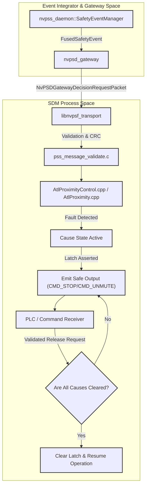
Sources: `[docs/integration/safe-state-model.mdx:12-35](), [safety-core/decision-makers/atl_proximity/atl_proximity.cmake:30-34](), [safety-core/components/event-integrator/daemon/src/NvPSSSafetyEventManager.cpp:147-155]()`

---

## Implementing a Custom Decision Maker

To write a custom SDM that successfully interfaces with the `nvpsd` gateway, developers must satisfy a strict communication and runtime contract [docs/integration/writing-a-decision-maker.mdx:6-10]().

### Gateway Connection Contract
1. **Shared Process Group**: The SDM must execute within the same primary POSIX group ID as `nvpsd_gateway` [docs/integration/writing-a-decision-maker.mdx:28-29]() (verified via `SO_PEERCRED` checks) [docs/integration/writing-a-decision-maker.mdx:61-62]().
2. **Transport Initialization**: Connect to the UNIX domain socket located at `NVPSF_SOCKET_PATH_PSD_GATEWAY` (`/run/nvpsf/nvpsd_gateway`) using `SOCK_SEQPACKET` [docs/integration/writing-a-decision-maker.mdx:57-58]().
3. **Registration (`REGR`)**: Send an initial registration message immediately upon connection, repeating every 30 seconds [docs/integration/writing-a-decision-maker.mdx:30-31]().
4. **Heartbeat Loop**: Respond to every gateway heartbeat (`HBPG`) with an acknowledgement (`HBPC`) and supervise incoming gateway heartbeats [docs/integration/writing-a-decision-maker.mdx:31-32]().
5. **Packet Validation**: Validate payload size, schema version (`PSS_SCHEMA_VERSION`), CRC (`pssDecisionRequestVerifyCRC`), and packet sequence headers [docs/integration/writing-a-decision-maker.mdx:32-33, 46-50]().

### Diagram: SDM Connection and Transport Lifecycle (Natural Language to Code Space)

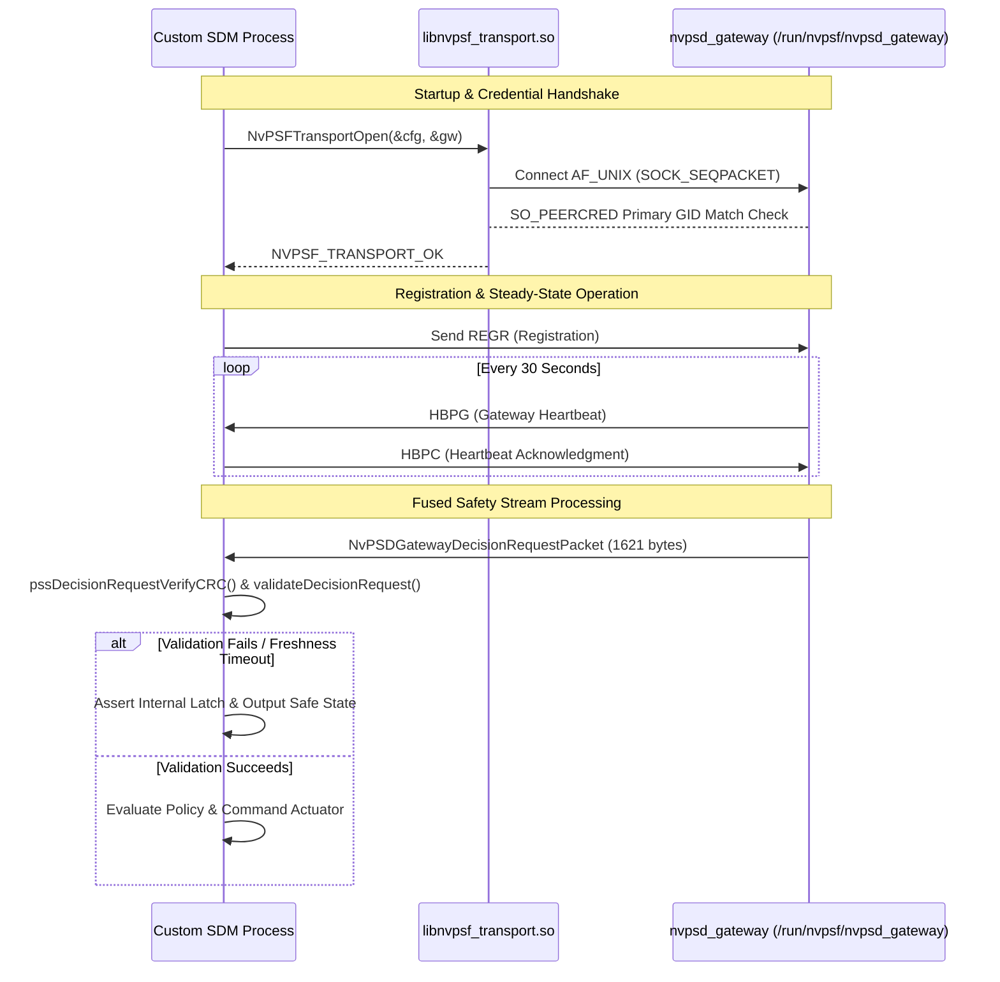
Sources: `[docs/integration/writing-a-decision-maker.mdx:44-112]()`

---

## Message Transport & Inter-Process Communication

Decision makers consume fixed-size serialization structures. Message queue buffers and transport configurations are strictly bounded to prevent memory fragmentation and ensure deterministic latency.

- **Maximum Message Size (`MQ_MAX_MSG_SIZE`)**: Configured to `16384` bytes to accommodate large sensor data arrays (`DecisionRequest` structures scaling up to 32 slots) [safety-core/components/safecomm/posix_msg_que/include/posix_msg_que.h:40-46]().
- **Gateway Decision Packet Size**: Exactly `1621` bytes (`sizeof(NvPSDGatewayDecisionRequestPacket)`) [docs/integration/writing-a-decision-maker.mdx:62-63]().
- **Queue Depth Minimum**: The client requests receive/send buffers dimensioned for at least `516` decision packets via `NvPSFGatewaySdmMinQueueDepth()` [docs/integration/writing-a-decision-maker.mdx:62-63, 78-78]().

Sources: `[safety-core/components/safecomm/posix_msg_que/include/posix_msg_que.h:40-46](), [docs/integration/writing-a-decision-maker.mdx:62-79]()`

---

# Page: Perception Adapters and Event Mapping

# Perception Adapters and Event Mapping

<details>
<summary>Relevant source files</summary>

The following files were used as context for generating this wiki page:

- [README.md](README.md)
- [SAFETY_NOTICE.md](SAFETY_NOTICE.md)
- [ai-perception/README.md](ai-perception/README.md)
- [docs/integration/custom-event-sources.mdx](docs/integration/custom-event-sources.mdx)
- [docs/reference/sensor-files.mdx](docs/reference/sensor-files.mdx)
- [safety-core/BUILD.md](safety-core/BUILD.md)
- [safety-core/adapters/vss/mdx-client/README.md](safety-core/adapters/vss/mdx-client/README.md)
- [skills/README.md](skills/README.md)
- [tools/srr-debug-viewer/README.md](tools/srr-debug-viewer/README.md)
- [tools/waypoint-generator/README.md](tools/waypoint-generator/README.md)

</details>


The purpose and scope of this page cover the perception backend integration seam within the Halos Outside-In Safety (HOISA) architecture. It details how the config-driven `mdx_client` consumes Kafka topics (`mdx-events` and `mdx-frames`), parses Metropolis MDX protobuf messages via `mdx-msg-codec`, maps alerts to Safety Core PSS (Safety Event Integrator) events using protobuf rules, manages 2D versus 3D/BEV sensor identity files, and how custom event sources interface with the Safety Core via `libnvpssd_interface`.

---

## 1. VSS mdx-client and Message Bus Architecture

The Safety Core decouples internal safety logic from perception internals through a Kafka-based event stream. The VSS Blueprint perception backend publishes video analytics events and frame states, which are ingested by the config-driven `mdx_client` [ai-perception/README.md:13-16](), [safety-core/adapters/vss/mdx-client/README.md:8-10]().

```mermaid
graph TD
    sub5["Natural_Language_Space"]
    sub6["Code_Entity_Space"]
    
    sub5 -->| "Video_Analytics_Events" | A[Cameras_and_Isaac_Sim_RTSP]
    A -->| "Inference_Pipeline" | B[VSS_Perception_Backend]
    B -->| "Kafka_mdx-events_and_mdx-frames" | C[safety-core/adapters/vss/mdx-client]
    C -->| "Protobuf_Event_Decoding" | D[safety-core/adapters/vss/mdx-msg-codec]
    D -->| "SafetyEvent_via_libnvpssd_interface" | E[safety-core/adapters/psi/nvpss_daemon]
    
    style A fill:none,stroke:#333,stroke-width:2px
    style B fill:none,stroke:#333,stroke-width:2px
    style C fill:none,stroke:#333,stroke-width:2px
    style D fill:none,stroke:#333,stroke-width:2px
    style E fill:none,stroke:#333,stroke-width:2px
```
*Figure 1: Perception-to-Safety Core Data Flow bridging natural language system components to code paths.*

Sources: `[ai-perception/README.md:13-16]()`, `[safety-core/adapters/vss/mdx-client/README.md:8-10]()`

---

## 2. Kafka Topics and Protobuf Event-Mapping Configuration

The `mdx_client` ingests two primary Kafka topics:
- **`mdx-events`**: Carries high-level region-of-interest (ROI) and tripwire behaviors.
- **`mdx-frames`**: Carries per-frame object detections, metadata, and social distancing metrics.

The translation of incoming Metropolis `mdx-messages` into `SafetyEvent` structures is governed entirely by protobuf text or binary configuration files [safety-core/adapters/vss/mdx-client/README.md:101-115]().

```mermaid
graph TD
    sub1["Natural_Language_Space"]
    sub2["Code_Entity_Space"]

    sub1 -->| "Restricted_Area_Violation" | F[Kafka_mdx-events]
    F -->| "Message_Payload" | G[safety-core/adapters/vss/mdx-client/src/main.cpp]
    G -->| "Condition_Matching" | H[safety-core/adapters/vss/mdx-msg-codec/proto/event_mapping.proto]
    H -->| "Rule_Evaluation" | I[SafetyEvent_Generation]
    I -->| "IPC_SEI_Submission" | J[libnvpssd_interface.so]

    style F fill:none,stroke:#333,stroke-width:2px
    style G fill:none,stroke:#333,stroke-width:2px
    style H fill:none,stroke:#333,stroke-width:2px
    style I fill:none,stroke:#333,stroke-width:2px
    style J fill:none,stroke:#333,stroke-width:2px
```
*Figure 2: Event Mapping Configuration logic pipeline from Kafka topics to Safety Core dispatch.*

### Event Mapping Rule Attributes
Each `EventMappingRule` defined in the protobuf schema checks specific matching criteria before emitting an output event [safety-core/adapters/vss/mdx-client/README.md:105-115]():
- **Conditions**: `message_source`, `alert_type`, `event_type`, `object_type`, and `rule_id` (matched case-insensitively).
- **Violation Filters**: `restricted_area_violation`, `confined_area_violation`, and `social_distancing_violation` evaluated against `FrameMessage.rois` and `FrameMessage.socialDistancing`.

Sources: `[safety-core/adapters/vss/mdx-client/README.md:101-115]()`, `[ai-perception/README.md:13-16]()`

---

## 3. Sensor Identity Management (2D vs 3D/BEV)

To resolve sensor identities between Kafka messages and internal pipeline IDs (`1` to `8`), `mdx_client` requires exactly one identity configuration file, enforcing strict safety separation between 2D and 3D topologies [safety-core/adapters/vss/mdx-client/README.md:19-40](), [docs/reference/sensor-files.mdx:5-15]().

| Deployment Mode | Configuration File | Format | Description |
|---|---|---|---|
| **2D Mode** | `sensor_config.conf` | `pipelineId, sensorName, rtspUrl` | Maps individual cameras as event sources [safety-core/adapters/vss/mdx-client/README.md:77-84](). |
| **3D / BEV Mode** | `sensor_pipelines_config.conf` | `pipelineId, sensorName` | Names the calibrated Bird's-Eye-View (BEV) group rather than individual cameras [safety-core/adapters/vss/mdx-client/README.md:86-91](). |

### Topology Safety Constraints
Passing both identity arguments or omitting them causes a fatal argument error in `mdx_client` [safety-core/adapters/vss/mdx-client/README.md:27-38]():
- In 3D topologies, cameras are calibrated into a single BEV group; reporting under individual cameras would gate safety against a single camera's health rather than the group consensus.
- Unrecognized Kafka `sensorId` values lacking a corresponding entry in the active config file are dropped silently rather than defaulting to `pipelineId` zero [docs/reference/sensor-files.mdx:16-25]().

Sources: `[safety-core/adapters/vss/mdx-client/README.md:19-40]()`, `[docs/reference/sensor-files.mdx:5-35]()`

---

## 4. Custom Event Sources and SEI Client Library

External or custom monitors integrate directly with the Safety Event Integrator (SEI daemon, `nvpss_daemon`) using the client library `libnvpssd_interface.so` [docs/integration/custom-event-sources.mdx:6-15]().

### Client Communication Contract
- **Socket Path**: `/run/nvpsf/nvpssd` (`AF_UNIX`, `SOCK_SEQPACKET`) [docs/integration/custom-event-sources.mdx:18-23]().
- **Credential Verification**: The daemon compares the client primary GID using `SO_PEERCRED` to ensure secure process group sharing [docs/integration/custom-event-sources.mdx:22-23]().
- **Core API Functions**: Declared in `pss_daemon.h` and implemented in `libnvpssd_interface.so` [docs/integration/custom-event-sources.mdx:18-21](), [docs/integration/custom-event-sources.mdx:96-103]():
  - `NvPSSRegisterPSSClientInstance(uint32_t* clientId, uint8_t clientType, uint8_t instanceId)`: Registers a numbered client instance (1–8 for `CLIENT_MDX`) [docs/integration/custom-event-sources.mdx:99]().
  - `NvPSSSendHeartbeat(const uint32_t clientId, const uint8_t clientType)`: Periodically sends liveness heartbeats [docs/integration/custom-event-sources.mdx:100]().
  - `NvPSSReportSafetyEvent(const uint32_t clientId, const SafetyEvent* event)`: Dispatches structured safety verdicts to the SEI daemon [docs/integration/custom-event-sources.mdx:101]().
  - `NvPSSTerminatePSSClient(const uint32_t clientId)`: Unregisters the client cleanly on shutdown [docs/integration/custom-event-sources.mdx:102]().

Sources: `[docs/integration/custom-event-sources.mdx:6-135]()`

---

# Page: Building and Packaging

# Building and Packaging

<details>
<summary>Relevant source files</summary>

The following files were used as context for generating this wiki page:

- [SAFETY_NOTICE.md](SAFETY_NOTICE.md)
- [safety-core/BUILD.md](safety-core/BUILD.md)
- [safety-core/CMakeLists.txt](safety-core/CMakeLists.txt)
- [safety-core/adapters/vss/event-mappings/atl_proximity/event_mapping_atl_proximity.pb.txt](safety-core/adapters/vss/event-mappings/atl_proximity/event_mapping_atl_proximity.pb.txt)
- [safety-core/adapters/vss/mdx-client/README.md](safety-core/adapters/vss/mdx-client/README.md)
- [safety-core/components/event-integrator/daemon/include/NvPSSSafetyEventManager.hpp](safety-core/components/event-integrator/daemon/include/NvPSSSafetyEventManager.hpp)
- [safety-core/components/event-integrator/daemon/include/pss_protocol.h](safety-core/components/event-integrator/daemon/include/pss_protocol.h)
- [tools/srr-debug-viewer/README.md](tools/srr-debug-viewer/README.md)

</details>


## Purpose and Scope

This page covers the compilation, cross-compilation, stub-based dependency resolution, and packaging pipeline for the `safety-core` engine of the HOISA (Halos Outside-In Safety) system. It details how the CMake build system [safety-core/CMakeLists.txt:1-116]() configures binaries, shared libraries, Debian packages, and Docker image archives for `x86_64` and `aarch64` architectures as documented in `safety-core/BUILD.md` [safety-core/BUILD.md:1-213]().

Sources: [safety-core/BUILD.md:1-10](), [safety-core/CMakeLists.txt:1-15]()

---

## Build Prerequisites and Environment Configuration

Compiling `safety-core` requires host build tools, runtime package utilities, and public development packages. The host environment must provide build essentials, CMake, Ninja, and packaging tools [safety-core/BUILD.md:12-20]().

| Dependency / Tool | Requirement / Package | Role in Build Process |
| :--- | :--- | :--- |
| Build System | `cmake`, `ninja-build`, `build-essential` | Generates build trees and executes parallel compilation [safety-core/BUILD.md:16-17]() |
| Packaging Tools | `dpkg-dev`, `docker.io` | Produces `.deb` package archives and local container images [safety-core/BUILD.md:18]() |
| Messaging & Parsing | `librdkafka-dev`, `libprotobuf-dev` | Provides Kafka development headers (`rdkafka.h`) and Google Protobuf headers [safety-core/BUILD.md:19-33]() |
| CUDA Toolkit | `/usr/local/cuda-13.0` (configurable via `-DSAFETY_CORE_CUDA_TOOLKIT_ROOT`) | Supplies CUDA driver headers and libraries for `ai-monitor` and GPU tasks [safety-core/BUILD.md:22-26]() |

Sources: [safety-core/BUILD.md:12-26]()

---

## Cross-Compilation, Stubs, and Third-Party Headers

To maintain consistent x86_64 and aarch64 build flows without requiring target-architecture copies of proprietary runtime libraries during compilation, `safety-core` employs link-time dependency stubs and isolated third-party headers [safety-core/BUILD.md:28-34]().

- **Stubs**: Dependency stubs are maintained under `safety-core/cmake/stubs` and exported as target namespaces such as `SafetyCore::Stub::nvcuvid`, `SafetyCore::Stub::rdkafka`, and `SafetyCore::Stub::protobuf` [safety-core/BUILD.md:28](), [safety-core/BUILD.md:188-194](). These stubs satisfy symbol resolution at link time, while runtime environments supply the real libraries [safety-core/BUILD.md:195-197]().
- **NVDEC Headers**: `safety-core/cmake/third-party-headers/nvcuvid/include` provides `nvcuvid.h` and `cuviddec.h` for `safety_monitor` [safety-core/BUILD.md:28](), [safety-core/BUILD.md:34]().
- **Toolchain Files**: Cross-compilation from an `x86_64` host to `aarch64` uses `safety-core/cmake/toolchains/aarch64-linux-gnu.cmake` with target name variables like `-DSAFETY_CORE_ARM64_CUDA_TARGET_NAME=sbsa-linux` [safety-core/BUILD.md:60-71]().

Sources: [safety-core/BUILD.md:28-36](), [safety-core/BUILD.md:60-71](), [safety-core/BUILD.md:188-197]()

### Diagram: Build and Stub Resolution Flow

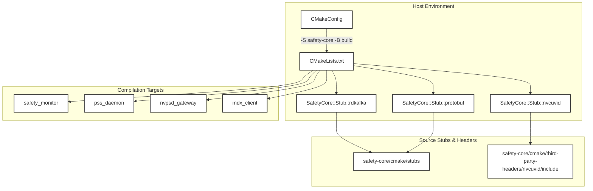
Sources: [safety-core/BUILD.md:28-36](), [safety-core/CMakeLists.txt:1-50]()

---

## CMake Build Execution (x86_64 and aarch64)

The build process is managed via CMake with configurable target architecture parameters (`SAFETY_CORE_TARGET_ARCH`) [safety-core/CMakeLists.txt:57-58]().

### Configuring and Building for x86_64
```sh
cmake -S safety-core -B safety-core/build-x86_64 \
  -DSAFETY_CORE_TARGET_ARCH=x86_64

cmake --build safety-core/build-x86_64 --parallel
```
Sources: [safety-core/BUILD.md:43-47]()

### Configuring and Building for ARM64/Tegra (Native or Cross-Compiled)
For native ARM64 hosts:
```sh
cmake -S safety-core -B safety-core/build-aarch64 \
  -DSAFETY_CORE_TARGET_ARCH=aarch64

cmake --build safety-core/build-aarch64 --parallel
```
Sources: [safety-core/BUILD.md:54-58]()

For cross-compilation from `x86_64` to `aarch64`:
```sh
cmake -S safety-core -B safety-core/build-aarch64 \
  -DSAFETY_CORE_TARGET_ARCH=aarch64 \
  -DCMAKE_TOOLCHAIN_FILE=safety-core/cmake/toolchains/aarch64-linux-gnu.cmake \
  -DSAFETY_CORE_ARM64_CUDA_TARGET_NAME=sbsa-linux

cmake --build safety-core/build-aarch64 --parallel
```
Sources: [safety-core/BUILD.md:63-69]()

Sources: [safety-core/BUILD.md:40-69](), [safety-core/CMakeLists.txt:57-82]()

---

## Packaging: Debian Packages and Docker Archives

Once compilation completes, packages and container archives are generated using dedicated CMake targets [safety-core/BUILD.md:73-146]().

### Packaging Targets and Output Artifacts

- **Debian Packages (`safety_core_debian`)**: Generates `.deb` and `.tar.gz` bundles for runtime deployment and development headers [safety-core/BUILD.md:78-100]().
  - `x86_64`: `psf-desktop.deb`, `psf-desktop-dev.deb`, `psf-desktop.tar.gz`, `psf-desktop-dev.tar.gz` [safety-core/BUILD.md:87-90]()
  - `aarch64`: `psf-tegra.deb`, `psf-tegra-dev.deb`, `psf-tegra.tar.gz`, `psf-tegra-dev.tar.gz` [safety-core/BUILD.md:96-99]()
- **Docker Image Archives (`safety_core_docker`)**: Builds container image archives (`.docker.tar`) using the generated Debian packages as inputs [safety-core/BUILD.md:104-125]().
  - Tags: `psf-desktop:latest` and `psf-tegra:latest` [safety-core/BUILD.md:130-132]()
- **Aggregate Package Target (`safety_core_package`)**: Builds both Debian packages and Docker archives in a single step [safety-core/BUILD.md:141-146]().

Sources: [safety-core/BUILD.md:73-146]()

### Packaged Runtime Layout

The runtime Debian package installs core binaries and configurations under `/opt/nvidia/psf`:
- `/opt/nvidia/psf/bin/safety_monitor` [safety-core/BUILD.md:203]()
- `/opt/nvidia/psf/bin/nv_perception_monitor` [safety-core/BUILD.md:204]()
- `/opt/nvidia/psf/bin/pss_daemon` [safety-core/BUILD.md:205]()
- `/opt/nvidia/psf/bin/nvpsd_gateway` [safety-core/BUILD.md:206]()
- `/opt/nvidia/psf/bin/launch_psf.sh` [safety-core/BUILD.md:207]()
- `/opt/nvidia/psf/apps/...` (Decision Maker SDMs and command receivers) [safety-core/BUILD.md:209-213]()

Sources: [safety-core/BUILD.md:198-213]()

### Diagram: Packaging and Artifact Generation Pipeline

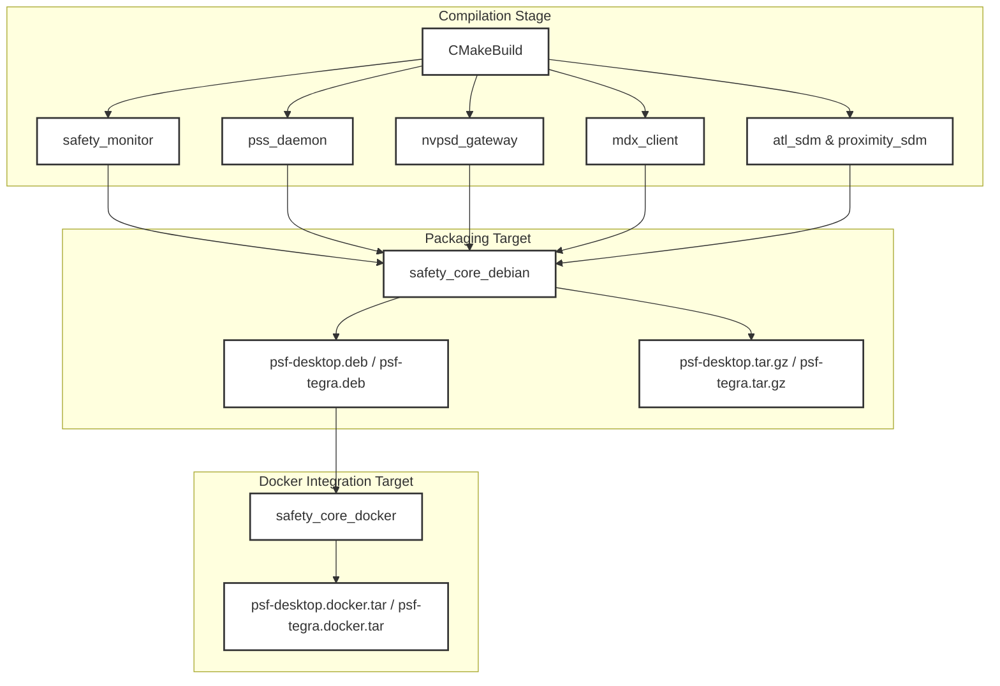
Sources: [safety-core/BUILD.md:73-146](), [safety-core/CMakeLists.txt:1-55]()

---

# Page: Safety Core Runtime Configuration

# Safety Core Runtime Configuration

<details>
<summary>Relevant source files</summary>

The following files were used as context for generating this wiki page:

- [closed-loop-testing/comm-layer/tests/test_atl_zones.py](closed-loop-testing/comm-layer/tests/test_atl_zones.py)
- [closed-loop-testing/safety-core/atl-dual-override.yaml](closed-loop-testing/safety-core/atl-dual-override.yaml)
- [closed-loop-testing/safety-core/atl-pxc-override.yaml](closed-loop-testing/safety-core/atl-pxc-override.yaml)
- [closed-loop-testing/safety-core/configs/atl_sdm.conf](closed-loop-testing/safety-core/configs/atl_sdm.conf)
- [closed-loop-testing/safety-core/configs/atl_sdm_zone2.conf](closed-loop-testing/safety-core/configs/atl_sdm_zone2.conf)
- [closed-loop-testing/safety-core/configs/nvpss.conf](closed-loop-testing/safety-core/configs/nvpss.conf)
- [closed-loop-testing/safety-core/configs/nvpss_bev.conf](closed-loop-testing/safety-core/configs/nvpss_bev.conf)
- [closed-loop-testing/safety-core/configs/proximity_event_mapping.pb.txt](closed-loop-testing/safety-core/configs/proximity_event_mapping.pb.txt)
- [closed-loop-testing/safety-core/configs/pxc_sdm.conf](closed-loop-testing/safety-core/configs/pxc_sdm.conf)
- [closed-loop-testing/safety-core/configs/sensor_group_config.conf](closed-loop-testing/safety-core/configs/sensor_group_config.conf)
- [closed-loop-testing/safety-core/configs/sensor_pipelines_config.conf](closed-loop-testing/safety-core/configs/sensor_pipelines_config.conf)
- [closed-loop-testing/safety-core/configs/sensor_pipelines_config_bev.conf](closed-loop-testing/safety-core/configs/sensor_pipelines_config_bev.conf)
- [closed-loop-testing/safety-core/safety-core.yml](closed-loop-testing/safety-core/safety-core.yml)
- [closed-loop-testing/safety-core/scripts/atl_pxc_entrypoint.sh](closed-loop-testing/safety-core/scripts/atl_pxc_entrypoint.sh)

</details>


This page details the runtime configuration architecture of the Safety Core (`safety-core`) within the Halos Outside-In Safety (HOISA) system. It covers the PSS daemon configurations (`nvpss.conf`, `nvpss_bev.conf`), sensor pipeline and group mappings, decision maker bindings (`atl_sdm.conf`, `pxc_sdm.conf`, `atl_sdm_zone2.conf`), and deployment override structures (`atl-pxc-override.yaml`, `atl-dual-override.yaml`, `atl_pxc_entrypoint.sh`).

---

## 1. PSS Daemon Configuration (`nvpss.conf` & `nvpss_bev.conf`)

The Perception and Safety Service (`pss`) daemon is controlled via configuration files that establish heartbeat fail-safes, retry budgets, staging queues, deployment topology modes, and event bypass rules.

### Configuration Parameters and Semantics

*   **Heartbeat & Fail-Safe Parameters:**
    *   `max_hb_failures`: Defines consecutive RPC heartbeat misses before triggering `SW_FAIL` and disconnecting [closed-loop-testing/safety-core/configs/nvpss.conf:4-6](). Valid range is `[1, 255]`, with an image default of `50`.
    *   `pss_to_psd_retry_budget` & `pss_to_psd_response_timeout_ms`: Controls delivery fail-safes. The product of retries and timeout must not exceed `6000` ms [closed-loop-testing/safety-core/configs/nvpss.conf:8-10]().
    *   `status_noop_interval_ms`: Sets the status/no-op `DecisionRequest` interval between `100` and `600000` ms [closed-loop-testing/safety-core/configs/nvpss.conf:12-13]().

*   **Queuing and Deployment Mode:**
    *   `psd_operational_queue_depth` & `psd_critical_queue_depth`: Staging queue depths for the decision gateway (`nvpsd`), sized between `8` and `512` [closed-loop-testing/safety-core/configs/nvpss.conf:15-18]().
    *   `deploymentMode`: Selects between `2D` (individual camera pipelines) and `3D` (Sparse4D BEV fused groups) [closed-loop-testing/safety-core/configs/nvpss.conf:20-23]().
    *   `enableFusion`: Toggles multi-camera event fusion [closed-loop-testing/safety-core/configs/nvpss.conf:25-26](). In 3D BEV configurations (`nvpss_bev.conf`), fusion is disabled (`enableFusion = false`) because the BEV application performs fusion upstream [closed-loop-testing/safety-core/configs/nvpss_bev.conf:33-36]().

*   **Time Windows and Event Bypassing:**
    *   `timeWindowSize`: Controls the temporal correlation window and STALE event threshold [closed-loop-testing/safety-core/configs/nvpss.conf:35-39](). SIL environments set this to `6000` ms (`6` seconds) to accommodate perception transport skew and prevent dropping tripwire events [closed-loop-testing/safety-core/configs/nvpss.conf:37-39]().
    *   `bypassFusionEvents`: Lists safety event types (such as `SW_FAIL`, `EVENT_0` through `EVENT_11`) that bypass fusion and route directly to decision makers [closed-loop-testing/safety-core/configs/nvpss.conf:63-87]().

```mermaid
graph TD
    sub5["nvpss.conf / nvpss_bev.conf"] -->|"deploymentMode = 2D"| sub6["nvpss_daemon (Fusion Enabled)"]
    sub5 -->|"deploymentMode = 3D"| sub7["nvpss_daemon (Fusion Disabled)"]
    sub6 --> sub8["atl_sdm / pxc_sdm"]
    sub7 --> sub8
```
*Figure 1: Configuration to PSS Daemon Runtime Flow.*

Sources: `closed-loop-testing/safety-core/configs/nvpss.conf`, `closed-loop-testing/safety-core/configs/nvpss_bev.conf`

---

## 2. Sensor Pipelines and Group Topologies

The mapping between physical sensors, processing pipelines, and logical safety groups is managed through dedicated configuration files mounted into the `safety-core` container.

### Pipeline Configuration Files

*   **`sensor_config.conf`**: Lists individual camera sensor pipelines (pipelines `1` through `3`) supplying raw frames or 2D detections.
*   **`sensor_pipelines_config.conf`**: Maps pipeline IDs to symbolic names used by the perception monitor (`PCM`) and safety AI monitor (`SAIM`).
*   **`sensor_group_config.conf`**: Defines logical groupings for 3D Sparse4D deployment [closed-loop-testing/safety-core/configs/sensor_group_config.conf:1-7]().
    *   Example entry: `4, bev-sensor-1, 1|2|3` defines a group with pipeline ID `4` named `bev-sensor-1` comprising member pipelines `1`, `2`, and `3` [closed-loop-testing/safety-core/configs/sensor_group_config.conf:7]().
*   **`sensor_pipelines_config_bev.conf`**: Exposes the BEV group (`bev-sensor-1`, pipeline `4`) to the decision makers instead of individual cameras [closed-loop-testing/safety-core/configs/sensor_pipelines_config_bev.conf:5-8]().

```mermaid
graph TD
    sub1["sensor_config.conf"] -->|"Pipelines 1, 2, 3"| sub2["SAIM / PCM Monitors"]
    sub1 -->|"Member Feeds"| sub3["sensor_group_config.conf"]
    sub3 -->|"Group ID 4 (bev-sensor-1)"| sub4["sensor_pipelines_config_bev.conf"]
    sub4 -->|"Exposed to SDM"| sub5["pxc_sdm"]
```
*Figure 2: Sensor Pipeline and Group Topology.*

Sources: `closed-loop-testing/safety-core/configs/sensor_config.conf`, `closed-loop-testing/safety-core/configs/sensor_pipelines_config_bev.conf`, `closed-loop-testing/safety-core/configs/sensor_group_config.conf`

---

## 3. Decision Maker Bindings (`atl_sdm`, `pxc_sdm`)

Safety Decision Makers (SDMs) require explicit configuration bindings to map event identifiers (`EVENT_0` through `EVENT_14`) to logical states and output codes.

### SDM Configuration Mappings

*   **`atl_sdm.conf` (Automatic Trailer Loading)**:
    Binds trailer-crossing and restricted-area violation events [closed-loop-testing/safety-core/configs/atl_sdm.conf:4-15]().
    ```ini
    forklift_entered = EVENT_0   # forklift tripwire OUT: entered the trailer
    forklift_exited  = EVENT_1   # forklift tripwire IN: left the trailer
    person_entered   = EVENT_2   # person tripwire OUT: entered the trailer
    person_exited    = EVENT_3   # person tripwire IN: left the trailer
    roi_violation    = EVENT_4   # a person is in the restricted area
    roi_cleared      = EVENT_5   # that violation cleared
    ```

*   **`atl_sdm_zone2.conf` (Dual-Zone ATL Extension)**:
    Binds secondary trailer bay events (`EVENT_6` through `EVENT_11`) used when running `--app atl_dual` [closed-loop-testing/safety-core/configs/atl_sdm_zone2.conf:4-14]().

*   **`proximity_event_mapping.pb.txt` (Proximity SDM)**:
    Defines social distancing tiers and distance thresholds mapping objects to proximity response events (`EVENT_12` through `EVENT_14`) [closed-loop-testing/safety-core/configs/proximity_event_mapping.pb.txt:31-62]().
    *   `d <= 2.0 m`: `EVENT_14` (`CMD_STOP`) [closed-loop-testing/safety-core/configs/proximity_event_mapping.pb.txt:53-61]()
    *   `2.0 < d <= 3.5 m`: `EVENT_13` (`CMD_REDUCE`) [closed-loop-testing/safety-core/configs/proximity_event_mapping.pb.txt:42-51]()
    *   `d > 3.5 m`: `EVENT_12` (`CMD_NORMAL`) [closed-loop-testing/safety-core/configs/proximity_event_mapping.pb.txt:31-40]()

Sources: `closed-loop-testing/safety-core/configs/atl_sdm.conf`, `closed-loop-testing/safety-core/configs/atl_sdm_zone2.conf`, `closed-loop-testing/safety-core/configs/proximity_event_mapping.pb.txt`

---

## 4. Override YAMLs and Entrypoint Scripts

Deployment profiles customize the base `safety-core.yml` compose stack using override files and specialized container entrypoints.

### Compose Overrides and Scripts

*   **`safety-core.yml`**: Base service definition configuring image volumes, network mode (`host`), and standard environment variables [closed-loop-testing/safety-core/safety-core.yml:1-37]().
*   **`atl-pxc-override.yaml`**: Combines ATL and Proximity applications (`--app atl,pxc`) into a single container instance [closed-loop-testing/safety-core/atl-pxc-override.yaml:1-34](). It utilizes `atl_pxc_entrypoint.sh` to merge protocol buffer event mappings [closed-loop-testing/safety-core/atl-pxc-override.yaml:22]().
*   **`atl_pxc_entrypoint.sh`**: Concatenates `event_mapping_atl.pb.txt` and `proximity_event_mapping.pb.txt` into `/tmp/event_mapping_atl_pxc.pb.txt` before executing the primary container entrypoint [closed-loop-testing/safety-core/scripts/atl_pxc_entrypoint.sh:14-25]().
*   **`atl-dual-override.yaml`**: Configures multi-zone ATL execution (`--app atl_dual`), binding secondary ports (`COMM_UDP_PORT_ZONE2`) and `atl_sdm_zone2.conf` [closed-loop-testing/safety-core/atl-dual-override.yaml:1-26]().

```mermaid
graph TD
    sub1["safety-core.yml"] -->|"Base Stack"| sub2["safety-core Container"]
    sub3["atl-pxc-override.yaml"] -->|"Entrypoint Script"| sub4["atl_pxc_entrypoint.sh"]
    sub4 -->|"Merges pb.txt"| sub5["/tmp/event_mapping_atl_pxc.pb.txt"]
    sub5 --> sub2
    sub6["atl-dual-override.yaml"] -->|"Dual Zone Binding"| sub2
```
*Figure 3: Override Stack and Entrypoint Data Flow.*

Sources: `closed-loop-testing/safety-core/safety-core.yml`, `closed-loop-testing/safety-core/atl-pxc-override.yaml`, `closed-loop-testing/safety-core/atl-dual-override.yaml`, `closed-loop-testing/safety-core/scripts/atl_pxc_entrypoint.sh`

---

# Page: Deployment and Profiles

# Deployment and Profiles

<details>
<summary>Relevant source files</summary>

The following files were used as context for generating this wiki page:

- [closed-loop-testing/scripts/setup.sh](closed-loop-testing/scripts/setup.sh)
- [deployments/profiles/base.env](deployments/profiles/base.env)
- [deployments/profiles/hil.env](deployments/profiles/hil.env)
- [deployments/profiles/sil.env](deployments/profiles/sil.env)
- [docs/deployment/index.mdx](docs/deployment/index.mdx)
- [docs/release-notes.mdx](docs/release-notes.mdx)

</details>


This section provides a high-level overview of the deployment profiles, environment variable configurations, setup automation scripts, and multi-node execution strategies for the Halos Outside-In Safety (HOISA) blueprint. HOISA supports multiple deployment topologies ranging from standalone Safety Core evaluation (`base`) and single-host software-in-the-loop simulation (`sil`) to distributed hardware-in-the-loop setups combining x86 stimulus hosts with NVIDIA IGX Thor safety targets (`hil`, `hil-thor`, `base-thor`).

For detailed implementation guides, step-by-step walkthroughs, and troubleshooting playbooks, refer to the respective child pages:
- [Profiles and Environment Configuration](#3.1)
- [SIL Deployment Walkthrough](#3.2)
- [HIL and Thor Deployment](#3.3)
- [Operations and Troubleshooting](#3.4)

---

## Deployment Architecture Overview

The deployment subsystem coordinates Docker Compose profiles, environment configuration files (`.env`), and preflight provisioning scripts located under `deployments/profiles/` and `closed-loop-testing/scripts/`.

```mermaid
graph TD
    subgraph "Environment Space"
        BaseEnv["deployments/profiles/base.env"]
        SilEnv["deployments/profiles/sil.env"]
        HilEnv["deployments/profiles/hil.env"]
        ThorEnv["deployments/profiles/hil-thor.env"]
    end

    subgraph "Provisioning Space"
        SetupScript["closed-loop-testing/scripts/setup.sh"]
    end

    subgraph "Container Orchestration"
        BaseProfile["COMPOSE_PROFILES=base"]
        SilProfile["COMPOSE_PROFILES=sil"]
        HilProfile["COMPOSE_PROFILES=hil"]
    end

    BaseEnv --> SetupScript
    SilEnv --> SetupScript
    HilEnv --> SetupScript
    
    BaseEnv --> BaseProfile
    SilEnv --> SilProfile
    HilEnv --> HilProfile
```
*Diagram 1: Natural Language Mapping from Environment Profiles to Compose Orchestration.*

Sources: `deployments/profiles/sil.env:1-92]`, `deployments/profiles/base.env:1-28]`, `deployments/profiles/hil.env:1-56]`, `closed-loop-testing/scripts/setup.sh:1-54]()`.

---

## 3.1. Profiles and Environment Configuration

Environment files define parameters for each deployment mode, including Docker image tags (`PSF_IMAGE`, `ISAAC_SIM_IMAGE`), ROS domain IDs (`ROS_DOMAIN_ID`), communication ports (`COMM_UDP_PORT`), and data mount paths (`MDX_DATA_DIR`). 

The provisioning script `closed-loop-testing/scripts/setup.sh` inspects the active `COMPOSE_PROFILES` string from the selected `.env` file to provision required directory structures conditionally (`psf-log`, `comm-layer`, `isaac-cache`) and validates container user permissions on NGC dataset extracts (`collected-assets`) [closed-loop-testing/scripts/setup.sh:44-146]().

For detailed variable breakdowns, preflight checks, and cleanup procedures, see [Profiles and Environment Configuration](#3.1).

Sources: `deployments/profiles/sil.env:1-92]`, `deployments/profiles/base.env:1-28]`, `deployments/profiles/hil.env:1-56]`, `closed-loop-testing/scripts/setup.sh:1-146]`.

---

## 3.2. SIL Deployment Walkthrough

Software-in-the-Loop (SIL) deployment integrates Isaac Sim, the ROS2 forklift controller, the communication layer, and the Safety Core (PSF) inside a self-contained single-host Docker Compose environment (`sil.env`) [deployments/profiles/sil.env:1-2](). Bring-up can be orchestrated via Jupyter notebooks (`deploy_hoisa_launchable.ipynb`) or directly through Docker Compose stacks utilizing VSS 2D/3D overrides and camera calibration parameters.

For step-by-step bring-up instructions and override configurations, see [SIL Deployment Walkthrough](#3.2).

Sources: `deployments/profiles/sil.env:1-92]`, `docs/deployment/index.mdx:1-40]`.

---

## 3.3. HIL and Thor Deployment

Hardware-in-the-Loop (HIL) deployments decouple simulation stimulus generation from safety decision enforcement across a dual-host topology. An x86 stimulus host runs Isaac Sim, the ROS2 controller, and the communication layer (`hil.env`), while an NVIDIA IGX Thor target executes the safety host stack (`hil-thor.env`, `launch_thor_safety.sh`) [deployments/profiles/hil.env:1-6](). Communication between hosts is mediated over UDP and REST APIs (`VST_BASE_URL`, `PERCEPTION_BASE_URL`) [deployments/profiles/hil.env:33-36]().

For network configurations, preflight validation scripts (`hil_preflight.sh`), and lifecycle scripts, see [HIL and Thor Deployment](#3.3).

Sources: `deployments/profiles/hil.env:1-56]`, `docs/deployment/index.mdx:33-38]`.

---

## 3.4. Operations and Troubleshooting

Runtime operations in HOISA environments can encounter specific failure modes, such as STALE event dropouts due to timestamp drift, zombie source bins lingering after unexpected container terminations, RTSP cold-start synchronization races, or corrupt VST sensor registries. Remediation scripts like `restart_isaac.sh`, VST sensor purges, and log inspection utilities (`pss.log`, `comm-layer`) help stabilize long-running test benches.

```mermaid
graph TD
    subgraph "Troubleshooting Space"
        StaleEvents["STALE_Events_Drop"]
        ZombieBins["Zombie_Source_Bins"]
        RtspRace["RTSP_Cold_Start_Race"]
        LogViewer["Log_Inspection_Tools"]
    end

    subgraph "Action / Remediation"
        RestartScript["restart_isaac.sh"]
        VstPurge["VST_Sensor_Purge"]
        PsfLogs["pss.log / pxc_sdm.log"]
    end

    StaleEvents --> PsfLogs
    ZombieBins --> VstPurge
    RtspRace --> RestartScript
    LogViewer --> PsfLogs
```
*Diagram 2: Troubleshooting Flow and Remediation Code References.*

For common failure symptoms, error codes, and diagnostic procedures, see [Operations and Troubleshooting](#3.4).

Sources: `deployments/profiles/sil.env:42-75]`, `docs/release-notes.mdx:51-70]`.

---

# Page: Profiles and Environment Configuration

# Profiles and Environment Configuration

<details>
<summary>Relevant source files</summary>

The following files were used as context for generating this wiki page:

- [closed-loop-testing/scripts/cleanup_all_datalog.sh](closed-loop-testing/scripts/cleanup_all_datalog.sh)
- [closed-loop-testing/scripts/launch_thor_safety.sh](closed-loop-testing/scripts/launch_thor_safety.sh)
- [closed-loop-testing/scripts/setup.sh](closed-loop-testing/scripts/setup.sh)
- [closed-loop-testing/scripts/stop_thor_safety.sh](closed-loop-testing/scripts/stop_thor_safety.sh)
- [deployments/profiles/base-thor.env](deployments/profiles/base-thor.env)
- [deployments/profiles/base.env](deployments/profiles/base.env)
- [deployments/profiles/hil-thor.env](deployments/profiles/hil-thor.env)
- [deployments/profiles/hil.env](deployments/profiles/hil.env)
- [deployments/profiles/sil.env](deployments/profiles/sil.env)
- [docs/reference/runtime-profile.mdx](docs/reference/runtime-profile.mdx)
- [skills/hoisa-deploy-profile/references/halos_thor.md](skills/hoisa-deploy-profile/references/halos_thor.md)
- [skills/hoisa-deploy-profile/references/prerequisites.md](skills/hoisa-deploy-profile/references/prerequisites.md)
- [skills/hoisa-deploy-profile/references/vss_hil_overrides.md](skills/hoisa-deploy-profile/references/vss_hil_overrides.md)

</details>


## Purpose and Scope
This section covers the runtime environment configuration files, deployment profiles, directory provisioning, log cleanup utilities, and preflight validation checks used across the HOISA (Halos Outside-In Safety) architecture. HOISA supports multiple deployment topologies ranging from standalone SIL (Software-in-the-Loop) simulations on x86 single hosts to distributed HIL (Hardware-in-the-Loop) configurations combining x86 simulation stimulus with NVIDIA IGX Thor safety hardware.

---

## 1. Profile Environment Files and Variables

HOISA defines five primary profile environment configurations located under `deployments/profiles/`:
* `base.env`: VSS Warehouse perception and Safety Core (PSF) only, rendering safety states via VST UI overlays [deployments/profiles/base.env:1-27]().
* `sil.env`: Self-contained x86 single-host SIL environment including Isaac Sim, Communication Layer, Forklift Controller, and Safety Core [deployments/profiles/sil.env:1-91]().
* `hil.env`: x86 stimulus host configuration for HIL deployments (Isaac Sim + comm-layer + controller), delegating safety processing to a remote Thor device [deployments/profiles/hil.env:1-55]().
* `base-thor.env`: IGX Thor hybrid deployment pairing VSS Warehouse with the Safety Core (`nv-psf` container + host binaries) for native edge safety [deployments/profiles/base-thor.env:1-27]().
* `hil-thor.env`: Thor safety-host side configuration for HIL, directing safety command sinks back to the remote x86 comm-layer [deployments/profiles/hil-thor.env:1-23]().

### Key Environment Variables Matrix

| Variable | Description | Target Profile(s) | Default / Example Value |
| :--- | :--- | :--- | :--- |
| `COMPOSE_PROFILES` | Selects active Docker Compose service groups | `base`, `sil`, `hil` | `base`, `sil`, `hil` [deployments/profiles/base.env:15](), [deployments/profiles/sil.env:4](), [deployments/profiles/hil.env:8]() |
| `SCENARIO` | Identifies simulation scenario configuration | `sil`, `hil` | `warehouse_20x20_1fl` [deployments/profiles/sil.env:15]() |
| `MDX_DATA_DIR` | Local root directory for cache, logs, and datasets | All profiles | `/path/to/sil-data` [deployments/profiles/sil.env:23]() |
| `COMM_UDP_PORT` | UDP port for safety command egress/ingress | `base`, `sil`, `hil` | `12345` (base) / `12346` (sil/hil) [deployments/profiles/base.env:20](), [deployments/profiles/sil.env:31]() |
| `PSF_IMAGE` | Safety Core container image reference | All profiles | `nvcr.io/nvidia/halos-outside-in/outside-in-safety:...` [deployments/profiles/sil.env:45]() |
| `PSF_LAUNCH_MODE` | Safety AI Monitor (SAIM) operation mode (`skip`, `learn`, `active`) | All profiles | `skip` or `active` [deployments/profiles/sil.env:46]() |
| `ROS_AUTOMATIC_DISCOVERY_RANGE` | CycloneDDS discovery scope (`LOCALHOST`, `SUBNET`, `OFF`) | `sil`, `hil` | `LOCALHOST` (single host) / `SUBNET` (HIL) [deployments/profiles/sil.env:91]() |

```mermaid
graph TD
    sub5["hil-thor.env"] -->|Read by| ScriptThor["closed-loop-testing/scripts/launch_thor_safety.sh"]
    sub4["base-thor.env"] -->|Read by| ScriptThor
    sub3["hil.env"] -->|Read by| ComposeHIL["Docker Compose (HIL x86)"]
    sub2["sil.env"] -->|Read by| ComposeSIL["Docker Compose (SIL)"]
    sub1["base.env"] -->|Read by| ComposeBase["Docker Compose (Base)"]

    ScriptThor -->|Invokes| LaunchHoisa["/opt/nvidia/psf/bin/launch_hoisa.sh"]
    ComposeBase -->|Mounts| PSFLogBase["psf-log/"]
    ComposeSIL -->|Mounts| PSFLogSIL["psf-log/ + comm-layer/ + isaac-cache/"]
    ComposeHIL -->|Mounts| CommHIL["comm-layer/ + isaac-cache/"]

    classDef default stroke:#000,stroke-width:1px,fill:none;
```
*Sources: [deployments/profiles/base.env:1-27](), [deployments/profiles/sil.env:1-91](), [deployments/profiles/hil.env:1-55](), [deployments/profiles/base-thor.env:1-27](), [deployments/profiles/hil-thor.env:1-23](), [closed-loop-testing/scripts/launch_thor_safety.sh:1-66]()*

---

## 2. Directory Provisioning (`setup.sh`)

The `setup.sh` utility provisions required data directories, log files, and cache structures based on the `COMPOSE_PROFILES` declared in the selected profile environment file [closed-loop-testing/scripts/setup.sh:1-54]().

### Implementation Details
* **Conditional Provisioning**: Inspects `COMPOSE_PROFILES` to determine whether PSF logs (`NEED_PSF`), communication layer logs (`NEED_COMM`), or Isaac Sim assets (`NEED_ISAAC`) should be created [closed-loop-testing/scripts/setup.sh:47-54]().
* **File vs Directory Bind-Mount Guard**: Docker automatically creates directories for missing bind-mount sources. Because Safety Core configuration files expect files (such as `pss.log`, `pxc_sdm.log`, and `atl_sdm.log`), `setup.sh` explicitly validates that these paths are not directories, unlinks or throws errors if misconfigured, and touches them as empty files with `777` permissions [closed-loop-testing/scripts/setup.sh:68-88]().
* **Isaac Sim Cache and Collected Assets**: Sets up omniverse cache subdirectories (`cache/ov`, `cache/warp`, `kit-cache`, `data`, `nvidia-omniverse`, `nv`), assigns `1234:1234` ownership, and verifies that `collected-assets` are readable by the container user [closed-loop-testing/scripts/setup.sh:99-146]().

```mermaid
graph TD
    Start([User runs setup.sh <profile>]) --> ReadEnv[Load environment file deployments/profiles/<profile>.env]
    ReadEnv --> ParseProfiles{Parse COMPOSE_PROFILES}
    
    ParseProfiles -->|base| GenBase[Create MDX_DATA_DIR & psf-log files]
    ParseProfiles -->|sil| GenSil[Create psf-log, comm-layer, isaac-cache, overlay dir]
    ParseProfiles -->|hil| GenHil[Create comm-layer & isaac-cache]

    GenBase --> CheckFiles[Validate bind mounts are files, not directories]
    GenSil --> CheckFiles
    GenHil --> CheckFiles

    CheckFiles --> TouchLogs[Touch pss.log, pxc_sdm.log, atl_sdm.log]
    TouchLogs --> ChownAssets[Verify and chown isaac-cache to UID/GID 1234]
    ChownAssets --> End([Setup Complete])

    classDef default stroke:#000,stroke-width:1px,fill:none;
```
*Sources: [closed-loop-testing/scripts/setup.sh:1-146]()*

---

## 3. Datalog Cleanup (`cleanup_all_datalog.sh`)

The `cleanup_all_datalog.sh` script purges per-run telemetry and log files while preserving active log inodes [closed-loop-testing/scripts/cleanup_all_datalog.sh:1-108]().

### Log Truncation Strategy
Deleting log files while containers are actively writing to them via `tee` unlinks the inode. The container continues writing to the unlinked sector, causing log files to permanently disappear from the mount point and breaking readiness checks (e.g., `opc_server.log`) [closed-loop-testing/scripts/cleanup_all_datalog.sh:60-65](). 
* `cleanup_all_datalog.sh` uses `sudo truncate -s 0` on known log files (`opc_server.log`, `ros_bridge.log`, `pss.log`, `pxc_sdm.log`, `atl_sdm.log`) to reset file sizes to zero without breaking active file descriptors [closed-loop-testing/scripts/cleanup_all_datalog.sh:60-88]().
* Non-essential transient files within `COMM_LOG_DIR` and `PSF_LOG_DIR` are purged using `sudo find` [closed-loop-testing/scripts/cleanup_all_datalog.sh:66-93]().

```mermaid
graph TD
    Entry([cleanup_all_datalog.sh <profile>]) --> LoadEnv[Source profile env & locate MDX_DATA_DIR]
    LoadEnv --> CleanComm[Clean Communication Layer Logs]
    
    CleanComm --> TruncateComm[Truncate opc_server.log & ros_bridge.log with truncate -s 0]
    TruncateComm --> FindComm[Delete other transient files in COMM_LOG_DIR]

    FindComm --> CleanPSF[Clean PSF Logs]
    CleanPSF --> TruncatePSF[Truncate pss.log, pxc_sdm.log, atl_sdm.log]
    TruncatePSF --> FindPSF[Delete other transient files in PSF_LOG_DIR]
    FindPSF --> Complete([Cleanup Successful])

    classDef default stroke:#000,stroke-width:1px,fill:none;
```
*Sources: [closed-loop-testing/scripts/cleanup_all_datalog.sh:1-108]()*

---

## 4. Preflight and Environment Validation Checks

Before executing any profile bring-up, system prerequisites must be validated against HOISA specifications [skills/hoisa-deploy-profile/references/prerequisites.md:1-182]().

### Preflight Verification Pipeline
1. **GPU & Driver Validation**: Queries `nvidia-smi` to ensure driver version `>= 580.95.05` and checks for RTX core availability and VRAM capacity (`>24 GB` for perception, RT-core support for Isaac Sim) [skills/hoisa-deploy-profile/references/prerequisites.md:14-51]().
2. **Docker & Container Toolkit**: Validates Docker version bounds (`28.3.3 <= Docker < 29.5.0` to avoid NGC repository format errors), Compose version `>= v2.39`, and checks the NVIDIA Container Toolkit runtime configuration (`nvidia-smi` execution inside a test container) [skills/hoisa-deploy-profile/references/prerequisites.md:54-101]().
3. **NGC CLI & Authentication**: Verifies NGC API key presence across environment variables, `~/.ngc/config`, or `~/.bashrc` without echoing plaintext keys, performing container registry authentication and resource manifest inspection [skills/hoisa-deploy-profile/references/prerequisites.md:103-182]().
4. **Thor Safety Host Launch**: For IGX Thor deployments, `launch_thor_safety.sh` performs preflight validation of host environment variables, checks executable permissions for `/opt/nvidia/psf/bin/launch_hoisa.sh`, verifies sensor config mapping, and spawns the hybrid stack [closed-loop-testing/scripts/launch_thor_safety.sh:1-66]().

```mermaid
graph TD
    PFStart([Start Preflight Validation]) --> GPUCheck[nvidia-smi Driver >= 580.95.05 & VRAM/RT Cores]
    GPUCheck --> DockerCheck[Docker 28.3.3+ and < 29.5.0]
    DockerCheck --> ToolkitCheck[NVIDIA Container Toolkit Runtime Check]
    ToolkitCheck --> NGCAuthCheck[NGC CLI Key Verification & Docker Login]
    NGCAuthCheck --> ResourceInspect[Inspect MDX_DATA_RESOURCE & Isaac Manifest]
    ResourceInspect --> PFFailure{Any Failure?}
    
    PFFailure -->|Yes| ReportError[Report specific failure and remediation path]
    PFFailure -->|No| PFSuccess([Preflight Passed — Ready for Setup & Bring-up])

    classDef default stroke:#000,stroke-width:1px,fill:none;
```
*Sources: [skills/hoisa-deploy-profile/references/prerequisites.md:1-182](), [closed-loop-testing/scripts/launch_thor_safety.sh:1-66]()*

---

# Page: SIL Deployment Walkthrough

# SIL Deployment Walkthrough

<details>
<summary>Relevant source files</summary>

The following files were used as context for generating this wiki page:

- [assets/sil_warehouse_architecture.png](assets/sil_warehouse_architecture.png)
- [closed-loop-testing/isaac-sim/sil/calibration/build_vss_calibration.py](closed-loop-testing/isaac-sim/sil/calibration/build_vss_calibration.py)
- [closed-loop-testing/isaac-sim/sil/calibration/warehouse_40x20/zones.yaml](closed-loop-testing/isaac-sim/sil/calibration/warehouse_40x20/zones.yaml)
- [deployments/scripts/deploy_hoisa_launchable.ipynb](deployments/scripts/deploy_hoisa_launchable.ipynb)
- [docs/reference/launcher.mdx](docs/reference/launcher.mdx)
- [docs/testing/hil/architecture.mdx](docs/testing/hil/architecture.mdx)
- [docs/testing/hil/quickstart.mdx](docs/testing/hil/quickstart.mdx)
- [docs/testing/sil/components/forklift-controller.mdx](docs/testing/sil/components/forklift-controller.mdx)
- [docs/testing/sil/sil-2d.mdx](docs/testing/sil/sil-2d.mdx)
- [docs/testing/sil/sil-3d.mdx](docs/testing/sil/sil-3d.mdx)
- [skills/hoisa-deploy-profile/references/halos_hil.md](skills/hoisa-deploy-profile/references/halos_hil.md)
- [skills/hoisa-deploy-profile/references/vss_2d_overrides.md](skills/hoisa-deploy-profile/references/vss_2d_overrides.md)
- [skills/hoisa-deploy-profile/references/vss_3d_overrides.md](skills/hoisa-deploy-profile/references/vss_3d_overrides.md)

</details>


Single-host software-in-the-loop (SIL) bring-up via `deploy_hoisa_launchable.ipynb` and compose stacks, VSS 2D/3D overrides, and calibration.

## Purpose and Scope

This section details the single-host Software-in-the-Loop (SIL) deployment architecture and execution steps for the Halos Outside-In Safety (HOISA) system. The SIL bring-up executes the complete closed safety loop on a single host across two distinct Docker Compose stacks: the VSS Warehouse perception backend stack and the Halos SIL stack (`safety-core`, `comm-layer`, `isaac-sim`, `forklift-controller`). This page covers automated notebook execution (`deployments/scripts/deploy_hoisa_launchable.ipynb`), 2D and 3D VSS profile overrides (`skills/hoisa-deploy-profile/references/vss_2d_overrides.md`, `skills/hoisa-deploy-profile/references/vss_3d_overrides.md`), and calibration dataset generation via `build_vss_calibration.py`.

Sources:
- `deployments/scripts/deploy_hoisa_launchable.ipynb:1-30`
- `skills/hoisa-deploy-profile/references/vss_2d_overrides.md:1-23`
- `skills/hoisa-deploy-profile/references/vss_3d_overrides.md:1-17`

---

## Single-Host SIL Bring-Up Flow and Stacks

The SIL deployment is orchestrated via the Jupyter notebook `deployments/scripts/deploy_hoisa_launchable.ipynb`, which coordinates prerequisite checks, NGC artifact retrieval, environment configuration, VSS overrides, perception bring-up, Halos safety core launch, and Isaac Sim scenario execution.

```mermaid
title "SIL Bring-Up and Two-Stack Architecture"
graph TD
    subgraph "Stack1_VSS_Warehouse"
        A["vss-rtvi-cv"] -->|Kafka mdx-events| B["Kafka_Broker"]
        C["vst_server"] -->|RTSP Stream over TCP| A
    end
    subgraph "Stack2_Halos_SIL"
        D["isaac-sim"] -->|RTSP :8554-8556| C
        D -->|/forklift_b/odom| E["forklift-controller"]
        E -->|/forklift_b/cmd_vel| D
        B -->|mdx-events| F["safety-core"]
        F -->|UDP 0xA5 Opcodes| G["comm-layer"]
        G -->|/safety/is_muted| D
    end
    H["deploy_hoisa_launchable.ipynb"] -->|Orchestrates| A
    H -->|Orchestrates| D
    H -->|Orchestrates| F
```

The bring-up sequence across the two compose stacks proceeds as follows:
1. **Stack 1 (VSS Warehouse 3.2.1/3.3.0)**: Pulled and deployed first with perception-specific overrides to establish the vision analytics and Kafka event bus `[deployments/scripts/deploy_hoisa_launchable.ipynb:16-16]()`.
2. **Stack 2 (Halos SIL)**: Deploys `safety-core` (PSF), `comm-layer` (UDP-to-ROS bridge), `isaac-sim`, and `forklift-controller` (ROS 2 waypoint driver with MUTE/UNMUTE actuation) `[deployments/scripts/deploy_hoisa_launchable.ipynb:17-17]()`.

Sources:
- `deployments/scripts/deploy_hoisa_launchable.ipynb:1-30`

---

## VSS Perception Backend Overrides (2D and 3D)

To integrate VSS perception with the Halos Safety Core during SIL execution, specific profile overrides must be applied to DeepStream configurations, VST settings, and environment files before invoking `docker compose up`.

| Configuration Layer | 2D Profile (`vss_2d_overrides.md`) | 3D Profile (`vss_3d_overrides.md`) |
| :--- | :--- | :--- |
| **VSS App Directory** | `warehouse-2d-app/` `[docs/testing/sil/sil-3d.mdx:21-25]()` | `warehouse-3d-app/` `[docs/testing/sil/sil-3d.mdx:21-25]()` |
| **Perception Engine** | RT-DETR detect + NvDCF track `[docs/testing/sil/sil-3d.mdx:21-25]()` | Sparse4D multi-view + BEV track `[docs/testing/sil/sil-3d.mdx:21-25]()` |
| **Compose Profiles** | `COMPOSE_PROFILES_WH_KAFKA_2D_MINIMAL` `[docs/testing/sil/sil-2d.mdx:82-90]()` | `COMPOSE_PROFILES_WH_KAFKA_3D_MINIMAL` `[skills/hoisa-deploy-profile/references/vss_3d_overrides.md:43-51]()` |
| **SEI Extraction** | Disabled (`# extract-sei-type5-data=1`) `[skills/hoisa-deploy-profile/references/vss_2d_overrides.md:91-100]()` | Disabled (Isaac Sim 6.1 wall-clock) `[skills/hoisa-deploy-profile/references/vss_3d_overrides.md:82-92]()` |
| **Streammux Timestamp** | `attach-sys-ts-as-ntp=1` `[skills/hoisa-deploy-profile/references/vss_2d_overrides.md:103-108]()` | `attach-sys-ts-as-ntp=1`, `sync-inputs-ntp=0` `[skills/hoisa-deploy-profile/references/vss_3d_overrides.md:93-105]()` |

```mermaid
title "Perception Override Code Entity Mapping"
graph TD
    subgraph "VSS_Configuration_Files"
        DS["ds-main-config.txt"] -->|Sets| T1["attach-sys-ts-as-ntp=1"]
        DS -->|Comments out| T2["extract-sei-type5-data=1"]
        VST["vst_config.json"] -->|Sets| V1["rtsp_streaming_over_tcp: true"]
        VST -->|Sets| V2["use_sensor_ntp_time: false"]
        VST -->|Sets| V3["bbox_tolerance_ms: 100"]
    end
    subgraph "Safety_Core_Behavior"
        PSF["nvpss.conf / nvpss_bev.conf"] -->|Consumes| K["Kafka mdx-events"]
        K -->|Prevents STALE drop| W["System Wall-Clock Timestamp"]
    end
    T1 -->|Synchronizes with| W
    V2 -->|Synchronizes with| W
```

### Key Override Parameters
- **SEI Extraction Off**: Isaac Sim RTSP embeds SEI sim-time data, but the Safety Core currently does not support sim-time timestamps. Disabling SEI extraction and forcing system wall-clock timestamps (`attach-sys-ts-as-ntp=1`) prevents the Safety Core from dropping perception events as `STALE` `[skills/hoisa-deploy-profile/references/vss_2d_overrides.md:18-22](), [skills/hoisa-deploy-profile/references/vss_3d_overrides.md:25-35]()`.
- **VST TCP Ingest**: Setting `rtsp_streaming_over_tcp: true` in `vst_config.json` ensures reliable ingestion of Isaac Sim's RTSP feeds without UDP packet loss or jitter `[skills/hoisa-deploy-profile/references/vss_2d_overrides.md:123-130]()`.

Sources:
- `skills/hoisa-deploy-profile/references/vss_2d_overrides.md:1-135`
- `skills/hoisa-deploy-profile/references/vss_3d_overrides.md:1-118`
- `docs/testing/sil/sil-2d.mdx:82-127`

---

## Calibration and Spatial Configuration

For custom SIL scenes, VSS calibration datasets containing homographies, camera intrinsic/extrinsic matrices, zones, regions of interest (ROIs), and tripwires are generated automatically via `closed-loop-testing/isaac-sim/sil/calibration/build_vss_calibration.py` `[closed-loop-testing/isaac-sim/sil/calibration/build_vss_calibration.py:4-19]()`.

```mermaid
title "Calibration Generation Code Entity Flow"
graph TD
    A["cameras.yaml"] -->|Camera Spawns| C["build_vss_calibration.py"]
    B["zones.yaml"] -->|Loading Zones| C
    D["waypoint-config.json"] -->|Scale & Origin| C
    C -->|Computes Homography & Projections| E["calibration.json"]
    C -->|Renders Top-Down Map| F["images/Top.png"]
    C -->|Metadata Output| G["images/imageMetadata.json"]
```

### Key Functions in `build_vss_calibration.py`
- `camera_to_world(spawn)`: Computes rotation and position matrices from USD camera spawns authored with `translate` and `rotateYXZ` `[closed-loop-testing/isaac-sim/sil/calibration/build_vss_calibration.py:44-49]()`.
- `euler_xyz_deg(rotation)`: Computes intrinsic XYZ rotation angles corresponding to the VSS `direction3d` convention `[closed-loop-testing/isaac-sim/sil/calibration/build_vss_calibration.py:52-57]()`.
- `sensor_entry(camera, scale, translation, rois, tripwires)`: Constructs the complete dictionary entry for a camera sensor, including intrinsic/extrinsic matrices, camera projection matrices, homography matrices, and bounding calibration polygons `[closed-loop-testing/isaac-sim/sil/calibration/build_vss_calibration.py:82-123]()`.
- `zone_roi(zone)` / `zone_tripwire(zone)`: Generates structured `roi-id-N` and `tripwire-id-N` rule definitions mapped to restricted object types (`Person`) and confined object types (`Forklift`) `[closed-loop-testing/isaac-sim/sil/calibration/build_vss_calibration.py:60-80]()`.

Sources:
- `closed-loop-testing/isaac-sim/sil/calibration/build_vss_calibration.py:1-158`

---

# Page: HIL and Thor Deployment

# HIL and Thor Deployment

<details>
<summary>Relevant source files</summary>

The following files were used as context for generating this wiki page:

- [closed-loop-testing/hil/README.md](closed-loop-testing/hil/README.md)
- [closed-loop-testing/scripts/hil_preflight.sh](closed-loop-testing/scripts/hil_preflight.sh)
- [closed-loop-testing/scripts/launch_thor_safety.sh](closed-loop-testing/scripts/launch_thor_safety.sh)
- [closed-loop-testing/scripts/stop_thor_safety.sh](closed-loop-testing/scripts/stop_thor_safety.sh)
- [deployments/profiles/base-thor.env](deployments/profiles/base-thor.env)
- [deployments/profiles/hil-thor.env](deployments/profiles/hil-thor.env)
- [docs/reference/launcher.mdx](docs/reference/launcher.mdx)
- [docs/testing/hil/architecture.mdx](docs/testing/hil/architecture.mdx)
- [docs/testing/hil/quickstart.mdx](docs/testing/hil/quickstart.mdx)
- [docs/testing/sil/components/forklift-controller.mdx](docs/testing/sil/components/forklift-controller.mdx)
- [docs/testing/sil/sil-2d.mdx](docs/testing/sil/sil-2d.mdx)
- [docs/testing/sil/sil-3d.mdx](docs/testing/sil/sil-3d.mdx)
- [skills/hoisa-deploy-profile/references/halos_thor.md](skills/hoisa-deploy-profile/references/halos_thor.md)
- [skills/hoisa-deploy-profile/references/prerequisites.md](skills/hoisa-deploy-profile/references/prerequisites.md)
- [skills/hoisa-deploy-profile/references/vss_hil_overrides.md](skills/hoisa-deploy-profile/references/vss_hil_overrides.md)

</details>


## Purpose and Scope

This section covers the dual-host Hardware-in-the-Loop (HIL) deployment architecture for the Halos Outside-In Safety (HOISA) framework. The deployment distributes workload across two distinct machines: an x86 stimulus host running NVIDIA Isaac Sim, the communication layer, and the forklift controller; and an NVIDIA IGX Thor safety host running the Video Search and Summarization (VSS) perception stack and the Safety Core (`nv-psf` container combined with host-side Safety Decision Maker binaries). This page details environment configuration (`hil.env` and `hil-thor.env`), host-side launcher scripts (`launch_thor_safety.sh`), VSS HIL perception overrides, preflight checks (`hil_preflight.sh`), and cross-host networking requirements.

---

## 1. Dual-Host Architecture and Environment Configuration

The HIL topology separates the simulation-and-stimulus execution plane from the safety-critical perception-and-decision plane. The x86 stimulus host executes the physical simulation and streams camera feeds via RTSP, while the IGX Thor device processes video streams through deep learning perception modules and executes safety logic via host-side application cores.

```mermaid
graph TD
    subgraph "X86StimulusHost"
        IS["IsaacSimContainer"] -->|RTSP:8554-8556| VST["VSSVISTor"]
        CL["CommLayerContainer"] -->|UDP:12346| SDM["atl_sdm"]
    end
    subgraph "IGXThorSafetyHost"
        VST -->|LocalStream| DS["DeepStreamPerception"]
        DS -->|Kafkamdx-events| PSF["nv-psfContainer"]
        PSF -->|DecisionRequest| SDM
    end
    SDM -->|Acknowledge0xA2| CL
    
    classDef default fill:#fff,stroke:#000,stroke-width:1px;
```
*Title: Dual-Host HIL System Architecture and Data Flows*

Configuration is split into two environment files: `deployments/profiles/hil.env` for the x86 side and `deployments/profiles/hil-thor.env` for the safety host side [deployments/profiles/hil-thor.env:1-12](). 

The IGX Thor configuration file (`hil-thor.env`) specifies core parameters including the target application core placement (`SDM_TARGET=ccplex`), operational mode (`PSF_LAUNCH_MODE=skip` or `active`), Kafka broker address (`KAFKA_BROKER=localhost:9092`), and the command routing sink pointing back to the x86 communication layer (`PSF_CMD_RX_IP` and `PSF_CMD_RX_PORT=12346`) [deployments/profiles/hil-thor.env:10-23]().

Sources:
- `deployments/profiles/hil-thor.env:1-24`
- `docs/testing/hil/architecture.mdx:1-84`

---

## 2. Thor Safety Core Orchestration Scripts

On the IGX Thor device, the Safety Core operates via a hybrid architecture. Instead of deploying entirely within Docker Compose, the system orchestrates an `nv-psf` container alongside native host binaries (`atl_sdm`, `safety_monitor`) via `launch_thor_safety.sh` and `launch_hoisa.sh` [skills/hoisa-deploy-profile/references/halos_thor.md:10-16]().

```mermaid
graph TD
    LTS["launch_thor_safety.sh"] -->|ReadsEnv| HENV["hil-thor.env"]
    LTS -->|Executes| LHOISA["launch_hoisa.sh"]
    LHOISA -->|Spawns| CONTAINER["nv-psfContainer"]
    LHOISA -->|Spawns| BINARY["atl_sdm Host Binary"]
    CONTAINER -->|UDP/UnixSocket| BINARY
    
    classDef default fill:#fff,stroke:#000,stroke-width:1px;
```
*Title: Thor Safety Core Launch Sequence (`launch_thor_safety.sh`)*

The `launch_thor_safety.sh` script validates environment variables such as `HOST_IP`, `PSF_IMAGE`, `PSF_CMD_RX_IP`, `PSF_CMD_RX_PORT`, and `PSF_SENSOR_CONFIG` [closed-loop-testing/scripts/launch_thor_safety.sh:33-40](). It checks for the presence of the Tegra host package launcher at `/opt/nvidia/psf/bin/launch_hoisa.sh` and verifies the sensor configuration template path [closed-loop-testing/scripts/launch_thor_safety.sh:41-45](). Upon passing checks, it executes `launch_hoisa.sh` with appropriate arguments for the ATL application profile [closed-loop-testing/scripts/launch_thor_safety.sh:60-66]().

Sources:
- `closed-loop-testing/scripts/launch_thor_safety.sh:1-67`
- `skills/hoisa-deploy-profile/references/halos_thor.md:1-134`

---

## 3. VSS Warehouse HIL Overrides and Perception Pipeline

For the `hil` profile, VSS Warehouse runs on the IGX Thor safety host and ingests camera streams published by the remote x86 stimulus host [skills/hoisa-deploy-profile/references/vss_hil_overrides.md:1-4](). 

Remote stream URLs must reference the x86 host IP rather than `localhost`:
```text
rtsp://<x86_host_ip>:8554/camera
rtsp://<x86_host_ip>:8555/camera_01
rtsp://<x86_host_ip>:8556/camera_02
```
[skills/hoisa-deploy-profile/references/vss_hil_overrides.md:5-13]()

Sensor registration supports two exclusive modes: configuration file mode (`SENSOR_INFO_SOURCE=file`) where the VST service reads `camera_info.json`, or Isaac-side registration where Isaac Sim pushes sensor metadata directly to the VST API [skills/hoisa-deploy-profile/references/vss_hil_overrides.md:16-41](). File mode requires that Isaac Sim streams are active and delivering frames *before* VSS is deployed to avoid cold-start DESCRIBE race conditions [skills/hoisa-deploy-profile/references/vss_hil_overrides.md:36-39]().

Sources:
- `skills/hoisa-deploy-profile/references/vss_hil_overrides.md:1-59`

---

## 4. Preflight Verification (`hil_preflight.sh`) and Networking

Before initiating a HIL run, the two-host environment must be validated using `hil_preflight.sh` from the x86 stimulus host [docs/testing/hil/quickstart.mdx:118-123]().

```bash
bash ../closed-loop-testing/scripts/hil_preflight.sh profiles/hil.env --thor <user>@<THOR_IP>
```

The preflight tool checks SSH reachability, repository checkout consistency, environment variable configuration, clock skew between hosts, and network port availability [docs/testing/hil/quickstart.mdx:124-128]().

### Network Ports and Protocols

| Port / Range | Protocol | Listener | Connector | Role |
| --- | --- | --- | --- | --- |
| `8554`, `8555`, `8556` | RTSP over TCP | `isaac-sim` (x86) | VST (IGX Thor) | Camera stream transmission |
| `12346` | UDP | `comm-layer` (x86) | SDM (IGX Thor) | Safety command communication (`0xA2` packets) |
| `4840` | OPC UA over TCP | `comm-layer` (x86) | External clients / Health check | State reporting and readiness gate |
| `30888` | HTTP | VST (IGX Thor) | x86 host | VST API and sensor management |
| `22` | SSH over TCP | IGX Thor | x86 host | Orchestration and preflight control |

[docs/testing/hil/architecture.mdx:48-61]()

The communication layer on the x86 host binds UDP port `12346` and acknowledges safety packets using a 64-byte protocol frame identified by magic byte `0xA2` [docs/testing/hil/architecture.mdx:27-72](). The IGX Thor safety host requires inbound rules allowing TCP `8554`-`8556` and outbound rules to reach the x86 communication layer on UDP `12346` [docs/testing/hil/architecture.mdx:64]().

Sources:
- `docs/testing/hil/architecture.mdx:1-169`
- `docs/testing/hil/quickstart.mdx:1-403`

---

# Page: Operations and Troubleshooting

# Operations and Troubleshooting

<details>
<summary>Relevant source files</summary>

The following files were used as context for generating this wiki page:

- [closed-loop-testing/scripts/restart_isaac.sh](closed-loop-testing/scripts/restart_isaac.sh)
- [docs/deployment/troubleshooting.mdx](docs/deployment/troubleshooting.mdx)
- [docs/reference/log-viewer.mdx](docs/reference/log-viewer.mdx)
- [skills/hoisa-deploy-profile/SKILL.md](skills/hoisa-deploy-profile/SKILL.md)
- [skills/hoisa-deploy-profile/references/halos_deploy.md](skills/hoisa-deploy-profile/references/halos_deploy.md)
- [skills/hoisa-deploy-profile/references/test_scenario.md](skills/hoisa-deploy-profile/references/test_scenario.md)
- [skills/hoisa-deploy-profile/references/troubleshooting.md](skills/hoisa-deploy-profile/references/troubleshooting.md)

</details>


## Purpose and Scope

This page outlines operational runbooks, common failure modes, diagnostic strategies, and recovery tooling for the Halos Outside-In Safety (HOISA) closed-loop architecture. It covers real-time safety pipeline anomalies such as `STALE` event flooding, RTSP cold-start descriptor races, VST sensor lifecycle management, automated container recovery via `restart_isaac.sh`, and log inspection using `pss_log_viewer`.

---

## 1. Common Failure Modes and Pipeline Anomalies

### STALE Events in Safety Core (PSF)

During continuous operation, the safety engine (`nvpss_daemon`) drops incoming perception events that exceed its configured temporal horizon. 

* **Symptom**: Safety Core logs flood with messages like `Dropping STALE event`, and safety decisions lag or fail to trigger [skills/hoisa-deploy-profile/references/troubleshooting.md:27-29]().
* **Expected Behavior**: A small baseline of `STALE` events during startup/bootstrap before Isaac streams stabilize is normal. Persistent high rates during steady-state execution indicate underlying perception-to-Kafka-to-PSF pipeline latency [skills/hoisa-deploy-profile/references/troubleshooting.md:31-34].
* **Root Cause**: Pipeline latency exceeding `timeWindowSize` (default configured as `6000` ms in SIL `nvpss.conf` with a code fallback of `200` ms), heavy GPU contention, or missing DeepStream SEI timestamp overrides. Without `attach-sys-ts-as-ntp=1` in the DeepStream stream-muxer config, frames lack proper wall-clock NTP timestamps, causing nearly all events to be classified as stale [skills/hoisa-deploy-profile/references/troubleshooting.md:31-39].
* **Remediation**: 
  1. Verify the DeepStream SEI override is applied to ensure system timestamps are attached.
  2. Increase `timeWindowSize` in `closed-loop-testing/safety-core/configs/nvpss.conf` [skills/hoisa-deploy-profile/references/troubleshooting.md:41-47].

Sources: `skills/hoisa-deploy-profile/references/troubleshooting.md:27-49`

### RTSP Cold-Start Races and Zombie Source Bins

When restarting Isaac Sim on heavy scenes, perception clients may fail to ingest self-hosted RTSP streams, leaving DeepStream stuck at `Active sources : 0` with errors indicating `stream has no caps` or `could not create SDP` [skills/hoisa-deploy-profile/references/troubleshooting.md:119-125].

* **Root Cause**: Isaac Sim self-hosts RTSP streams in-process (one server per camera). Two primary triggers cause caps negotiation failure:
  1. *Cold pre-roll*: The RTX renderer and encoder pre-roll are slow on cold starts; the RTSP server accepts clients before the encoder produces its first frame [skills/hoisa-deploy-profile/references/troubleshooting.md:130-135].
  2. *Concurrent DESCRIBE race*: VST (`vss-vios-streamprocessing`) DESCRIBEs each registered sensor eagerly on separate threads. When multiple clients issue simultaneous `DESCRIBE` commands during a cold server bind window, caps negotiation fails across all streams [skills/hoisa-deploy-profile/references/troubleshooting.md:135-140].
* **Impact**: A client experiencing DESCRIBE-churn on wedged media will not self-recover. Clearing the condition requires a warm render state combined with halted stream churn [skills/hoisa-deploy-profile/references/troubleshooting.md:143-147].

Sources: `skills/hoisa-deploy-profile/references/troubleshooting.md:110-164`

### Diagram: RTSP Cold-Start Race Architecture

```mermaid
graph TD
    subgraph NaturalLanguageSpace["Natural Language Space"]
        A["Cold Isaac Sim Boot"] --> B["Simultaneous VST DESCRIBE Threads"]
        B --> C["RTSP Caps Negotiation Failure"]
        C --> D["DeepStream Active Sources 0 / Zombie Bin"]
    end

    subgraph CodeEntitySpace["Code Entity Space"]
        E["isaac-sim"] -->| "In-Process RTSP Server (:8554-:8556)" | F["vss-vios-streamprocessing"]
        F -->| "Concurrent DESCRIBE Race" | G["vss-rtvi-cv"]
        G -->| "Stream Caps Drop" | H["nvpss_daemon"]
    end

    NaturalLanguageSpace -.-> CodeEntitySpace
```

Sources: `skills/hoisa-deploy-profile/references/troubleshooting.md:110-164`, `skills/hoisa-deploy-profile/references/test_scenario.md:85-110`

---

## 2. Isaac Sim Recovery Automation (`restart_isaac.sh`)

To recover from RTSP wedging or restart simulation scenarios on a live SIL stack without recreating container state, the `restart_isaac.sh` script automates the orchestration sequence [closed-loop-testing/scripts/restart_isaac.sh:5-16].

### Orchestration Workflow

1. **Driver Argument Resolution**: Inspects the running container (`isaac-sim`) via `ps` to extract CLI arguments used by `run_actor_sdg.py` [closed-loop-testing/scripts/restart_isaac.sh:41-55].
2. **Camera Configuration Parsing**: Resolves camera ports and mount paths from `cameras.yaml` mapped via `scenarios.yaml` [closed-loop-testing/scripts/restart_isaac.sh:57-77].
3. **VST Pause (Churn Elimination)**: Stops the `vss-vios-streamprocessing` container to eliminate concurrent `DESCRIBE` requests while retaining the underlying database sensor registry [closed-loop-testing/scripts/restart_isaac.sh:78-81].
4. **Driver Relaunch**: Kills existing instances of `run_actor_sdg.py` inside `isaac-sim` and restarts the SDG runner script [closed-loop-testing/scripts/restart_isaac.sh:82-88].
5. **Encoder Warm-Up Probing**: Iterates over RTSP endpoints using `ffprobe` until all camera mounts successfully deliver H.264 streams [closed-loop-testing/scripts/restart_isaac.sh:90-110].
6. **VST & DeepStream Resumption**: Restarts `vss-vios-streamprocessing` so its re-connection requests hit a warm, stable RTSP server, followed by validation of DeepStream sensor states [closed-loop-testing/scripts/restart_isaac.sh:111-143].

Sources: `closed-loop-testing/scripts/restart_isaac.sh:1-143`

### Diagram: `restart_isaac.sh` Execution Flow

```mermaid
graph TD
    subgraph NaturalLanguageSpace["Natural Language Space"]
        Start["Trigger restart_isaac.sh"] --> StopVST["Pause VST Stream Processing"]
        StopVST --> KillSim["Kill and Restart SDG Driver"]
        KillSim --> ProbeRTSP["Probe RTSP Ports via ffprobe"]
        ProbeRTSP --> ResumeVST["Resume VST and Sync DeepStream"]
    end

    subgraph CodeEntitySpace["Code Entity Space"]
        Start -->| "Exec Script" | Script["restart_isaac.sh"]
        Script -->| "Docker Stop" | VST["vss-vios-streamprocessing"]
        Script -->| "Kill/Restart" | SDG["run_actor_sdg.py in isaac-sim"]
        SDG -->| "Stream H264" | FFProbe["ffprobe -rtsp_transport tcp"]
        FFProbe -->| "Warm Confirmed" | VSTStart["docker start vss-vios-streamprocessing"]
        VSTStart -->| "Re-register Sensors" | DS["vss-rtvi-cv"]
    end

    NaturalLanguageSpace -.-> CodeEntitySpace
```

Sources: `closed-loop-testing/scripts/restart_isaac.sh:1-143`

---

## 3. Real-Time Log Analysis (`pss_log_viewer`)

`pss_log_viewer` is a self-contained, browser-based diagnostic dashboard designed for real-time aggregation and inspection of Safety Core log files [docs/reference/log-viewer.mdx:1-10].

### Core Properties and Features

| Property | Details |
| --- | --- |
| **Packaging** | Self-contained binary with all runtime dependencies bundled [docs/reference/log-viewer.mdx:13-15] |
| **Live Updates** | Near real-time log ingestion via Linux `inotify` [docs/reference/log-viewer.mdx:16] |
| **File Capacity** | Up to 2 independent log files merged into a unified dashboard [docs/reference/log-viewer.mdx:17] |
| **Default Port** | `8080` (configurable via `--port`) [docs/reference/log-viewer.mdx:18] |

* **Dashboard Tabs**: Component-specific views featuring error metrics, event counters, and interactive timeline charts [docs/reference/log-viewer.mdx:22].
* **Filtering & Search**: Free-text search, severity toggles, and sliding timestamp range filters [docs/reference/log-viewer.mdx:23].
* **AI Debug Integration**: Enables natural-language queries against live log states by connecting to any LLM endpoint implementing the Chat Completions API [docs/reference/log-viewer.mdx:26,58-63].

### Command Usage

```bash
# Single log file inspection (default port 8080)
./pss_log_viewer /var/log/psf/psf.log

# Merge two log files into a single timeline (e.g. SEI/Gateway + Decision Maker)
./pss_log_viewer /var/log/psf/psf.log /var/log/psf/atl_sdm.log

# Bind to a custom port and load only the last N lines on startup
./pss_log_viewer /var/log/psf/psf.log --port 9090 --last 50000
```

### AI Debug Environment Variables

To query log state using an external LLM provider, export the following variables prior to execution:

```bash
export PSS_AI_BASE_URL=<your-llm-endpoint-url>
export PSS_AI_MODEL=<your-model-name>
export PSS_AI_API_KEY=<your-api-key>
./pss_log_viewer /var/log/psf/psf.log
```

Sources: `docs/reference/log-viewer.mdx:1-96`

---

# Page: Closed-Loop Simulation (Isaac Sim SIL)

# Closed-Loop Simulation (Isaac Sim SIL)

<details>
<summary>Relevant source files</summary>

The following files were used as context for generating this wiki page:

- [closed-loop-testing/forklift-controller/docker_run.sh](closed-loop-testing/forklift-controller/docker_run.sh)
- [closed-loop-testing/forklift-controller/forklift-controller.yml](closed-loop-testing/forklift-controller/forklift-controller.yml)
- [closed-loop-testing/forklift-controller/launch_controller.sh](closed-loop-testing/forklift-controller/launch_controller.sh)
- [closed-loop-testing/isaac-sim/isaac-sim.yml](closed-loop-testing/isaac-sim/isaac-sim.yml)
- [closed-loop-testing/isaac-sim/sil/configs/scenarios.yaml](closed-loop-testing/isaac-sim/sil/configs/scenarios.yaml)
- [docs/testing/sil/architecture.mdx](docs/testing/sil/architecture.mdx)
- [docs/testing/sil/overview.mdx](docs/testing/sil/overview.mdx)

</details>


The closed-loop simulation harness leverages NVIDIA Isaac Sim to establish a Software-in-the-Loop (SIL) environment. This harness replaces physical warehouses, forklifts, and cameras with virtual counterparts while running production-grade AI perception, safety logic, and communication layers. 

For comprehensive details on specific subsystems, consult the child pages:
- [Simulation Runner and Scenario Configuration](#4.1)
- [Action Graphs and Robot Fleet Configuration](#4.2)
- [Cameras, RTSP and VST Sensor Registration](#4.3)
- [Post-Processing Anomaly Injection](#4.4)
- [Warehouse Scenes and Waypoints](#4.5)

---

## Simulation Harness Architecture

The simulation harness bridges abstract simulation concepts to concrete code entities within the `closed-loop-testing/isaac-sim/` and `closed-loop-testing/forklift-controller/` directories.

```mermaid
graph TD
    subgraph "Natural Language Space"
      SimRunner["Simulation Runner"]
      FleetConfig["Robot Fleet Config"]
      CameraReg["Camera Registration"]
      AnomalyInj["Post-Processing Injection"]
      SceneWorld["Warehouse Scenes"]
    end

    subgraph "Code Entity Space"
      ActorSDG["ActorSDGRunner / run_actor_sdg.py"]
      RobotsYAML["robots.yaml / robots-40x20.yaml"]
      CamLoader["cameras.yaml / camera_loader"]
      PostCtrl["PostProcessingController"]
      USDScene["default_config_ros.yaml / default_config_ros_40x20.yaml"]
    end

    SimRunner --> ActorSDG
    FleetConfig --> RobotsYAML
    CameraReg --> CamLoader
    AnomalyInj --> PostCtrl
    SceneWorld --> USDScene
```
Sources: `closed-loop-testing/isaac-sim/isaac-sim.yml:1-63`, `closed-loop-testing/isaac-sim/sil/configs/scenarios.yaml:1-29`, `docs/testing/sil/architecture.mdx:1-142`

---

## 4.1. Simulation Runner and Scenario Configuration

The simulation lifecycle is governed by entrypoint scripts and configuration manifests that orchestrate Isaac Replicator Agents (IRA), digital humans, and scenario parameters. Scenarios link specific warehouse USD configurations, camera layouts, and robot fleets into a unified execution context.

For a thorough breakdown of runner lifecycles, configuration files, runtime patches, and indicator loaders, refer to [Simulation Runner and Scenario Configuration](#4.1).

Sources: `closed-loop-testing/isaac-sim/sil/configs/scenarios.yaml:1-29`, `docs/testing/sil/architecture.mdx:1-142`

---

## 4.2. Action Graphs and Robot Fleet Configuration

Robots within the simulation are instantiated dynamically via fleet configuration files (`robots.yaml` and `robots-40x20.yaml`). Omniverse Action Graphs construct the runtime control loops, handling kinematics, odometry publishing, safety indicators, and proximity lines for each forklift instance.

```mermaid
graph TD
    subgraph "Fleet & Control Entities"
      FleetFile["robots.yaml / robots-40x20.yaml"]
      GraphBuilder["forklift_common.build_forklift_graphs"]
      CtrlNode["/forklift_b/cmd_vel"]
      OdomNode["/forklift_b/odom"]
    end

    FleetFile --> GraphBuilder
    GraphBuilder --> CtrlNode
    GraphBuilder --> OdomNode
```
Sources: `closed-loop-testing/forklift-controller/forklift-controller.yml:1-51`, `docs/testing/sil/architecture.mdx:1-28`

For details on graph construction, fleet parameters, and extension patterns, see [Action Graphs and Robot Fleet Configuration](#4.2).

---

## 4.3. Cameras, RTSP and VST Sensor Registration

Camera nodes and RTSP streaming pipelines provide the visual data consumed by the VSS perception stack. The simulation self-hosts RTSP streams in-process and auto-registers sensors using configuration descriptors and registration managers.

For implementation specifics regarding encoding, decoding, and VST registration, see [Cameras, RTSP and VST Sensor Registration](#4.3).

Sources: `docs/testing/sil/architecture.mdx:1-25`, `docs/testing/sil/overview.mdx:1-145`

---

## 4.4. Post-Processing Anomaly Injection

To test system resilience against perception failures and edge cases, the simulation harness integrates a post-processing controller. This controller manages allow-listed effects, presets, spatial scopes, and targeted anomalies defined within configuration presets.

For details on effect definitions, scoping rules, and automated testing hooks, see [Post-Processing Anomaly Injection](#4.4).

Sources: `docs/testing/sil/overview.mdx:1-69`

---

## 4.5. Warehouse Scenes and Waypoints

Physical layouts are defined by USD warehouse scenes (such as the 20x20m and 40x20m two-dock configurations). Navigation and motion planning rely on JSON waypoint files mapped per scenario and vehicle, paired with calibration zones required by perception modules.

```mermaid
graph LR
    subgraph "Scene Mapping Space"
      USDSceneFile["USD Warehouse Scene"]
      WaypointJSON["waypoint JSON Files"]
      CalibrationZone["Calibration Zones"]
    end

    subgraph "Execution Target"
      Controller["forklift-controller.py"]
      SimEnv["Isaac Sim Container"]
    end

    USDSceneFile --> SimEnv
    WaypointJSON --> Controller
    CalibrationZone --> SimEnv
```
Sources: `closed-loop-testing/forklift-controller/launch_controller.sh:1-60`, `closed-loop-testing/isaac-sim/sil/configs/scenarios.yaml:1-29`

For complete mapping schemas, coordinate spaces, and waypoint generation guides, see [Warehouse Scenes and Waypoints](#4.5).

---

# Page: Simulation Runner and Scenario Configuration

# Simulation Runner and Scenario Configuration

<details>
<summary>Relevant source files</summary>

The following files were used as context for generating this wiki page:

- [.gitignore](.gitignore)
- [closed-loop-testing/isaac-sim/sil/scenes/indicator_warehouse_20x20_layout_overflow_test.usd](closed-loop-testing/isaac-sim/sil/scenes/indicator_warehouse_20x20_layout_overflow_test.usd)
- [closed-loop-testing/isaac-sim/sil/scripts/action_graphs/srr_ground_truth.py](closed-loop-testing/isaac-sim/sil/scripts/action_graphs/srr_ground_truth.py)
- [closed-loop-testing/isaac-sim/sil/scripts/forklift_overlay.py](closed-loop-testing/isaac-sim/sil/scripts/forklift_overlay.py)
- [closed-loop-testing/isaac-sim/sil/scripts/indicator_loader.py](closed-loop-testing/isaac-sim/sil/scripts/indicator_loader.py)
- [closed-loop-testing/isaac-sim/sil/scripts/run_actor_sdg.py](closed-loop-testing/isaac-sim/sil/scripts/run_actor_sdg.py)
- [closed-loop-testing/isaac-sim/sil/scripts/runtime_patches/README.md](closed-loop-testing/isaac-sim/sil/scripts/runtime_patches/README.md)
- [closed-loop-testing/isaac-sim/sil/scripts/runtime_patches/halos_runtime_patches.py](closed-loop-testing/isaac-sim/sil/scripts/runtime_patches/halos_runtime_patches.py)
- [closed-loop-testing/isaac-sim/sil/scripts/runtime_patches/scene_component_isolation.py](closed-loop-testing/isaac-sim/sil/scripts/runtime_patches/scene_component_isolation.py)
- [closed-loop-testing/regression-reporter/halos-integration/default_config_ros.yaml.template](closed-loop-testing/regression-reporter/halos-integration/default_config_ros.yaml.template)
- [docs/testing/sil/components/isaac-sim.mdx](docs/testing/sil/components/isaac-sim.mdx)

</details>


## Purpose and Scope
This page details the core simulation runner and configuration architecture for the Halos Outside-In Safety (HOISA) Software-in-the-Loop (SIL) environment. It covers the `ActorSDGRunner` lifecycle [closed-loop-testing/isaac-sim/sil/scripts/run_actor_sdg.py:43] running on Isaac Sim 6.1, the Replicator Agent (IRA) scene configuration (`default_config_ros.yaml`), scenario mappings (`scenarios.yaml`), runtime USD stage patches (`halos_runtime_patches.py`), procedural forklift overlays (`forklift_overlay.py`), and safety indicator generation (`indicator_loader.py`).

---

## 1. `ActorSDGRunner` Lifecycle and Execution Flow

The simulation driver is encapsulated by the `ActorSDGRunner` class (`run_actor_sdg.py`). It orchestrates the Isaac Sim application initialization, Replicator Agent setup, procedural asset overlay, runtime stage modifications, and VST (Video Streaming Toolkit) camera warmup.

### Lifecycle Sequence

```mermaid
graph TD
    subgraph "Initialization Phase"
        A[SimulationApp] --> B[ActorSDGRunner.__init__]
        B --> C[SimulationManager.get_instance]
    end

    subgraph "Setup Phase"
        C --> D[setup_simulation async]
        D --> E[SET_UP_SIMULATION_DONE_EVENT Callback]
    end

    subgraph "Runtime Application Phase"
        E --> F[apply_halos_runtime_patches]
        F --> G[build_forklift_graphs & indicator_loader]
        G --> H[VST Sensor Warmup & Timeline Play]
    end

    style A fill:none,stroke:#000,stroke-width:1px
    style D fill:none,stroke:#000,stroke-width:1px
    style E fill:none,stroke:#000,stroke-width:1px
    style H fill:none,stroke:#000,stroke-width:1px
```

*Natural Language to Code Entity Mapping:*
* **Driver Entrypoint**: `run_actor_sdg.py` [closed-loop-testing/isaac-sim/sil/scripts/run_actor_sdg.py:4]
* **Runner Class**: `ActorSDGRunner` [closed-loop-testing/isaac-sim/sil/scripts/run_actor_sdg.py:43]
* **Singleton Manager**: `SimulationManager.get_instance()` [closed-loop-testing/isaac-sim/sil/scripts/run_actor_sdg.py:10]
* **Runtime Patches Callback**: `apply_halos_runtime_patches()` [closed-loop-testing/isaac-sim/sil/scripts/runtime_patches/halos_runtime_patches.py]

Sources: [closed-loop-testing/isaac-sim/sil/scripts/run_actor_sdg.py:1-138]()

---

## 2. Scenario and Configuration Schema

Simulation runs are governed by a collection of YAML configuration files located in `/isaac-sim/sil/configs/`. These files decouple scene definitions, robot fleets, camera placements, and behavior trees from the core simulation executable.

### Configuration Hierarchy
* `scenarios.yaml`: Maps high-level scenario IDs (e.g., `warehouse_20x20_1fl`) to specific IRA configs, robot fleet YAMLs, camera definitions, and waypoint directories [docs/testing/sil/components/isaac-sim.mdx:37-49].
* `default_config_ros.yaml`: Replicator Agent 1.7.0 configuration schema defining simulation duration, base USD stage path, character groups, and ceiling camera target generation ranges [closed-loop-testing/regression-reporter/halos-integration/default_config_ros.yaml.template:48-123].
* `robots.yaml`: Describes the robot fleet, articulation prim paths, spawn poses, and control/odometry Action Graphs.

```yaml
isaacsim.replicator.agent:
  version: 1.7.0
  seed: 42
  simulation_duration: 300.0
  environment:
    base_stage_asset_path: /isaac-sim/sil/scenes/indicator_warehouse_20x20_layout_overflow_test.usd
  character:
    root_prim_path: /World/Characters
    motion_library_path: Isaac/People/MotionLibrary/HumanMotionLibrary.usd
    groups:
      inspect_workers:
        num: 1
        asset_path: Isaac/People/Characters/
        behavior_tree: /isaac-sim/sil/configs/inspect_loop.bt.json
```

Sources: [closed-loop-testing/regression-reporter/halos-integration/default_config_ros.yaml.template:1-122](), [docs/testing/sil/components/isaac-sim.mdx:1-125]()

---

## 3. Runtime Stage Modifications (`halos_runtime_patches.py`)

Because Replicator Agent 6.1 initializes agents dynamically without deterministic USD spawn attributes for characters, Halos applies a post-setup stage patch (`apply_halos_runtime_patches`) immediately after `setup_simulation()` completes [closed-loop-testing/isaac-sim/sil/scripts/runtime_patches/halos_runtime_patches.py:5-17].

### Patch Operations
1. **Character Repositioning**: Moves IRA-spawned pedestrians (`/World/Characters/<group>/<group>_0`) from NavMesh-randomized positions to canonical scenario spawn coordinates (e.g., `inspect_workers_0` to `(2.26, -10.30, 0.00)`) [closed-loop-testing/isaac-sim/sil/scripts/runtime_patches/halos_runtime_patches.py:10-16].
2. **PhysX TGS Re-balancing**: Clamps forklift articulation TGS velocity iterations to `4` (migrating excess velocity iterations to position iterations) to preserve Isaac Sim 5.1 baseline dynamics under PhysX 5.3 [closed-loop-testing/isaac-sim/sil/scripts/runtime_patches/halos_runtime_patches.py:62-74].

```mermaid
graph TD
    A[SET_UP_SIMULATION_DONE_EVENT] --> B[apply_halos_runtime_patches]
    B --> C[_reposition_characters]
    B --> D[_rebalance_tgs_iterations]
    C --> E[Translate Inspect/Gather/Pickup Prims]
    D --> F[Clamp TGS Velocity Iters to 4]

    style A fill:none,stroke:#000,stroke-width:1px
    style B fill:none,stroke:#000,stroke-width:1px
    style C fill:none,stroke:#000,stroke-width:1px
    style D fill:none,stroke:#000,stroke-width:1px
```

Sources: [closed-loop-testing/isaac-sim/sil/scripts/runtime_patches/halos_runtime_patches.py:1-137]()

---

## 4. Forklift Overlay and Indicator Loader

To avoid modifying tracked warehouse USD scene files when adding or repositioning robots, asset placement is handled procedurally at startup.

### Forklift Overlay (`forklift_overlay.py`)
`forklift_overlay.py` reads `robots.yaml`, parses `spawn:` configuration blocks (asset path, position, yaw angle, scale), and generates an ephemeral sublayer (`.overlay.usda`) under `scenes/generated/` before the primary stage opens [closed-loop-testing/isaac-sim/sil/scripts/forklift_overlay.py:3-44]. This keeps warehouse geometry purely static while allowing dynamic fleet composition.

### Indicator Loader (`indicator_loader.py`)
Safety-indicator discs are procedurally generated by `indicator_loader.py` to match the configuration specified under `robots.yaml` [closed-loop-testing/isaac-sim/sil/scripts/indicator_loader.py:3-8].

```mermaid
graph TD
    subgraph "Configuration Inputs"
        A[robots.yaml] -->|spawn block| B[forklift_overlay.py]
        A[safety_indicator.mesh block] -->|radius & segments| C[indicator_loader.py]
    end

    subgraph "Stage Authoring"
        B -->|writes sublayer| D[scenes/generated/overlay.usda]
        C -->|authors triangle fan| E[Live USD Stage Prim]
    end

    style A fill:none,stroke:#000,stroke-width:1px
    style B fill:none,stroke:#000,stroke-width:1px
    style C fill:none,stroke:#000,stroke-width:1px
    style D fill:none,stroke:#000,stroke-width:1px
    style E fill:none,stroke:#000,stroke-width:1px
```

Sources: [closed-loop-testing/isaac-sim/sil/scripts/forklift_overlay.py:1-150](), [closed-loop-testing/isaac-sim/sil/scripts/indicator_loader.py:1-152]()

---

# Page: Action Graphs and Robot Fleet Configuration

# Action Graphs and Robot Fleet Configuration

<details>
<summary>Relevant source files</summary>

The following files were used as context for generating this wiki page:

- [closed-loop-testing/forklift-controller/fleet_config.py](closed-loop-testing/forklift-controller/fleet_config.py)
- [closed-loop-testing/forklift-controller/proximity_gate.py](closed-loop-testing/forklift-controller/proximity_gate.py)
- [closed-loop-testing/forklift-controller/test/test_proximity_gate.py](closed-loop-testing/forklift-controller/test/test_proximity_gate.py)
- [closed-loop-testing/isaac-sim/sil/configs/robots-40x20.yaml](closed-loop-testing/isaac-sim/sil/configs/robots-40x20.yaml)
- [closed-loop-testing/isaac-sim/sil/configs/robots.yaml](closed-loop-testing/isaac-sim/sil/configs/robots.yaml)
- [closed-loop-testing/isaac-sim/sil/scripts/action_graphs/README.md](closed-loop-testing/isaac-sim/sil/scripts/action_graphs/README.md)
- [closed-loop-testing/isaac-sim/sil/scripts/action_graphs/__init__.py](closed-loop-testing/isaac-sim/sil/scripts/action_graphs/__init__.py)
- [closed-loop-testing/isaac-sim/sil/scripts/action_graphs/forklift_common.py](closed-loop-testing/isaac-sim/sil/scripts/action_graphs/forklift_common.py)
- [closed-loop-testing/isaac-sim/sil/scripts/action_graphs/forklift_control.py](closed-loop-testing/isaac-sim/sil/scripts/action_graphs/forklift_control.py)
- [closed-loop-testing/isaac-sim/sil/scripts/action_graphs/forklift_odometry.py](closed-loop-testing/isaac-sim/sil/scripts/action_graphs/forklift_odometry.py)
- [closed-loop-testing/isaac-sim/sil/scripts/action_graphs/forklift_safety_indicator.py](closed-loop-testing/isaac-sim/sil/scripts/action_graphs/forklift_safety_indicator.py)
- [closed-loop-testing/isaac-sim/sil/scripts/action_graphs/proximity_line.py](closed-loop-testing/isaac-sim/sil/scripts/action_graphs/proximity_line.py)
- [deployments/scripts/preflight.py](deployments/scripts/preflight.py)
- [docs/testing/sil/extending-the-fleet.mdx](docs/testing/sil/extending-the-fleet.mdx)

</details>


## Purpose and Scope

This page details the architecture of robot fleet configurations and OmniGraph Action Graph builders used in the Halos Outside-In Safety (HOISA) Software-in-the-Loop (SIL) simulation environment. It covers the schema definitions for `robots.yaml` and `robots-40x20.yaml`, the orchestrator function `build_forklift_graphs()` inside `forklift_common.py`, the specialized OmniGraph modules (`forklift_control.py`, `forklift_odometry.py`, `forklift_safety_indicator.py`, and `proximity_line.py`), and the end-to-end workflow for extending the robot fleet.

---

## 1. Fleet Configuration Schemas (`robots.yaml` & `robots-40x20.yaml`)

Robot and fleet topologies are defined externally via declarative YAML schemas rather than hardcoded into USD stage assets. The default single-robot profile uses `robots.yaml`, while multi-robot variants (such as the two-dock setup) use `robots-40x20.yaml` [closed-loop-testing/isaac-sim/sil/configs/robots.yaml:1-16](), [closed-loop-testing/isaac-sim/sil/configs/robots-40x20.yaml:1-16]().

### Configuration Structure
Each configuration file contains three core blocks:
1. **`scene`**: Defines the target USD asset path loaded by Isaac Sim [closed-loop-testing/isaac-sim/sil/configs/robots.yaml:28](), [closed-loop-testing/isaac-sim/sil/configs/robots-40x20.yaml:57]().
2. **`models`**: Defines asset-coupled parameters shared by all instances of a specific robot model (e.g., `forklift_b`), including asset S3/Omniverse paths, drive type kinematics (`swivel`), wheel radii, wheelbases, steering limits, and safety indicator mesh specifications [closed-loop-testing/isaac-sim/sil/configs/robots.yaml:34-79](), [closed-loop-testing/isaac-sim/sil/configs/robots-40x20.yaml:67-112]().
3. **`robots`**: An array of instance configurations. Each instance overrides or inherits model parameters and defines specific simulation properties such as `articulation_prim`, controller `drive` settings, `spawn` coordinates (position and yaw), and `proximity` watchdog parameters [closed-loop-testing/isaac-sim/sil/configs/robots.yaml:80-123]().

```mermaid
graph TD
    sub-yaml["robots.yaml / robots-40x20.yaml"] -->|scene| SceneUSD["sil/scenes/*.usd"]
    sub-yaml -->|models| ModelBlock["models: forklift_b (wheelbase, drive_type, asset_path)"]
    sub-yaml -->|robots| RobotInstance["robots: [name: forklift_b, articulation_prim, spawn, proximity]"]
    ModelBlock -->|merged via _apply_model()| RobotInstance
    RobotInstance -->|loaded by| Loader["forklift_common.load_and_validate_robots_yaml()"]

    style sub-yaml fill:#f9f,stroke:#333,stroke-width:2px
    style Loader fill:#bbf,stroke:#333,stroke-width:2px
```

Sources: `[closed-loop-testing/isaac-sim/sil/configs/robots.yaml:1-123]()`, `[closed-loop-testing/isaac-sim/sil/configs/robots-40x20.yaml:1-119]`, `[closed-loop-testing/isaac-sim/sil/scripts/action_graphs/forklift_common.py:1-160]()`.

---

## 2. Action Graph Builders and Orchestrator (`forklift_common.py`)

Rather than relying on baked-in Action Graphs within the USD scene, runtime Python builders in `closed-loop-testing/isaac-sim/sil/scripts/action_graphs/` construct graphs dynamically upon simulation startup [closed-loop-testing/isaac-sim/sil/scripts/action_graphs/README.md:54-55]().

### Orchestration and Prims Stripping
The orchestrator entry point `build_forklift_graphs()` (defined in `forklift_common.py`) coordinates the build pipeline:
1. **`strip_baked_scene_graphs()`**: Removes legacy static graphs (such as `/World/ActionGraph`, `/World/ROS_Forklift_Control_Graph`, and `/World/Odometry_Graph`) from the loaded USD stage to prevent duplicate execution or state collision [closed-loop-testing/isaac-sim/sil/scripts/action_graphs/forklift_common.py:27-45]().
2. **YAML Validation**: Loads and validates `robots.yaml` via `load_and_validate_robots_yaml()`, folding instance parameters over model defaults using `_apply_model()` [closed-loop-testing/isaac-sim/sil/scripts/action_graphs/forklift_common.py:139-158]().
3. **Graph Generation**: Invokes specialized builders for control, odometry, and safety indicators per robot entry.

```mermaid
graph TD
    Start["run_actor_sdg.py setup-done callback"] -->|calls| BuildGraphs["build_forklift_graphs(config_path)"]
    BuildGraphs -->|invokes| Strip["strip_baked_scene_graphs()"]
    Strip -->|deletes static prims| USDStage["USD Stage"]
    BuildGraphs -->|parses YAML| LoadYAML["load_and_validate_robots_yaml()"]
    LoadYAML -->|iterates robots| Loop[For each robot in fleet]
    Loop -->|calls| Ctrl["build_control_graph()"]
    Loop -->|calls| Odom["build_odometry_graph()"]
    Loop -->|calls| Ind["build_safety_graph()"]

    style BuildGraphs fill:#f9f,stroke:#333,stroke-width:2px
    style USDStage fill:#bbf,stroke:#333,stroke-width:2px
```

Sources: `[closed-loop-testing/isaac-sim/sil/scripts/action_graphs/forklift_common.py:1-160]()`, `[closed-loop-testing/isaac-sim/sil/scripts/action_graphs/README.md:1-55]()`.

---

## 3. Specialized Robot Action Graphs

### Control Graph (`forklift_control.py`)
`build_control_graph()` replaces the legacy baked control graph by subscribing to `/cmd_vel` (`geometry_msgs/Twist`) and driving the robot's articulation joints via an embedded script node executing Swivel Inverse Kinematics [closed-loop-testing/isaac-sim/sil/scripts/action_graphs/forklift_control.py:3-45]().
* **Key Nodes**: `OnPlaybackTick`, `ROS2Context`, `SubscribeTwist`, `SwivelIK` (OgnScriptNode), and `IsaacArticulationController` [closed-loop-testing/isaac-sim/sil/scripts/action_graphs/forklift_control.py:121-127]().
* **Kinematics**: Computes steering angles and drive wheel velocities based on wheelbase, wheel radius, and maximum steering limits, respecting reverse logic flag configurations [closed-loop-testing/isaac-sim/sil/scripts/action_graphs/forklift_control.py:43-80]().

### Odometry Graph (`forklift_odometry.py`)
`build_odometry_graph()` generates `/World/<name>_OdometryGraph` instances that compute and publish robot odometry and transform trees [closed-loop-testing/isaac-sim/sil/scripts/action_graphs/forklift_odometry.py:3-39]().
* **Key Nodes**: `IsaacComputeOdometry`, `ROS2PublishOdometry`, and `ROS2PublishRawTransformTree` [closed-loop-testing/isaac-sim/sil/scripts/action_graphs/forklift_odometry.py:68-74]().
* **Topic & Frame Resolution**: Ensures unique association of chassis primitives and prevents TF parent-frame collisions across multi-robot fleets [closed-loop-testing/isaac-sim/sil/scripts/action_graphs/forklift_odometry.py:46-136]().

### Safety Indicator Graph (`forklift_safety_indicator.py`)
`build_safety_graph()` dynamically creates indicator graphs (`/World/<name>_SafetyGraph`) that update the display color of safety disc meshes based on safety state subscriptions (`/<name>/safety/is_muted` or `/<name>/proximity/state`) [closed-loop-testing/isaac-sim/sil/scripts/action_graphs/forklift_safety_indicator.py:3-40]().
* **Sources**: Supports `mute` (ATL mode, green when muted), `proximity` (PXC mode, green/orange/red depending on proximity state), or `both` [closed-loop-testing/isaac-sim/sil/scripts/action_graphs/forklift_safety_indicator.py:5-18]().

### Proximity Line Graph (`proximity_line.py`)
When opted in via `robots.yaml` (`proximity_line: {enabled: true}`), `build_proximity_line()` subscribes to `/safety/proximity/pair` and visualizes proximity pairs and separation distances directly on the simulation floor [closed-loop-testing/isaac-sim/sil/scripts/action_graphs/proximity_line.py:3-14]().

```mermaid
graph LR
    SubTwist["ROS2SubscribeTwist"] -->|linear/angular velocity| Swivel["SwivelIK (ScriptNode)"]
    Swivel -->|position/velocity commands| ArtCtrl["IsaacArticulationController"]
    ArtCtrl --> Articulation["Robot Articulation Prims"]

    OdomComp["IsaacComputeOdometry"] -->|pose & velocities| PubOdom["ROS2PublishOdometry"]
    OdomComp -->|transform matrix| PubTF["ROS2PublishRawTransformTree"]

    SubMute["ROS2Subscriber (/is_muted)"] --> IndScript["Safety ScriptNode"]
    SubProx["ROS2Subscriber (/proximity/state)"] --> IndScript
    IndScript -->|DisplayColorAttr| SafetyDisc["Safety Indicator Mesh"]

    style Swivel fill:#f9f,stroke:#333,stroke-width:2px
    style IndScript fill:#f9f,stroke:#333,stroke-width:2px
    style SafetyDisc fill:#bbf,stroke:#333,stroke-width:2px
```

Sources: `[closed-loop-testing/isaac-sim/sil/scripts/action_graphs/forklift_control.py:1-160]`, `[closed-loop-testing/isaac-sim/sil/scripts/action_graphs/forklift_odometry.py:1-145]`, `[closed-loop-testing/isaac-sim/sil/scripts/action_graphs/forklift_safety_indicator.py:1-168]`, `[closed-loop-testing/isaac-sim/sil/scripts/action_graphs/proximity_line.py:1-181]()`.

---

## 4. Extending the Fleet

Adding a new robot instance or fleet variant involves configuring YAML definitions and verifying consistency across containers:
1. **Update Fleet YAML**: Add a new robot block under `robots:` in `robots.yaml` or `robots-40x20.yaml`, ensuring unique `name` and `articulation_prim` attributes [closed-loop-testing/isaac-sim/sil/configs/robots.yaml:80-123](), [closed-loop-testing/isaac-sim/sil/configs/robots-40x20.yaml:1-119]().
2. **Configure Controller Service**: Provision a corresponding controller container profile (e.g., adding `multi-robot` compose profiles for container `forklift-controller-b2`) [closed-loop-testing/isaac-sim/sil/configs/robots-40x20.yaml:15-16]().
3. **Run Preflight Verification**: Execute `preflight.py` from the host to validate consistency between the fleet configuration, controller services, and waypoint files before launching simulation containers [deployments/scripts/preflight.py:30-59]().

```bash
python3 deployments/scripts/preflight.py --robots-config closed-loop-testing/isaac-sim/sil/configs/robots-40x20.yaml
```

Sources: `[closed-loop-testing/isaac-sim/sil/configs/robots-40x20.yaml:1-50]`, `[deployments/scripts/preflight.py:1-154]()`.

---

# Page: Cameras, RTSP and VST Sensor Registration

# Cameras, RTSP and VST Sensor Registration

<details>
<summary>Relevant source files</summary>

The following files were used as context for generating this wiki page:

- [closed-loop-testing/isaac-sim/Dockerfile](closed-loop-testing/isaac-sim/Dockerfile)
- [closed-loop-testing/isaac-sim/sil/configs/cameras-40x20.yaml](closed-loop-testing/isaac-sim/sil/configs/cameras-40x20.yaml)
- [closed-loop-testing/isaac-sim/sil/configs/cameras.yaml](closed-loop-testing/isaac-sim/sil/configs/cameras.yaml)
- [closed-loop-testing/isaac-sim/sil/configs/default_config_ros.yaml](closed-loop-testing/isaac-sim/sil/configs/default_config_ros.yaml)
- [closed-loop-testing/isaac-sim/sil/configs/default_config_ros_40x20.yaml](closed-loop-testing/isaac-sim/sil/configs/default_config_ros_40x20.yaml)
- [closed-loop-testing/isaac-sim/sil/scripts/action_graphs/rtsp_cameras.py](closed-loop-testing/isaac-sim/sil/scripts/action_graphs/rtsp_cameras.py)
- [closed-loop-testing/isaac-sim/sil/scripts/camera_loader.py](closed-loop-testing/isaac-sim/sil/scripts/camera_loader.py)
- [closed-loop-testing/isaac-sim/sil/scripts/rtsp/sei_decode.py](closed-loop-testing/isaac-sim/sil/scripts/rtsp/sei_decode.py)
- [closed-loop-testing/isaac-sim/sil/scripts/test_vst_sensor_manager_config.py](closed-loop-testing/isaac-sim/sil/scripts/test_vst_sensor_manager_config.py)
- [closed-loop-testing/isaac-sim/sil/scripts/vst_sensor_manager.py](closed-loop-testing/isaac-sim/sil/scripts/vst_sensor_manager.py)
- [docs/reference/sei-configuration.mdx](docs/reference/sei-configuration.mdx)

</details>


## Purpose and Scope
This page details the camera configuration schema, dynamic prim generation, RTSP multi-camera streaming pipelines, H.264 SEI metadata injection and decoding, and the Video Storage Toolkit (VST) sensor registration lifecycle within Halos Outside-In Safety (HOISA). It bridges Isaac Sim 6.1 simulation output with perception services (`vss`) and the safety engine (`safety-core`).

Sources:
- `closed-loop-testing/isaac-sim/sil/configs/cameras.yaml:1-50` ()
- `closed-loop-testing/isaac-sim/sil/scripts/camera_loader.py:1-49` ()
- `closed-loop-testing/isaac-sim/sil/scripts/action_graphs/rtsp_cameras.py:1-36` ()
- `closed-loop-testing/isaac-sim/sil/scripts/vst_sensor_manager.py:1-20` ()

## 1. Camera Configuration Schema (`cameras.yaml`)
Camera deployment in Isaac Sim 6.1 uses `cameras.yaml`, replacing the legacy `mediamtx` broker with per-camera in-process RTSP streaming servers. 

Key attributes in `cameras.yaml` [closed-loop-testing/isaac-sim/sil/configs/cameras.yaml:1-52]():
- `scene`: Restricts configuration application to specified warehouse USD stages, validated by `camera_loader.assert_scene_matches()` [closed-loop-testing/isaac-sim/sil/configs/cameras.yaml:32-37]().
- `cameras`: Array of camera definitions containing:
  - `name`: Display name used by VST [closed-loop-testing/isaac-sim/sil/configs/cameras.yaml:8]()
  - `camera_prim`: USD prim path on the stage [closed-loop-testing/isaac-sim/sil/configs/cameras.yaml:11]()
  - `port`: Unique TCP port for the in-process RTSP server (e.g., `8554`, `8555`, `8556`) [closed-loop-testing/isaac-sim/sil/configs/cameras.yaml:9]()
  - `mount_path`: URL suffix starting with `/` [closed-loop-testing/isaac-sim/sil/configs/cameras.yaml:10]()
  - `spawn`: Optional world-space transform and intrinsic parameters for dynamic prim loading [closed-loop-testing/isaac-sim/sil/configs/cameras.yaml:12-21]().
- `rtsp.host`: Host IP address string used by `vst_sensor_manager.py` to construct endpoints [closed-loop-testing/isaac-sim/sil/configs/cameras.yaml:49-52]().

```mermaid
graph TD
    YAML["cameras.yaml"] --> SC["assert_scene_matches()"]
    YAML --> CUST["cameras List"]
    CUST --> C1["Camera: port 8554, /camera"]
    CUST --> C2["Camera_01: port 8555, /camera_01"]
    CUST --> C3["Camera_02: port 8556, /camera_02"]
    C1 --> VSM["VSTSensorManager"]
    C2 --> VSM
    C3 --> VSM
```
*Diagram 1: Configuration flow from `cameras.yaml` to `VSTSensorManager`.*

Sources:
- `closed-loop-testing/isaac-sim/sil/configs/cameras.yaml:1-92` ()
- `closed-loop-testing/isaac-sim/sil/scripts/camera_loader.py:90-136` ()

## 2. Dynamic Camera Loading (`camera_loader.py`)
To decouple camera poses from static scene USDs, `camera_loader.py` dynamically spawns camera prims at startup.

Key functions and validation flows:
- `_load_cameras_yaml(yaml_path)`: Reads and parses the YAML configuration [closed-loop-testing/isaac-sim/sil/scripts/camera_loader.py:83-88]().
- `assert_scene_matches(config_path, base_stage_asset_path)`: Prevents world-space coordinate errors by verifying that the loaded warehouse USD matches the declared `scene:` value [closed-loop-testing/isaac-sim/sil/scripts/camera_loader.py:90-136]().
- `_validate_spawn_block(name, spawn)`: Checks required numeric keys (`position`, `rotation_yxz_deg`, `focal_length`, `horizontal_aperture`, `vertical_aperture`) [closed-loop-testing/isaac-sim/sil/scripts/camera_loader.py:143-156]().
- **Idempotency**: Spawned prims receive the `halos:spawnedBy` attribute (`_MARKER_ATTR`, `_MARKER_VALUE`). Existing unmarked prims at target paths raise a fatal error to prevent conflicts between baked definitions and dynamic configurations [closed-loop-testing/isaac-sim/sil/scripts/camera_loader.py:43-48]().

```mermaid
graph TD
    RSD["run_actor_sdg.py"] --> ASM["assert_scene_matches()"]
    ASM --> LCY["_load_cameras_yaml()"]
    LCY --> VSB["_validate_spawn_block()"]
    VSB --> DEF["stage.DefinePrim(camera_prim)"]
    DEF --> MRK["SetAttr(halos:spawnedBy, camera_loader)"]
```
*Diagram 2: Code entity execution flow in `camera_loader.py`.*

Sources:
- `closed-loop-testing/isaac-sim/sil/scripts/camera_loader.py:1-156` ()

## 3. RTSP Multi-Camera Action Graph & SEI Metadata (`rtsp_cameras.py` & `sei_decode.py`)
Streaming frames from Isaac Sim to downstream perception is managed by an OmniGraph built via `rtsp_cameras.py`.

- `build_rtsp_graph()`: Validates camera prim presence, clears existing graphs at `/World/RTSPMultiGraph`, and configures an `OnPlaybackTick` trigger routed through an `IsaacSimulationGate` (with `step=2` to enforce 30Hz streaming) [closed-loop-testing/isaac-sim/sil/scripts/action_graphs/rtsp_cameras.py:119-179]().
- **SEI Encoding**: Each frame includes H.264 SEI (Supplemental Enhancement Information) `user_data_unregistered` NAL units carrying metadata (simulation time, frame number, ISO8601 timestamp) stamped with UUID `aa71e48f-0711-5d80-a247-cd31ca6fa49c` [closed-loop-testing/isaac-sim/sil/scripts/action_graphs/rtsp_cameras.py:10-13]().
- `sei_decode.py`: Parses H.264 byte streams, isolates NAL unit type `6`, matches the target UUID, and validates JSON schemas containing `publish_sim_time_ns`, `timestamp_iso8601`, `timestamp`, and `frame_num` [closed-loop-testing/isaac-sim/sil/scripts/rtsp/sei_decode.py:21-73]().

```mermaid
graph TD
    OPT["OnPlaybackTick"] --> ISG["IsaacSimulationGate"]
    ISG --> CRP["IsaacCreateRenderProduct"]
    CRP --> RCH["RTSPCameraHelper"]
    RCH --> H264["H.264 Stream + SEI (UUID aa71e48f...)"]
    H264 --> DEC["sei_decode.decode()"]
```
*Diagram 3: RTSP graph execution and SEI decoding pipeline.*

Sources:
- `closed-loop-testing/isaac-sim/sil/scripts/action_graphs/rtsp_cameras.py:1-179` ()
- `closed-loop-testing/isaac-sim/sil/scripts/rtsp/sei_decode.py:1-109` ()

## 4. VST Sensor Registration Lifecycle (`vst_sensor_manager.py`)
The `VSTSensorManager` Python module provides an interface to the VST Sensor Management API, registering RTSP stream URLs for perception processing.

Key classes and methods in `VSTSensorManager` (`closed-loop-testing/isaac-sim/sil/scripts/vst_sensor_manager.py`):
- `__init__(base_url, auth_token, timeout)`: Sets base URLs from parameters or environment variables (`VST_BASE_URL`, `VST_AUTH_TOKEN`) [closed-loop-testing/isaac-sim/sil/scripts/vst_sensor_manager.py:48-73]().
- `_request(method, endpoint, data)`: Handles HTTP communication (`GET`, `POST`, `DELETE`) with automatic `urllib` fallback if `requests` is absent [closed-loop-testing/isaac-sim/sil/scripts/vst_sensor_manager.py:84-144]().
- `list_sensors()`: Queries `/v1/sensor/list` to return registered sensors [closed-loop-testing/isaac-sim/sil/scripts/vst_sensor_manager.py:145-164]().
- `get_sensor_streams(sensor_id)`: Retrieves active stream details from `/v1/sensor/streams` [closed-loop-testing/isaac-sim/sil/scripts/vst_sensor_manager.py:165-191]().

```mermaid
graph TD
    VSTM["VSTSensorManager"] --> LS["list_sensors() GET /v1/sensor/list"]
    VSTM --> AS["add_sensor() POST /v1/sensor/add"]
    VSTM --> DS["delete_all_sensors() DELETE /v1/sensor/..."]
    AS --> RTSP["rtsp://<host>:<port><mount_path>"]
```
*Diagram 4: VST sensor management API request lifecycle.*

Sources:
- `closed-loop-testing/isaac-sim/sil/scripts/vst_sensor_manager.py:1-191` ()

---

# Page: Post-Processing Anomaly Injection

# Post-Processing Anomaly Injection

<details>
<summary>Relevant source files</summary>

The following files were used as context for generating this wiki page:

- [closed-loop-testing/isaac-sim/sil/configs/postprocessing.yaml](closed-loop-testing/isaac-sim/sil/configs/postprocessing.yaml)
- [closed-loop-testing/isaac-sim/sil/scripts/postprocessing/README.md](closed-loop-testing/isaac-sim/sil/scripts/postprocessing/README.md)
- [closed-loop-testing/isaac-sim/sil/scripts/postprocessing/__init__.py](closed-loop-testing/isaac-sim/sil/scripts/postprocessing/__init__.py)
- [closed-loop-testing/isaac-sim/sil/scripts/postprocessing/controller.py](closed-loop-testing/isaac-sim/sil/scripts/postprocessing/controller.py)
- [closed-loop-testing/isaac-sim/sil/scripts/postprocessing/effects.py](closed-loop-testing/isaac-sim/sil/scripts/postprocessing/effects.py)
- [closed-loop-testing/isaac-sim/sil/scripts/postprocessing/set_preset.sh](closed-loop-testing/isaac-sim/sil/scripts/postprocessing/set_preset.sh)
- [closed-loop-testing/isaac-sim/sil/scripts/postprocessing/test_animation.py](closed-loop-testing/isaac-sim/sil/scripts/postprocessing/test_animation.py)
- [closed-loop-testing/isaac-sim/sil/scripts/postprocessing/test_controller.py](closed-loop-testing/isaac-sim/sil/scripts/postprocessing/test_controller.py)
- [docs/integration/saim-distortion-injection.mdx](docs/integration/saim-distortion-injection.mdx)

</details>


This page documents the config-driven RTX post-processing anomaly injection subsystem used within the Isaac Sim Software-in-the-Loop (SIL) simulation harness (`closed-loop-testing/isaac-sim/sil/scripts/postprocessing/`). The subsystem injects realistic sensor faults—such as low light, white-balance drift, brightness flicker, sensor grain, scanlines, and CRT anomalies—directly into the renderer pipeline to test perception and safety monitors under degraded visual conditions.

---

## 1. Subsystem Architecture & Non-OmniGraph Design

Unlike modular pipeline components built using OmniGraphs (which require graph reconstruction and simulation restart), RTX post-processing executes directly within the renderer engine (`closed-loop-testing/isaac-sim/sil/scripts/postprocessing/README.md:7-12`). Because the pass runs prior to the video encoder, a single preset configuration instantly propagates to the viewport, the Synthetic Data Generation (SDG) RGB output, and every RTSP camera stream simultaneously [closed-loop-testing/isaac-sim/sil/scripts/postprocessing/controller.py:5-8].

The lifecycle of the injection mechanism is managed by `PostProcessingController`, which coordinates live file polling, preset resolution, USD session layer authoring, and deferred render-product binding [closed-loop-testing/isaac-sim/sil/scripts/postprocessing/controller.py:79-160].

```mermaid
graph TD
    YAML["postprocessing.yaml"] -->|poll_interval_sec| P[PostProcessingController]
    P -->|start / update| E[effects.py EFFECTS Allow-List]
    E -->|Global Scope| C[Carb Settings /rtx/post/...]
    E -->|Camera Scope| S[USD Session Layer Stage]
    C --> R[RTX Renderer Engine]
    S --> R
    R --> V[Viewport / SDG RGB / RTSP Streams]
```
*Sources: `closed-loop-testing/isaac-sim/sil/scripts/postprocessing/controller.py:79-160`, `closed-loop-testing/isaac-sim/sil/scripts/postprocessing/effects.py:44-178`, `closed-loop-testing/isaac-sim/sil/configs/postprocessing.yaml:1-41`*

---

## 2. Scopes, Targets, and the EFFECTS Allow-List

The controller supports three distinct evaluation scopes depending on whether an anomaly applies site-wide or targets specific cameras [closed-loop-testing/isaac-sim/sil/scripts/postprocessing/controller.py:10-25]:

1. **Global Scope (Default)**: Modifies Carb settings (`carb.settings`) which affect the viewport and all cameras lacking specific overrides [closed-loop-testing/isaac-sim/sil/scripts/postprocessing/controller.py:12-13, closed-loop-testing/isaac-sim/sil/scripts/postprocessing/effects.py:8-9].
2. **Per-Camera Scope (`cameras:` key)**: Authors USD attributes directly onto specified camera prims and render products, isolating degradation to individual sensors [closed-loop-testing/isaac-sim/sil/scripts/postprocessing/controller.py:14-17].
3. **Per-Camera Independent Scope (`per_camera:` key)**: Allows unique settings and independent animation blocks per camera prim [closed-loop-testing/isaac-sim/sil/scripts/postprocessing/controller.py:18-24].

Every controllable effect is cataloged in `effects.py` via the `Effect` class, which maps logical strings to low-level renderer paths, USD attributes, required USD schemas, and value types (`KIND_BOOL`, `KIND_FLOAT`, `KIND_COLOR3`) [closed-loop-testing/isaac-sim/sil/scripts/postprocessing/effects.py:37-56].

```mermaid
graph TD
    subgraph Natural_Language_Space
        NL1["Sudden Low Light"]
        NL2["White-Balance Drift"]
        NL3["Sensor Grain & Scanlines"]
    end

    subgraph Code_Entity_Space
        E1[Effect: exposure.iso]
        E2[Effect: grade.gain]
        E3[Effect: tv_noise.film_grain.amount]
        C1["carb: /rtx/post/tonemap/filmIso"]
        C2["carb: /rtx/post/colorgrad/gain"]
        C3["carb: /rtx/post/tvNoise/grainAmount"]
        U1["USD: exposure:iso"]
        U2["USD: omni:rtx:post:grade:gain"]
        U3["USD: omni:rtx:post:tvNoise:filmGrain:amount"]
    end

    NL1 --> E1
    NL2 --> E2
    NL3 --> E3
    E1 --> C1 & U1
    E2 --> C2 & U2
    E3 --> C3 & U3
```
*Sources: `closed-loop-testing/isaac-sim/sil/scripts/postprocessing/effects.py:37-178`, `closed-loop-testing/isaac-sim/sil/configs/postprocessing.yaml:46-110`*

---

## 3. Configuration, Presets, and Live Switching

Presets are declared in `postprocessing.yaml` under version `1` schema [closed-loop-testing/isaac-sim/sil/configs/postprocessing.yaml:32-37]. The file maintains an `active:` preset pointer that `PostProcessingController` polls periodically (controlled by `poll_interval_sec`, default `0.5s`) [closed-loop-testing/isaac-sim/sil/scripts/postprocessing/controller.py:88-115, closed-loop-testing/isaac-sim/sil/configs/postprocessing.yaml:35].

Operators can switch presets dynamically at runtime using `set_preset.sh`, which performs an atomic file replacement via a temporary file in the same directory (`.postprocessing.yaml.XXXXXX`), preventing partial reads [closed-loop-testing/isaac-sim/sil/scripts/postprocessing/set_preset.sh:5-80].

| Preset Name | Description | Key Settings / Targets |
| :--- | :--- | :--- |
| `baseline` | Reference golden run with no degradation | `settings: {}` [closed-loop-testing/isaac-sim/sil/configs/postprocessing.yaml:39-41] |
| `low_light` | Sudden lamp failure / sensor underexposure | `auto_exposure.enabled: false`, `exposure.iso: 12.0` [closed-loop-testing/isaac-sim/sil/configs/postprocessing.yaml:46-51] |
| `hue_shift` | Warm white-balance color cast | `grade.enabled: true`, `grade.gain: [1.03, 1.0, 0.97]` [closed-loop-testing/isaac-sim/sil/configs/postprocessing.yaml:55-60] |
| `flicker` | Sine-modulated brightness oscillation | `exposure.iso` animated via sine waveform (`frequency_hz: 2.0`) [closed-loop-testing/isaac-sim/sil/configs/postprocessing.yaml:86-97] |
| `tv_noise` | Analog sensor grain combined with scanlines | `tv_noise.enabled: true`, `film_grain.amount: 0.12`, `scanlines.spread: 1.0` [closed-loop-testing/isaac-sim/sil/configs/postprocessing.yaml:102-110] |
| `crt_artifacts` | Roll, ghosting, wave distortion, vertical lines | Boolean toggles for scroll bug, ghost flickering, and wave distortion [closed-loop-testing/isaac-sim/sil/configs/postprocessing.yaml:129-139] |

*Sources: `closed-loop-testing/isaac-sim/sil/configs/postprocessing.yaml:32-139`, `closed-loop-testing/isaac-sim/sil/scripts/postprocessing/set_preset.sh:1-93`*

---

## 4. Animation Engine and Phase Synchronization

Animated effects evaluate periodic mathematical functions (such as sine waves) over time relative to a latched clock origin (`_animation_t0`) [closed-loop-testing/isaac-sim/sil/scripts/postprocessing/controller.py:26-29, 141-147]. 

When multiple camera scopes or render products are animated within a single preset, they share a unified clock origin while supporting individual phase shifts via `animation.phase_deg` [closed-loop-testing/isaac-sim/sil/scripts/postprocessing/controller.py:26-29]. This ensures that multi-camera dissonance (e.g., two cameras flickering 180 degrees out of phase) is deterministically reproducible across simulation runs [closed-loop-testing/isaac-sim/sil/scripts/postprocessing/controller.py:26-29].

*Sources: `closed-loop-testing/isaac-sim/sil/scripts/postprocessing/controller.py:26-29, 141-147`*

---

## 5. Verification, Testing, and Diagnostics

The post-processing framework is accompanied by robust test suites that execute independently of Kit runtime dependencies:

* **`test_animation.py`**: Validates animator math, backward compatibility for non-phased presets (`flicker`), antiphase symmetry checks, and discrete Fourier transform (DFT) frequency separation across synthetic clock samples [closed-loop-testing/isaac-sim/sil/scripts/postprocessing/README.md:24, closed-loop-testing/isaac-sim/sil/scripts/postprocessing/test_animation.py:3-177].
* **`test_controller.py`**: Tests controller application, reversion logic (`_apply`, `_revert`), USD attribute deduplication, session layer authoring, and deferred render-product queue management using mock `pxr` and `omni.usd` modules [closed-loop-testing/isaac-sim/sil/scripts/postprocessing/README.md:25, closed-loop-testing/isaac-sim/sil/scripts/postprocessing/test_controller.py:3-27].

```mermaid
graph TD
    TC["test_controller.py"] -->|Mocks pxr / omni.usd| PC[PostProcessingController]
    PC -->|Validates Bookkeeping| A[_apply & _revert]
    PC -->|Validates Deduplication| B[_authored_attrs]
    TA["test_animation.py"] -->|Synthetic Clock| AN[_advance_animation]
    AN -->|Validates Math| S[Waveform / Phase Shift]
```
*Sources: `closed-loop-testing/isaac-sim/sil/scripts/postprocessing/test_controller.py:3-27`, `closed-loop-testing/isaac-sim/sil/scripts/postprocessing/test_animation.py:3-17`*

---

# Page: Warehouse Scenes and Waypoints

# Warehouse Scenes and Waypoints

<details>
<summary>Relevant source files</summary>

The following files were used as context for generating this wiki page:

- [closed-loop-testing/forklift-controller/waypoints/warehouse_20x20/forklift_b.json](closed-loop-testing/forklift-controller/waypoints/warehouse_20x20/forklift_b.json)
- [closed-loop-testing/forklift-controller/waypoints/warehouse_40x20/forklift_b.json](closed-loop-testing/forklift-controller/waypoints/warehouse_40x20/forklift_b.json)
- [closed-loop-testing/forklift-controller/waypoints/warehouse_40x20/forklift_b2.json](closed-loop-testing/forklift-controller/waypoints/warehouse_40x20/forklift_b2.json)
- [closed-loop-testing/isaac-sim/sil/calibration/build_vss_calibration.py](closed-loop-testing/isaac-sim/sil/calibration/build_vss_calibration.py)
- [closed-loop-testing/isaac-sim/sil/calibration/warehouse_40x20/zones.yaml](closed-loop-testing/isaac-sim/sil/calibration/warehouse_40x20/zones.yaml)
- [closed-loop-testing/isaac-sim/sil/scenes/warehouse_40x20_two_loading_dock.usd](closed-loop-testing/isaac-sim/sil/scenes/warehouse_40x20_two_loading_dock.usd)

</details>


## Purpose and Scope
This page details the USD simulation scenes, per-robot waypoint JSON configurations, and calibration zone specifications used in the HOISA closed-loop simulation harness (`closed-loop-testing/`). It covers the physical layout representations in Isaac Sim (`warehouse_40x20_two_loading_dock.usd`), trajectory and pose data structures consumed by the forklift controller, and the calibration pipeline (`build_vss_calibration.py`) that translates simulation camera parameters and loading zone bounds into VSS 2D perception configurations.

---

## 1. USD Simulation Scenes
The simulation harness supports multiple standardized warehouse environments modeled in Universal Scene Description (USD) format. The primary environments include the 20x20 overflow test layout and the `warehouse_40x20_two_loading_dock.usd` scene.

The `warehouse_40x20_two_loading_dock.usd` asset defines the structural geometry, physics properties, camera mount points, and metrics assemblers for multi-dock testing. The file root establishes simulation metadata such as `metersPerUnit = 1`, `upAxis = "Z"`, and timeline parameters (`framesPerSecond = 24`, `timeCodesPerSecond = 60`) [closed-loop-testing/isaac-sim/sil/scenes/warehouse_40x20_two_loading_dock.usd:146-152]().

Custom layer data embeds camera settings (`Front`, `Perspective`, `Right`, `Top`) and navmesh settings (`agentMaxFloorSlope`, `agentMaxRadius`, `agentMaxStepHeight`) [closed-loop-testing/isaac-sim/sil/scenes/warehouse_40x20_two_loading_dock.usd:4-125](). Physics metrics are assembled under `/World` for racks, crates, safety tape, forklifts, and warehouse piles [closed-loop-testing/isaac-sim/sil/scenes/warehouse_40x20_two_loading_dock.usd:23-103]().

```mermaid
graph TD
    A["USD Scene File\nwarehouse_40x20_two_loading_dock.usd"] --> B["Root Metadata\nmetersPerUnit=1, upAxis=Z"]
    B --> C["Custom Layer Data\nCamera Settings & Navmesh"]
    C --> D["World Primitives\n/World/Nova_Carter_ROS"]
    D --> E["Physics Assemblers\nRacks, Piles, Forklifts"]

    sub5["Sources: closed-loop-testing/isaac-sim/sil/scenes/warehouse_40x20_two_loading_dock.usd:1-152"]
```
Sources: `closed-loop-testing/isaac-sim/sil/scenes/warehouse_40x20_two_loading_dock.usd:1-152`

---

## 2. Waypoint JSON Files and Schema
Trajectory planning and path following for forklifts in simulation rely on per-robot JSON configuration files located under `closed-loop-testing/forklift-controller/waypoints/`. Each file specifies the target map ID, associated USD scene, world origin offset, discrete waypoints, pre-computed dense poses, and trajectory segments.

### Schema Structure
- `map`: Dictionary identifying the `id` (e.g., `warehouse_40x20` or `warehouse_20x20`) and corresponding USD `scene` path [closed-loop-testing/forklift-controller/waypoints/warehouse_40x20/forklift_b.json:2-5]().
- `origin`: World-space coordinate offset (`world_x`, `world_y`) defining the local coordinate frame origin [closed-loop-testing/forklift-controller/waypoints/warehouse_40x20/forklift_b.json:6-9]().
- `waypoints`: List of target coordinates (`x`, `y`, `theta_deg`), motion mode (`reverse`: boolean), velocity limits, and operational notes [closed-loop-testing/forklift-controller/waypoints/warehouse_40x20/forklift_b.json:10-31]().
- `poses`: Dense array of interpolated poses (`x`, `y`, `theta`) consumed by path-following controllers [closed-loop-testing/forklift-controller/waypoints/warehouse_40x20/forklift_b.json:32-243]().
- `segments`: Transition metadata linking `from_waypoint` to `to_waypoint`, specifying whether movement is in reverse and the associated `pose_count` [closed-loop-testing/forklift-controller/waypoints/warehouse_40x20/forklift_b.json:244-257]().

Example configuration snippet for `forklift_b` in the 40x20 warehouse:
```json
{
  "map": {
    "id": "warehouse_40x20",
    "scene": "sil/scenes/warehouse_40x20_two_loading_dock.usd"
  },
  "origin": {
    "world_x": 2.0,
    "world_y": -13.35
  }
}
```
*(Reference: `closed-loop-testing/forklift-controller/waypoints/warehouse_40x20/forklift_b.json`)*

Similarly, `forklift_b2.json` targets the second loading dock at `world_y = -21.63` [closed-loop-testing/forklift-controller/waypoints/warehouse_40x20/forklift_b2.json:6-9](), and `warehouse_20x20/forklift_b.json` handles overflow tests [closed-loop-testing/forklift-controller/waypoints/warehouse_20x20/forklift_b.json:1-30]().

```mermaid
graph TD
    A["Waypoint JSON File\nforklift_b.json / forklift_b2.json"] --> B["Map Block\nid & scene path"]
    A --> C["Origin Block\nworld_x & world_y"]
    A --> D["Waypoints Array\nx, y, theta_deg, reverse, velocity"]
    A --> E["Poses Array\nDense interpolated x, y, theta"]
    A --> F["Segments Array\nfrom_waypoint, to_waypoint, pose_count"]
    
    D --> G["Forklift Controller\nPath Following Module"]
    E --> G

    sub2["Sources: closed-loop-testing/forklift-controller/waypoints/warehouse_40x20/forklift_b.json:1-258, closed-loop-testing/forklift-controller/waypoints/warehouse_40x20/forklift_b2.json:1-258"]
```
Sources: `closed-loop-testing/forklift-controller/waypoints/warehouse_40x20/forklift_b.json:1-258`, `closed-loop-testing/forklift-controller/waypoints/warehouse_40x20/forklift_b2.json:1-258`, `closed-loop-testing/forklift-controller/waypoints/warehouse_20x20/forklift_b.json:1-253`

---

## 3. Calibration Zones and Dataset Generation
To enable VSS perception monitoring within Isaac Sim scenes, simulation camera spawns and loading zone definitions are processed into calibration datasets via `build_vss_calibration.py` [closed-loop-testing/isaac-sim/sil/calibration/build_vss_calibration.py:1-19]().

### Zone Definitions (`zones.yaml`)
Loading zones for the two-dock scene are specified with bounding box limits in meters (`x_min`, `x_max`, `y_min`, `y_max`) and the trailer-facing edge (`trailer_side`) [closed-loop-testing/isaac-sim/sil/calibration/warehouse_40x20/zones.yaml:1-17](). Each zone ID maps directly to corresponding ROIs (`roi-id-N`) and tripwires (`tripwire-id-N`) consumed by the ATL decision maker [closed-loop-testing/isaac-sim/sil/calibration/warehouse_40x20/zones.yaml:4-17]().

```yaml
zones:
  - id: 1                    # /World/Loading_Zone (forklift_b)
    x_min: 5.307
    x_max: 10.004
    y_min: -19.261
    y_max: -10.761
    trailer_side: x_max
  - id: 2                    # /World/Loading_Zone_01 (forklift_b2)
    x_min: 5.307
    x_max: 10.004
    y_min: -27.883
    y_max: -19.383
    trailer_side: x_max
```
*(Reference: `closed-loop-testing/isaac-sim/sil/calibration/warehouse_40x20/zones.yaml`)*

### Calibration Builder Pipeline (`build_vss_calibration.py`)
The Python script loads camera specifications (`cameras-40x20.yaml`), zone definitions (`zones.yaml`), and map configs to generate camera intrinsics, extrinsics, homography matrices, and spatial constraints [closed-loop-testing/isaac-sim/sil/calibration/build_vss_calibration.py:144-158]().

Key functions within `build_vss_calibration.py`:
- `camera_to_world(spawn)`: Computes rotation and position matrices from USD YXZ rotation parameters [closed-loop-testing/isaac-sim/sil/calibration/build_vss_calibration.py:44-49]().
- `euler_xyz_deg(rotation)`: Converts rotation matrices to intrinsic XYZ Euler angles for VSS `direction3d` attributes [closed-loop-testing/isaac-sim/sil/calibration/build_vss_calibration.py:52-57]().
- `zone_roi(zone)`: Generates restricted object type constraints (`Person`) and confined object types (`Forklift`) for ROIs [closed-loop-testing/isaac-sim/sil/calibration/build_vss_calibration.py:60-67]().
- `zone_tripwire(zone)`: Defines wire segment endpoints and directional vector vectors facing into the trailer [closed-loop-testing/isaac-sim/sil/calibration/build_vss_calibration.py:70-79]().
- `sensor_entry(...)`: Constructs complete sensor calibration entries including camera matrices, homography, tripwires, and ROIs [closed-loop-testing/isaac-sim/sil/calibration/build_vss_calibration.py:82-123]().
- `add_fov_polygons(sensors)`: Optionally computes camera frustum polygons via `spatialai_data_utils` when available [closed-loop-testing/isaac-sim/sil/calibration/build_vss_calibration.py:126-141]().

```mermaid
graph TD
    A["zones.yaml\nLoading Zone Bounds"] --> C["build_vss_calibration.py\nMain Execution Flow"]
    B["cameras-40x20.yaml\nCamera Spawns"] --> C
    D["waypoint-generator\nmap config.json"] --> C
    
    C --> E["camera_to_world()\nExtrinsics Calculation"]
    C --> F["zone_roi()\nROI Object Constraints"]
    C --> G["zone_tripwire()\nTrailer Wire & Direction"]
    
    E --> H["sensor_entry()\nHomography & Projection"]
    F --> H
    G --> H
    
    H --> I["VSS Calibration Dataset\ncalibration.json & Metadata"]

    sub3["Sources: closed-loop-testing/isaac-sim/sil/calibration/build_vss_calibration.py:44-141, closed-loop-testing/isaac-sim/sil/calibration/warehouse_40x20/zones.yaml:1-18"]
```
Sources: `closed-loop-testing/isaac-sim/sil/calibration/build_vss_calibration.py:1-141`, `closed-loop-testing/isaac-sim/sil/calibration/warehouse_40x20/zones.yaml:1-18`

---

# Page: Robot Control and Communication Layer

# Robot Control and Communication Layer

<details>
<summary>Relevant source files</summary>

The following files were used as context for generating this wiki page:

- [closed-loop-testing/comm-layer/Dockerfile](closed-loop-testing/comm-layer/Dockerfile)
- [closed-loop-testing/comm-layer/comm-layer.yml](closed-loop-testing/comm-layer/comm-layer.yml)
- [closed-loop-testing/comm-layer/scripts/entrypoint.sh](closed-loop-testing/comm-layer/scripts/entrypoint.sh)
- [closed-loop-testing/comm-layer/src/comm_layer/opc_ua/safety_opc_server.py](closed-loop-testing/comm-layer/src/comm_layer/opc_ua/safety_opc_server.py)
- [closed-loop-testing/comm-layer/src/ros_bridge/safety_ros_bridge.py](closed-loop-testing/comm-layer/src/ros_bridge/safety_ros_bridge.py)
- [closed-loop-testing/comm-layer/tests/test_atl_safe_hold.py](closed-loop-testing/comm-layer/tests/test_atl_safe_hold.py)
- [closed-loop-testing/comm-layer/tests/test_no_tear.py](closed-loop-testing/comm-layer/tests/test_no_tear.py)
- [closed-loop-testing/forklift-controller/Dockerfile](closed-loop-testing/forklift-controller/Dockerfile)
- [closed-loop-testing/forklift-controller/path_resume.py](closed-loop-testing/forklift-controller/path_resume.py)
- [closed-loop-testing/forklift-controller/robot_controller.py](closed-loop-testing/forklift-controller/robot_controller.py)
- [closed-loop-testing/forklift-controller/test/test_path_resume.py](closed-loop-testing/forklift-controller/test/test_path_resume.py)
- [closed-loop-testing/forklift-controller/test/test_robot_controller_topics.py](closed-loop-testing/forklift-controller/test/test_robot_controller_topics.py)

</details>


This wiki page covers the **Robot Control and Communication Layer** (Section 5) of the Halos Outside-In Safety (HOISA) system. The control and communication layer bridges safety decisions generated by the Safety Core (PSF) to actuation commands executed by the ROS2-controlled forklift fleet in simulation or hardware. 

The layer is divided into two primary subsystems:
1. **Forklift Controller**: Manages waypoint navigation, speed scaling, state machines, and proximity gate responses on the robot side [closed-loop-testing/forklift-controller/robot_controller.py:49-166]().
2. **Communication Bridge Layer**: Receives UDP safety packets from the safety engine, exposes them over an OPC UA server (non-safe black channel), and translates them into ROS2 topics via `SafetyRosBridge` [closed-loop-testing/comm-layer/src/comm_layer/opc_ua/safety_opc_server.py:63-166](), [closed-loop-testing/comm-layer/src/ros_bridge/safety_ros_bridge.py:114-179]().

For deep technical details, implementation scripts, and test suites, refer to the child pages:
- [Forklift Controller](#5.1)
- [Comm Layer: UDP, ROS Bridge and OPC UA](#5.2)

---

## Architecture and Data Flow Overview

The safety loop closure relies on a multi-stage translation pipeline passing through UDP, OPC UA, ROS2, and finally into the robot controller node.

```mermaid
graph TD
    subgraph "Safety Core"
        PSF["Safety Engine (PSF/SDM)"]
    end
    subgraph "Communication Layer (comm-layer.yml)"
        UDP["SafetyReceiver (UDP Port 12346)"]
        OPC["SafetyOpcUaServer (opc_ua/safety_opc_server.py)"]
        BRIDGE["SafetyRosBridge (ros_bridge/safety_ros_bridge.py)"]
    end
    subgraph "Robot Controller"
        CTRL["RobotController (robot_controller.py)"]
        PXC["ProximityGate (proximity_gate.py)"]
        SM["StateMachine (state_machine.py)"]
    end

    PSF -->|"(0xA5 / Opcodes)"| UDP
    UDP -->|"Queue"| OPC
    OPC -->|"StateJson / OPC Nodes"| BRIDGE
    BRIDGE -->|"/safety/command & /safety/proximity/pair"| CTRL
    CTRL --> PXC
    CTRL --> SM
    CTRL -->|"cmd_vel (speed_factor applied)"| ROS["Isaac Sim / Forklift Actuation"]

    classDef default fill:#fff,stroke:#333,stroke-width:2px;
    classDef process fill:#f9f,stroke:#333,stroke-width:2px;
```

**Sources:** `closed-loop-testing/comm-layer/comm-layer.yml:1-35](), [closed-loop-testing/comm-layer/src/comm_layer/opc_ua/safety_opc_server.py:63-166](), [closed-loop-testing/comm-layer/src/ros_bridge/safety_ros_bridge.py:114-179](), [closed-loop-testing/forklift-controller/robot_controller.py:49-166]()`

---

## 5.1 Forklift Controller

The forklift controller is a ROS2 node (`RobotController`) built to ingest planned waypoint paths, monitor robot odometry (`/odom`), handle global safety commands (`/safety/command`), and process proximity intervention gates (`/safety/proximity/pair`) [closed-loop-testing/forklift-controller/robot_controller.py:49-166]().

Key responsibilities and components detailed in the child page include:
- **Path Following & Mid-Path Resume**: Utilizing `path_resume.py` to identify the nearest path index and resume navigation seamlessly when restarting or spawning mid-route [closed-loop-testing/forklift-controller/path_resume.py:28-47]().
- **Proximity Gate**: Evaluating `ProximityGate` objects to dynamically apply speed factors (`NORMAL`, `STOP`, `REDUCE_SPEED`) or trigger safety holds [closed-loop-testing/forklift-controller/robot_controller.py:163-167]().
- **State Machine**: Managing state transitions between `IDLE`, `MOVING`, `PAUSED`, and `SLOW` via `StateMachine` [closed-loop-testing/forklift-controller/robot_controller.py:39-81]().
- **Deployment Scripts & Testing**: Containerized execution through `Dockerfile` and automated tests verifying topic mapping and path resumption [closed-loop-testing/forklift-controller/Dockerfile:1-65](), [closed-loop-testing/forklift-controller/test/test_path_resume.py:1-66]().

For full documentation, code structures, and test guides, see [Forklift Controller](#5.1).

**Sources:** `closed-loop-testing/forklift-controller/robot_controller.py:39-167](), [closed-loop-testing/forklift-controller/path_resume.py:28-47](), [closed-loop-testing/forklift-controller/Dockerfile:1-65](), [closed-loop-testing/forklift-controller/test/test_path_resume.py:1-66]()`

---

## 5.2 Comm Layer: UDP, ROS Bridge and OPC UA

The communication layer runs as a dedicated container (`comm-layer`) defined in `comm-layer.yml` and orchestrated via `scripts/entrypoint.sh` [closed-loop-testing/comm-layer/comm-layer.yml:1-34](), [closed-loop-testing/comm-layer/scripts/entrypoint.sh:1-133](). It forms an uncertified black channel communication bridge between the safety core and ROS2 nodes.

```mermaid
graph TD
    subgraph "Comm Layer Components"
        SR["SafetyReceiver (udp_receiver.py)"]
        SOS["SafetyOpcUaServer (safety_opc_server.py)"]
        SRB["SafetyRosBridge (safety_ros_bridge.py)"]
    end

    SR -->|"Queue (SafetyCommand)"| SOS
    SR -->|"Queue (ProximityCmdPacket)"| SOS
    SOS -->|"AsyncUA Poll / StateJson"| SRB
    SRB -->|"ROS2 Topics (/safety/*)"| ROS_BUS["ROS2 CycloneDDS Bus"]

    classDef default fill:#fff,stroke:#333,stroke-width:2px;
```

Core components include:
- **UDP Packet Decoding**: Ingests raw safety packets (including `0xA5` proximity opcodes and ATL zone updates) over UDP ports [closed-loop-testing/comm-layer/src/comm_layer/opc_ua/safety_opc_server.py:99-150]().
- **OPC UA Server**: Exposes safety state snapshots and proximity metrics over non-safe OPC UA nodes (`Safety.Command`, `Safety.StateJson`, `Safety.ProximityStateJson`) [closed-loop-testing/comm-layer/src/comm_layer/opc_ua/safety_opc_server.py:63-86]().
- **ROS2 Bridge**: Polls the OPC UA server and publishes synchronized safety statuses and proximity decisions to topics such as `/safety/command`, `/safety/is_muted`, and `/safety/proximity/pair` [closed-loop-testing/comm-layer/src/ros_bridge/safety_ros_bridge.py:114-145]().

For detailed service initialization routines, container entrypoint configuration, and regression test suites (such as NVBug 6512051 atomic state serialization tests), see [Comm Layer: UDP, ROS Bridge and OPC UA](#5.2).

**Sources:** `closed-loop-testing/comm-layer/comm-layer.yml:1-35](), [closed-loop-testing/comm-layer/scripts/entrypoint.sh:1-133](), [closed-loop-testing/comm-layer/src/comm_layer/opc_ua/safety_opc_server.py:63-150](), [closed-loop-testing/comm-layer/src/ros_bridge/safety_ros_bridge.py:114-145]()`

---

# Page: Forklift Controller

# Forklift Controller

<details>
<summary>Relevant source files</summary>

The following files were used as context for generating this wiki page:

- [closed-loop-testing/forklift-controller/Dockerfile](closed-loop-testing/forklift-controller/Dockerfile)
- [closed-loop-testing/forklift-controller/command_handler.py](closed-loop-testing/forklift-controller/command_handler.py)
- [closed-loop-testing/forklift-controller/docker_run.sh](closed-loop-testing/forklift-controller/docker_run.sh)
- [closed-loop-testing/forklift-controller/forklift-controller.yml](closed-loop-testing/forklift-controller/forklift-controller.yml)
- [closed-loop-testing/forklift-controller/launch_controller.sh](closed-loop-testing/forklift-controller/launch_controller.sh)
- [closed-loop-testing/forklift-controller/path_resume.py](closed-loop-testing/forklift-controller/path_resume.py)
- [closed-loop-testing/forklift-controller/robot_controller.py](closed-loop-testing/forklift-controller/robot_controller.py)
- [closed-loop-testing/forklift-controller/state_machine.py](closed-loop-testing/forklift-controller/state_machine.py)
- [closed-loop-testing/forklift-controller/test/send_command.py](closed-loop-testing/forklift-controller/test/send_command.py)
- [closed-loop-testing/forklift-controller/test/test_path_resume.py](closed-loop-testing/forklift-controller/test/test_path_resume.py)
- [closed-loop-testing/forklift-controller/test/test_robot_controller_topics.py](closed-loop-testing/forklift-controller/test/test_robot_controller_topics.py)
- [closed-loop-testing/isaac-sim/isaac-sim.yml](closed-loop-testing/isaac-sim/isaac-sim.yml)
- [closed-loop-testing/isaac-sim/sil/configs/scenarios.yaml](closed-loop-testing/isaac-sim/sil/configs/scenarios.yaml)

</details>


## Purpose and Scope
The Forklift Controller provides autonomous path following, command processing, state machine orchestration, and safety/proximity gating for simulated or physical forklift robots within the Halos Outside-In Safety (HOISA) architecture. Operating as a ROS 2 node (`RobotController`), it bridges safety decisions received from perception-safety components with robot actuation commands (`cmd_vel`) [closed-loop-testing/forklift-controller/robot_controller.py:1-49](). 

This leaf page details the implementation of `RobotController`, fleet configurations (`fleet_config`), proximity gating (`proximity_gate`), path resumption logic (`path_resume`), command handlers (`command_handler`), container deployment scripts, and unit tests.

---

## 1. System Architecture and Component Layout

The forklift controller codebase is structured into modular ROS 2 nodes and standalone Python libraries handling specific functional domains, such as state transitions, path adherence, and safety overrides.

```mermaid
graph TD
    subgraph "NaturalLanguageSpace"
        A["SafetyCommandBus"] --> B["CommandInterpreter"]
        C["OdometryStream"] --> D["WaypointNavigator"]
        E["ProximitySensorFeed"] --> F["SpeedModifierGate"]
    end

    subgraph "CodeEntitySpace"
        G["CommandHandler\n(command_handler.py)"]
        H["RobotController\n(robot_controller.py)"]
        I["StateMachine\n(state_machine.py)"]
        J["ProximityGate\n(proximity_gate.py)"]
        K["nearest_pose / resume_index\n(path_resume.py)"]
    end

    A --> G
    B --> H
    C --> H
    D --> K
    E --> J
    F --> J
    G --> H
    H --> I
    H --> J
    H --> K

    style A fill:#fff,stroke:#000,stroke-width:1px
    style B fill:#fff,stroke:#000,stroke-width:1px
    style C fill:#fff,stroke:#000,stroke-width:1px
    style D fill:#fff,stroke:#000,stroke-width:1px
    style E fill:#fff,stroke:#000,stroke-width:1px
    style F fill:#fff,stroke:#000,stroke-width:1px
    style G fill:#fff,stroke:#000,stroke-width:1px
    style H fill:#fff,stroke:#000,stroke-width:1px
    style I fill:#fff,stroke:#000,stroke-width:1px
    style J fill:#fff,stroke:#000,stroke-width:1px
    style K fill:#fff,stroke:#000,stroke-width:1px
```
*Sources: [closed-loop-testing/forklift-controller/robot_controller.py:1-49](), [closed-loop-testing/forklift-controller/command_handler.py:1-102](), [closed-loop-testing/forklift-controller/path_resume.py:1-47]()*

---

## 2. Robot Controller Node (`robot_controller.py`)

The `RobotController` class inherits from `rclpy.node.Node` and acts as the central orchestrator for a single robot instance (e.g., `forklift_b`, `forklift_b2`) [closed-loop-testing/forklift-controller/robot_controller.py:49-55](). It maintains subscriptions to robot odometry, simulation clock signals, and global safety commands, while publishing velocity commands and visualization markers [closed-loop-testing/forklift-controller/robot_controller.py:120-160]().

### Key Attributes and Initialization
* **Node Identification**: Automatically names the node using the configured `robot_id` (e.g., `forklift_b_controller`) to avoid parameter and rosout collisions across multiple containers [closed-loop-testing/forklift-controller/robot_controller.py:54-70]().
* **Speed Profiles**: Manages `base_linear_speed` and `base_angular_speed` adjusted dynamically via command factors and proximity gates [closed-loop-testing/forklift-controller/robot_controller.py:53-78]().
* **Simulation Clock Monitoring**: Subscribes to `/clock` to detect simulation pauses, jumps, or resets (`_odom_jump_threshold`), pausing navigation states if simulation time stops advancing [closed-loop-testing/forklift-controller/robot_controller.py:111-119]().

```mermaid
graph TD
    subgraph "NaturalLanguageSpace"
        NC["RobotControllerNode"] --> OD["OdometryCallback"]
        NC --> CC["CommandCallback"]
        NC --> CL["ClockCallback"]
    end

    subgraph "CodeEntitySpace"
        OD -->|updates| PX["Robot Pose (x, y, theta)"]
        CC -->|triggers| SM["StateMachine"]
        CL -->|monitors| ST["Simulation Heartbeat"]
        PX --> WP["Waypoint Following Logic"]
        WP --> VEL["Publisher: cmd_vel"]
    end

    style NC fill:#fff,stroke:#000,stroke-width:1px
    style OD fill:#fff,stroke:#000,stroke-width:1px
    style CC fill:#fff,stroke:#000,stroke-width:1px
    style CL fill:#fff,stroke:#000,stroke-width:1px
    style PX fill:#fff,stroke:#000,stroke-width:1px
    style SM fill:#fff,stroke:#000,stroke-width:1px
    style ST fill:#fff,stroke:#000,stroke-width:1px
    style WP fill:#fff,stroke:#000,stroke-width:1px
    style VEL fill:#fff,stroke:#000,stroke-width:1px
```
*Sources: [closed-loop-testing/forklift-controller/robot_controller.py:49-160]()*

---

## 3. Command Handling and State Machine

The controller delegates state management and command interpretation to dedicated helper modules: `state_machine.py` and `command_handler.py`.

### Command Handler (`command_handler.py`)
The `CommandHandler` class subscribes to `/safety/command` using JSON-formatted string messages [closed-loop-testing/forklift-controller/command_handler.py:28-53](). It supports targeted commands (filtering by `robot_id`) and global broadcasts (`robot_id: null`) [closed-loop-testing/forklift-controller/command_handler.py:63-68]().

| JSON Field | Type | Description |
| :--- | :--- | :--- |
| `robot_id` | `String` (Opt) | Target robot name, or `null` for all robots [closed-loop-testing/forklift-controller/command_handler.py:12-14]() |
| `command` | `String` | Action command: `proceed`, `stop`, `slow`, `idle` [closed-loop-testing/forklift-controller/command_handler.py:11-15]() |
| `speed_factor` | `Float` (Opt) | Multiplier for linear/angular speed (0.0 to 1.0) [closed-loop-testing/forklift-controller/command_handler.py:11-16]() |
| `timestamp` | `Integer` (Opt) | Epoch millisecond timestamp for command ordering/rejection [closed-loop-testing/forklift-controller/command_handler.py:11-16]() |
| `reason` | `String` (Opt) | Descriptive log rationale for safety state changes [closed-loop-testing/forklift-controller/command_handler.py:71-76]() |

Sources: [closed-loop-testing/forklift-controller/command_handler.py:28-102]()

---

## 4. Path Resuming and Proximity Gating

### Path Resumption (`path_resume.py`)
When a container starts or simulation resumes mid-path, the truck avoids returning to the start pose by evaluating its current position against the waypoint array [closed-loop-testing/forklift-controller/path_resume.py:3-16](). 

* `nearest_pose(poses, x, y, theta)`: Computes a weighted composite score combining Euclidean distance and heading delta (`HEADING_WEIGHT_M_PER_RAD = 3.0`) to locate the closest waypoint index [closed-loop-testing/forklift-controller/path_resume.py:21-41]().
* `resume_index(poses, x, y, theta)`: Returns `nearest + 1` so the robot drives toward the subsequent unreached waypoint rather than back-tracking [closed-loop-testing/forklift-controller/path_resume.py:44-47]().

```python
# Example usage of resume_index from path_resume.py
from path_resume import resume_index

# Given waypoint poses and current robot odometry (x, y, theta)
next_idx = resume_index(poses, robot_x, robot_y, robot_theta)
```
Sources: [closed-loop-testing/forklift-controller/path_resume.py:1-47](), [closed-loop-testing/forklift-controller/test/test_path_resume.py:1-66]()

---

## 5. Deployment Artifacts and Launch Scripts

The controller can be executed via standalone Docker containers, Docker Compose stacks, or local shell execution scripts.

### Build and Launch Files
* **Dockerfile**: Built on `ros:jazzy-ros-base`, installing `python3-yaml`, `ros-jazzy-rmw-cyclonedds-cpp`, and copying controller modules into `/app` [closed-loop-testing/forklift-controller/Dockerfile:1-65]().
* **Compose Integration (`forklift-controller.yml`)**: Defines services for primary and secondary forklifts (`forklift-controller`, `forklift-controller-b2`) using shared volume mounts for warehouse configs and waypoints [closed-loop-testing/forklift-controller/forklift-controller.yml:1-50]().
* **Launch Script (`launch_controller.sh`)**: Sets up environment paths, resolves waypoint maps based on `WAYPOINTS_MAP`, and executes `robot_controller.py` with arguments [closed-loop-testing/forklift-controller/launch_controller.sh:1-59]().
* **Docker Run Script (`docker_run.sh`)**: Handles direct container builds, old container cleanup, and volume mounts for external waypoint files [closed-loop-testing/forklift-controller/docker_run.sh:1-43]().

Sources: [closed-loop-testing/forklift-controller/Dockerfile:1-65](), [closed-loop-testing/forklift-controller/forklift-controller.yml:1-50](), [closed-loop-testing/forklift-controller/launch_controller.sh:1-59](), [closed-loop-testing/forklift-controller/docker_run.sh:1-43]()

---

## 6. Testing and Verification

The forklift controller includes pytest-based test suites covering path resumption calculations and topic binding correctness without requiring active ROS daemon instances [closed-loop-testing/forklift-controller/test/test_path_resume.py:1-3](), [closed-loop-testing/forklift-controller/test/test_robot_controller_topics.py:1-3]().

* **Path Resume Tests (`test_path_resume.py`)**: Verifies correct index resumption at segment ends, mid-segments, wrapping headings across $\pi$, and multi-segment warehouse paths [closed-loop-testing/forklift-controller/test/test_path_resume.py:26-66]().
* **Topic Mapping Tests (`test_robot_controller_topics.py`)**: Validates fallback mechanisms to fleet file conventions and custom topic overrides using ROS node stubs [closed-loop-testing/forklift-controller/test/test_robot_controller_topics.py:17-88]().
* **Command Utility (`send_command.py`)**: Provides command line injection of `proceed`, `stop`, `slow`, and `idle` states into `/safety/command` with subscriber count verification [closed-loop-testing/forklift-controller/test/send_command.py:1-132]().

Sources: [closed-loop-testing/forklift-controller/test/test_path_resume.py:1-66](), [closed-loop-testing/forklift-controller/test/test_robot_controller_topics.py:1-88](), [closed-loop-testing/forklift-controller/test/send_command.py:1-132]()

---

# Page: Comm Layer: UDP, ROS Bridge and OPC UA

# Comm Layer: UDP, ROS Bridge and OPC UA

<details>
<summary>Relevant source files</summary>

The following files were used as context for generating this wiki page:

- [closed-loop-testing/comm-layer/Dockerfile](closed-loop-testing/comm-layer/Dockerfile)
- [closed-loop-testing/comm-layer/comm-layer.yml](closed-loop-testing/comm-layer/comm-layer.yml)
- [closed-loop-testing/comm-layer/scripts/entrypoint.sh](closed-loop-testing/comm-layer/scripts/entrypoint.sh)
- [closed-loop-testing/comm-layer/src/comm_layer/common/proximity_commands.py](closed-loop-testing/comm-layer/src/comm_layer/common/proximity_commands.py)
- [closed-loop-testing/comm-layer/src/comm_layer/opc_ua/safety_opc_server.py](closed-loop-testing/comm-layer/src/comm_layer/opc_ua/safety_opc_server.py)
- [closed-loop-testing/comm-layer/src/comm_layer/scripts/send_packet.py](closed-loop-testing/comm-layer/src/comm_layer/scripts/send_packet.py)
- [closed-loop-testing/comm-layer/src/comm_layer/udp_receiver/safety_receiver.py](closed-loop-testing/comm-layer/src/comm_layer/udp_receiver/safety_receiver.py)
- [closed-loop-testing/comm-layer/src/ros_bridge/safety_ros_bridge.py](closed-loop-testing/comm-layer/src/ros_bridge/safety_ros_bridge.py)
- [closed-loop-testing/comm-layer/tests/test_atl_safe_hold.py](closed-loop-testing/comm-layer/tests/test_atl_safe_hold.py)
- [closed-loop-testing/comm-layer/tests/test_no_tear.py](closed-loop-testing/comm-layer/tests/test_no_tear.py)
- [closed-loop-testing/comm-layer/tests/test_proximity_chain.py](closed-loop-testing/comm-layer/tests/test_proximity_chain.py)

</details>


### Purpose and Scope
This page details the communication layer in the HOISA (Halos Outside-In Safety) architecture, which closes the perception-to-actuation safety loop. The communication layer spans three core components: the UDP Safety Receiver (`SafetyReceiver`), the OPC UA Non-Safe Black Channel Server (`SafetyOpcUaServer`), and the ROS2 Safety Bridge (`SafetyRosBridge`). Together, these services decode raw 64-byte safety packets from the Perception Safety Feature (PSF) core, host them over a standardized OPC UA data exchange, and translate them into ROS2 topics consumed by the forklift controller.

---

## 1. UDP Safety Receiver and Packet Decoding

The UDP receiver service (`SafetyReceiver`) listens for incoming 64-byte safety packets emitted by the safety core over UDP [closed-loop-testing/comm-layer/src/comm_layer/udp_receiver/safety_receiver.py:118-141]. 

### Packet Structure and Discriminator Byte
Two distinct packet types arrive on the same port, differentiated entirely by **Byte 0** [closed-loop-testing/comm-layer/src/comm_layer/udp_receiver/safety_receiver.py:9-15]:
* `0xA2`: Area Trust Level (ATL) command packets (`CmdPacket`) [closed-loop-testing/comm-layer/src/comm_layer/common/safety_commands.py:50-57].
* `0xA5`: Proximity Safety Feature (PXC) command packets (`ProximityCmdPacket`) [closed-loop-testing/comm-layer/src/comm_layer/common/proximity_commands.py:5-70].

> **CRITICAL OPCODE COLLISION WARNING**: 
> Byte opcode values `0x02` and `0x07` carry diametrically opposed safety meanings between ATL and Proximity modes:
> * In **ATL (`0xA2`)**: `0x02` means `MUTE` (allow operation) and `0x07` means `UNMUTE` (prevent operation + alarm) [closed-loop-testing/comm-layer/src/comm_layer/common/proximity_commands.py:16-19].
> * In **Proximity (`0xA5`)**: `0x02` means `STOP` (prevent operation) and `0x07` means `NORMAL` (standard operation) [closed-loop-testing/comm-layer/src/comm_layer/common/proximity_commands.py:16-19].
> 
> Because of this collision, Byte 0 must select the exact parser and command enum; sharing a single enum would silently invert safety semantics [closed-loop-testing/comm-layer/src/comm_layer/common/proximity_commands.py:11-25].

### Validation and Latch Handling
The receiver performs the following validation steps upon packet arrival:
1. **Size check**: Verifies packet length equals `COMMAND_PACKET_SIZE` (64 bytes) [closed-loop-testing/comm-layer/src/comm_layer/udp_receiver/safety_receiver.py:143].
2. **Identifier check**: Inspects byte 0 to route to either `_process_atl` or `_process_proximity` [closed-loop-testing/comm-layer/src/comm_layer/udp_receiver/safety_receiver.py:118-124].
3. **CRC-32 verification**: Validates the ISO 3309 CRC checksum over the header and object record payloads [closed-loop-testing/comm-layer/src/comm_layer/udp_receiver/safety_receiver.py:24-25].

For proximity packets, the receiver tracks safe-state latches (`_LATCH_OPCODES` including `SW_ERROR` and `SAFE_RELEASE_DENIED`) and manages the automated safe-release handshake (`SAFE_RELEASE_REQUEST`) if `startup_safe_release` is enabled [closed-loop-testing/comm-layer/src/comm_layer/udp_receiver/safety_receiver.py:68-87, 155-177].

```mermaid
graph TD
    A["Raw UDP Socket Data"] --> B{{"SafetyReceiver. _receive_loop()"}}
    B --> C["Check Packet Size (64B)"]
    C --> D{"Byte 0 Identifier?"}
    D -- "0xA2 ATL" --> E["Parse CmdPacket & Verify CRC-32"]
    D -- "0xA5 Proximity" --> F["Parse ProximityCmdPacket & Verify CRC-32"]
    E --> G["Enqueue to SafetyCommand Queue"]
    F --> H["Invoke proximity_callback"]
    F --> I{"Latch Detected? (SW_ERROR)"}
    I -- "Yes" --> J["Track safe_state_latched = True"]
    J --> K{"startup_safe_release=1?"}
    K -- "Yes" --> L["Send SAFE_RELEASE_REQUEST"]

    style B fill:none,stroke:#000,stroke-width:2px
    style D fill:none,stroke:#000,stroke-width:2px
```
*Sources: `closed-loop-testing/comm-layer/src/comm_layer/udp_receiver/safety_receiver.py`, `closed-loop-testing/comm-layer/src/comm_layer/common/proximity_commands.py`*

---

## 2. OPC UA Server and Black Channel Data Exchange

The `SafetyOpcUaServer` exposes decoded safety commands over an OPC UA server interface (`opc.tcp://0.0.0.0:4840/safety/`) [closed-loop-testing/comm-layer/src/comm_layer/opc_ua/safety_opc_server.py:63-109]. 

> **IMPORTANT**: This server is a **Non-Safe Black Channel** data exchange mechanism. It is **not** an OPC UA Safety-certified implementation; certified safety protocols (such as PROFISAFE or FSoE) remain future work [closed-loop-testing/comm-layer/src/comm_layer/opc_ua/safety_opc_server.py:5-14].

### Exposed Node Architecture
The server relies on the `asyncua` sync library to manage its address space [closed-loop-testing/comm-layer/src/comm_layer/opc_ua/safety_opc_server.py:52-60]. It exposes distinct node trees for ATL commands, proximity packets, and secondary safety zones:

* **ATL Nodes (`Safety.*`)**:
  * `Safety.Command`: Current command code integer [closed-loop-testing/comm-layer/src/comm_layer/opc_ua/safety_opc_server.py:71].
  * `Safety.CommandName`: String description of the command [closed-loop-testing/comm-layer/src/comm_layer/opc_ua/safety_opc_server.py:72].
  * `Safety.Sequence`: Packet sequence number [closed-loop-testing/comm-layer/src/comm_layer/opc_ua/safety_opc_server.py:73].
  * `Safety.Status` & `Safety.StatusName`: Safety status code and description [closed-loop-testing/comm-layer/src/comm_layer/opc_ua/safety_opc_server.py:74-75].
  * `Safety.IsMuted` & `Safety.IsAlarm`: Booleans tracking the aggregate zone safety state [closed-loop-testing/comm-layer/src/comm_layer/opc_ua/safety_opc_server.py:77-78].
  * `Safety.StateJson`: An atomic JSON string snapshot of the latest packet and tracked state [closed-loop-testing/comm-layer/src/comm_layer/opc_ua/safety_opc_server.py:79].
* **Proximity Nodes**: Living on separate nodes, containing `ProximityCommand`, `ProximityMode` ("stop", "reduce_speed", "normal"), `ProximitySeparation`, and `ProximityStateJson` [closed-loop-testing/comm-layer/src/comm_layer/opc_ua/safety_opc_server.py:81-87].
* **Zone 2 Nodes**: Mirrors the ATL node structure for a secondary safety monitoring zone (`atl_dual`) [closed-loop-testing/comm-layer/src/comm_layer/opc_ua/safety_opc_server.py:124-125].

```mermaid
graph TD
    subgraph "OPC UA Address Space"
        A["Safety.Command (int)"]
        B["Safety.CommandName (string)"]
        C["Safety.IsMuted (bool)"]
        D["Safety.StateJson (atomic string)"]
        E["Safety.ProximityCommand (int)"]
        F["Safety.ProximityMode (string)"]
        G["Safety.ProximityStateJson (json)"]
    end

    H["SafetyReceiver Queue"] -->|Drain & Process| I["SafetyOpcUaServer._update_command()"]
    I -->|Write Scalar & JSON| A
    I -->|Write Scalar| B
    I -->|Write State| C
    I -->|Atomic Commit| D
    
    J["Proximity Queue"] -->|Drain & Process| K["SafetyOpcUaServer._update_proximity()"]
    K --> E
    K --> F
    K --> G

    style I fill:none,stroke:#000,stroke-width:2px
    style K fill:none,stroke:#000,stroke-width:2px
```
*Sources: `closed-loop-testing/comm-layer/src/comm_layer/opc_ua/safety_opc_server.py`*

---

## 3. ROS2 Safety Bridge

The `SafetyRosBridge` consumes safety updates from either the OPC UA server or a direct queue and publishes them onto ROS2 topics [closed-loop-testing/comm-layer/src/ros_bridge/safety_ros_bridge.py:114-179].

### Published ROS2 Topics
* `/safety/command` (`std_msgs/String`): JSON string containing full command details, sequence numbers, and timestamps [closed-loop-testing/comm-layer/src/ros_bridge/safety_ros_bridge.py:119-122].
* `/safety/status` (`std_msgs/Int32`): Numerical safety status code [closed-loop-testing/comm-layer/src/ros_bridge/safety_ros_bridge.py:123].
* `/safety/is_muted` & `/safety/is_alarm` (`std_msgs/Bool`): Core boolean flags governing whether machine motion is allowed [closed-loop-testing/comm-layer/src/ros_bridge/safety_ros_bridge.py:124-125].
* `/<robot_id>/safety/is_muted` (`std_msgs/Bool`): Per-robot mirror topics generated for each forklift specified in the fleet configuration [closed-loop-testing/comm-layer/src/ros_bridge/safety_ros_bridge.py:126-131].
* `/safety/proximity/mode` (`std_msgs/String`) & `/safety/proximity/pair` (`std_msgs/String`): Proximity decision topics publishing motion levels (`stop`, `reduce_speed`, `normal`) and object record pairs [closed-loop-testing/comm-layer/src/ros_bridge/safety_ros_bridge.py:136-144].

### Preventing Field-Tearing (NVBug 6512051)
In earlier revisions, the bridge read command attributes (sequence number, command code, status) across 7 separate OPC UA `read_value()` calls. This introduced a race condition where mid-update interleaving paired a fresh sequence number with a stale command code (e.g., publishing `is_muted=False` during a critical `MUTE` sequence) [closed-loop-testing/comm-layer/tests/test_no_tear.py:5-13]. 

The bridge resolves this by reading and parsing a single atomic `StateJson` node [closed-loop-testing/comm-layer/tests/test_no_tear.py:105-131]. Because scalar string reads cannot interleave byte-wise, the sequence and command tuple remains entirely coherent.

```mermaid
graph TD
    subgraph "OPC Server Process"
        A["Incoming UDP Packet Sequence"] --> B["Build Atomic StateDict"]
        B --> C["Commit JSON string to Safety.StateJson Node"]
    end

    subgraph "ROS2 Bridge Process"
        D["10 Hz Polling Timer"] --> E["Read Safety.StateJson (Single Scalar Read)"]
        E --> F["json.loads() Coherent Snapshot"]
        F --> G["Extract sequence, command, is_muted"]
        G --> H["Publish to /safety/is_muted & /<robot>/safety/is_muted"]
    end

    C -.->|"OPC UA TCP"| E

    style C fill:none,stroke:#000,stroke-width:2px
    style E fill:none,stroke:#000,stroke-width:2px
```
*Sources: `closed-loop-testing/comm-layer/src/ros_bridge/safety_ros_bridge.py`, `closed-loop-testing/comm-layer/tests/test_no_tear.py`*

---

## 4. Container Architecture, Entrypoint and Deployment

The communication layer runs as a containerized service managed via Docker Compose (`comm-layer.yml`) [closed-loop-testing/comm-layer/comm-layer.yml:1-35].

### Container Lifecycle and Entrypoint
The container image is built on `ros:jazzy-ros-base` and includes `asyncua` and CycloneDDS for Isaac Sim ROS2 domain compatibility [closed-loop-testing/comm-layer/Dockerfile:10-31]. 

The container initialization script (`entrypoint.sh`) performs the following sequence:
1. Sources the ROS2 Jazzy environment (`/opt/ros/jazzy/setup.bash`) [closed-loop-testing/comm-layer/scripts/entrypoint.sh:5-8].
2. Initializes log files under `/app/logs/` [closed-loop-testing/comm-layer/scripts/entrypoint.sh:22-24].
3. Starts `SafetyOpcUaServer` with optional zone 2 or proximity ports (`--zone2-port`, `--pxc-port`) in the background [closed-loop-testing/comm-layer/scripts/entrypoint.sh:37-55].
4. Polls the OPC UA endpoint until ready, verifying connectivity via a synchronous client probe [closed-loop-testing/comm-layer/scripts/entrypoint.sh:60-81].
5. Starts `SafetyRosBridge`, passing configured topic prefixes, OPC UA endpoints, and scenario names [closed-loop-testing/comm-layer/scripts/entrypoint.sh:83-94].
6. Enters a supervision wait loop (`wait -n`), terminating services if either process exits unexpectedly [closed-loop-testing/comm-layer/scripts/entrypoint.sh:122-133].

```mermaid
graph TD
    A["Container Entrypoint entrypoint.sh"] --> B["Source ROS2 Jazzy Setup"]
    B --> C["Launch SafetyOpcUaServer (Background PID)"]
    C --> D["Poll OPC UA Endpoint Connection"]
    D -- "Success" --> E["Launch SafetyRosBridge (Background PID)"]
    D -- "Timeout/Fail" --> F["Exit 1 / Log Error"]
    E --> G["Supervise Processes via wait -n"]
    G -->|"Process Exited"| H["Trigger cleanup() & Exit"]

    style A fill:none,stroke:#000,stroke-width:2px
    style C fill:none,stroke:#000,stroke-width:2px
    style E fill:none,stroke:#000,stroke-width:2px
```
*Sources: `closed-loop-testing/comm-layer/scripts/entrypoint.sh`, `closed-loop-testing/comm-layer/comm-layer.yml`, `closed-loop-testing/comm-layer/Dockerfile`*

---

## 5. Testing and Validation

The comm-layer module includes automated regression and unit test suites that run inside the container environment to verify packet decoding, latch handshakes, and atomic state propagation.

### Key Test Modules
* `test_no_tear.py`: Validates the atomic `StateJson` design against simulated torn-read race conditions (NVBug 6512051) [closed-loop-testing/comm-layer/tests/test_no_tear.py:1-134].
* `test_atl_safe_hold.py`: Ensures ATL safe holds (such as `SW_ERROR` following an `UNMUTE`) correctly propagate through OPC UA nodes and bridge outputs to `/safety/is_muted` [closed-loop-testing/comm-layer/tests/test_atl_safe_hold.py:1-161].
* `test_proximity_chain.py`: Tests the complete 0xA5 proximity decoding chain, confirming that proximity `STOP` commands never leak into the ATL command queue [closed-loop-testing/comm-layer/tests/test_proximity_chain.py:1-191].
* `send_packet.py`: A developer utility script used to inject custom 64-byte ATL or proximity packets (including negative tests for bad CRCs or wrong identifiers) into running receivers [closed-loop-testing/comm-layer/src/comm_layer/scripts/send_packet.py:1-155].

```mermaid
graph TD
    A["Developer Test Suites"] --> B["test_no_tear.py (NVBug 6512051)"]
    A --> C["test_atl_safe_hold.py (ATL Safe States)"]
    A --> D["test_proximity_chain.py (0xA5 Proximity Path)"]
    B --> E["Assert Atomic JSON vs Torn Reads"]
    C --> F["Assert OPC & Bridge Mute/Alarm Consistency"]
    D --> G["Assert Strict Separation of 0xA2 / 0xA5 Opcodes"]

    style A fill:none,stroke:#000,stroke-width:2px
    style B fill:none,stroke:#000,stroke-width:2px
    style C fill:none,stroke:#000,stroke-width:2px
    style D fill:none,stroke:#000,stroke-width:2px
```
*Sources: `closed-loop-testing/comm-layer/tests/test_no_tear.py`, `closed-loop-testing/comm-layer/tests/test_atl_safe_hold.py`, `closed-loop-testing/comm-layer/tests/test_proximity_chain.py`*

---

# Page: Regression Testing (SRR)

# Regression Testing (SRR)

<details>
<summary>Relevant source files</summary>

The following files were used as context for generating this wiki page:

- [closed-loop-testing/regression-reporter/.env.example](closed-loop-testing/regression-reporter/.env.example)
- [closed-loop-testing/regression-reporter/scripts/run_multi.sh](closed-loop-testing/regression-reporter/scripts/run_multi.sh)
- [closed-loop-testing/regression-reporter/scripts/snapshot_pss.sh](closed-loop-testing/regression-reporter/scripts/snapshot_pss.sh)
- [docs/testing/srr/architecture.mdx](docs/testing/srr/architecture.mdx)
- [docs/testing/srr/overview.mdx](docs/testing/srr/overview.mdx)
- [skills/hoisa-deploy-profile/references/calibration_3d.md](skills/hoisa-deploy-profile/references/calibration_3d.md)
- [skills/hoisa-deploy-profile/references/ngc_artifacts.md](skills/hoisa-deploy-profile/references/ngc_artifacts.md)

</details>


The Simulation Regression Reporter (`srr`) harness provides closed-loop regression testing for the Halos Outside-In Safety system [docs/testing/srr/overview.mdx:5-10](). It runs test scenarios inside Isaac Sim, records what the Safety Core decides alongside what simulation ground truth dictates, aligns the data frame-by-frame, and generates graded regression reports [docs/testing/srr/overview.mdx:5-10](). 

This page serves as a high-level overview of scenario orchestration, data recording, metrics calculation, and report analysis. For deep implementation details, refer to the respective child pages:
- Scenario Orchestration: See [Scenario Orchestration](#6.1) (covers `run_multi.sh` [closed-loop-testing/regression-reporter/scripts/run_multi.sh:1-4](), behavior trees [closed-loop-testing/regression-reporter/scripts/run_multi.sh:22-27](), and environment setup [closed-loop-testing/regression-reporter/scripts/run_multi.sh:41-56]()).
- SRR Service: Recording and Metrics: See [SRR Service: Recording and Metrics](#6.2) (covers recording schemas [docs/testing/srr/architecture.mdx:62-71](), clip splitting, calibration datasets [closed-loop-testing/regression-reporter/.env.example:28-32](), and two-layer scoring [docs/testing/srr/architecture.mdx:49-58]()).
- Analysis Scripts and Report Interpretation: See [Analysis Scripts and Report Interpretation](#6.3) (covers `snapshot_pss.sh` [closed-loop-testing/regression-reporter/scripts/snapshot_pss.sh:1-27](), summary reports, and result interpretation [docs/testing/srr/overview.mdx:47-60]()).

---

## 6.1 Scenario Orchestration

Scenario orchestration governs the automated execution of multi-test sweeps, environment configuration, and asset synchronization across Isaac Sim and the regression framework [closed-loop-testing/regression-reporter/scripts/run_multi.sh:4-33](). Orchestration scripts coordinate scenario definitions, path randomization, and phase-gate readiness checks without human intervention [closed-loop-testing/regression-reporter/scripts/run_multi.sh:25-33]().

```mermaid
graph TD
    sub5["Natural Language Space"] --> sub6["Code Entity Space"]
    sub5_orch["Multi-Scenario Sweep"] --> code_rm["run_multi.sh"]
    sub5_tokens["Scenario Token Expansion"] --> code_et["expand_tokens()"]
    sub5_purge["Sensor Purge Cleanup"] --> code_vp["phase_vst_purge()"]
    sub5_snap["PSF Log Preservation"] --> code_sp["snapshot_pss.sh"]

    code_rm --> code_et
    code_rm --> code_vp
    code_rm --> code_sp

    classDef default fill:#fff,stroke:#000,stroke-width:1px;
```
*Figure 1: Bridging Natural Language Scenario Orchestration Concepts to Script Implementation.*

For detailed information on the `run_multi.sh` lifecycle, behavior tree configurations (`srr_<name>_char{0,1,2}.bt.json`), path randomization, and environment synchronization, see [Scenario Orchestration](#6.1).

Sources: `closed-loop-testing/regression-reporter/scripts/run_multi.sh:1-56`, `docs/testing/srr/architecture.mdx:91-97`.

---

## 6.2 SRR Service: Recording and Metrics

The SRR service records the closed loop by capturing ground-truth poses from Isaac Sim (`/gt/*`) alongside perception events from Kafka (`mdx-*`) and actual Safety Core decisions (`/safety/*`) [docs/testing/srr/architecture.mdx:15-20](). Data is logged at 30 Hz into a unified `parquet` structure, split into analytical clips at trailer tripwire crossings (`TW_X`), and evaluated across two scoring layers [docs/testing/srr/architecture.mdx:39-58]().

```mermaid
graph TD
    sub7["Natural Language Space"] --> sub8["Code Entity Space"]
    sub7_rec["High-Frequency Capture"] --> code_srr["srr-service (parquet)"]
    sub7_split["Clip Boundary Cutting"] --> code_ts["tw_split"]
    sub7_score["Two-Layer Aggregation"] --> code_agg["aggregator"]

    code_srr --> code_ts
    code_ts --> code_agg

    classDef default fill:#fff,stroke:#000,stroke-width:1px;
```
*Figure 2: Bridging Recording and Scoring Concepts to Python Service Components.*

For detailed information on the recorder service, `tw_split`, calibration bindings (`CALIBRATION_JSON`) [closed-loop-testing/regression-reporter/.env.example:28-32](), and phase 1/2 metrics, see [SRR Service: Recording and Metrics](#6.2).

Sources: `docs/testing/srr/architecture.mdx:15-71`, `closed-loop-testing/regression-reporter/.env.example:28-32`.

---

## 6.3 Analysis Scripts and Report Interpretation

Analysis tooling processes the aggregated test runs to generate Markdown summary reports, JSON failure manifests, and review videos [docs/testing/overview.mdx:47-60](). Critical internal states of the Safety Core (`pss.log`) are preserved via snapshot utilities (`snapshot_pss.sh`) prior to container restarts [closed-loop-testing/regression-reporter/scripts/snapshot_pss.sh:1-17]().

For detailed information on latency diagnostics, failure splitting (`perclass_split_idsw`), safety unmute flags, `snapshot_pss.sh` operational modes, and interpreting metric results, see [Analysis Scripts and Report Interpretation](#6.3).

Sources: `closed-loop-testing/regression-reporter/scripts/snapshot_pss.sh:1-27`, `docs/testing/srr/overview.mdx:47-60`.

---

# Page: Scenario Orchestration

# Scenario Orchestration

<details>
<summary>Relevant source files</summary>

The following files were used as context for generating this wiki page:

- [closed-loop-testing/regression-reporter/.env.example](closed-loop-testing/regression-reporter/.env.example)
- [closed-loop-testing/regression-reporter/halos-integration/README.md](closed-loop-testing/regression-reporter/halos-integration/README.md)
- [closed-loop-testing/regression-reporter/halos-integration/sync_to_halos.sh](closed-loop-testing/regression-reporter/halos-integration/sync_to_halos.sh)
- [closed-loop-testing/regression-reporter/scenarios/README.md](closed-loop-testing/regression-reporter/scenarios/README.md)
- [closed-loop-testing/regression-reporter/scenarios/isaac-scripts/README.md](closed-loop-testing/regression-reporter/scenarios/isaac-scripts/README.md)
- [closed-loop-testing/regression-reporter/scenarios/isaac-scripts/srr_pubs/check_srr_prereqs.py](closed-loop-testing/regression-reporter/scenarios/isaac-scripts/srr_pubs/check_srr_prereqs.py)
- [closed-loop-testing/regression-reporter/scenarios/tools/README.md](closed-loop-testing/regression-reporter/scenarios/tools/README.md)
- [closed-loop-testing/regression-reporter/scenarios/tools/randomize_paths.py](closed-loop-testing/regression-reporter/scenarios/tools/randomize_paths.py)
- [closed-loop-testing/regression-reporter/scripts/run_multi.sh](closed-loop-testing/regression-reporter/scripts/run_multi.sh)
- [closed-loop-testing/regression-reporter/scripts/snapshot_pss.sh](closed-loop-testing/regression-reporter/scripts/snapshot_pss.sh)
- [closed-loop-testing/regression-reporter/srr-service/docker-compose.yml](closed-loop-testing/regression-reporter/srr-service/docker-compose.yml)
- [docs/testing/srr/scenarios.mdx](docs/testing/srr/scenarios.mdx)
- [skills/hoisa-deploy-profile/references/calibration_3d.md](skills/hoisa-deploy-profile/references/calibration_3d.md)
- [skills/hoisa-deploy-profile/references/ngc_artifacts.md](skills/hoisa-deploy-profile/references/ngc_artifacts.md)

</details>


## Purpose and Scope
This page details the scenario orchestration subsystem within the Halos Outside-In Safety (HOISA) Regression Testing Reporter (SRR). It covers the end-to-end lifecycle of multi-scenario sweeps managed by `run_multi.sh`, the generation and structure of IRA 1.7 behavior trees via `randomize_paths.py`, environment configuration, path validation, and the synchronization glue (`sync_to_halos.sh`) that links canonical test artifacts into the Isaac Sim Software-in-the-Loop (SIL) container tree.

---

## 1. Environment Configuration and Workspace Setup

The regression-reporter pipeline relies on a unified root directory structure anchored by `HOISA_ROOT_PATH`. Environment variables are initialized via template configuration files located at `closed-loop-testing/regression-reporter/.env.example` and are supplemented by deployment profiles under `deployments/profiles/`.

Key environment parameters governing execution paths, vision backend selection, and Kafka broker topics include:
- `HOISA_ROOT_PATH`: Absolute path to the main repository root.
- `VSS_ROOT_PATH`: Root directory of the Video Search and Summarization (VSS) perception backend checkout.
- `ENV_VSS_PATH`: Path to the VSS build override environment file, determining mode (`2d`, `3d`, or `mv3dt`).
- `CALIBRATION_JSON`: Host path to the camera calibration file consumed by aggregators for Region of Interest (ROI) polygons and tripwires.
- `SENSORS`: Comma-separated list of active camera sensor names matching scene topology (e.g., `Camera,Camera_01,Camera_02`).
- `KAFKA_TOPIC`: Primary message bus topic (`mdx-events`) streamed from perception to safety core monitors.

```bash
# Example environment setup mapping
HOISA_ROOT_PATH=/opt/nvidia/halos-outside-in-safety
VSS_ROOT_PATH=/opt/nvidia/video-search-and-summarization
ENV_VSS_PATH=${VSS_ROOT_PATH}/_builds/default/override.env
CALIBRATION_JSON=${VSS_ROOT_PATH}/deploy/docker/industry-profiles/warehouse-operations/warehouse-2d-app/calibration/sample-data/warehouse-loading-dock-3cams-synthetic/calibration.json
SENSORS=Camera,Camera_01,Camera_02
KAFKA_TOPIC=mdx-events
```

Sources: `closed-loop-testing/regression-reporter/.env.example:1-66`()

---

## 2. Scenario Definitions and Behavior Trees

The SRR harness defines five canonical randomized test scenarios alongside an opt-in deterministic baseline. Each scenario uses the stock warehouse USD scene (`indicator_warehouse_20x20_layout_overflow_test.usd`) and shares identical calibration parameters, differing exclusively in the character movement scripts governed by Isaac Sim Behavior Trees.

| Scenario | Default Duration | Stress Focus & Behavior Characteristics |
| :--- | :--- | :--- |
| `in-roi` | 5 min | Person stays inside work zone constantly — constant presence stress on the Safety Core. |
| `psf-edge` | 5 min | Person sits directly on the ROI boundary — exercises hysteresis and debounce logic. |
| `psf-clear` | 5 min | Person operates clearly inside or outside boundaries — clean A/B verification partner. |
| `balanced` | 10 min | Mixed activity — standard baseline performance test. |
| `fast` | 20 min | Low idle duration, high motion intensity — tests cumulative drift over extended runs. |
| `fixed` | 5 min | Hand-authored deterministic baseline (opt-in; excluded from `all`/`full` automatic sweeps). |

With Isaac Sim 6.1 and Isaac Robot Architecture (IRA) 1.7, legacy text-based command files have been deprecated. Pedestrian locomotion is fully defined by JSON behavior trees (`srr_<name>_char{0,1,2}.bt.json`) adhering to schema version `2.0.0`.

Sources: `closed-loop-testing/regression-reporter/scenarios/README.md:1-69`(), `docs/testing/srr/scenarios.mdx:1-39`()

---

## 3. Path Randomization and Validation Tooling

Test fixtures are generated via host-side Python utilities housed in `closed-loop-testing/regression-reporter/scenarios/tools/`. The primary generator, `randomize_paths.py`, samples navigation nodes across per-character polygon boundaries (`ZONE_CHAR0` and `ZONE_CHAR12`) while validating against baked NavMesh geometry.

```mermaid
graph TD
    A["randomize_paths.py"] -->|Reads| B["navmesh.json"]
    A -->|Samples within| C["ZONE_CHAR0 / ZONE_CHAR12"]
    A -->|Applies ForceStatus| D["_bt_move_to()"]
    A -->|Applies Duration| E["_bt_wait()"]
    D --> F["srr_<name>_char{0,1,2}.bt.json"]
    E --> F
    
    subgraph "Code Entities"
        A
        B
        C
        D
        E
        F
    end
    
    style A fill:#f9f,stroke:#333,stroke-width:2px
    style F fill:#bbf,stroke:#333,stroke-width:2px
```
Sources: `closed-loop-testing/regression-reporter/scenarios/tools/README.md:1-125`(), `closed-loop-testing/regression-reporter/scenarios/tools/randomize_paths.py:1-118`()

### Behavior Tree Node Construction
The generator produces node trees utilizing `omni.behavior.tree.core` and `omni.anim.behavior.tree`. Each `MoveTo` directive is wrapped in a `ForceStatus` modifier to ensure that navigation failures (such as temporary path blockages) return success instead of aborting execution sequences, preventing character freezing:

```python
def _bt_move_to(idx, x, y, z):
    return {
        "type": "MoveTo",
        "source": "omni.anim.behavior.tree",
        "name": f"n{idx}_MoveTo",
        "portOverrides": {"target": {"type": "carb::Float3", "value": [x, y, z]}},
        "modifiers": [
            {
                "type": "ForceStatus",
                "source": "omni.behavior.tree.core",
                "name": f"n{idx}_MoveTo_ForceSuccess",
            }
        ],
    }
```
Sources: `closed-loop-testing/regression-reporter/scenarios/tools/randomize_paths.py:41-60`()

---

## 4. Halos Integration and Sync Pipeline

Because SRR fixtures reside within `closed-loop-testing/regression-reporter/scenarios/`, a synchronization step is required to populate the Isaac Sim SIL execution tree (`closed-loop-testing/isaac-sim/sil/configs/`) prior to container bring-up.

### Integration Pattern A (Sync at Deploy Time)
The synchronization script `sync_to_halos.sh` copies canonical trees and configuration templates into the runtime container mount directory:
- `scenarios/behavior-trees/srr_*.bt.json` $\rightarrow$ `$SIL/configs/`
- `scenarios/scenes/navmesh.json` $\rightarrow$ `$SIL/configs/`
- `scenarios/isaac-scripts/**/*.py` $\rightarrow$ `$SIL/scripts/isaac/`
- `default_config_ros.yaml.template` $\rightarrow$ `$SIL/configs/default_config_ros.yaml`

```mermaid
graph LR
    subgraph "SRR Source"
        SRR_BT["scenarios/behavior-trees/srr_*.bt.json"]
        SRR_NM["scenarios/scenes/navmesh.json"]
    end

    subgraph "Sync Mechanism"
        SYNC["sync_to_halos.sh"]
    end

    subgraph "Isaac SIL Mount"
        SIL_CFG["isaac-sim/sil/configs/"]
    end

    SRR_BT --> SYNC
    SRR_NM --> SYNC
    SYNC --> SIL_CFG

    style SYNC fill:#f9f,stroke:#333,stroke-width:2px
```
Sources: `closed-loop-testing/regression-reporter/halos-integration/README.md:1-85`()

---

## 5. Multi-Scenario Orchestration Lifecycle (`run_multi.sh`)

Sequential execution of regression test suites is driven by `closed-loop-testing/regression-reporter/scripts/run_multi.sh`. The orchestrator processes scenario tokens, manages Video Streaming Toolkit (VST) sensor purgation to prevent stale registration leaks, copies active behavior trees, and coordinates state preservation via `snapshot_pss.sh`.

```mermaid
graph TD
    START["run_multi.sh <tokens>"] --> PARSE["expand_tokens()"]
    PARSE --> ITERATE{"For Each Scenario"}
    
    ITERATE --> PURGE["phase_vst_purge()"]
    PURGE --> COPY["Copy srr_<name>_char*.bt.json to srr_char*.bt.json"]
    COPY --> LAUNCH["docker compose up (Isaac + Safety Core)"]
    LAUNCH --> WAIT["Sleep Scenario Duration (Default 300s)"]
    WAIT --> SNAP["snapshot_pss.sh --per-scn"]
    SNAP --> TEARDOWN["docker compose down"]
    TEARDOWN --> CHECK_MORE{"More Scenarios?"}
    CHECK_MORE -->|Yes| ITERATE
    CHECK_MORE -->|No| FINISH["Rollup & Exit"]

    subgraph "Execution Flow"
        START
        PARSE
        ITERATE
        PURGE
        COPY
        LAUNCH
        WAIT
        SNAP
        TEARDOWN
        CHECK_MORE
        FINISH
    end

    style START fill:#f9f,stroke:#333,stroke-width:2px
    style SNAP fill:#bbf,stroke:#333,stroke-width:2px
```
Sources: `closed-loop-testing/regression-reporter/scripts/run_multi.sh:1-157`(), `closed-loop-testing/regression-reporter/scripts/snapshot_pss.sh:1-133`()

### Key Orchestration Phases
1. **Token Expansion (`expand_tokens`)**: Parses user arguments supporting explicit durations (`name:seconds`), presets (`all`), and full sweeps (`full`), defaulting to 300 seconds per test.
2. **VST Sensor Purgation (`phase_vst_purge`)**: Purges stale VST sensor registrations between container restart cycles. Because Isaac Sim re-registers sensors with new identifiers on startup, clearing old registrations ensures perception modules bind cleanly without inactive source pileups.
3. **Behavior Tree Activation**: Maps the selected scenario's canonical tree files onto the fixed active file names (`srr_char{0,1,2}.bt.json`) expected by `default_config_ros.yaml`.
4. **Safety Core Logging Snapshots (`snapshot_pss.sh`)**: Captures host bind-mount safety logs (`pss.log`) immediately after recording stops to prevent truncation during subsequent compose resets.

Sources: `closed-loop-testing/regression-reporter/scripts/run_multi.sh:1-157`(), `closed-loop-testing/regression-reporter/scripts/snapshot_pss.sh:1-133`()

---

# Page: SRR Service: Recording and Metrics

# SRR Service: Recording and Metrics

<details>
<summary>Relevant source files</summary>

The following files were used as context for generating this wiki page:

- [closed-loop-testing/regression-reporter/srr-service/Dockerfile](closed-loop-testing/regression-reporter/srr-service/Dockerfile)
- [closed-loop-testing/regression-reporter/srr-service/pyproject.toml](closed-loop-testing/regression-reporter/srr-service/pyproject.toml)
- [closed-loop-testing/regression-reporter/srr-service/srr/aggregator.py](closed-loop-testing/regression-reporter/srr-service/srr/aggregator.py)
- [closed-loop-testing/regression-reporter/srr-service/srr/calib.py](closed-loop-testing/regression-reporter/srr-service/srr/calib.py)
- [closed-loop-testing/regression-reporter/srr-service/srr/clip_logs.py](closed-loop-testing/regression-reporter/srr-service/srr/clip_logs.py)
- [closed-loop-testing/regression-reporter/srr-service/srr/recorder.py](closed-loop-testing/regression-reporter/srr-service/srr/recorder.py)
- [closed-loop-testing/regression-reporter/srr-service/srr/service.py](closed-loop-testing/regression-reporter/srr-service/srr/service.py)
- [closed-loop-testing/regression-reporter/srr-service/srr/tripwire.py](closed-loop-testing/regression-reporter/srr-service/srr/tripwire.py)
- [closed-loop-testing/regression-reporter/srr-service/srr/tw_split.py](closed-loop-testing/regression-reporter/srr-service/srr/tw_split.py)
- [closed-loop-testing/regression-reporter/srr-service/tests/test_atl_ground_truth.py](closed-loop-testing/regression-reporter/srr-service/tests/test_atl_ground_truth.py)
- [skills/hoisa-generate-regression-report/PROMPT_TEMPLATES.md](skills/hoisa-generate-regression-report/PROMPT_TEMPLATES.md)
- [skills/hoisa-generate-regression-report/references/04_analyze.md](skills/hoisa-generate-regression-report/references/04_analyze.md)
- [skills/hoisa-generate-regression-report/references/06_interpret_report.md](skills/hoisa-generate-regression-report/references/06_interpret_report.md)

</details>


This document details the Simulation Regression Reporter (SRR) service, covering its real-time ROS 2 node architecture (`srr.service`), append-mode parquet persistence (`srr.recorder`), tripwire geometry and scene splitting (`srr.tripwire`, `srr.tw_split`, `srr.calib`), analytical metric aggregation and verdict evaluation (`srr.aggregator`), and the evidence packaging and ground truth verification test suite (`srr.clip_logs`, `tests/test_atl_ground_truth.py`).

---

## 1. SRR ROS 2 Node and Recorder Service (`srr.service` & `srr.recorder`)

The SRR data collection pipeline is anchored by an `rclpy` node (`SRRNode`) defined in `closed-loop-testing/regression-reporter/srr-service/srr/service.py:52`. The node subscribes to ground truth transform streams (`/gt/character_0/tf`, `/gt/character_1/tf`, `/gt/character_2/tf`, and `/gt/forklift/tf`), safety state topics (`/safety/command`, `/safety/is_muted`), simulation clock topics (`/clock`), and consumes Kafka message streams (`mdx-events`, `mdx-bev`, `mdx-behavior`) via dedicated consumer threads.

```
Title: "SRR Service and Recorder Data Flow"

graph TD
    subgraph "ROS 2 Environment"
        A["/gt/*/tf & /gt/forklift/tf"] --> B["tf2_ros::Buffer"]
        C["/safety/command & /safety/is_muted"] --> D["SRRNode callbacks"]
        E["/clock"] --> D
    end

    subgraph "Kafka Message Bus"
        F["mdx-events"] --> G["KafkaConsumerThread"]
        H["mdx-bev / mdx-behavior"] --> I["KafkaConsumerThread"]
    end

    subgraph "SRR Service Core"
        B --> J["_sample_tick (30Hz)"]
        D --> J
        G --> J
        I --> J
        J --> K["Recorder::_flush_to_writer"]
    end

    subgraph "Storage Layer"
        K --> L["run-YYYYMMDD-HHMMSS.parquet"]
    end
```

Sources: `closed-loop-testing/regression-reporter/srr-service/srr/service.py:52-115`, `closed-loop-testing/regression-reporter/srr-service/srr/recorder.py:47-110`

The sampling timer runs at `30 Hz` (`SAMPLE_HZ = 30`, `[closed-loop-testing/regression-reporter/srr-service/srr/service.py:48]`), compiling buffered coordinate transforms, safety states, and perception detections into structured `Frame` objects. These are pushed to the `Recorder` instance (`[closed-loop-testing/regression-reporter/srr-service/srr/recorder.py:47]`), which buffers up to 256 rows before appending them to a Snappy-compressed Apache Parquet file using an explicit Apache Arrow schema (`SCHEMA`, `[closed-loop-testing/regression-reporter/srr-service/srr/recorder.py:23]`).

Sources: `closed-loop-testing/regression-reporter/srr-service/srr/service.py:48-115`, `closed-loop-testing/regression-reporter/srr-service/srr/recorder.py:23-110`

---

## 2. Geometry, Calibration, and Scene Splitting (`srr.tripwire`, `srr.calib`, `srr.tw_split`)

Continuous test runs are segmented into discrete clips using tripwire crossing detection. The geometry engine (`Tripwire`, `[closed-loop-testing/regression-reporter/srr-service/srr/tripwire.py:24]`) reads segment definitions (`wire.p1` to `wire.p2`) and entry-vector directives (`direction.p1` to `direction.p2`) from VSS calibration files (`[closed-loop-testing/regression-reporter/srr-service/srr/calib.py:11]`).

```
Title: "Tripwire Geometry and Slicing Pipeline"

graph TD
    subgraph "Calibration Ingestion"
        A["calibration.json"] --> B["srp.calib::first_entry"]
        B --> C["Tripwire::from_calib_dict"]
    end

    subgraph "Crossing Detection"
        C --> D["srr.tw_split::crossings"]
        E["Parquet Stream"] --> D
        E --> F["srr.tw_split::crossings_from_ba"]
    end

    subgraph "Scene Generation"
        D --> G["srr.tw_split::split"]
        F --> G
        G --> H["scn_*.parquet"]
        G --> I["scenes_manifest.csv"]
    end
```

Sources: `closed-loop-testing/regression-reporter/srr-service/srr/tripwire.py:24-69`, `closed-loop-testing/regression-reporter/srr-service/srr/calib.py:11-19`, `closed-loop-testing/regression-reporter/srr-service/srr/tw_split.py:78-172`

The `tw_split` module (`[closed-loop-testing/regression-reporter/srr-service/srr/tw_split.py:4]`) processes continuous run parquets, identifying when the forklift traverses the trailer tripwire boundary. When ground truth transform updates are degraded, `tw_split` falls back to Behavioral Analytics (`BA`) tripwire events (`crossings_from_ba`, `[closed-loop-testing/regression-reporter/srr-service/srr/tw_split.py:91]`) to determine scene start and end boundaries padded by `1.0` second (`PADDING_SEC`, `[closed-loop-testing/regression-reporter/srr-service/srr/tw_split.py:47]`).

Sources: `closed-loop-testing/regression-reporter/srr-service/srr/tw_split.py:4-172`, `closed-loop-testing/regression-reporter/srr-service/srr/tripwire.py:24-75`

---

## 3. Aggregator Metrics and Verdict Engine (`srr.aggregator`)

The `aggregator` module (`[closed-loop-testing/regression-reporter/srr-service/srr/aggregator.py:4]`) evaluates per-clip parquet files against ground truth behavior to generate summary reports, failure JSON logs, and individual clip verdicts.

```
Title: "Aggregator Evaluation and Verdict Engine"

graph TD
    subgraph "Inputs"
        A["scn_*.parquet"] --> B["srr.aggregator::load_roi"]
        C["calibration.json"] --> B
    end

    subgraph "Evaluation Engine"
        B --> D["Ground Truth ATL Rule Calculation"]
        D --> E["Match Rate & Mismatch Windows"]
        D --> F["Reaction Lag Measurement"]
    end

    subgraph "Verdict Classification"
        E --> G{"match_rate >= 95%?"}
        G -- Yes --> H["PASS"]
        G -- No --> I{"match_rate >= 80%?"}
        I -- Yes --> J["NEAR"]
        I -- No --> K["FAIL"]
    end

    subgraph "Outputs"
        H --> L["reports/scn_*.md"]
        J --> L
        K --> L
        H --> M["reports/summary.md"]
        L --> N["reports/failures.json"]
    end
```

Sources: `closed-loop-testing/regression-reporter/srr-service/srr/aggregator.py:4-175`, `skills/hoisa-generate-regression-report/references/06_interpret_report.md:1-91`

Verdict assignment relies on frame-by-frame agreement (`match_rate`) between expected safety states and actual safety commands governed by the Active Trailer Link (ATL) logic:

- **PASS**: `match_rate >= 95.0%` (`[closed-loop-testing/regression-reporter/srr-service/srr/aggregator.py:63]`).
- **NEAR**: `80.0% <= match_rate < 95.0%` (`[closed-loop-testing/regression-reporter/srr-service/srr/aggregator.py:64]`).
- **FAIL**: `match_rate < 80.0%` (`[closed-loop-testing/regression-reporter/srr-service/srr/aggregator.py:66]`).

Frames occurring within `0.5m` of the ROI edge (`ROI_EDGE_BAND_M`, `[closed-loop-testing/regression-reporter/srr-service/srr/aggregator.py:73]`) or within `1.0s` after an expected-state transition (`SETTLE_ALLOWANCE_S`, `[closed-loop-testing/regression-reporter/srr-service/srr/aggregator.py:76]`) are filtered out to prevent false penalties on edge-case ambiguities.

Sources: `closed-loop-testing/regression-reporter/srr-service/srr/aggregator.py:4-175`, `skills/hoisa-generate-regression-report/references/06_interpret_report.md:30-75`

---

## 4. Evidence Packager and Ground Truth Testing (`srr.clip_logs` & `tests/test_atl_ground_truth.py`)

To assist QA engineers and automated triage workflows, `clip_logs.py` (`[closed-loop-testing/regression-reporter/srr-service/srr/clip_logs.py:4]`) packages parquets, raw safety daemon logs (`pss.log`), and timelines into structured CSV and JSON artifacts under `<runs-dir>/<scenario>/clip_logs/` (`[closed-loop-testing/regression-reporter/srr-service/srr/clip_logs.py:10]`).

Ground truth logic is verified by pytest suites such as `test_atl_ground_truth.py` (`[closed-loop-testing/regression-reporter/srr-service/tests/test_atl_ground_truth.py:3]`). These tests validate safety state expectations under specific scenarios:

```
Title: "Ground Truth Test Architecture"

graph TD
    subgraph "Test Suite Execution"
        A["tests/test_atl_ground_truth.py"] --> B["write_clip (Synthetic Generator)"]
        B --> C["srr.aggregator::load_roi"]
        C --> D["srr.aggregator::analyze_clip"]
    end

    subgraph "Validation Rules"
        D --> E["test_a_person_in_the_trailer_expects_unmute"]
        D --> F["test_a_person_on_the_roi_edge_is_not_scored"]
        D --> G["test_a_lag_within_settling_allowance"]
        D --> H["test_a_missed_interval_is_not_answered"]
    end
```

Sources: `closed-loop-testing/regression-reporter/srr-service/srr/clip_logs.py:4-30`, `closed-loop-testing/regression-reporter/srr-service/tests/test_atl_ground_truth.py:3-137`

---

# Page: Analysis Scripts and Report Interpretation

# Analysis Scripts and Report Interpretation

<details>
<summary>Relevant source files</summary>

The following files were used as context for generating this wiki page:

- [closed-loop-testing/regression-reporter/scripts/latency_decompose.py](closed-loop-testing/regression-reporter/scripts/latency_decompose.py)
- [closed-loop-testing/regression-reporter/scripts/latency_diag.py](closed-loop-testing/regression-reporter/scripts/latency_diag.py)
- [closed-loop-testing/regression-reporter/scripts/latency_eval.py](closed-loop-testing/regression-reporter/scripts/latency_eval.py)
- [closed-loop-testing/regression-reporter/scripts/latency_stages.py](closed-loop-testing/regression-reporter/scripts/latency_stages.py)
- [closed-loop-testing/regression-reporter/scripts/perclass_split_idsw.py](closed-loop-testing/regression-reporter/scripts/perclass_split_idsw.py)
- [closed-loop-testing/regression-reporter/scripts/safety_critical_unmute.py](closed-loop-testing/regression-reporter/scripts/safety_critical_unmute.py)
- [docs/testing/srr/interpret-results.mdx](docs/testing/srr/interpret-results.mdx)
- [docs/testing/srr/quickstart.mdx](docs/testing/srr/quickstart.mdx)

</details>


This leaf page details the analysis scripts provided in the Regression Testing Reporter (`closed-loop-testing/regression-reporter/scripts/`) and the procedures for interpreting regression test results (`docs/testing/srr/interpret-results.mdx`). It covers end-to-end latency decomposition, per-class tracking quality metrics, safety-critical unmute evaluation, and core snapshot diagnostics.

---

## 1. Interpreting Regression Reports and Verdicts

A completed regression test run outputs a directory tree under `runs/multi-test-<TIMESTAMP>/` containing cross-run summaries, per-scenario rollups, failures catalogs, and per-clip evaluation logs [docs/testing/srr/interpret-results.mdx:17-30]().

```text
runs/multi-test-<TIMESTAMP>/
├── summary.md                      <- top-level rollup
├── failures.json                   <- machine-readable failures
├── pss.log                         <- safety core log slice
└── <scenario>/
    ├── scenes/scn_*.parquet
    ├── videos/scn_*.mp4
    ├── clip_logs/<scn>/
    └── reports/
        ├── summary.md              <- per-scenario rollup
        └── scn_*.md                <- per-clip detail
```

### Verdict Buckets and Phases
Clips are assigned a verdict based on their frame-by-frame `match%` over scored frames [docs/testing/srr/interpret-results.mdx:41-45]():
- **PASS**: `match% ≥ 95` [docs/testing/srr/interpret-results.mdx:43]()
- **NEAR**: `80 ≤ match% < 95` [docs/testing/srr/interpret-results.mdx:44]()
- **FAIL**: `match% < 80` [docs/testing/srr/interpret-results.mdx:45]()

- **Phase 1 (Safety Decision)**: Evaluates the Safety Core's MUTE/UNMUTE logic against ground truth at 30 Hz [docs/testing/srr/interpret-results.mdx:50-51](). Key metrics include `match%`, Mute/Unmute correct percentages, and worst-case reaction lags [docs/testing/srr/interpret-results.mdx:53-61]().
- **Phase 2 (Perception Quality)**: Active when the 3D Sparse4D pipeline (`mdx-bev` + `mdx-behavior`) is enabled. Evaluates per-class tracking metrics such as `detect-fail%`, `tracking-loss%`, `precision/recall/F1`, localization jitter (`pos p95`), and ID switches [docs/testing/srr/interpret-results.mdx:82-90]().

```mermaid
graph TD
    subcode["Code Entity Space"]
        A_Clip["srr.aggregator.analyze_clip"]
        Sum_Parse["parse_summary"]
        Lat_Eval["latency_eval.py"]
    end

    Input["Parquet Logs & Kafka Events"] --> A_Clip
    A_Clip --> Phase1["Phase 1: Mute/Unmute Decision Match"]
    A_Clip --> Phase2["Phase 2: Per-Class Detect/Track Quality"]
    Phase1 --> TopSummary["summary.md (Rollup)"]
    Phase2 --> TopSummary
    TopSummary --> Lat_Eval
    TopSummary --> Sum_Parse

    style subcode fill:none,stroke:#000,stroke-width:1px
    style TopSummary fill:none,stroke:#000,stroke-width:1px
```

*Sources: [docs/testing/srr/interpret-results.mdx:1-92](), [closed-loop-testing/regression-reporter/scripts/safety_critical_unmute.py:21-71]()*

---

## 2. End-to-End Latency Diagnostics

The regression reporter includes dedicated diagnostic scripts under `closed-loop-testing/regression-reporter/scripts/` to dissect latency across system boundaries (Ground Truth $\rightarrow$ Detector $\rightarrow$ Tracker $\rightarrow$ Behavior Analytics $\rightarrow$ Safety Core Decision).

### Latency Scripts Overview
- **`latency_eval.py`**: Reuses `srr.aggregator` per-clip logic to pool raw per-event reaction lags across multi-tests [closed-loop-testing/regression-reporter/scripts/latency_eval.py:4-17](). It calculates median, mean, p95, max, min, and sample count (`n`) for unmute, mute, ROI entries, and trailer crossings [closed-loop-testing/regression-reporter/scripts/latency_eval.py:60-71]().
- **`latency_diag.py`**: Reconciles varying counting policies (e.g., canonical settled vs. never-settle edges capped at clip end) for Mute reactions and Person-to-ROI BA events [closed-loop-testing/regression-reporter/scripts/latency_diag.py:4-8]().
- **`latency_decompose.py`**: Decomposes Ground-Truth-to-BA latency into specific pipeline components using a shared wall-clock timeline (`arrival_wall_time`, `bev_create_time`, and Kafka `_kafka_ts`) [closed-loop-testing/regression-reporter/scripts/latency_decompose.py:4-19]():
  - `detector_staleness` = `t_det_seen - t_det_stamp` [closed-loop-testing/regression-reporter/scripts/latency_decompose.py:15]()
  - `geom_detloc` = `t_det_seen - t_gt` [closed-loop-testing/regression-reporter/scripts/latency_decompose.py:16]()
  - `ba_after_det` = `t_ba - t_det_seen` [closed-loop-testing/regression-reporter/scripts/latency_decompose.py:17]()
- **`latency_stages.py`**: Probes a 3-stage pipeline split: Ground Truth $\rightarrow$ Detection (`mdx-bev`) $\rightarrow$ Tracking (`ba_positions`) $\rightarrow$ BA Event (`_kafka_ts`) [closed-loop-testing/regression-reporter/scripts/latency_stages.py:4-12]().

```mermaid
graph TD
    subcode["Code Entity Space"]
        T_GT["Ground Truth Crossing t_gt"]
        T_Det["Detection mdx-bev t_det_seen"]
        T_Track["Tracker ba_positions t_bapos"]
        T_Event["BA Event Kafka _kafka_ts t_ba"]
    end

    T_GT -->|"geom_detloc"| T_Det
    T_Det -->|"detector_staleness"| T_Track
    T_Track -->|"ba_after_det"| T_Event
    T_GT -->|"total latency"| T_Event

    style subcode fill:none,stroke:#000,stroke-width:1px
    style T_GT fill:none,stroke:#000,stroke-width:1px
    style T_Event fill:none,stroke:#000,stroke-width:1px
```

*Sources: [closed-loop-testing/regression-reporter/scripts/latency_eval.py:1-149](), [closed-loop-testing/regression-reporter/scripts/latency_diag.py:1-154](), [closed-loop-testing/regression-reporter/scripts/latency_decompose.py:1-170](), [closed-loop-testing/regression-reporter/scripts/latency_stages.py:1-151]()*

---

## 3. Per-Class Metrics and Safety-Critical Unmute Filters

### Per-Class Split and ID Switches (`perclass_split_idsw.py`)
This script analyzes frame-weighted split percentages and sums ID switches per object class (`Person` vs. `Forklift`) [closed-loop-testing/regression-reporter/scripts/perclass_split_idsw.py:4-17](). It iterates over scenario parquets, extracts `phase2` results from `srr.aggregator.analyze_clip`, and computes frame-weighted metrics [closed-loop-testing/regression-reporter/scripts/perclass_split_idsw.py:21-36]():

```python
# From closed-loop-testing/regression-reporter/scripts/perclass_split_idsw.py
for c in ("Person", "Forklift"):
    fw = round(100 * split_frames[c] / tot_frames, 2) if tot_frames else None
    cm = round(sum(clip_split[c]) / len(clip_split[c]), 2) if clip_split[c] else None
```

### Safety-Critical Unmute Evaluation (`safety_critical_unmute.py`)
To isolate safety-critical scenarios where a person is present in the work zone and a forklift is operating inside a trailer, `safety_critical_unmute.py` parses summary Markdown tables and applies filtering thresholds [closed-loop-testing/regression-reporter/scripts/safety_critical_unmute.py:4-10]():

1. **Parse Summary**: `parse_summary(path: Path)` scans Markdown tables robustly by header name (`%char_in_roi`, `%fk_trailer`, `over-mute%`, `match%`) [closed-loop-testing/regression-reporter/scripts/safety_critical_unmute.py:21-44]().
2. **Filter Critical Clips**: Filters clips where `%char_in_roi > 70` AND `%fk_trailer > 50` [closed-loop-testing/regression-reporter/scripts/safety_critical_unmute.py:102-103]().
3. **Compute Unmute Score**: Computes average `100 - over_mute%` across critical clips, validating against a passing threshold of $\ge 95\%$ [closed-loop-testing/regression-reporter/scripts/safety_critical_unmute.py:8-9, 111-115]().

```mermaid
graph TD
    subcode["Code Entity Space"]
        ParseFn["safety_critical_unmute.parse_summary"]
        FilterLogic["Critical Filter: char_in_roi > 70 & fk_trailer > 50"]
        ScoreComp["Unmute Score: 100 - over_mute"]
    end

    SummaryMD["summary.md Reports"] --> ParseFn
    ParseFn --> FilterLogic
    FilterLogic --> ScoreComp
    ScoreComp --> PassGate["Pass Gate >= 95%"]

    style subcode fill:none,stroke:#000,stroke-width:1px
    style SummaryMD fill:none,stroke:#000,stroke-width:1px
    style PassGate fill:none,stroke:#000,stroke-width:1px
```

*Sources: [closed-loop-testing/regression-reporter/scripts/perclass_split_idsw.py:1-44](), [closed-loop-testing/regression-reporter/scripts/safety_critical_unmute.py:1-136]()*

---

## 4. Safety Core State Snapshotting (`snapshot_pss`)

While comprehensive runtime logs are managed by the Safety Core gateway daemon (`nvpss_daemon`), regression testing bundles include internal state extraction to cross-reference decision gateway outputs [docs/testing/srr/quickstart.mdx:120-123](). 

The snapshot utility extracts time-bounded slices of `pss.log` into run evidence bundles (`runs/multi-test-<TIMESTAMP>/pss.log`) [docs/testing/srr/interpret-results.mdx:21](). These logs capture state transitions for Decision Makers (ATL, PXC) and communication bridges, allowing developers to trace exact microsecond discrepancies between expected simulation states and Safety Core POSIX IPC decisions (`safecomm`) without manual log parsing.

*Sources: [docs/testing/srr/quickstart.mdx:120-123](), [docs/testing/srr/interpret-results.mdx:21]*

---

# Page: Tools and Agentic Skills

# Tools and Agentic Skills

<details>
<summary>Relevant source files</summary>

The following files were used as context for generating this wiki page:

- [README.md](README.md)
- [ai-perception/README.md](ai-perception/README.md)
- [skills/README.md](skills/README.md)
- [tools/waypoint-generator/README.md](tools/waypoint-generator/README.md)
- [tools/waypoint-generator/src/App.css](tools/waypoint-generator/src/App.css)
- [tools/waypoint-generator/src/App.jsx](tools/waypoint-generator/src/App.jsx)
- [tools/waypoint-generator/src/components/ExportPanel.jsx](tools/waypoint-generator/src/components/ExportPanel.jsx)
- [tools/waypoint-generator/src/components/WaypointCanvas.jsx](tools/waypoint-generator/src/components/WaypointCanvas.jsx)
- [tools/waypoint-generator/src/components/WaypointList.jsx](tools/waypoint-generator/src/components/WaypointList.jsx)
- [tools/waypoint-generator/src/utils/coordinates.js](tools/waypoint-generator/src/utils/coordinates.js)

</details>


This page provides a high-level overview of the developer-facing tooling ecosystem within the NVIDIA Halos Outside-In Safety (HOISA) repository [`README.md:61-63`](). This tooling suite includes the React/Redux-based Waypoint Generator web app [`tools/waypoint-generator/README.md:1-21`](), the Simulation Regression Reporter (SRR) debug viewer, the Doxygen-to-MDX C API documentation generation pipeline, and automation skills conforming to the `agentskills.io` specification [`skills/README.md:1-3`]().

For detailed implementation guides, architecture specs, and operational workflows, refer to the respective child pages:
- [Waypoint Generator](#7.1)
- [SRR Debug Viewer and C-API Doc Tooling](#7.2)
- [Agentic Deployment Skills](#7.3)

---

## 7.1 Waypoint Generator

The Forklift Waypoint Generator is a web application located in `tools/waypoint-generator/` designed to visually author navigation paths for the simulated forklift [tools/waypoint-generator/README.md:1-6](). Built with React, Redux, and Vite [tools/waypoint-generator/README.md:24](), it allows developers to load warehouse floor plans, configure origin poses, place waypoints with custom headings, and export interpolated trajectory files [tools/waypoint-generator/README.md:9-18]().

The application manages three distinct coordinate systems via `tools/waypoint-generator/src/utils/coordinates.js`: **Pixel** (image space), **World** (Isaac Sim global coordinates in meters), and **Odom** (relative frame offset from the starting origin) [tools/waypoint-generator/src/utils/coordinates.js:4-11](). Calibration parameters such as `scaleFactor` and `translationToGlobalCoordinates` map pixels to physical meters [tools/waypoint-generator/src/utils/coordinates.js:20-21](). The final export schema generates a JSON structure containing map identifiers, origin transforms, discrete waypoints, and dense interpolation `poses` consumed directly by the forklift controller [`tools/waypoint-generator/README.md:90-145]().

For deep dives into the React/Redux store structure, coordinate transformations, map configuration bindings, and output JSON schemas, see [Waypoint Generator](#7.1).

```mermaid
graph TD
    UI["WaypointCanvas.jsx"] -->|Pixel Clicks| COORDS["coordinates.js pixelToWorld"]
    COORDS -->|World Meters| STATE["App.jsx Redux Store"]
    STATE -->|Export Data| EP["ExportPanel.jsx"]
    EP -->|JSON Output| CTRL["robot_controller.py"]

    sub-section-sources
    Sources: [tools/waypoint-generator/src/App.jsx:1-30](), [tools/waypoint-generator/src/components/ExportPanel.jsx:1-87](), [tools/waypoint-generator/src/utils/coordinates.js:1-45]()
```

---

## 7.2 SRR Debug Viewer and C-API Doc Tooling

To support regression analysis and C/C++ integration, the repository includes specialized developer tools under `tools/`. The `srr-debug-viewer` parses recorded simulation metrics, tripwire crossings, and Phase 2 perception events into an interactive visualization interface [`skills/README.md:10-15`](). This allows engineers to inspect safety decision latency, mute/unmute states, and 3D bounding box discrepancies against ground truth recordings.

Additionally, the `tools/c-api` directory houses documentation tooling that executes a Doxygen-to-MDX pipeline, automatically transforming source comments from the `safety-core/` C library headers into structured documentation integrated with the Fern documentation site [`README.md:62-63`]().

For details on the SRR debug viewer data schema and the C-API documentation build workflow, see [SRR Debug Viewer and C-API Doc Tooling](#7.2).

```mermaid
graph TD
    REC["Simulation Recorder"] -->|Kafka Logs & GT| SRR["srr-debug-viewer"]
    DOXY["safety-core/ C Headers"] -->|Doxygen Pipeline| MDX["tools/c-api Markdown Output"]
    MDX -->|Fern Site Sync| DOCS["docs/ Index"]

    sub-section-sources
    Sources: [README.md:61-63](), [skills/README.md:10-15]()
```

---

## 7.3 Agentic Deployment Skills

Automation and lifecycle management are encapsulated as agentic skills stored in `skills/` [`skills/README.md:1-4`](). Conforming to the `agentskills.io` specification, each skill directory contains a `SKILL.md` file detailing its frontmatter metadata (`name`, `description`, `version`) and operational prompts [skills/README.md:1-3](). 

The primary skills include `skills/hoisa-deploy-profile`, which coordinates stack deployment across `base`, `sil`, and `hil` profiles, and `skills/hoisa-generate-regression-report`, which automates Isaac Sim scenario orchestration, log clipping, and metric aggregation [skills/README.md:10-15](). These skills enable coding agents (such as Claude Code or Cursor) to execute multi-container lifecycle operations from natural language requests [skills/README.md:7-8]().

For complete reference documentation, prompt templates, and execution workflows, see [Agentic Deployment Skills](#7.3).

```mermaid
graph TD
    NL["Natural Language Prompt"] -->|Loaded by Agent| SKILL["skills/hoisa-deploy-profile/SKILL.md"]
    SKILL -->|Executes Setup| SCRIPT["deployments/scripts/preflight.py"]
    SCRIPT -->|Compose Stack| COMPOSE["deployments/compose.yaml"]
    COMPOSE -->|Brings Up| VSS["ai-perception/ VSS Blueprint"]
    COMPOSE -->|Brings Up| CORE["safety-core/ nvpss_daemon"]

    sub-section-sources
    Sources: [README.md:89-93](), [skills/README.md:1-15]()
```

---

# Page: Waypoint Generator

# Waypoint Generator

<details>
<summary>Relevant source files</summary>

The following files were used as context for generating this wiki page:

- [LICENSE-3rd-party.txt](LICENSE-3rd-party.txt)
- [tools/waypoint-generator/.gitignore](tools/waypoint-generator/.gitignore)
- [tools/waypoint-generator/3rdParty_Licenses.txt](tools/waypoint-generator/3rdParty_Licenses.txt)
- [tools/waypoint-generator/assets/path-manager.png](tools/waypoint-generator/assets/path-manager.png)
- [tools/waypoint-generator/assets/waypoint-generator.png](tools/waypoint-generator/assets/waypoint-generator.png)
- [tools/waypoint-generator/eslint.config.js](tools/waypoint-generator/eslint.config.js)
- [tools/waypoint-generator/index.html](tools/waypoint-generator/index.html)
- [tools/waypoint-generator/package-lock.json](tools/waypoint-generator/package-lock.json)
- [tools/waypoint-generator/package.json](tools/waypoint-generator/package.json)
- [tools/waypoint-generator/public/maps/maps.json](tools/waypoint-generator/public/maps/maps.json)
- [tools/waypoint-generator/public/maps/warehouse_20x20/config.json](tools/waypoint-generator/public/maps/warehouse_20x20/config.json)
- [tools/waypoint-generator/public/maps/warehouse_20x20/map.png](tools/waypoint-generator/public/maps/warehouse_20x20/map.png)
- [tools/waypoint-generator/public/maps/warehouse_40x20/config.json](tools/waypoint-generator/public/maps/warehouse_40x20/config.json)
- [tools/waypoint-generator/public/maps/warehouse_40x20/map.png](tools/waypoint-generator/public/maps/warehouse_40x20/map.png)
- [tools/waypoint-generator/src/App.css](tools/waypoint-generator/src/App.css)
- [tools/waypoint-generator/src/App.jsx](tools/waypoint-generator/src/App.jsx)
- [tools/waypoint-generator/src/components/ExportPanel.jsx](tools/waypoint-generator/src/components/ExportPanel.jsx)
- [tools/waypoint-generator/src/components/PathManager.css](tools/waypoint-generator/src/components/PathManager.css)
- [tools/waypoint-generator/src/components/PathManager.jsx](tools/waypoint-generator/src/components/PathManager.jsx)
- [tools/waypoint-generator/src/components/SavePathModal.jsx](tools/waypoint-generator/src/components/SavePathModal.jsx)
- [tools/waypoint-generator/src/components/WaypointCanvas.jsx](tools/waypoint-generator/src/components/WaypointCanvas.jsx)
- [tools/waypoint-generator/src/components/WaypointList.jsx](tools/waypoint-generator/src/components/WaypointList.jsx)
- [tools/waypoint-generator/src/maps/loadMaps.js](tools/waypoint-generator/src/maps/loadMaps.js)
- [tools/waypoint-generator/src/redux/pathsSlice.js](tools/waypoint-generator/src/redux/pathsSlice.js)
- [tools/waypoint-generator/src/redux/store.js](tools/waypoint-generator/src/redux/store.js)
- [tools/waypoint-generator/src/utils/coordinates.js](tools/waypoint-generator/src/utils/coordinates.js)
- [tools/waypoint-generator/test/pathsPersistence.test.js](tools/waypoint-generator/test/pathsPersistence.test.js)

</details>


The Waypoint Generator is a developer-facing web application located in `tools/waypoint-generator/` designed to visually create, edit, and export robot navigation paths and safety calibration maps for HOISA simulated warehouses (such as `warehouse_20x20` and `warehouse_40x20`). It provides a React/Redux frontend running on Vite, supporting interactive canvas-based waypoint placement, heading adjustment, coordinate transformation between pixel, world, and odom spaces, and JSON/YAML export for the forklift controller.

Sources: `tools/waypoint-generator/package.json:1-36`

---

## 1. Application Architecture & React/Redux Structure

The application is structured around a single-page React architecture utilizing Redux Toolkit for state management. The main entry point `App.jsx` coordinates active map selection, mode switching (`origin`, `waypoint`, `view`), and synchronization with Redux storage.

### Component Hierarchy and State Flow
The user interacts with specialized sub-components for canvas rendering, sidebar list management, and export handling:
- `App.jsx`: Root component managing application modes, active map configurations, and global event handlers [tools/waypoint-generator/src/App.jsx:26-194]().
- `WaypointCanvas.jsx`: HTML5 canvas component handling pan/zoom, background warehouse image rendering, grid overlays, and mouse-based waypoint/origin dragging [tools/waypoint-generator/src/components/WaypointCanvas.jsx:17-30]().
- `WaypointList.jsx`: Sidebar component rendering waypoint sequences, reordering (drag-and-drop or up/down buttons), and inline editing [tools/waypoint-generator/src/components/WaypointList.jsx:10-18]().
- `ExportPanel.jsx`: Generates and exports curve-interpolated JSON paths or imports existing waypoint files [tools/waypoint-generator/src/components/ExportPanel.jsx:11-199]().
- `SavePathModal.jsx`: Modal dialog for naming, creating, or updating saved paths in Redux [tools/waypoint-generator/src/components/SavePathModal.jsx:11-136]().

```mermaid
graph TD
    sub0["Natural Language Space: Root Application Lifecycle"]
    sub1["Code Entity Space: React & Redux Components"]
    
    App["App.jsx"] --> Store["redux/pathsSlice.js"]
    App --> Canvas["WaypointCanvas.jsx"]
    App --> List["WaypointList.jsx"]
    App --> Export["ExportPanel.jsx"]
    App --> Modal["SavePathModal.jsx"]
    
    Canvas --> Coords["utils/coordinates.js"]
    Export --> Bezier["utils/bezier.js"]
    Store --> LocalStore["redux/store.js"]
```
*Figure 1: Waypoint Generator component architecture bridging UI interactions to Redux state and utility modules.*

Sources: `tools/waypoint-generator/src/App.jsx:1-194`, `tools/waypoint-generator/src/redux/pathsSlice.js:1-185`, `tools/waypoint-generator/src/redux/store.js:1-38`, `tools/waypoint-generator/src/components/WaypointCanvas.jsx:17-30`

---

## 2. Coordinate Systems & Map Configurations

The Waypoint Generator bridges three distinct coordinate spaces to map user interactions on a 2D image to 3D simulation/robot frames:

1. **Pixel Space**: Image coordinates `(pixelX, pixelY)` relative to the warehouse plan view image (`map.png`).
2. **World Space**: Global simulation/USD world coordinates `(world_x, world_y)` measured in meters.
3. **Odom Space**: Local path-relative coordinates `(x, y)` measured in meters relative to the user-defined `origin` point.

### Map Configuration Schema
Each warehouse map is defined by a `config.json` file specifying scale factors, translation offsets, and default forklift spawn properties [tools/waypoint-generator/public/maps/warehouse_20x20/config.json:1-27]().

| Field | Type | Description |
| :--- | :--- | :--- |
| `name` | string | Human-readable warehouse identifier [tools/waypoint-generator/public/maps/warehouse_20x20/config.json:2]() |
| `scene` | string | Path to the Isaac Sim USD scene file [tools/waypoint-generator/public/maps/warehouse_20x20/config.json:3]() |
| `image` | string | Filename of the 2D plan view image [tools/waypoint-generator/public/maps/warehouse_20x20/config.json:4]() |
| `scaleFactor` | number | Pixels per meter scaling factor (`scale`) [tools/waypoint-generator/public/maps/warehouse_20x20/config.json:5]() |
| `translationToGlobalCoordinates` | object | Offset `{ x, y }` used to shift world origins to pixel coordinates [tools/waypoint-generator/public/maps/warehouse_20x20/config.json:6-9]() |
| `defaultForkliftStart` | object | Default spawn pose `{ world_x, world_y, theta_deg }` [tools/waypoint-generator/public/maps/warehouse_20x20/config.json:14-18]() |

### Transformation Formulas
Conversions between World Space and Pixel Space are implemented using the map config parameters:
- `pixelX = (worldX + transX) * scale` [tools/waypoint-generator/public/maps/warehouse_20x20/config.json:26]()
- `pixelY = (-worldY + transY) * scale` [tools/waypoint-generator/public/maps/warehouse_20x20/config.json:26]()

```mermaid
graph TD
    sub0["Natural Language Space: Spatial Transformations"]
    sub1["Code Entity Space: Coordinate Functions"]
    
    MouseClick["UI Canvas Click"] --> ScreenToImg["WaypointCanvas.screenToImage()"]
    ScreenToImg --> PixelToWorld["coords.pixelToWorld()"]
    PixelToWorld --> WorldCoord["World Space (meters)"]
    WorldCoord --> OdomConv["Odom Space (relative to Origin)"]
    
    Config["config.json"] --> Scale["scaleFactor"]
    Config --> Trans["translationToGlobalCoordinates"]
    Scale --> PixelToWorld
    Trans --> PixelToWorld
```
*Figure 2: Coordinate transformation pipeline mapping pixel interactions through map calibration parameters.*

Sources: `tools/waypoint-generator/public/maps/warehouse_20x20/config.json:1-28`, `tools/waypoint-generator/src/components/WaypointCanvas.jsx:55-61`

---

## 3. Path Generation & Export JSON Schema

When exporting paths, `ExportPanel.jsx` compiles the user-defined waypoints and origin point into a structured JSON payload [tools/waypoint-generator/src/components/ExportPanel.jsx:15-87](). It invokes `generateCurvedPath` from `tools/waypoint-generator/src/utils/bezier.js` to interpolate intermediate poses and segment metadata for path-following controllers [tools/waypoint-generator/src/components/ExportPanel.jsx:35-38]().

### Export JSON Structure
The exported schema contains map metadata, origin reference, discrete waypoints (in both odom and world frames), and dense interpolated poses:

```json
{
  "map": {
    "id": "warehouse_20x20",
    "scene": "sil/scenes/indicator_warehouse_20x20_layout_overflow_test.usd"
  },
  "origin": {
    "world_x": 1.0,
    "world_y": -13.39,
    "theta_deg": 180
  },
  "waypoints": [
    {
      "x": 2.0,
      "y": 0.0,
      "theta_deg": 0,
      "reverse": false,
      "world_x": 3.0,
      "world_y": -13.39,
      "velocity": 0.5,
      "note": "Waypoint 1"
    }
  ],
  "poses": [
    { "x": 1.0, "y": -13.39, "theta": 3.1416 }
  ],
  "segments": [
    { "from_waypoint": 0, "to_waypoint": 1, "reverse": false, "pose_count": 20 }
  ]
}
```

Sources: `tools/waypoint-generator/src/components/ExportPanel.jsx:15-87`

---

## 4. State Management, Persistence & Testing

### Redux Persistence Layer
State persistence across browser reloads is handled by `store.js`, which subscribes to store updates and writes the paths array into `localStorage` using `PATHS_STORAGE_KEY` [tools/waypoint-generator/src/redux/store.js:18-32](). The Redux slice (`pathsSlice.js`) manages actions such as `createPath`, `openPath`, `savePath`, `updateCurrentPath`, and `loadPaths` [tools/waypoint-generator/src/redux/pathsSlice.js:27-167]().

### Automated Regression Testing
Persistence logic and slice reducers are thoroughly tested using Node's native test runner (`node --test`) [tools/waypoint-generator/package.json:15](). The test suite in `pathsPersistence.test.js` simulates page reloads across browser sessions and verifies path creation, updates, renames, and deletions [tools/waypoint-generator/test/pathsPersistence.test.js:4-123]().

Sources: `tools/waypoint-generator/src/redux/store.js:18-32`, `tools/waypoint-generator/src/redux/pathsSlice.js:27-167`, `tools/waypoint-generator/test/pathsPersistence.test.js:4-124`

---

# Page: SRR Debug Viewer and C-API Doc Tooling

# SRR Debug Viewer and C-API Doc Tooling

<details>
<summary>Relevant source files</summary>

The following files were used as context for generating this wiki page:

- [.github/workflows/c-api-docs.yml](.github/workflows/c-api-docs.yml)
- [closed-loop-testing/3rdParty_Licenses.txt](closed-loop-testing/3rdParty_Licenses.txt)
- [closed-loop-testing/regression-reporter/README.md](closed-loop-testing/regression-reporter/README.md)
- [docs/api-documentation.mdx](docs/api-documentation.mdx)
- [docs/c-api/nvpsdgatewaycontract-hpp.mdx](docs/c-api/nvpsdgatewaycontract-hpp.mdx)
- [docs/c-api/nvpsdgatewayprotocol-h.mdx](docs/c-api/nvpsdgatewayprotocol-h.mdx)
- [skills/hoisa-generate-regression-report/references/03_monitor.md](skills/hoisa-generate-regression-report/references/03_monitor.md)
- [tools/c-api/Doxyfile](tools/c-api/Doxyfile)
- [tools/c-api/doxyxml_to_mdx.py](tools/c-api/doxyxml_to_mdx.py)
- [tools/srr-debug-viewer/docs/architecture.md](tools/srr-debug-viewer/docs/architecture.md)
- [tools/srr-debug-viewer/docs/data-schema.md](tools/srr-debug-viewer/docs/data-schema.md)
- [whitepaper/halos-outside-in-safety.md](whitepaper/halos-outside-in-safety.md)

</details>


## Purpose and Scope

This page details the developer tooling provided under `tools/` for the Halos Outside-In Safety (HOISA) codebase: the Simulation Regression Reporter (SRR) Debug Viewer (`tools/srr-debug-viewer/`) and the C-API documentation generation pipeline (`tools/c-api/`). These tools streamline regression analysis of evidence bundles and automate the synchronization of Safety Core C/C++ API headers with the Fern-based documentation site.

Sources: [tools/srr-debug-viewer/docs/architecture.md:1-48](), [.github/workflows/c-api-docs.yml:1-33]()

---

## 1. SRR Debug Viewer Architecture and Design Philosophy

The SRR Debug Viewer is a client-side Single Page Application (SPA) designed to inspect regression evidence bundles (`clip_logs`) produced by the `regression-reporter` service. 

### Why Vanilla JavaScript?
- **No Build Step**: The entire tool consists of static source files served directly via `python3 -m http.server`. It runs offline, from a USB stick, or in air-gapped lab environments without requiring Node.js or `npm install`.
- **No Backend**: Data is read straight from disk via HTTP GET requests. Python's built-in directory listing provides run discovery.
- **Simplicity and Auditability**: Designed as a focused engineering tool rather than a high-traffic dashboard, keeping logic transparent and eliminating framework version drift.

Sources: [closed-loop-testing/regression-reporter/README.md:1-21](), [tools/srr-debug-viewer/docs/architecture.md:1-22]()

### Directory Layout and Routing
The viewer application is structured around a lightweight router in `tools/srr-debug-viewer/app.js`:

```
tools/srr-debug-viewer/
├── index.html              # Entry point booting app.js
├── app.js                  # SPA router, teardown hooks, global error handlers
├── styles.css              # Dark theme stylesheet
├── lib/
│   ├── csv.js              # Minimal CSV parser
│   ├── manifest.js         # Loaders for summary.md, index.json, manifests
│   ├── md.js               # Minimal markdown-to-HTML parser (~100 lines)
│   └── time.js             # Wall-time and video-time conversions + binary search
└── components/
    ├── landing.js          # Run grid auto-discovering data/<run>/ via directory listing
    ├── browser.js          # Per-run page rendering summary.md and scenario tables
    ├── clip-view.js        # Per-clip page: video player + synchronized tabular panels
    └── panel.js            # Generic time-keyed table component with row highlighting
```

Sources: [tools/srr-debug-viewer/docs/architecture.md:23-49]()

Routing is fully URL-parameter driven (`?run`, `&scenario`, `&clip`), enabling bookmarking and browser back/forward navigation. State transitions trigger explicit teardown functions (canceling requestAnimationFrame loops, detaching event listeners, and releasing media buffers) via `registerTeardown()`.

Sources: [tools/srr-debug-viewer/docs/architecture.md:50-68](), [tools/srr-debug-viewer/docs/architecture.md:149-158]()

Sources: [tools/srr-debug-viewer/docs/architecture.md:1-68]()

---

## 2. Data Schema and Synchronization Pipeline

### Evidence Bundle Schema
The viewer consumes evidence bundles structured under `data/<multi-test-run>/`:
- `summary.md`: Aggregator headline metrics, per-run rollups, and per-clip validation tables [tools/srr-debug-viewer/docs/data-schema.md:10-50]().
- `<scenario>/clip_logs/index.json`: Scenario-level clip lists with PASS/FAIL verdicts [tools/srr-debug-viewer/docs/data-schema.md:72-94]().
- `<scenario>/clip_logs/<clip>/manifest.json`: Metadata linking start/end wall-times, simulation time, and stream file paths [tools/srr-debug-viewer/docs/data-schema.md:96-140]().
- CSV/JSONL Streams: `gt_positions.csv`, `psf_timeline.csv`, `ba_events.csv`, and `pss_log.jsonl` [tools/srr-debug-viewer/docs/data-schema.md:115-124]().

Sources: [tools/srr-debug-viewer/docs/data-schema.md:1-140]()

### Video-Driven Panel Synchronization
In the clip view component (`components/clip-view.js`), synchronization relies on the HTML5 `<video>` element firing `timeupdate` events coupled with `requestAnimationFrame` (rAF) loops.

```
Title: SRR Debug Viewer Synchronization Pipeline
```
```mermaid
graph TD
    A["video.element"] -->| "timeupdate / rAF (~4Hz)" | B["clip-view.js: seekSync(currentTime)"]
    B -->| "lib/time.js: videoToWall()" | C["wall_time"]
    C --> D1["panel.sync(wall_time)<br/>(gt_positions.csv)"]
    C --> D2["panel.sync(wall_time)<br/>(psf_timeline.csv)"]
    C --> D3["panel.sync(wall_time)<br/>(ba_events.csv)"]
    C --> D4["panel.sync(wall_time)<br/>(pss_log.jsonl)"]
    D1 --> E1["Binary Search Rows"]
    D2 --> E2["Binary Search Rows"]
    D3 --> E3["Binary Search Rows"]
    D4 --> E4["Binary Search Rows"]
    E1 --> F["Toggle .now class & scrollIntoView"]
    E2 --> F
    E3 --> F
    E4 --> F
```
Sources: [tools/srr-debug-viewer/docs/architecture.md:87-106](), [tools/srr-debug-viewer/docs/architecture.md:128-148]()

Sources: [tools/srr-debug-viewer/docs/architecture.md:69-148]()

---

## 3. C-API Doc Generation Pipeline (`tools/c-api`)

The `tools/c-api/` directory contains automation scripts that extract documentation from Safety Core headers (`safety-core/**/*.h`, `safety-core/**/*.hpp`) and compile them into Fern-compatible Markdown Extension (`.mdx`) files under `docs/c-api/`.

### Pipeline Components

| Tool / Config | Path | Role |
| --- | --- | --- |
| **Doxyfile** | `tools/c-api/Doxyfile` | Configures Doxygen to parse headers without generating HTML, producing intermediate XML output (`GENERATE_XML = YES`) [tools/c-api/Doxyfile:1-32](). |
| **Parser & Exporter** | `tools/c-api/doxyxml_to_mdx.py` | Python script that consumes Doxygen XML, escapes content for MDX safety, and generates deterministic Markdown documentation per header [tools/c-api/doxyxml_to_mdx.py:1-175](). |
| **Generation Script** | `tools/c-api/generate_pages.sh` | Orchestrates temporary directory staging, runs Doxygen, and invokes `doxyxml_to_mdx.py`. |

Sources: [tools/c-api/Doxyfile:1-32](), [tools/c-api/doxyxml_to_mdx.py:1-11]()

```
Title: C-API Documentation Generation Pipeline
```
```mermaid
graph TD
    A["safety-core/*.h<br/>safety-core/*.hpp"] -->| "generate_pages.sh" | B["Doxygen Execution<br/>(tools/c-api/Doxyfile)"]
    B -->| "XML Output" | C["doxyxml_to_mdx.py"]
    C -->| "Render MDX & Escape JSX" | D["docs/c-api/*.mdx"]
    D -->| "fern docs md check" | E["Validation Pipeline"]
    D -->| "fern docs broken-links --strict" | E
```
Sources: [.github/workflows/c-api-docs.yml:71-89](), [tools/c-api/Doxyfile:5-10](), [tools/c-api/doxyxml_to_mdx.py:4-11]()

Sources: [.github/workflows/c-api-docs.yml:71-89](), [tools/c-api/doxyxml_to_mdx.py:1-25]()

---

## 4. C-API Documentation CI/CD Workflow (`c-api-docs.yml`)

Automated validation and synchronization of C-API reference docs are governed by [.github/workflows/c-api-docs.yml](). The workflow runs on `ubuntu-24.04` to maintain consistent output using Doxygen 1.9.8.

### Job Definitions
1. **`check` (Pull Requests)**:
   - Triggers when headers under `safety-core/`, generator scripts under `tools/c-api/`, or workflow files are modified in a pull request [.github/workflows/c-api-docs.yml:35-53]().
   - Installs Doxygen and runs `tools/c-api/generate_pages.sh` [.github/workflows/c-api-docs.yml:71-75]().
   - Installs Fern CLI and verifies document integrity using `fern docs md check` and `fern docs broken-links --strict` [.github/workflows/c-api-docs.yml:77-89]().

2. **`update` (Merges to `main`)**:
   - Triggers on pushes to `main` affecting API headers or tooling [.github/workflows/c-api-docs.yml:37-44]().
   - Regenerates C-API pages and invokes `peter-evans/create-pull-request` to automatically open or update a pull request titled `docs: regenerate the C API reference` if header definitions have drifted from generated docs [.github/workflows/c-api-docs.yml:100-146]().

Sources: [.github/workflows/c-api-docs.yml:1-146]()

---

# Page: Agentic Deployment Skills

# Agentic Deployment Skills

<details>
<summary>Relevant source files</summary>

The following files were used as context for generating this wiki page:

- [closed-loop-testing/scripts/restart_isaac.sh](closed-loop-testing/scripts/restart_isaac.sh)
- [docs/getting-started/agentic-deployment.mdx](docs/getting-started/agentic-deployment.mdx)
- [docs/getting-started/index.mdx](docs/getting-started/index.mdx)
- [docs/getting-started/inference-pipeline.mdx](docs/getting-started/inference-pipeline.mdx)
- [docs/getting-started/prerequisites.mdx](docs/getting-started/prerequisites.mdx)
- [docs/index.mdx](docs/index.mdx)
- [docs/integration/components/ai-monitor.mdx](docs/integration/components/ai-monitor.mdx)
- [docs/integration/components/event-integrator.mdx](docs/integration/components/event-integrator.mdx)
- [docs/integration/components/perception-monitor.mdx](docs/integration/components/perception-monitor.mdx)
- [skills/hoisa-deploy-profile/SKILL.md](skills/hoisa-deploy-profile/SKILL.md)
- [skills/hoisa-deploy-profile/references/halos_deploy.md](skills/hoisa-deploy-profile/references/halos_deploy.md)
- [skills/hoisa-deploy-profile/references/test_scenario.md](skills/hoisa-deploy-profile/references/test_scenario.md)
- [skills/hoisa-deploy-profile/references/troubleshooting.md](skills/hoisa-deploy-profile/references/troubleshooting.md)
- [skills/hoisa-generate-regression-report/SKILL.md](skills/hoisa-generate-regression-report/SKILL.md)
- [skills/hoisa-generate-regression-report/references/01_test_plan.md](skills/hoisa-generate-regression-report/references/01_test_plan.md)
- [skills/hoisa-generate-regression-report/references/02_launch.md](skills/hoisa-generate-regression-report/references/02_launch.md)

</details>


## Purpose and Scope

This page details the implementation, architecture, reference documents, prompt templates, and execution workflows for the agentic deployment skills provided within the Halos Outside-In Safety (HOISA) codebase: `skills/hoisa-deploy-profile` and `skills/hoisa-generate-regression-report`. Built in accordance with the `agentskills.io` specification `[docs/getting-started/agentic-deployment.mdx:1-7]`, these skills allow autonomous coding agents (such as Claude Code, Codex, or Cursor) to orchestrate closed-loop safety deployments, configure perception profiles, execute multi-scenario test plans, and manage simulation recovery routines without human intervention.

---

## 1. Structure of `hoisa-deploy-profile`

The `hoisa-deploy-profile` skill manages deployment configurations, profile selection (`base`, `sil`, `hil`), artifact validation, and stack bring-up sequence rules `[skills/hoisa-deploy-profile/SKILL.md:1-25]`. 

### SKILL.md Architecture and Agent Autonomy Rules
The skill package is structured around a core metadata manifest (`SKILL.md`) and a suite of reference documentation files governing troubleshooting, test execution, and deployment specifications. When invoked autonomously, the agent operates under strict operational guardrails designed to prevent premature readiness claims and cascading configuration errors `[skills/hoisa-deploy-profile/SKILL.md:78-99]`:
- **Phase Gates over Timers**: Readiness must be validated via specific system state checks (e.g., container FPS counters, Kafka consumers, and log files) rather than static time-based sleep delays `[skills/hoisa-deploy-profile/SKILL.md:85-87]`.
- **Non-Blocking Polling**: Blocking commands such as `docker logs -f` are strictly prohibited during autonomous execution loops `[skills/hoisa-deploy-profile/SKILL.md:88-89]`.
- **Two-Stack Bring-up Ordering**: The VSS Warehouse perception backend (Stack 1) must be deployed, fully healthy, and verified *before* initiating the Halos safety stack (Stack 2) `[skills/hoisa-deploy-profile/SKILL.md:21-23, 72-75]`.

```mermaid
graph TD
    subgraph "NaturalLanguageSpace"
        NL_SIL["Deploy HOISA SIL profile with 2D/3D perception"]
        NL_BASE["Deploy base safety core profile on existing feed"]
    end

    subgraph "CodeEntitySpace"
        SKILL["skills/hoisa-deploy-profile/SKILL.md"]
        PROFILE_ENV["deployments/profiles/sil.env"]
        REF_DEPLOY["skills/hoisa-deploy-profile/references/halos_deploy.md"]
        REF_SCN["skills/hoisa-deploy-profile/references/test_scenario.md"]
        COMPOSE_UP["docker compose --env-file profiles/sil.env up -d"]
    end

    NL_SIL --> SKILL
    NL_BASE --> SKILL
    SKILL --> PROFILE_ENV
    SKILL --> REF_DEPLOY
    SKILL --> REF_SCN
    REF_DEPLOY --> COMPOSE_UP
    REF_SCN --> COMPOSE_UP

    classDef default stroke:#333,fill:#fff;
```
*Diagram 1: Bridging Natural Language deployment requests to underlying SKILL.md configurations, profile environment variables, and Docker Compose commands.*

Sources: `[skills/hoisa-deploy-profile/SKILL.md:1-50]`, `[docs/getting-started/agentic-deployment.mdx:1-45]`

---

## 2. Deployment Profiles and Operational Workflows

The skill supports three primary deployment profiles (`base`, `sil`, `hil`) configured via environment files in `deployments/profiles/` `[skills/hoisa-deploy-profile/SKILL.md:27-36]`:

| Profile | Target Services | Description / Use Case |
|---|---|---|
| `base` | `safety-core` | Runs Safety Core on an existing VSS perception feed without Isaac Sim; renders MUTE/UNMUTE decisions as the VST `halo_safety` overlay `[skills/hoisa-deploy-profile/SKILL.md:33]` |
| `sil` | `safety-core`, `comm-layer`, `isaac-sim`, `forklift-controller` (+ `forklift-controller-b2` for multi-robot) | Full single-host closed loop: Isaac Sim stimulus feeds VSS perception, which passes events to PSF, translating to ROS commands back to the forklift `[skills/hoisa-deploy-profile/SKILL.md:34]` |
| `hil` | `comm-layer`, `isaac-sim`, `forklift-controller` | Two-host split closed loop: x86 stimulus host running simulation communicating with an IGX Thor target hosting VSS perception and Safety Core `[skills/hoisa-deploy-profile/SKILL.md:35]` |

### Calibration Validation and Safety App Modes
Before starting the safety stack, calibration files must define restricted object types (e.g., `restrictedObjectTypes: ["Person"]`) for regions of interest (ROIs) `[skills/hoisa-deploy-profile/references/halos_deploy.md:15-38]`. The `PSF_APP` parameter determines which decision maker (SDM) is active:
- `atl`: Automatic Trailer Loading decision logic (MUTE/UNMUTE) `[skills/hoisa-deploy-profile/SKILL.md:67-69]`, `[skills/hoisa-deploy-profile/references/halos_deploy.md:84-89]`.
- `pxc`: Proximity-based decision logic (`NORMAL`, `REDUCE`, `STOP`) evaluated via `closed-loop-testing/safety-core/configs/proximity_event_mapping.pb.txt` `[skills/hoisa-deploy-profile/references/halos_deploy.md:84-94]`.
- `both`: Runs both ATL and Proximity modules concurrently within the safety container `[skills/hoisa-deploy-profile/references/halos_deploy.md:84-89]`.

### Troubleshooting and Scenario Recovery (`restart_isaac.sh`)
When cold-starting Isaac Sim on heavy scenes, in-process RTSP streaming servers can experience concurrent `DESCRIBE` races resulting in `stream has no caps` or `could not create SDP` errors `[skills/hoisa-deploy-profile/references/troubleshooting.md:112-148]`. The helper script `closed-loop-testing/scripts/restart_isaac.sh` automates safe recovery by temporarily pausing the VST stream processing container to halt descriptor churn during the boot window `[closed-loop-testing/scripts/restart_isaac.sh:5-11]`:

```mermaid
graph TD
    subgraph "NaturalLanguageSpace"
        NL_RESTART["Restart Isaac Sim simulation safely without breaking RTSP mounts"]
    end

    subgraph "CodeEntitySpace"
        RESTART_SH["closed-loop-testing/scripts/restart_isaac.sh"]
        VST_CONTAINER["vss-vios-streamprocessing"]
        ISAAC_CONTAINER["isaac-sim"]
        FFPROBE_CHECK["ffprobe RTSP stream probe loop"]
        DS_RECOVER["DeepStream sensor re-registration"]
    end

    NL_RESTART --> RESTART_SH
    RESTART_SH --> VST_CONTAINER
    RESTART_SH --> ISAAC_CONTAINER
    ISAAC_CONTAINER --> FFPROBE_CHECK
    FFPROBE_CHECK --> VST_CONTAINER
    VST_CONTAINER --> DS_RECOVER

    classDef default stroke:#333,fill:#fff;
```
*Diagram 2: Flow of `restart_isaac.sh` coordinating container suspension, Isaac Sim driver reboot, stream verification, and DeepStream reconnection.*

Sources: `[skills/hoisa-deploy-profile/references/troubleshooting.md:1-164]`, `[skills/hoisa-deploy-profile/references/test_scenario.md:1-126]`, `[closed-loop-testing/scripts/restart_isaac.sh:1-143]`

---

## 3. Structure of `hoisa-generate-regression-report`

The `hoisa-generate-regression-report` (`srr`) skill coordinates multi-scenario test orchestration, automated scenario recording, perception event stream consumption, and metric aggregation `[skills/hoisa-generate-regression-report/SKILL.md:1-29]`.

### Six Pre-Built Test Cases
The SRR pipeline defines 6 standard test scenarios running against the stock scene `indicator_warehouse_20x20_layout_overflow_test.usd` `[skills/hoisa-generate-regression-report/SKILL.md:53-64]`:
1. `in-roi`: 5 minutes; person remains continuously inside the work zone to stress constant-presence safety logic `[skills/hoisa-generate-regression-report/SKILL.md:59]`.
2. `psf-edge`: 5 minutes; person sits directly on the ROI boundary to evaluate hysteresis and debounce logic `[skills/hoisa-generate-regression-report/SKILL.md:60]`.
3. `psf-clear`: 5 minutes; person alternates clearly inside and outside zones as a clean A/B regression pair `[skills/hoisa-generate-regression-report/SKILL.md:61]`.
4. `balanced`: 10 minutes; mixed activity baseline profile `[skills/hoisa-generate-regression-report/SKILL.md:62]`.
5. `fast`: 20 minutes; motion-heavy scenario testing cumulative drift over extended runtimes `[skills/hoisa-generate-regression-report/SKILL.md:63]`.
6. `fixed`: 5 minutes (opt-in, excluded from `all`/`full` suites); deterministic hand-authored waypoints for regression anchors and unmute-direction verification `[skills/hoisa-generate-regression-report/SKILL.md:64, 67-69]`.

Behavior trees for these scenarios are managed via Isaac Sim IRA 1.7 formats located at `${HOISA_ROOT_PATH}/closed-loop-testing/isaac-sim/sil/configs/` generated via `scenarios/tools/randomize_paths.py` `[skills/hoisa-generate-regression-report/SKILL.md:71-82]`.

Sources: `[skills/hoisa-generate-regression-report/SKILL.md:1-84]`, `[skills/hoisa-generate-regression-report/references/01_test_plan.md:1-106]`

---

## 4. SRR Execution Workflows and Validation

Executing a regression report run follows a strict phase-gated lifecycle managed by the SRR agent skill `[skills/hoisa-generate-regression-report/references/01_test_plan.md:1-85]`, `[skills/hoisa-generate-regression-report/references/02_launch.md:1-131]`:

- **Phase 1 (Test Plan Generation)**: Parses user specifications (`all`, comma-separated list, or single scenario), verifies directory mounts, checks VST API endpoint health (`/v1/record/streams` returning HTTP 200), and outputs a JSON run plan to `/tmp/srr-skill-plan.json` `[skills/hoisa-generate-regression-report/references/01_test_plan.md:7-105]`.
- **Phase 2 (Container Freshness & Fixture Sync)**: Verifies that SRR container scripts match host sources (preventing stale `clip_logs.py` or metric aggregator code execution) `[skills/hoisa-generate-regression-report/references/02_launch.md:20-53]`. Ensures canonical behavior trees and NavMesh JSON assets are synchronized into the Isaac SIL directory via `closed-loop-testing/regression-reporter/halos-integration/sync_to_halos.sh` `[skills/hoisa-generate-regression-report/SKILL.md:27]`, `[skills/hoisa-generate-regression-report/references/02_launch.md:95-128]`.
- **Phase 3 (Per-Scenario Execution)**: Cleans datalogs between distinct scenario runs (while respecting the `SETUP_BEFORE_UP` mandate to avoid wiping active run evidence prematurely) `[skills/hoisa-generate-regression-report/SKILL.md:31-48]`, records 30 Hz parquet data streams combining Ground Truth, Safety Core state, and Kafka perception events, and subsequently triggers clip splitting, metric aggregation, and MP4 generation `[skills/hoisa-generate-regression-report/SKILL.md:7-12]`.

Sources: `[skills/hoisa-generate-regression-report/SKILL.md:1-84]`, `[skills/hoisa-generate-regression-report/references/01_test_plan.md:1-106]`, `[skills/hoisa-generate-regression-report/references/02_launch.md:1-131]`

---

# Page: Documentation Site and CI

# Documentation Site and CI

<details>
<summary>Relevant source files</summary>

The following files were used as context for generating this wiki page:

- [.github/workflows/check-docs.yml](.github/workflows/check-docs.yml)
- [.github/workflows/preview-docs.yml](.github/workflows/preview-docs.yml)
- [.github/workflows/publish-docs.yml](.github/workflows/publish-docs.yml)
- [.github/workflows/staging-docs.yml](.github/workflows/staging-docs.yml)
- [docs/index.yml](docs/index.yml)
- [fern/docs.yml](fern/docs.yml)
- [fern/fern.config.json](fern/fern.config.json)
- [fern/redirects.yml](fern/redirects.yml)

</details>


## Purpose and Scope

This page provides a high-level overview of the documentation infrastructure for the Halos Outside-In Safety (HOISA) project. The documentation site is built using the **Fern** platform and authored in Markdown/MDX within `docs/` and `fern/`. Automated validation, preview generation, staging, and production publication are managed via GitHub Actions workflows in `.github/workflows/`.

This is a parent page. For detailed breakdowns of file structures, navigation configuration, redirects, and workflow execution steps, refer to the child pages:
- [Fern Docs Structure](#8.1) — Covers `fern/docs.yml` navigation, `fern/redirects.yml`, MDX organization under `docs/`, and image assets.
- [Docs CI/CD Workflows](#8.2) — Covers `check-docs`, `preview-docs`, `staging-docs`, `publish-docs`, and C API documentation generation pipelines, security secrets, concurrency gating, and environments.

Sources: [fern/docs.yml:1-27](), [.github/workflows/publish-docs.yml:1-76]()

---

## 8.1 Fern Docs Structure

The documentation portal is configured via `fern/docs.yml`, which defines the multi-source site instances, global themes, navbar links, and version definitions [fern/docs.yml:5-27](). Site navigation and hierarchical layout are structured through `docs/index.yml`, grouping content into sections such as Getting Started, Deployment Guide, Integration Guide, Safety Core Components, Closed-Loop Testing, and Reference [docs/index.yml:5-180](). 

To ensure continuity across versions, legacy Sphinx paths and renamed pages are mapped to their modern equivalents using regex rules in `fern/redirects.yml` [fern/redirects.yml:4-95](). All textual documentation is authored in MDX format, requiring strict self-closing tag syntax for elements like ``.

For detailed information on directory organization, navigation mapping, redirects, and asset management, see [Fern Docs Structure](#8.1).

```mermaid
graph TD
    A[fern/docs.yml] --> B[docs/index.yml]
    B --> C[docs/index.mdx]
    B --> D[docs/getting-started/]
    B --> E[docs/deployment/]
    B --> F[docs/testing/]
    G[fern/redirects.yml] --> H[Legacy URL Mapping]
    
    sub: "Natural Language Space to Code Entity Space"
    sub_docs["Markdown & MDX Content"]:::noColor
    sub_config["Fern Configurations"]:::noColor
```
*Diagram: Relationship between Fern configuration, navigation trees, and documentation source directories.*

Sources: [fern/docs.yml:5-27](), [fern/redirects.yml:4-95](), [docs/index.yml:5-180]()

---

## 8.2 Docs CI/CD Workflows

Documentation quality, preview generation, and publishing are automated through a suite of GitHub Actions workflows:

- **`check-docs`**: Validates MDX file syntax (e.g., self-closing `` tags), runs `fern check`, executes `fern docs md check`, and verifies link validity using `fern docs broken-links --strict` [.github/workflows/check-docs.yml:70-89]().
- **`preview-docs`**: Triggers on pull requests affecting `docs/` or `fern/`, builds an isolated documentation preview using `fern generate --docs --preview`, and posts the temporary preview URL back to the pull request [.github/workflows/preview-docs.yml:20-118]().
- **`staging-docs`**: Automatically builds and publishes a staging preview on pushes to the `main` branch [.github/workflows/staging-docs.yml:20-79]().
- **`publish-docs`**: Triggered by engineering release tags or manual dispatches, runs the validation checks first, and targets the production `production` environment for publication [.github/workflows/publish-docs.yml:21-76]().

Concurrency controls and secret gating (`DOCS_FERN_TOKEN`) prevent race conditions and secure publication endpoints. For details on workflow triggers, caching, concurrency groups, and step-by-step execution, see [Docs CI/CD Workflows](#8.2).

```mermaid
graph TD
    PR[Pull Request] -->|Triggers| Check[check-docs.yml]
    PR -->|Triggers| Preview[preview-docs.yml]
    Main[Push to main] -->|Triggers| Staging[staging-docs.yml]
    Tag[Release Tag] -->|Triggers| Publish[publish-docs.yml]
    
    Preview -->|fern generate --preview| FernAPI[BuildWithFern API]
    Staging -->|fern generate --preview| FernAPI
    Publish -->|fern generate --docs| FernProduction[Production Docs Site]

    sub: "Natural Language Space to Code Entity Space"
    Check -->|"check-docs.yml"| MDXCheck[MDX & Link Validation]
    Publish -->|"publish-docs.yml"| ProdEnv[GitHub Environment: production]
```
*Diagram: CI/CD workflow execution paths from code changes to documentation deployment.*

Sources: [.github/workflows/check-docs.yml:21-89](), [.github/workflows/preview-docs.yml:20-118](), [.github/workflows/staging-docs.yml:20-79](), [.github/workflows/publish-docs.yml:21-76]()

---

# Page: Fern Docs Structure

# Fern Docs Structure

<details>
<summary>Relevant source files</summary>

The following files were used as context for generating this wiki page:

- [docs/getting-started/safety-core.mdx](docs/getting-started/safety-core.mdx)
- [docs/index.yml](docs/index.yml)
- [docs/integration/components/decision-maker.mdx](docs/integration/components/decision-maker.mdx)
- [docs/integration/index.mdx](docs/integration/index.mdx)
- [docs/reference/event-mapping-configuration.mdx](docs/reference/event-mapping-configuration.mdx)
- [fern/assets/images/safety-core/safety-core-overview.svg](fern/assets/images/safety-core/safety-core-overview.svg)
- [fern/docs.yml](fern/docs.yml)
- [fern/fern.config.json](fern/fern.config.json)
- [fern/redirects.yml](fern/redirects.yml)

</details>


## Purpose and Scope

This page describes the technical structure of the Fern-based documentation site for the NVIDIA Halos Outside-In Safety (HOISA) blueprint. It covers the configuration of navigation hierarchies via `docs/index.yml` [docs/index.yml:1-180](), global site properties and multi-version setups in `fern/docs.yml` [fern/docs.yml:1-27](), URL redirection mapping in `fern/redirects.yml` [fern/redirects.yml:1-95](), and the organization of MDX source content and image assets. 

---

## 1. Navigation and `docs/index.yml` Organization

The documentation site navigation is declared centrally in `docs/index.yml` [docs/index.yml:1-180](). The file defines a tree of sections, pages, file paths, and URL slugs. Sections use `skip-slug: true` to act as logical groupings without generating intermediate URL segments, while individual leaf pages bind specific Markdown Extended (`.mdx`) files to explicit URL slugs under the version root.

The following diagram bridges the natural language section names presented to documentation readers to their underlying code entities and file paths in the repository:

```mermaid
graph TD
    subgraph "NaturalLanguageSpace"
        RootPage["Overview Page"]
        GettingStartedSec["Getting Started Section"]
        IntegrationSec["Integration Guide Section"]
        SafetyCoreSec["Safety Core Components Section"]
        TestingSec["Closed-Loop Testing Section"]
    end

    subgraph "CodeEntitySpace"
        RootMdx["docs/index.mdx"]
        IndexYml["docs/index.yml"]
        GsMdx["docs/getting-started/index.mdx"]
        IntegMdx["docs/integration/index.mdx"]
        CompIndexMdx["docs/integration/components/index.mdx"]
        TestIndexMdx["docs/testing/index.mdx"]
    end

    RootPage --> RootMdx
    IndexYml --> RootMdx
    GettingStartedSec --> GsMdx
    IntegrationSec --> IntegMdx
    SafetyCoreSec --> CompIndexMdx
    TestingSec --> TestIndexMdx

    IndexYml -.->|"defines navigation structure"| GettingStartedSec
    IndexYml -.->|"defines navigation structure"| IntegrationSec
```
*Figure 1: Mapping documentation sections and pages to underlying MDX files and configuration entries.*

Sources: [docs/index.yml:1-180]()

---

## 2. Instance, Theme, and Configuration

Global site behavior, multi-source instances, and theme properties are defined in `fern/docs.yml` [fern/docs.yml:1-27]() and `fern/fern.config.json` [fern/fern.config.json:1-4](). 

`fern/docs.yml` defines the instance URL (`nvidia-halos.docs.buildwithfern.com/halos/outside-in-safety`), custom domain mappings (`docs.nvidia.com/halos/outside-in-safety`), multi-source support, document title, global theme (`nvidia`), navbar links pointing to the GitHub repository, and branding properties [fern/docs.yml:1-21](). Versioning is explicitly declared by mapping version slugs to navigation files (e.g., version `1.4.0` points to `../docs/index.yml`) [fern/docs.yml:22-26]().

The configuration schema version and organization namespace are managed in `fern/fern.config.json` [fern/fern.config.json:1-4]().

```mermaid
graph TD
    subgraph "NaturalLanguageSpace"
        SiteConfig["Site Configuration & Metadata"]
        VersionControl["Multi-Version Management"]
        GlobalTheme["Global NVIDIA Theme"]
    end

    subgraph "CodeEntitySpace"
        DocsYml["fern/docs.yml"]
        ConfigJson["fern/fern.config.json"]
        DocIndexYml["docs/index.yml"]
    end

    SiteConfig --> DocsYml
    VersionControl --> DocsYml
    VersionControl --> DocIndexYml
    GlobalTheme --> DocsYml
    SiteConfig --> ConfigJson
```
*Figure 2: Architecture of site configuration files and multi-version binding.*

Sources: [fern/docs.yml:1-27](), [fern/fern.config.json:1-4]()

---

## 3. Redirect Rules (`fern/redirects.yml`)

To maintain backwards compatibility with legacy Sphinx documentation and earlier blueprint releases (such as version `1.2.1`), `fern/redirects.yml` [fern/redirects.yml:1-95]() specifies comprehensive pattern-matching redirect rules. 

The redirect engine processes source pattern regexes against incoming requests and rewrites them to modern Fern slugs. Rules handle renamed guides, reference pages, component paths, SIL/HIL test documentation paths, and raw Doxygen HTML files, mapping them to their modern MDX counterparts or API documentation slugs [fern/redirects.yml:13-95]().

Sources: [fern/redirects.yml:1-95]()

---

## 4. MDX Content Organization and Image Assets

Documentation content is authored using MDX (`.mdx`) format, located within the `docs/` directory hierarchy. Each major functional module of the HOISA codebase corresponds to a dedicated subdirectory:
- `docs/getting-started/`: Prerequisites, inference pipelines, and bring-up guides [docs/index.yml:17-37]()
- `docs/deployment/`: Deployment guides, custom configurations, and troubleshooting [docs/index.yml:42-59]()
- `docs/integration/`: Integration guides, component architectures, and API explanations [docs/index.yml:64-112]()
- `docs/testing/`: SIL, HIL, and Simulation Regression Reporter (SRR) guides [docs/index.yml:118-176]()
- `docs/reference/`: Reference materials, logs, and glossary

Static assets, including architectural diagrams and system flow schematics (e.g., `safety-core-overview.svg`), are stored under `fern/assets/images/` and referenced directly within MDX pages using standard Markdown image syntax or HTML tags [docs/integration/index.mdx:14]().

Sources: [docs/index.yml:1-180](), [docs/integration/index.mdx:1-14]()

---

# Page: Docs CI/CD Workflows

# Docs CI/CD Workflows

<details>
<summary>Relevant source files</summary>

The following files were used as context for generating this wiki page:

- [.github/workflows/c-api-docs.yml](.github/workflows/c-api-docs.yml)
- [.github/workflows/check-docs.yml](.github/workflows/check-docs.yml)
- [.github/workflows/preview-docs.yml](.github/workflows/preview-docs.yml)
- [.github/workflows/publish-docs.yml](.github/workflows/publish-docs.yml)
- [.github/workflows/staging-docs.yml](.github/workflows/staging-docs.yml)
- [docs/api-documentation.mdx](docs/api-documentation.mdx)
- [docs/c-api/nvpsdgatewaycontract-hpp.mdx](docs/c-api/nvpsdgatewaycontract-hpp.mdx)
- [docs/c-api/nvpsdgatewayprotocol-h.mdx](docs/c-api/nvpsdgatewayprotocol-h.mdx)

</details>


## Purpose and Scope

This page details the implementation, architecture, and operational mechanics of the documentation continuous integration and delivery (CI/CD) pipelines for the Halos Outside-In Safety (HOISA) codebase. The documentation site is structured around Fern (`fern/docs.yml`) and backed by GitHub Actions workflows located in `.github/workflows/`. These pipelines automate validation, pull request previews, staging deployments, production releases, and C API reference synchronization derived from headers in `safety-core/`.

Sources: [.github/workflows/check-docs.yml:1-89](), [.github/workflows/preview-docs.yml:1-118](), [.github/workflows/staging-docs.yml:1-79](), [.github/workflows/publish-docs.yml:1-76](), [.github/workflows/c-api-docs.yml:1-146]()

---

## Documentation Pipeline Architecture

The documentation CI/CD framework handles multiple event triggers—including pull requests, pushes to `main`, release tags, and scheduled or manual dispatches—routing them through specialized validation and deployment jobs.

```mermaid
graph TD
    subgraph "Triggers"
        PR["Pull Request\n(docs/**, fern/**, safety-core/**)"]
        PushMain["Push to main\n(docs/**, fern/**)"]
        PushTag["Tag Push\n(v* or docs-v*)"]
        WorkflowDispatch["Workflow Dispatch"]
    end

    subgraph "Workflows (.github/workflows/)"
        CheckWorkflow["check-docs.yml\n[check-docs.yml:21-48]"]
        PreviewWorkflow["preview-docs.yml\n[preview-docs.yml:20-43]"]
        StagingWorkflow["staging-docs.yml\n[staging-docs.yml:20-41]"]
        PublishWorkflow["publish-docs.yml\n[publish-docs.yml:21-43]"]
        CApiWorkflow["c-api-docs.yml\n[c-api-docs.yml:34-52]"]
    end

    subgraph "Execution Steps & Targets"
        FernCheck["fern check & validation\n[check-docs.yml:67-89]"]
        FernPreview["fern generate --preview\n[preview-docs.yml:68-88]"]
        FernStaging["fern generate --preview --id halos-outside-in-staging\n[staging-docs.yml:56-78]"]
        FernPublish["fern generate --docs\n[publish-docs.yml:70-76]"]
        GenCApi["tools/c-api/generate_pages.sh\n[c-api-docs.yml:75-116]"]
    end

    PR --> CheckWorkflow
    PR --> PreviewWorkflow
    PR --> CApiWorkflow
    PushMain --> StagingWorkflow
    PushMain --> CheckWorkflow
    PushMain --> CApiWorkflow
    PushTag --> PublishWorkflow
    WorkflowDispatch --> CheckWorkflow
    WorkflowDispatch --> PublishWorkflow
    WorkflowDispatch --> StagingWorkflow
    WorkflowDispatch --> CApiWorkflow

    CheckWorkflow --> FernCheck
    PreviewWorkflow --> FernPreview
    StagingWorkflow --> FernStaging
    PublishWorkflow --> CheckWorkflow
    PublishWorkflow --> FernPublish
    CApiWorkflow --> GenCApi
```
*Figure 1: High-level mapping of CI/CD triggers to workflows and actions.*

Sources: [.github/workflows/check-docs.yml:21-48](), [.github/workflows/preview-docs.yml:20-43](), [.github/workflows/staging-docs.yml:20-41](), [.github/workflows/publish-docs.yml:21-43](), [.github/workflows/c-api-docs.yml:34-52]()

---

## Validation & Quality Gate: `check-docs.yml`

The `check-docs` workflow serves as the mandatory quality gate for all documentation and API-related changes. It executes on pull requests, pushes to `main`, manual dispatches, and is called directly by the publishing pipeline [.github/workflows/check-docs.yml:23-44]().

### Implementation Steps
1. **Repository Checkout & Node Setup**: Checks out the repository without persisting credentials [:[.github/workflows/check-docs.yml:57-65]()] and sets up Node.js version `22`.
2. **Fern CLI Installation**: Installs the Fern CLI tool globally matching the version specified in `fern/fern.config.json` [:[.github/workflows/check-docs.yml:67-68]()].
3. **MDX Safety Check**: Scans Markdown and MDX files for non-self-closing `` tags (``), enforcing MDX compliance (``) [:[.github/workflows/check-docs.yml:70-77]()].
4. **API and Syntax Validation**: Runs `fern check` using `DOCS_FERN_TOKEN` (when present) to validate API definitions and missing redirects [:[.github/workflows/check-docs.yml:79-82]()].
5. **MDX Validity & Broken Link Check**: Executes `fern docs md check` and strict link validation via `fern docs broken-links --strict` [:[.github/workflows/check-docs.yml:84-89]()].

Sources: [.github/workflows/check-docs.yml:1-89]()

---

## Pull Request Previews: `preview-docs.yml`

When pull requests modify paths under `docs/**` or `fern/**`, the `preview-docs` workflow generates a transient build preview via Fern and posts or updates a comment on the corresponding pull request [.github/workflows/preview-docs.yml:16-36]().

### Concurrency and Security Mechanics
* **Concurrency Group**: Grouped by PR number (`preview-docs-${{ github.event.pull_request.number }}`) with `cancel-in-progress: true`, ensuring newer pushes supersede older in-flight preview jobs [.github/workflows/preview-docs.yml:33-36]().
* **Secret Gating**: Fork pull requests receive restricted read-only tokens and lack access to repository secrets (`DOCS_FERN_TOKEN`). The workflow explicitly checks for the token's presence and safely skips or fails on unauthenticated external forks [:[.github/workflows/preview-docs.yml:40-53]()].
* **URL Validation**: Extracted URLs from `fern generate --preview` output are validated via a Node.js one-liner to ensure they conform to expected HTTPS endpoints on `*.buildwithfern.com` without userinfo components [:[.github/workflows/preview-docs.yml:73-87]()].
* **Comment Management**: Uses the GitHub CLI (`gh api`) to search for existing comments from `github-actions[bot]` tagged with the marker `<!-- preview-docs -->`, patching the existing comment or posting a new one [:[.github/workflows/preview-docs.yml:91-118]()].

Sources: [.github/workflows/preview-docs.yml:1-118]()

---

## Staging & Continuous Publishing: `staging-docs.yml` & `publish-docs.yml`

Continuous integration to staging and production environments is handled across two workflows.

### Staging (`staging-docs.yml`)
Triggered on every push to the `main` branch affecting documentation paths [.github/workflows/staging-docs.yml:22-30](). It generates a staging preview assigned to the fixed ID `halos-outside-in-staging` and appends the resulting URL to the GitHub Actions step summary (`$GITHUB_STEP_SUMMARY`) [:[.github/workflows/staging-docs.yml:37-79]()]. Concurrency is configured with `cancel-in-progress: false` to guarantee chronological execution order [:[.github/workflows/staging-docs.yml:37-39]()].

### Production Publishing (`publish-docs.yml`)
Triggered upon pushing engineering release tags (`vX.Y.Z`) or doc-only patch tags (`docs-vX.Y.Z-N`), as well as manual dispatches [:[.github/workflows/publish-docs.yml:23-32]()]. 

* **Prerequisite Gate**: The `check` job calls `check-docs.yml` prior to running the publishing job [:[.github/workflows/publish-docs.yml:45-51]()].
* **Environment Protection**: The `run` job requires the GitHub Actions `production` environment, enabling deployment review gates and branch protection rules [:[.github/workflows/publish-docs.yml:56-58]()].
* **Publish Command**: Executes `fern generate --docs --log-level debug` authenticated via `DOCS_FERN_TOKEN` [:[.github/workflows/publish-docs.yml:73-76]()].

Sources: [.github/workflows/staging-docs.yml:1-79](), [.github/workflows/publish-docs.yml:1-76]()

---

## C API Reference Automation: `c-api-docs.yml`

The `c-api-docs` workflow synchronizes C and C++ header files in `safety-core/` with generated Markdown reference pages under `docs/c-api/` [:[.github/workflows/c-api-docs.yml:16-23]()].

```mermaid
graph TD
    subgraph "Code Entity Space"
        Headers["safety-core/**/*.h\nsafety-core/**/*.hpp"]
        Metadata["release_metadata.yaml"]
        ToolScript["tools/c-api/generate_pages.sh"]
    end

    subgraph "Workflow Execution (.github/workflows/c-api-docs.yml)"
        CheckJob["Job: check (Pull Request)\n[c-api-docs.yml:62-99]"]
        UpdateJob["Job: update (Push to main)\n[c-api-docs.yml:100-147]"]
    end

    subgraph "Documentation Space"
        Doxy["Doxygen 1.9.8\n(ubuntu-24.04)"]
        MarkdownDocs["docs/c-api/*.mdx"]
        PRAction["peter-evans/create-pull-request\n[c-api-docs.yml:133-146]"]
    end

    Headers --> Doxy
    Metadata --> ToolScript
    ToolScript --> Doxy
    Doxy --> MarkdownDocs

    CheckJob --> Doxy
    UpdateJob --> Doxy
    
    CheckJob --> FernMDX["fern docs md check &\nbroken-links --strict\n[c-api-docs.yml:85-89]"]
    UpdateJob --> PRAction
```
*Figure 2: C API reference generation data flow from `safety-core/` headers to generated MDX files.*

### Runner Environment and Constraints
* **OS Selection**: Both jobs run on `ubuntu-24.04` rather than `ubuntu-latest` [:[.github/workflows/c-api-docs.yml:65,103]()]. This is required because Doxygen `1.9.8` (provided in Ubuntu 24.04) correctly preserves `constexpr` modifiers in variable declarations, whereas newer Doxygen releases drop them—which would trigger false-positive diff changes on every run without header modifications [:[.github/workflows/c-api-docs.yml:24-27]()].

### Job Bifurcation
1. **Pull Request Check (`check`)**: Installs Doxygen, executes `tools/c-api/generate_pages.sh`, and validates MDX integrity and link validity. It reports notices if pages diverge but does not commit [:[.github/workflows/c-api-docs.yml:62-99]()].
2. **Main Branch Update (`update`)**: Automatically regenerates pages on `main` branch changes and uses `peter-evans/create-pull-request` to open or update a pull request titled `docs: regenerate the C API reference` under the branch `bot/c-api-reference` [:[.github/workflows/c-api-docs.yml:100-146]()].

Sources: [.github/workflows/c-api-docs.yml:1-146]()

---

## Secrets, Concurrency, and Gating Mechanisms

The documentation CI/CD pipelines rely on several security and synchronization controls:

| Workflow File | Concurrency Group Strategy | Cancel In Progress | Required Secrets / Tokens | Environmental Gating |
| --- | --- | --- | --- | --- |
| `check-docs.yml` | N/A (runs per trigger) | N/A | `DOCS_FERN_TOKEN` (optional) | None |
| `preview-docs.yml` | `preview-docs-${{ github.event.pull_request.number }}` | `true` | `DOCS_FERN_TOKEN`, `GITHUB_TOKEN` | Internal PR check (skips forks) |
| `staging-docs.yml` | `staging-docs` | `false` | `DOCS_FERN_TOKEN` | `main` branch push |
| `publish-docs.yml` | `publish-docs` | `false` | `DOCS_FERN_TOKEN` | GitHub Environment: `production` |
| `c-api-docs.yml` | `c-api-reference-${{ github.ref }}` | `true` | `GITHUB_TOKEN` (implicit) | `main` branch / PR paths |

Sources: [.github/workflows/check-docs.yml:1-89](), [.github/workflows/preview-docs.yml:1-118](), [.github/workflows/staging-docs.yml:1-79](), [.github/workflows/publish-docs.yml:1-76](), [.github/workflows/c-api-docs.yml:1-146]()

---

# Page: Glossary

# Glossary

<details>
<summary>Relevant source files</summary>

The following files were used as context for generating this wiki page:

- [CHANGELOG.md](CHANGELOG.md)
- [README.md](README.md)
- [ai-perception/README.md](ai-perception/README.md)
- [docs/reference/causes-and-records.mdx](docs/reference/causes-and-records.mdx)
- [docs/reference/glossary.mdx](docs/reference/glossary.mdx)
- [skills/README.md](skills/README.md)
- [tools/waypoint-generator/README.md](tools/waypoint-generator/README.md)

</details>


## Purpose and Scope

This page provides formal technical definitions for domain-specific terms, architectural abstractions, component abbreviations, and message schemas used across the NVIDIA Halos Outside-In Safety (HOISA) Blueprint codebase and its underlying Safety Core (OISF/PSF) engine. Each entry includes direct code pointers to relevant source files, configuration files, and daemon implementations.

---

## Architectural & System Terminology

### HOISA
**NVIDIA Halos Outside-In Safety Blueprint**: A reference architecture that extends robot perception beyond on-board sensors using external infrastructure cameras, AI perception, and dedicated safety logic. Formerly referred to as PSF (Proactive Safety Framework).
- Sources: `README.md:20-25`, `docs/reference/glossary.mdx:106-111`

### OISF / PSF
**Outside-In Safety Framework / Proactive Safety Foundation**: The internal C/C++ safety engine and middleware stack located in `safety-core/`. It handles event integration, safety decision-making, and fault-safe command transport.
- Sources: `README.md:34-35`, `docs/reference/glossary.mdx:106-111`

### SIL / HIL
**Software-in-the-Loop** and **Hardware-in-the-Loop**: Testing methodologies. SIL runs the complete simulation, perception proxy, and Safety Core locally in Docker containers (`deployments/compose.yaml`). HIL runs the Safety Core on target edge hardware (such as NVIDIA IGX Thor) while receiving sensor stimulus from an external host.
- Sources: `README.md:45-50`, `docs/reference/glossary.mdx:101-105`

### MUTE / UNMUTE
The fundamental safety actuation states emitted by the Safety Core. `MUTE` commands a fault-safe lockout (stopping the forklift), whereas `UNMUTE` releases the safety lock when the zone is verified clear.
- Sources: `README.md:47`

---

## Safety Core Components & Daemons

### PSS (`nvpss_daemon`)
**Perception & Safety Server (SEI Daemon)**: The core C daemon (`nvpss_daemon`) responsible for ingesting perception events, enforcing timing/heartbeat budgets, executing event fusion (`enableFusion`), and distributing validated safety requests to decision gateways. Configured via `nvpss.conf`.
- Sources: `CHANGELOG.md:29-32`, `docs/reference/glossary.mdx:153-156`

### PSD (`nvpsd_gateway`)
**NvPSD Gateway**: The inter-process communication router (`nvpsd_gateway`) sitting between the SEI daemon and individual Safety Decision Makers (SDMs). It manages sequenced envelopes (`DecisionRequestEnvelope`), supervises SDM heartbeats, and isolates fault propagation.
- Sources: `docs/reference/glossary.mdx:145-152`

### PSB (`libnvpsb`)
**Safety Black Box Library**: The logging and audit subsystem (`libnvpsb`) that records immutable safety state transitions, decision requests, and fault logs to persistent storage.
- Sources: `README.md:34`

### SDM
**Safety Decision Maker**: A safety application binary (e.g., `atl_sdm`, `pxc_sdm`) that subscribes to filtered safety events through the NvPSD Gateway, evaluates fault-safe logic, manages lockout latches, and issues UDP command packets to downstream actuators.
- Sources: `CHANGELOG.md:27-35`, `docs/reference/glossary.mdx:13-16`

### SAIM
**Safety AI Monitor**: A safety monitor daemon responsible for validating camera stream continuity, detecting frame drops, and monitoring hardware video decoders (NVDEC). Emits `SENSOR_INVALID` or `SENSOR_VALID` events.
- Sources: `docs/reference/causes-and-records.mdx:46-51`, `docs/reference/glossary.mdx:132-134`

### PCM (`nv_perception_monitor`)
**Perception Container Monitor**: A monitoring service (`nv_perception_monitor`) that supervises perception container health via the Docker Engine and inspects data frames through the Data Validation Monitor (DVM), issuing `AI_PIPELINE_VALID` or `AI_PIPELINE_INVALID` verdicts.
- Sources: `docs/reference/glossary.mdx:136-138`, `docs/reference/glossary.mdx:157-164`

---

## Application & Decision Logic

### ATL
**Automated Trailer Loading**: The reference safety application and SDM (`atl_sdm`) that monitors loading dock zones to determine when it is safe for an autonomous forklift to enter a docked trailer.
- Sources: `docs/reference/glossary.mdx:13-16`

### PXC
**Proximity Detection Safety Monitor**: The safety decision maker (`pxc_sdm`) focused on real-time pedestrian and obstacle proximity alerts within warehouse aisles and junctions.
- Sources: `CHANGELOG.md:11`, `CHANGELOG.md:35`

---

## Perception, Simulation & Infrastructure

### VSS
**Video Search and Summarization**: The reference NVIDIA Metropolis Blueprint perception backend (`ai-perception/`) providing AI-powered video analytics, object detection, and multi-camera tracking.
- Sources: `ai-perception/README.md:4-10`

### VST
**Video Streaming Toolkit**: A streaming and recording utility integrated with VSS that manages RTSP camera ingest and renders visual safety overlays (such as `halo_safety`) back to operators.
- Sources: `README.md:47`, `CHANGELOG.md:14`

### IRA
<b>Isaac Sim Robot Architecture Configuration</b>: The robot configuration blueprint (`default_config_ros.yaml`) used by Isaac Sim to configure ROS2 bridges, sensor publication rates, and action graphs.
- Sources: `CHANGELOG.md:17`

### SDG
**Scenario Data Generator**: The simulation orchestration framework (`run_actor_sdg.py`) managing scenario lifecycles, forklift path spawning, and dynamic anomaly injection inside Isaac Sim.
- Sources: `CHANGELOG.md:16-21`

### SRR
**Simulation Regression Reporter**: An automated test harness (`skills/hoisa-generate-regression-report/`) that orchestrates multi-scenario runs, records 30Hz ground truth and Safety Core states, splits clips on tripwire crossings, and generates quantitative evaluation reports.
- Sources: `skills/README.md:14`

### BEV
**Bird's-Eye View**: A 3D perception fusion representation where multiple camera feeds are spatially calibrated and projected into a unified overhead coordinate frame.
- Sources: `docs/reference/glossary.mdx:18-21`

### ROI
**Region of Interest**: A geometrically defined spatial boundary within a camera view or BEV grid configured for targeted safety monitoring (e.g., trailer interiors).
- Sources: `CHANGELOG.md:19`

### Tripwire
A virtual boundary line crossing in a warehouse map or camera view. When traversed by an entity (forklift or worker), it triggers specific safety state evaluations and clip-splitting events in SRR.
- Sources: `CHANGELOG.md:19`

---

## Communication, Topics & Events

### mdx-events & mdx-frames
The primary Kafka topic family used by VSS to stream perception outputs (`mdx-events` for ROI/tripwire behavioral alerts; `mdx-frames` for frame-level analysis metadata) consumed by the Safety Core's `mdx_client`.
- Sources: `ai-perception/README.md:14-16`, `docs/reference/glossary.mdx:122-125`

### ROS2 / DDS Topics
Robot Operating System communication channels used by the forklift controller and bridge nodes (e.g., `/forklift_b/cmd_vel`, `/forklift_b/odom`, `/safety/is_muted`).
- Sources: `CHANGELOG.md:52-53`

---

## Natural Language to Code Entity Mapping

The following diagrams bridge high-level domain terminology (Natural Language Space) to exact underlying executable binaries, configuration files, and socket paths (Code Entity Space).

### Diagram 1: Perception & Safety Core Ingestion Pipeline

```mermaid
graph TD
    subgraph NaturalLanguage["Natural Language Space"]
        VSS[("VSS Perception Backend")]
        SEI["SEI Daemon / PSS"]
        Gateway["NvPSD Gateway / PSD"]
        SDM["Safety Decision Maker (ATL/PXC)"]
    end

    subgraph CodeSpace["Code Entity Space"]
        KafkaTopic["Kafka Topic: mdx-events"] --> MDXClient["safety-core/adapters/vss/mdx-client/"]
        MDXClient --> SocketDaemon["/run/nvpsf/nvpssd"]
        SocketDaemon --> DaemonBin["safety-core/ daemons/nvpss_daemon"]
        DaemonBin --> ConfFile["safety-core/configs/nvpss.conf"]
        DaemonBin --> SocketPSD["/run/nvpsf/nvpsd_to_psd"]
        SocketPSD --> GatewayBin["safety-core/ daemons/nvpsd_gateway"]
        GatewayBin --> SocketSDM["/run/nvpsf/nvpsd_gateway"]
        SocketSDM --> SDMBin["safety-core/sdms/atl_sdm/atl_sdm"]
    end

    VSS --> KafkaTopic
    SEI --> DaemonBin
    Gateway --> GatewayBin
    SDM --> SDMBin

    classDef default fill:#fff,stroke:#000,stroke-width:1px;
```
*Sources: `ai-perception/README.md:14-16`, `docs/reference/glossary.mdx:145-156`*

### Diagram 2: Closed-Loop Simulation & Actuation Bridge

```mermaid
graph TD
    subgraph NaturalLanguage["Natural Language Space"]
        Sim["Isaac Sim Warehouse Scene"]
        Bridge["Communication Bridge"]
        Controller["Forklift Controller"]
        Receiver["Safety Command Receiver"]
    end

    subgraph CodeSpace["Code Entity Space"]
        USDScene["closed-loop-testing/isaac-sim/sil/scenes/"] --> SDGRunner["closed-loop-testing/isaac-sim/sil/run_actor_sdg.py"]
        SDGRunner --> ROSBridge["closed-loop-testing/comm-layer/safety_ros_bridge/"]
        ROSBridge --> RobotCtrl["closed-loop-testing/forklift-controller/robot_controller.py"]
        ReceiverNode["closed-loop-testing/comm-layer/safety_receiver/"] --> UDPPort["UDP Opcodes (0xA5)"]
        UDPPort --> SDMExec["safety-core/sdms/atl_sdm/atl_sdm_cmd_receiver"]
    end

    Sim --> USDScene
    Bridge --> ROSBridge
    Controller --> RobotCtrl
    Receiver --> ReceiverNode

    classDef default fill:#fff,stroke:#000,stroke-width:1px;
```
*Sources: `README.md:35`, `docs/reference/glossary.mdx:34-40`*