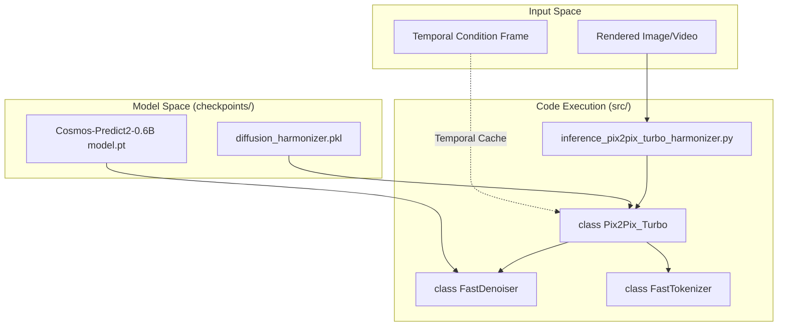
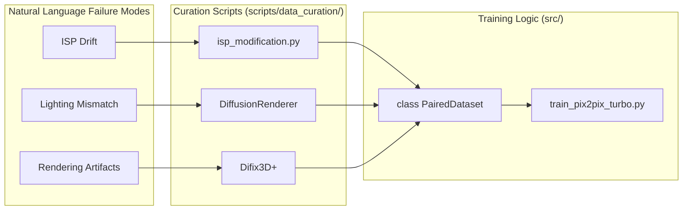

<!-- source: DeepWiki mcp.deepwiki.com · repo NVIDIA/harmonizer · page 1 Harmonizer: Project Overview · fetched 2026-10-26 -->

# Harmonizer: Project Overview

Relevant source files

The following files were used as context for generating this wiki page:

- [README.md](README.md)
- [assets/demo.gif](assets/demo.gif)
- [media/method_teaser.svg](media/method_teaser.svg)
- [media/teaser.gif](media/teaser.gif)
- [media/teaser.mp4](media/teaser.mp4)

**Harmonizer** is an online generative enhancement framework designed to bridge the gap between neural reconstructions (e.g., NeRF, 3D Gaussian Splatting) and photorealistic simulation [README.md:3-15](). It transforms imperfect renderings into temporally consistent, realistic outputs by distilling a multi-step diffusion model into a single-step, temporally-conditioned enhancer [README.md:17-18]().

### Purpose and Scope
Simulation is critical for autonomous vehicle development, but neural reconstructions often suffer from novel-view artifacts and struggle to integrate dynamic objects realistically [README.md:15-16](). Harmonizer addresses these issues through:
*   **Appearance Harmonization**: Matching tone and color between foreground assets and background scenes.
*   **Artifact Correction**: Removing ghosting, blur, and spurious geometry from reconstructions.
*   **Lighting Realism**: Simulating realistic shadows and illumination for inserted objects.

For a detailed guide on setting up the repository and downloading checkpoints, see [Getting Started: Environment Setup & Checkpoint Download](#1.1).

### System Architecture
The framework is built upon the **Pix2Pix-Turbo** paradigm, utilizing the **Cosmos-Predict2-0.6B-Text2Image** model as its backbone [README.md:42-55](). It operates as a single-step denoiser that can be integrated directly into online simulators.

#### Code-to-Concept Mapping: Inference Flow
The following diagram maps the logical inference process to specific code entities and files within the repository.

**Diagram: Inference Pipeline Entity Map**

**Sources:** [README.md:59-76](), [pix2pix_turbo_harmonizer.py:1-50]()

### Key Capabilities
*   **Temporal Consistency**: Uses an autoregressive temporal conditioning mechanism to ensure video stability across frames [README.md:59-63]().
*   **High Resolution**: Supports rendering at 1024 resolution with scheduling [README.md:71-76]().
*   **Deployment Flexibility**: Provides paths for standard PyTorch inference, temporal video processing, and TensorRT-accelerated deployment for H100 GPUs.

### Repository Organization
The repository is structured to support the full lifecycle of the model, from synthetic data curation to production deployment.

| Directory | Purpose |
| :--- | :--- |
| `src/` | Core implementation including model architecture, training scripts, and inference wrappers. |
| `scripts/data_curation/` | Tools for generating synthetic-real training pairs (e.g., ISP modification). |
| `onnx_export/` | Modules and scripts for converting models to ONNX and TensorRT engine formats. |
| `doc/` | Technical documentation and curation recipes. |
| `models/` | Default location for pretrained Harmonizer checkpoints. |

For a full map of the layout and coding standards, see [Repository Structure & Code Conventions](#1.2).

### Data Curation Pipeline
Harmonizer relies on a specialized pipeline that produces synthetic-real training pairs targeting specific failure modes.

**Diagram: Data Curation to Code Entity Bridge**

**Sources:** [README.md:88-105](), [training_utils.py:1-40]()

### Navigation
*   **Setup**: [Getting Started: Environment Setup & Checkpoint Download](#1.1)
*   **Architecture**: [Core Model Architecture](#2)
*   **Training**: [Training Pipeline](#3)
*   **Inference**: [Inference](#4)
*   **Deployment**: [ONNX Export & TensorRT Deployment](#5)
*   **Governance**: [Project Governance & Legal](#6)

**Sources:** [README.md:1-110](), [pix2pix_turbo_harmonizer.py:1-20]()

---

