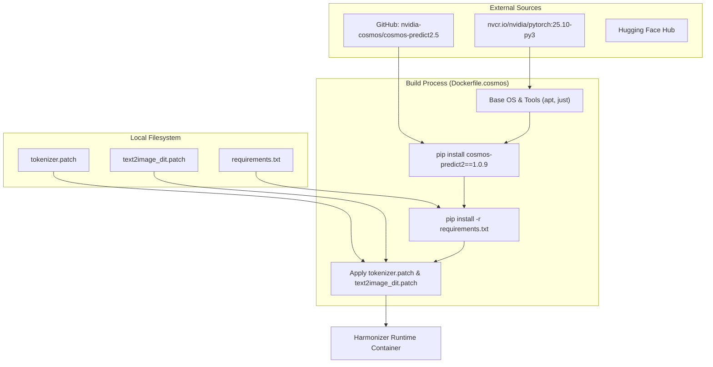
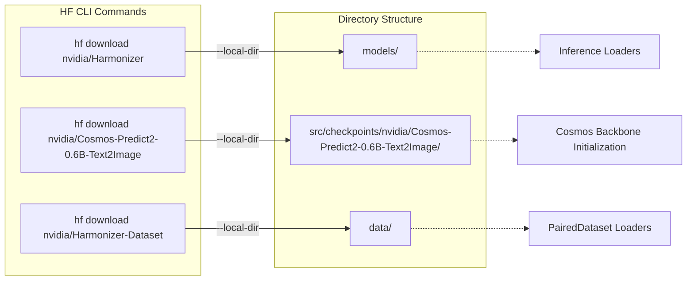

<!-- source: DeepWiki mcp.deepwiki.com · repo NVIDIA/harmonizer · page 1.1 Getting Started: Environment Setup & Checkpoint Download · fetched 2026-10-26 -->

# Getting Started: Environment Setup & Checkpoint Download

<details>
<summary>Relevant source files</summary>

The following files were used as context for generating this wiki page:

- [Dockerfile.cosmos](Dockerfile.cosmos)
- [download_checkpoints.sh](download_checkpoints.sh)
- [requirements.txt](requirements.txt)
- [ruff.toml](ruff.toml)

</details>


This page provides a technical guide for establishing the Harmonizer development environment and acquiring the necessary pretrained weights. The setup relies on a Dockerized workflow to ensure compatibility with the `cosmos-predict2` backbone and specific CUDA requirements.

## Environment Architecture

The Harmonizer environment is built upon the `nvcr.io/nvidia/pytorch:25.10-py3` base image [Dockerfile.cosmos:19-19](). It integrates the `cosmos-predict2` library alongside project-specific dependencies and patches required for gradient flow and version compatibility.

### Docker Environment Construction

The `Dockerfile.cosmos` implements a multi-stage build to manage dependencies efficiently:

1.  **Repository Stage**: Copies the local source code into the build context [Dockerfile.cosmos:28-29]().
2.  **Base Stage**: Installs system utilities (`ffmpeg`, `libx11-dev`, etc.) and the `just` command runner [Dockerfile.cosmos:41-45]().
3.  **Cosmos Dependency Stage**: Clones the `cosmos-predict2.5` repository and installs its nightly requirements [Dockerfile.cosmos:48-51]().
4.  **Harmonizer Stage**: Installs the core `cosmos-predict2==1.0.9` package and project-specific requirements [Dockerfile.cosmos:65-67]().

### Data Flow: Environment Setup
The following diagram illustrates how the Docker build process assembles the runtime environment from various sources.

**Environment Assembly Flow**

**Sources:** [Dockerfile.cosmos:19-70](), [requirements.txt:1-4]()

## Dependency Management

### Python Requirements
The project specifies several key libraries in `requirements.txt` that are essential for the Pix2Pix-Turbo paradigm and loss calculation:
*   `lpips`: Used for perceptual loss during training [requirements.txt:1-1]().
*   `vision-aided-loss`: Provides structural and GAN losses [requirements.txt:2-2]().
*   `CLIP`: Installed directly from source for text/image embedding [requirements.txt:4-4]().

### Critical Patches
To enable the specific architectural needs of Harmonizer, two patches are applied to the `cosmos_predict2` installation inside the container:
1.  **`tokenizer.patch`**: Modifies `tokenizer.py` to remove `@torch.no_grad()` decorators, allowing gradient flow through the VAE during training [Dockerfile.cosmos:69-69]().
2.  **`text2image_dit.patch`**: Adjusts `text2image_dit.py` to ensure compatibility with specific `transformer_engine` versions [Dockerfile.cosmos:70-70]().

**Sources:** [Dockerfile.cosmos:65-70](), [requirements.txt:1-4]()

## Checkpoint Acquisition

Checkpoints are managed via the `download_checkpoints.sh` script, which utilizes the Hugging Face CLI (`hf`) [download_checkpoints.sh:19-22]().

### Checkpoint Structure
The script organizes downloaded weights into specific directory structures expected by the model loaders:

| Component | Source Repository | Local Destination |
| :--- | :--- | :--- |
| Harmonizer Weights | `nvidia/Harmonizer` | `models/` |
| Cosmos Backbone | `nvidia/Cosmos-Predict2-0.6B-Text2Image` | `src/checkpoints/nvidia/Cosmos-Predict2-0.6B-Text2Image/` |
| Training Dataset | `nvidia/Harmonizer-Dataset` | `data/` (Optional) |

### Code-to-Checkpoint Mapping
The following diagram maps the CLI commands in the download script to the resulting directory structure used by the Python source code.

**Checkpoint Distribution Map**

**Sources:** [download_checkpoints.sh:24-34]()

## Implementation Steps

1.  **Build the Container**:
    ```bash
    docker build -t harmonizer-cosmos-env -f Dockerfile.cosmos .
    ```
    [Dockerfile.cosmos:16-17]()

2.  **Download Weights**:
    Run the script from the repository root to ensure relative paths are preserved [download_checkpoints.sh:15-17]().
    *   For inference only: `./download_checkpoints.sh` [download_checkpoints.sh:11-11]()
    *   For training (includes dataset): `./download_checkpoints.sh --with-dataset` [download_checkpoints.sh:12-12]()

3.  **Linting**:
    The project uses `ruff` for code quality, targeting Python 3.10 with a line length of 120 [ruff.toml:16-17](). The configuration enables Bugbear (B), Isort (I), and Pyflakes (F) rules [ruff.toml:20-28]().

**Sources:** [Dockerfile.cosmos:16-17](), [download_checkpoints.sh:1-37](), [ruff.toml:16-35]()

---

