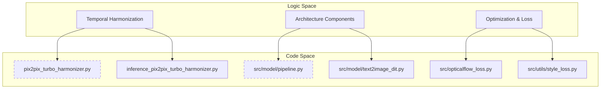
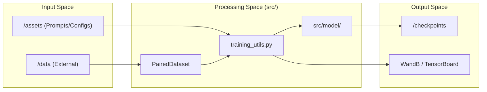

<!-- source: DeepWiki mcp.deepwiki.com · repo NVIDIA/harmonizer · page 1.2 Repository Structure & Code Conventions · fetched 2026-10-26 -->

# Repository Structure & Code Conventions

<details>
<summary>Relevant source files</summary>

The following files were used as context for generating this wiki page:

- [CONTRIBUTING.md](CONTRIBUTING.md)
- [LICENSE](LICENSE)
- [SECURITY.md](SECURITY.md)
- [THIRD_PARTY_LICENSE.txt](THIRD_PARTY_LICENSE.txt)
- [ruff.toml](ruff.toml)

</details>


This page provides a technical map of the Harmonizer repository, detailing the organization of source code, assets, and documentation. It also outlines the development standards, including linting configurations and the legal requirements for contributing code to the project.

## Repository Layout

The Harmonizer repository is structured to separate core model logic, training utilities, deployment pipelines, and project metadata.

### Directory Overview

| Directory | Description |
| :--- | :--- |
| `src/` | Core Python source code including model definitions (`src/model/`), loss functions, and dataset loaders. |
| `doc/` | Technical documentation and methodology reports, such as NuRec data curation details. |
| `assets/` | Static configuration files, prompts, and metadata required for model operation. |
| `examples/` | Scripts demonstrating usage of the pretrained models for inference and evaluation. |
| `media/` | Visual assets, diagrams, and demonstration videos for the project. |
| `onnx_export/` | Dedicated sub-package for converting PyTorch models to ONNX and TensorRT formats. |

### Code Entity Mapping: Source to Function

The following diagram bridges the natural language concepts of the system to their specific implementations within the `src/` directory.

**Diagram: System Component Mapping**

**Sources:** `CONTRIBUTING.md:1-5`(), `ruff.toml:1-36`()

---

## Coding Style & Enforcement

Harmonizer uses `ruff` to enforce a consistent coding style across the repository. The configuration is defined in `ruff.toml`.

### Linting Configuration
The project targets **Python 3.10** and enforces a maximum line length of **120 characters** [`ruff.toml:16-17`]().

The following rule sets are active [`ruff.toml:20-28`]():
*   **B (bugbear):** Finds likely bugs and design flaws.
*   **E (pycodestyle errors):** Standard PEP8 error checks.
*   **I (isort):** Ensures imports are sorted consistently.
*   **ISC (flake8-implicit-str-concat):** Prevents accidental string concatenations.
*   **F (pyflakes):** Checks for logical errors like unused imports or undefined names.
*   **UP (pyupgrade):** Automatically upgrades syntax to newer Python versions.
*   **RUF (ruff):** Internal Ruff-specific rules.

### Specific Exceptions
Certain rules are ignored to accommodate specific architectural patterns or legacy code compatibility [`ruff.toml:29-34`]():
*   `E402`: Allows module imports not at the top of the file (useful for dynamic environment setup).
*   `E501`: Line length checks are relaxed in specific contexts.
*   `F841`: Unused variables do not trigger failures.
*   `UP038`: Disables mandatory PEP 604 `isinstance` checks.

**Sources:** `ruff.toml:1-36`()

---

## Contribution Guidelines

Contributors must adhere to specific legal and technical workflows to ensure code quality and license compliance.

### Developer Certificate of Origin (DCO)
All contributions must be "signed-off" to certify that the contributor has the right to submit the code under the project's license [`CONTRIBUTING.md:11-15`](). This is enforced via Git commit trailers.

**Requirement:** Use the `-s` or `--signoff` flag during commit [`CONTRIBUTING.md:17-20`]():
```bash
git commit -s -m "Brief description of the change"
```
This appends a `Signed-off-by: Name <email>` line to the commit message, signifying agreement with the DCO 1.1 [`CONTRIBUTING.md:21-52`]().

### Licensing
The project is licensed under the **Apache License 2.0** [`LICENSE:2-5`](). 
*   **Third-Party Code:** Any new dependencies or code snippets must not introduce license conflicts [`CONTRIBUTING.md:7-8`]().
*   **Attributions:** Third-party package licenses (MIT, BSD, Apache) are cataloged in `THIRD_PARTY_LICENSE.txt` [`THIRD_PARTY_LICENSE.txt:1-30`]().

### Security Reporting
Security vulnerabilities should **not** be reported via public GitHub issues [`SECURITY.md:5`](). Instead, they must be submitted through:
1.  **Web:** [NVIDIA Security Vulnerability Submission Form](https://www.nvidia.com/object/submit-security-vulnerability.html) [`SECURITY.md:10`]()
2.  **Email:** `psirt@nvidia.com` [`SECURITY.md:11`]()

**Sources:** `CONTRIBUTING.md:1-52`(), `LICENSE:1-143`(), `SECURITY.md:1-25`(), `THIRD_PARTY_LICENSE.txt:1-60`()

---

## Data Flow & File Interaction

The following diagram illustrates how the repository structure supports the training and inference data flow, linking high-level directories to internal code logic.

**Diagram: Repository Data Flow**

**Sources:** `CONTRIBUTING.md:5`(), `ruff.toml:1-36`()

---

