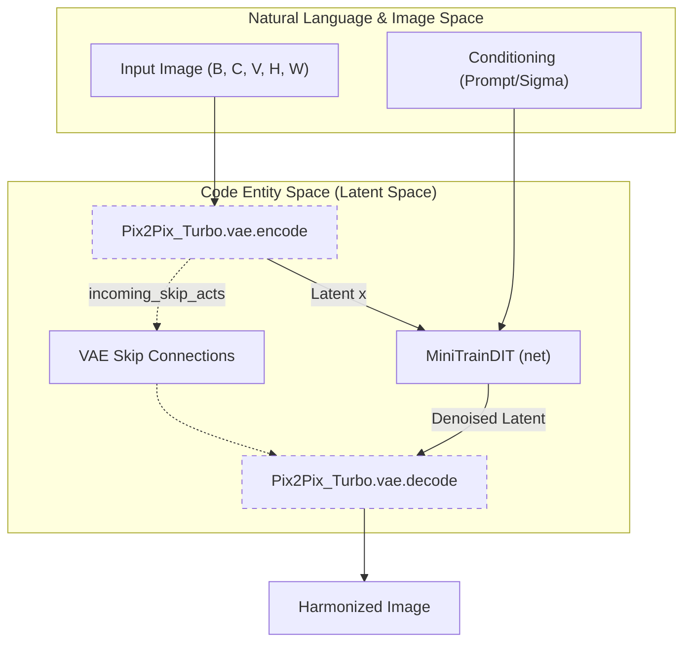
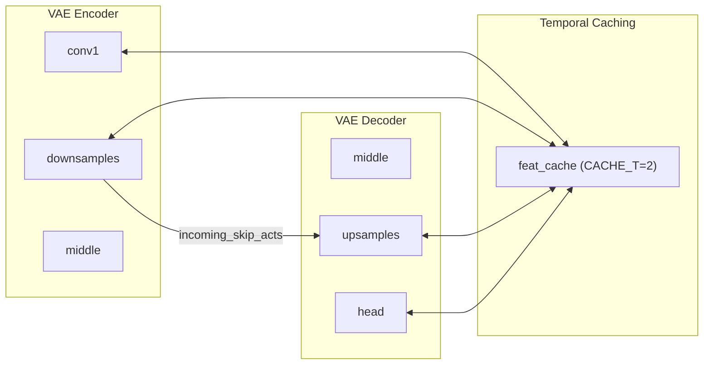

<!-- source: DeepWiki mcp.deepwiki.com · repo NVIDIA/harmonizer · page 2 Core Model Architecture · fetched 2026-10-26 -->

# Core Model Architecture

Relevant source files

The following files were used as context for generating this wiki page:

- [src/model/__init__.py](src/model/__init__.py)
- [src/pix2pix_turbo_harmonizer.py](src/pix2pix_turbo_harmonizer.py)
- [src/pix2pix_turbo_nocond_cosmos_base_faster_tokenizer.py](src/pix2pix_turbo_nocond_cosmos_base_faster_tokenizer.py)

The Harmonizer model architecture is built upon the **Pix2Pix-Turbo** paradigm, leveraging the **Cosmos-Predict2** backbone for high-fidelity video and image synthesis. It utilizes a 1-step rectified flow distillation approach to enable rapid image-to-image translation while maintaining temporal consistency through a specialized caching mechanism.

### Architectural Overview

Harmonizer integrates a Variational Autoencoder (VAE) for latent space compression and a Diffusion Transformer (DiT) for denoising. The architecture is designed to handle multi-view tensors with the shape `(B, C, V, H, W)`, where `V` represents the temporal or view dimension [src/pix2pix_turbo_harmonizer.py:4-8]().

#### System Data Flow
The following diagram illustrates the flow from input images through the encoding, denoising, and decoding stages, highlighting the primary code entities involved.

**Harmonizer Data Flow: Input to Output**

Sources: [src/pix2pix_turbo_harmonizer.py:177-180](), [src/pix2pix_turbo_harmonizer.py:140-141](), [src/model/text2image_dit.py:23-23]()

---

### Key Components

#### 1. Pix2Pix_Turbo Wrapper
The `Pix2Pix_Turbo` class serves as the primary interface for training and inference. It wraps the underlying UNet (DiT) and VAE components, providing methods for loading checkpoints and managing the forward pass [src/pix2pix_turbo_harmonizer.py:177-181](). It specifically handles the integration of LoRA (Low-Rank Adaptation) for both the UNet and VAE to enable efficient fine-tuning [src/pix2pix_turbo_harmonizer.py:187-188]().

For details, see [Pix2Pix_Turbo Wrapper](#2.1).

#### 2. Cosmos-Predict2 Backbone
Harmonizer is built on the **Cosmos-Predict2-0.6B** foundation. The model configuration is initialized via `get_cosmos_predict2_text2image_pipeline`, which sets up the transformer backend and tokenizer paths [src/pix2pix_turbo_harmonizer.py:26-37](). To ensure compatibility with modern training environments and enable gradient flow through the tokenizer, specific patches are applied to the upstream library.

For details, see [Cosmos-Predict2 Integration & Patches](#2.3).

#### 3. VAE Tokenizer with Skip Connections
The VAE uses a causal 3D convolutional structure. A critical feature of the Harmonizer architecture is the use of **skip connections** between the encoder and decoder to preserve spatial details during the 1-step generation process [src/pix2pix_turbo_harmonizer.py:148-164](). The encoder stores intermediate activations in `self.current_down_blocks`, which are then accessed by the decoder as `self.incoming_skip_acts` [src/pix2pix_turbo_harmonizer.py:113-145]().

**VAE Forward Logic and Caching**

Sources: [src/pix2pix_turbo_harmonizer.py:72-114](), [src/pix2pix_turbo_harmonizer.py:117-174]()

#### 4. DiT Denoiser & Scaling
The core denoising logic resides in `MiniTrainDIT`, which replaces the standard DiT in the pipeline for training [src/model/text2image_dit.py:23-23](). It works in conjunction with `RectifiedFlowScaling` to manage timestep conditioning and noise schedules. The model typically operates in a 1-step regime using a `DPMSolverMultistepScheduler` configured with `set_timesteps(1)` [src/model/__init__.py:27-33]().

For details, see [Model Sub-modules: Pipeline, DiT, and Denoiser Scaling](#2.2).

---

### Component Relationship Table

| Component | Code Entity | Role |
| :--- | :--- | :--- |
| **Top-level Wrapper** | `Pix2Pix_Turbo` | Manages VAE/DiT lifecycle and LoRA [src/pix2pix_turbo_harmonizer.py:177]() |
| **Backbone DIT** | `MiniTrainDIT` | Core transformer for rectified flow [src/model/text2image_dit.py:23]() |
| **Tokenizer** | `FastTokenizer` | High-speed VAE encoding/decoding [src/model/pipeline.py:22]() |
| **Temporal Logic** | `CACHE_T` | Constant defining temporal lookback (2 frames) [src/pix2pix_turbo_harmonizer.py:72]() |
| **Scheduler** | `make_1step_sched` | Configures 1-step DPM Solver [src/model/__init__.py:45]() |

Sources: [src/pix2pix_turbo_harmonizer.py:72-177](), [src/model/__init__.py:22-45](), [src/model/text2image_dit.py:23]()

---

