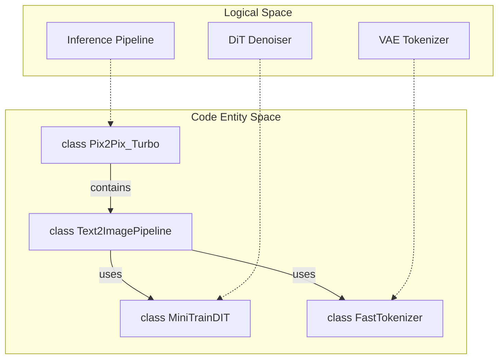
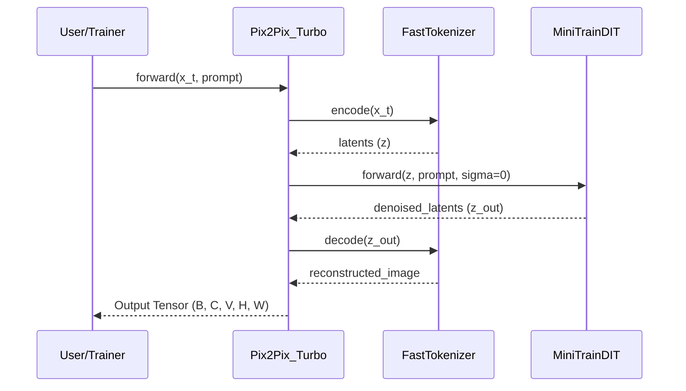

<!-- source: DeepWiki mcp.deepwiki.com · repo NVIDIA/harmonizer · page 2.1 Pix2Pix_Turbo Wrapper · fetched 2026-10-26 -->

# Pix2Pix_Turbo Wrapper

Relevant source files

The following files were used as context for generating this wiki page:

- [src/pix2pix_turbo_harmonizer.py](src/pix2pix_turbo_harmonizer.py)
- [src/pix2pix_turbo_nocond_cosmos_base_faster_tokenizer.py](src/pix2pix_turbo_nocond_cosmos_base_faster_tokenizer.py)

The `Pix2Pix_Turbo` class serves as the primary training and inference wrapper for the Harmonizer model. It integrates the **Cosmos-Predict2** backbone with the Pix2Pix-Turbo paradigm, supporting multi-view video tensors and temporal consistency through specialized caching mechanisms.

## Purpose and Scope

The wrapper is designed to handle video latents in `(B, C, V, H, W)` format, where `V` represents the number of frames (views) [src/pix2pix_turbo_harmonizer.py:178-179](). It encapsulates the VAE (tokenizer) and the DiT (denoiser) into a single `torch.nn.Module`, ensuring compatibility with legacy diffusion-fixer checkpoints [src/pix2pix_turbo_harmonizer.py:4-7]().

---

## Class Architecture and Data Flow

The `Pix2Pix_Turbo` class manages the interaction between the image tokenizer and the transformer-based denoiser.

### System Entity Mapping
The following diagram maps the high-level logical components to their specific implementations within the `Pix2Pix_Turbo` wrapper.

**Diagram: Entity Mapping**

**Sources:** [src/pix2pix_turbo_harmonizer.py:177-190](), [src/pix2pix_turbo_nocond_cosmos_base_faster_tokenizer.py:26-32]()

### Forward Pass Flow
The forward pass accepts a batch of images (or video frames) and a prompt, then performs encoding, denoising, and decoding.

**Diagram: Pix2Pix_Turbo Forward Flow**

**Sources:** [src/pix2pix_turbo_harmonizer.py:178-180](), [src/pix2pix_turbo_nocond_cosmos_base_faster_tokenizer.py:26-40]()

---

## VAE Encode/Decode Flow

The wrapper utilizes a specialized VAE flow that supports skip connections between the encoder and decoder to preserve high-frequency spatial details.

*   **Encoding:** The `my_vae_encoder_fwd` function processes input tensors and stores intermediate feature maps in `self.current_down_blocks` [src/pix2pix_turbo_harmonizer.py:113-114]().
*   **Decoding:** The `my_vae_decoder_fwd` function retrieves these skip activations via `self.incoming_skip_acts` and applies them through a series of `skip_convs` (1x1 convolutions) before merging them with the upsampled path [src/pix2pix_turbo_harmonizer.py:129-164]().

---

## Temporal Caching Mechanism

To maintain temporal consistency during video processing without the memory overhead of full 3D attention, the wrapper implements a temporal caching mechanism.

### `CACHE_T` and `feat_cache`
The mechanism relies on a global constant `CACHE_T = 2` [src/pix2pix_turbo_harmonizer.py:72]().

1.  **Cache Extraction:** For every `CausalConv3d` or `ResidualBlock` layer, the last `CACHE_T` frames of the current feature map are cloned and stored in `feat_cache` [src/pix2pix_turbo_harmonizer.py:78-82]().
2.  **Context Injection:** If the current input chunk has fewer than 2 frames, the last frame from the previous chunk's cache is concatenated to provide temporal context [src/pix2pix_turbo_harmonizer.py:79-80]().
3.  **State Management:** An index `feat_idx` tracks the specific layer's cache position during the recursive forward pass [src/pix2pix_turbo_harmonizer.py:75-77]().

**Sources:** [src/pix2pix_turbo_harmonizer.py:72-114](), [src/pix2pix_turbo_nocond_cosmos_base_faster_tokenizer.py:70-117]()

---

## Checkpoint Loading and Saving

The wrapper provides utility functions to handle complex `state_dict` mappings, specifically for loading weights from legacy "diffusion-fixer" models into the new Cosmos-based architecture.

| Function | Purpose | Key Logic |
| :--- | :--- | :--- |
| `load_ckpt_from_state_dict` | Resumes training or initializes inference. | Maps `net.` prefixes to `dit.` and `net_ema.` to `dit_ema.` [src/pix2pix_turbo_harmonizer.py:43-49](). |
| `save_ckpt` | Persists model state. | Packages `state_dict_unet`, `state_dict_vae`, and discriminator/optimizer states into a single `.pkl` or `.pt` file [src/pix2pix_turbo_harmonizer.py:61-69](). |

**Sources:** [src/pix2pix_turbo_harmonizer.py:40-70](), [src/pix2pix_turbo_nocond_cosmos_base_faster_tokenizer.py:43-68]()

---

## Constructor Arguments

The `Pix2Pix_Turbo` constructor configures the underlying pipeline and LoRA (Low-Rank Adaptation) settings.

| Argument | Type | Description |
| :--- | :--- | :--- |
| `pretrained_path` | `str` | Path to the `.pt` or `.pkl` checkpoint containing UNet and VAE weights [src/pix2pix_turbo_harmonizer.py:185](). |
| `lora_rank_unet` | `int` | Rank for UNet LoRA layers (default: 8) [src/pix2pix_turbo_harmonizer.py:187](). |
| `lora_rank_vae` | `int` | Rank for VAE LoRA layers (default: 4) [src/pix2pix_turbo_harmonizer.py:188](). |
| `fast_pipeline` | `bool` | If True, uses `MiniTrainDIT` as the network target for accelerated training [src/pix2pix_turbo_harmonizer.py:34-35](). |

**Sources:** [src/pix2pix_turbo_harmonizer.py:26-37](), [src/pix2pix_turbo_harmonizer.py:181-190]()

---

