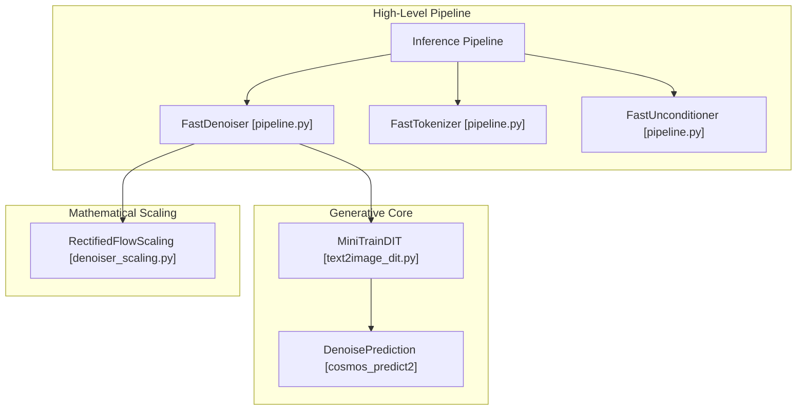
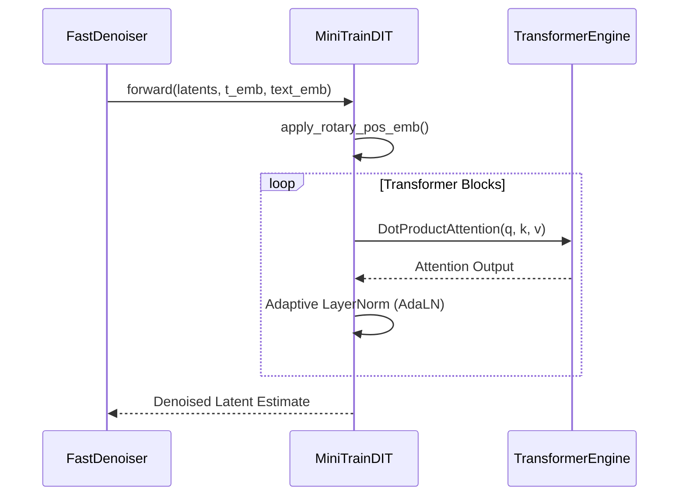

<!-- source: DeepWiki mcp.deepwiki.com · repo NVIDIA/harmonizer · page 2.2 Model Sub-modules: Pipeline, DiT, and Denoiser Scaling · fetched 2026-10-26 -->

# Model Sub-modules: Pipeline, DiT, and Denoiser Scaling

Relevant source files

The following files were used as context for generating this wiki page:

- [src/model/__init__.py](src/model/__init__.py)
- [src/model/denoiser_scaling.py](src/model/denoiser_scaling.py)
- [src/model/pipeline.py](src/model/pipeline.py)
- [src/model/text2image_dit.py](src/model/text2image_dit.py)

This page provides a technical deep dive into the `src/model/` package, which forms the backbone of the Harmonizer's generative capabilities. It covers the high-speed inference pipeline, the Diffusion Transformer (DiT) architecture, and the mathematical scaling used for Rectified Flow.

## Architecture Overview

The Harmonizer model architecture is composed of three primary layers: the high-level **Pipeline** wrappers, the core **MiniTrainDIT** engine, and the **RectifiedFlowScaling** logic.

### Natural Language to Code Entity Mapping

The following diagram maps high-level system concepts to their specific class implementations within the codebase.

**System Entity Mapping**

**Sources:** [src/model/pipeline.py:18-22](), [src/model/text2image_dit.py:23](), [src/model/denoiser_scaling.py:22]()

---

## 1. Fast Pipeline Components

The `src/model/pipeline.py` file contains optimized wrappers designed to minimize overhead during training and inference.

### FastDenoiser
`FastDenoiser` is the primary module for executing the diffusion reverse process. It optimizes performance by caching constants that do not change during a single generation step.

*   **Caching Mechanism**: The `compute_caching` function pre-calculates `sigma`-dependent coefficients (`c_skip`, `c_out`, `c_in`, `c_noise`) and text conditioning embeddings [src/model/pipeline.py:150-189]().
*   **Forward Pass**: The `forward` method applies these cached scalars to the input latents, reducing redundant GPU operations [src/model/pipeline.py:191-209]().

### FastTokenizer
`FastTokenizer` wraps the VAE (Variational Autoencoder) used for compressing images into latent space.
*   **Skip Connections**: It supports a specialized `skip_connection` mode where activations from the encoder are passed directly to the decoder to preserve high-frequency details [src/model/pipeline.py:89-91]().
*   **Scaling**: It handles the `sigma_data` scaling required to normalize latents for the DiT [src/model/pipeline.py:85-91]().

### FastUnconditioner
This utility generates "null" or negative conditioning. It creates a sample batch of zeros (for T5 text embeddings and images) to provide a baseline for classifier-free guidance [src/model/pipeline.py:28-40]().

**Sources:** [src/model/pipeline.py:18-143](), [src/model/pipeline.py:144-209]()

---

## 2. MiniTrainDIT: The Diffusion Transformer

The `MiniTrainDIT` class in `src/model/text2image_dit.py` is a specialized implementation of the Diffusion Transformer architecture, adapted for the Harmonizer's training and inference requirements.

### Key Implementation Details
*   **Rotary Positional Embeddings (RoPE)**: The model uses 1D rotary embeddings to inject positional information into the transformer blocks. The implementation in `apply_rotary_pos_emb` handles the `bshd` (batch, sequence, head, dimension) tensor format [src/model/text2image_dit.py:62-98]().
*   **Conditioning**: It integrates `crossattn_emb` (text) and `t_embedding` (timestep) into the transformer blocks to guide the denoising process [src/model/text2image_dit.py:51-52]().
*   **Transformer Engine Integration**: It utilizes `transformer_engine` (TE) for optimized attention operations, specifically `DotProductAttention` [src/model/text2image_dit.py:27-46]().

### Data Flow in MiniTrainDIT
The following diagram illustrates how latents and conditioning move through the DiT core.

**MiniTrainDIT Data Flow**

**Sources:** [src/model/text2image_dit.py:62-98](), [src/model/pipeline.py:191-209]()

---

## 3. Rectified Flow Scaling

The `RectifiedFlowScaling` class in `src/model/denoiser_scaling.py` implements the mathematical framework for Rectified Flow (RF) models.

### Preconditioning Scalars
The class calculates four key coefficients based on the current noise level `sigma` [src/model/denoiser_scaling.py:36-42]():

| Coefficient | Formula | Role |
| :--- | :--- | :--- |
| `c_skip` | $1.0 - t$ | Determines how much of the input is preserved. |
| `c_out` | $-t$ | Scales the network output for the update. |
| `c_in` | $1.0 - t$ | Scales the input latent before the DiT. |
| `c_noise` | $t \times \text{scaling\_factor}$ | Scales the timestep embedding. |

*Where $t = \frac{\sigma}{\sigma + 1}$* [src/model/denoiser_scaling.py:37]().

### Loss Weighting
The `sigma_loss_weights` function provides the weighting for the training objective.
*   **Uniform Weighting**: Returns $(1.0 + \sigma)^2 / \sigma^2$ [src/model/denoiser_scaling.py:46-47]().
*   **Non-Uniform Weighting**: Uses a pre-computed Gaussian-like shift to prioritize specific noise levels during training [src/model/denoiser_scaling.py:27-33]().

**Sources:** [src/model/denoiser_scaling.py:22-55]()

---

## 4. VAE Custom Forward Patches

To support the specialized Pix2Pix-Turbo architecture, the VAE encoder and decoder forward passes are modified in `src/model/__init__.py`.

*   **Encoder Patch (`my_vae_encoder_fwd`)**: Captures intermediate activations (`current_down_blocks`) during the encoding process [src/model/__init__.py:55-68]().
*   **Decoder Patch (`my_vae_decoder_fwd`)**: Injects these captured activations back into the decoder via `skip_convs` if `skip_connection` is enabled. This allows the model to bypass the latent bottleneck for high-resolution image structure preservation [src/model/__init__.py:71-95]().

**Sources:** [src/model/__init__.py:55-95]()

---

