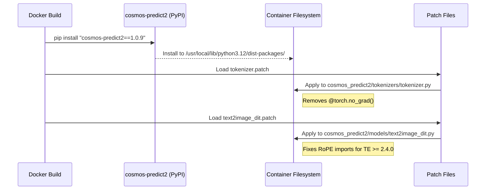

<!-- source: DeepWiki mcp.deepwiki.com · repo NVIDIA/harmonizer · page 2.3 Cosmos-Predict2 Integration & Patches · fetched 2026-10-26 -->

# Cosmos-Predict2 Integration & Patches

<details>
<summary>Relevant source files</summary>

The following files were used as context for generating this wiki page:

- [Dockerfile.cosmos](Dockerfile.cosmos)
- [text2image_dit.patch](text2image_dit.patch)
- [tokenizer.patch](tokenizer.patch)

</details>


Harmonizer leverages the **Cosmos-Predict2** library as its foundation for high-fidelity image and video synthesis. To adapt this upstream library for the specific needs of the Harmonizer training pipeline—specifically to support gradient-based fine-tuning and to maintain compatibility with modern NVIDIA software stacks—two critical patches are applied during the environment setup.

## Integration Overview

Harmonizer integrates `cosmos-predict2` (version 1.0.9) to provide the VAE (Video Autoencoder) and DiT (Diffusion Transformer) backbones. The integration is managed via the `Dockerfile.cosmos` environment, which installs the library and immediately applies source-level patches to the installed site-packages.

| Component | Upstream Entity | Harmonizer Usage |
| :--- | :--- | :--- |
| **Tokenizer** | `cosmos_predict2.tokenizers.tokenizer` | VAE Encoding/Decoding of image/video frames. |
| **DiT** | `cosmos_predict2.models.text2image_dit` | Core Transformer backbone for denoising. |

**Sources:**
* [Dockerfile.cosmos:64-70]()

---

## Patch 1: Gradient Flow in Tokenizers (`tokenizer.patch`)

The upstream `cosmos-predict2` tokenizer implementation explicitly disables gradient calculation using the `@torch.no_grad()` decorator on its `encode` and `decode` methods. While this is efficient for pure inference, Harmonizer requires gradients to flow through the VAE during specific training regimes or when calculating structural losses (like DINO or LPIPS) that may involve the reconstructed manifold.

### Implementation Details
The `tokenizer.patch` file removes the `@torch.no_grad()` decorators from the following classes in `cosmos_predict2/tokenizers/tokenizer.py`:
1.  **Video Tokenizer**: Affects `encode` and `decode` methods [tokenizer.patch:9-17]().
2.  **Image Tokenizer**: Affects `encode` and `decode` methods [tokenizer.patch:25-34]().

### Data Flow Impact
The following diagram illustrates how removing these decorators enables the backpropagation path required by the Harmonizer training utilities.

**Tokenizer Gradient Flow Path**

```mermaid
graph TD
    subgraph "Natural Language Space"
        UserConfig["Training Configuration"]
    end

    subgraph "Code Entity Space"
        InputImage["Input Tensors (B, C, T, H, W)"]
        VAE_Enc["cosmos_predict2.tokenizers.tokenizer.encode"]
        Latent["Latent Space (Z)"]
        VAE_Dec["cosmos_predict2.tokenizers.tokenizer.decode"]
        LossFunc["Loss Functions (L2/LPIPS)"]
        
        InputImage --> VAE_Enc
        VAE_Enc --> Latent
        Latent --> VAE_Dec
        VAE_Dec --> LossFunc
        
        LossFunc -. "Gradient Flow (Enabled by Patch)" .-> VAE_Dec
        VAE_Dec -. "Gradient Flow (Enabled by Patch)" .-> Latent
        Latent -. "Gradient Flow (Enabled by Patch)" .-> VAE_Enc
    end
```


**Sources:**
* [tokenizer.patch:1-37]()
* [Dockerfile.cosmos:69-69]()

---

## Patch 2: Transformer Engine Compatibility (`text2image_dit.patch`)

The `text2image_dit.patch` addresses a breaking change in the NVIDIA `transformer_engine` library. Upstream `cosmos-predict2` assumes a specific import path for Rotary Positional Embeddings (RoPE), which changed in `transformer_engine` version 2.4.0.

### Technical Problem
In older versions of `transformer_engine`, `apply_rotary_pos_emb` was located directly under `transformer_engine.pytorch.attention`. In version 2.4.0 and later, this function was moved to `transformer_engine.pytorch.attention.rope`.

### Patch Logic
The patch introduces a version check using `packaging.version.Version` to dynamically resolve the import path, ensuring Harmonizer can run on both older and newer `transformer_engine` environments.

```python
# Logic introduced by text2image_dit.patch
if Version(te.__version__) >= Version("2.4.0"):
    from transformer_engine.pytorch.attention.rope import apply_rotary_pos_emb
else:
    from transformer_engine.pytorch.attention import apply_rotary_pos_emb
```

**Sources:**
* [text2image_dit.patch:9-22]()
* [Dockerfile.cosmos:70-70]()

---

## Environment Integration Flow

The integration process is automated within the `Dockerfile.cosmos` build sequence. This ensures that every developer and training node operates on a consistent, patched version of the dependencies.

**System Integration & Patching Sequence**


### Summary of Patched Files

| Target File Path | Purpose of Patch |
| :--- | :--- |
| `cosmos_predict2/tokenizers/tokenizer.py` | Enables gradient flow by removing `no_grad` decorators. |
| `cosmos_predict2/models/text2image_dit.py` | Fixes `transformer_engine` compatibility for RoPE embeddings. |

**Sources:**
* [Dockerfile.cosmos:59-71]()
* [tokenizer.patch:3-4]()
* [text2image_dit.patch:3-4]()

---

