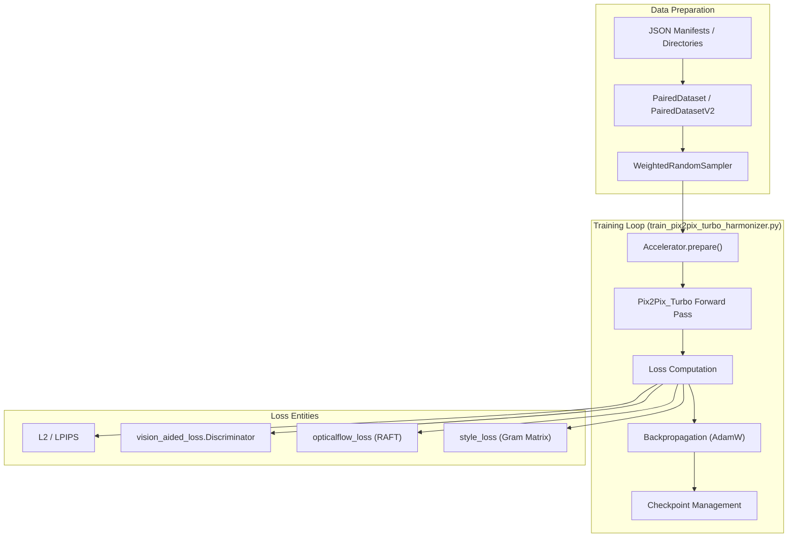
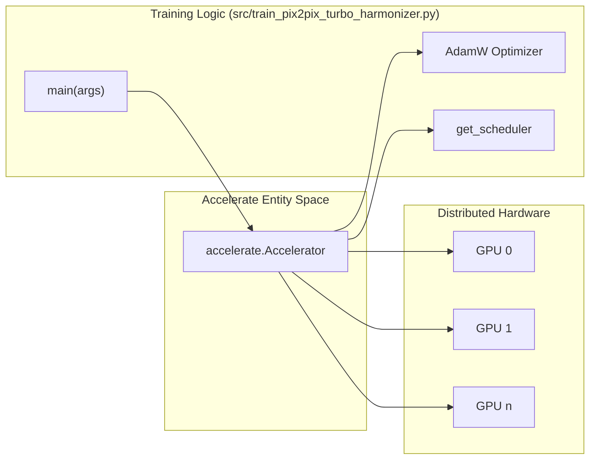

<!-- source: DeepWiki mcp.deepwiki.com · repo NVIDIA/harmonizer · page 3 Training Pipeline · fetched 2026-10-26 -->

# Training Pipeline

Relevant source files

The following files were used as context for generating this wiki page:

- [src/train_pix2pix_turbo_harmonizer.py](src/train_pix2pix_turbo_harmonizer.py)
- [src/train_pix2pix_turbo_nocond_cosmos_base_faster_tokenizer.py](src/train_pix2pix_turbo_nocond_cosmos_base_faster_tokenizer.py)

The Harmonizer training pipeline is designed to transform the **Cosmos-Predict2** foundation model into a high-fidelity image and video harmonization engine using the **Pix2Pix-Turbo** paradigm. The workflow encompasses multi-source data loading, a complex multi-modal loss objective (including GAN, perceptual, and temporal losses), and a distributed multi-GPU execution environment.

### Training Workflow Overview

The training process is orchestrated by `src/train_pix2pix_turbo_harmonizer.py`, which manages the initialization of the `Pix2Pix_Turbo` model, the setup of discriminators for GAN training, and the optimization loop.

The following diagram illustrates the high-level flow from data ingestion to checkpoint generation:

**Harmonizer Training Flow**

Sources: [src/train_pix2pix_turbo_harmonizer.py:48-101](), [src/train_pix2pix_turbo_harmonizer.py:119-146]()

---

### Data Curation & Dataset Preparation
The pipeline supports training on a mixture of datasets to ensure robustness across various harmonization tasks (Relighting, PBR Shadow Simulation, etc.). Data is loaded via `PairedDataset` or `PairedDatasetV2` classes defined in `training_utils.py`. 

*   **Multi-Source Loading**: The script parses comma-separated paths from the `--dataset_folder` argument [src/train_pix2pix_turbo_harmonizer.py:50-51]().
*   **Weighted Sampling**: A `WeightedRandomSampler` is used to balance different data sources (e.g., synthetic vs. real-world data) based on the `fixing_data_weight` parameter [src/train_pix2pix_turbo_harmonizer.py:202-211]().

For details on the five data sources and NuRec curation methods, see **[Data Curation & Dataset Preparation](#3.1)**.

Sources: [src/train_pix2pix_turbo_harmonizer.py:48-65](), [src/utils/training_utils.py:1-44]()

---

### Loss Functions & Training Utilities
Harmonizer employs a hybrid loss function to ensure structural integrity, color consistency, and temporal stability.

| Loss Category | Implementation / Class | Purpose |
| :--- | :--- | :--- |
| **Perceptual** | `lpips.LPIPS(net="vgg")` | Maintains high-level visual features [src/train_pix2pix_turbo_harmonizer.py:134](). |
| **Adversarial** | `vision_aided_loss.Discriminator` | Vision-aided GAN loss using CLIP-based features [src/train_pix2pix_turbo_harmonizer.py:123](). |
| **Temporal** | `get_temporal_loss` | Uses RAFT optical flow to ensure consistency across video frames [src/train_pix2pix_turbo_harmonizer.py:36](). |
| **Structural** | `DinoStructureLoss` | Preserves the geometry of the foreground object. |
| **Style** | `style_loss` | Gram-matrix based loss for texture matching [src/utils/style_loss.py:1-42](). |

For details on loss weights and implementation, see **[Loss Functions & Training Utilities](#3.2)**.

Sources: [src/train_pix2pix_turbo_harmonizer.py:116-146](), [src/opticalflow_loss.py:1-36]()

---

### Multi-GPU Training Configuration
The pipeline utilizes the `accelerate` library to handle distributed training across multiple GPUs, supporting `bf16` mixed precision and gradient checkpointing to manage memory on large Cosmos-Predict2 backbones.

**System-to-Code Mapping: Distributed Training**

Sources: [src/train_pix2pix_turbo_harmonizer.py:68-81](), [src/train_pix2pix_turbo_harmonizer.py:159-193]()

Key configuration aspects include:
*   **Mixed Precision**: Configurable via `--mixed_precision` (typically `bf16`) [src/train_pix2pix_turbo_harmonizer.py:71]().
*   **Checkpointing**: Models are saved as `.pkl` files containing both the `net_pix2pix` state and discriminator/optimizer states for seamless resumption [src/train_pix2pix_turbo_harmonizer.py:40]().
*   **Gradient Checkpointing**: Enabled via `net_pix2pix.unet.enable_gradient_checkpointing()` to reduce VRAM footprint during the backward pass [src/train_pix2pix_turbo_harmonizer.py:111]().

For details on launching training and hyperparameter tuning, see **[Multi-GPU Training Configuration](#3.3)**.

Sources: [src/train_pix2pix_turbo_harmonizer.py:110-112](), [src/train_pix2pix_turbo_harmonizer.py:174-188]()

---

