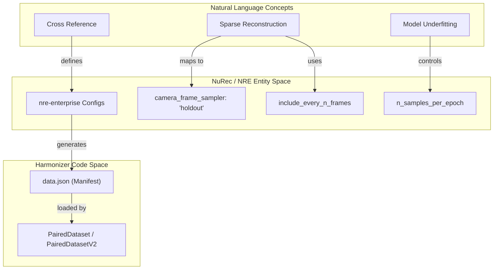
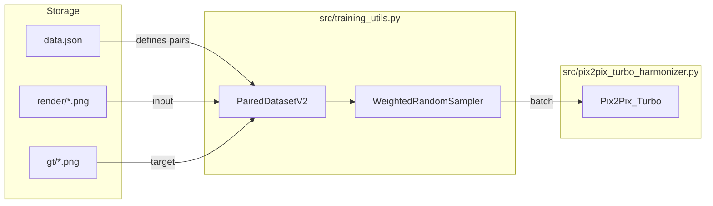

<!-- source: DeepWiki mcp.deepwiki.com · repo NVIDIA/harmonizer · page 3.1 Data Curation & Dataset Preparation · fetched 2026-10-26 -->

# Data Curation & Dataset Preparation

<details>
<summary>Relevant source files</summary>

The following files were used as context for generating this wiki page:

- [assets/cr_000289.png](assets/cr_000289.png)
- [assets/cr_gt_000289.png](assets/cr_gt_000289.png)
- [assets/sp_000016.png](assets/sp_000016.png)
- [assets/sp_gt_000016.png](assets/sp_gt_000016.png)
- [assets/uf_000006.png](assets/uf_000006.png)
- [assets/uf_gt_000006.png](assets/uf_gt_000006.png)
- [doc/dataset_preparation_tutorial.md](doc/dataset_preparation_tutorial.md)
- [doc/test_dataset_preparation_tutorial.md](doc/test_dataset_preparation_tutorial.md)

</details>


This page documents the methodologies for curating training data and preparing datasets for the Harmonizer model. The preparation pipeline bridges the gap between synthetic/degraded renders and high-fidelity ground truth (GT) images, leveraging both traditional image processing simulations and advanced neural reconstruction (NuRec) techniques.

## Purpose and Scope

The goal of data preparation is to create paired training data $(I_{input}, I_{target})$ where $I_{input}$ contains artifacts, lighting inconsistencies, or rendering degradations, and $I_{target}$ represents the clean ground truth. This diversity allows the model to learn a robust mapping for various harmonization tasks, including relighting, artifact correction, and asset re-insertion.

## Data Sources & Simulation Methods

Harmonizer utilizes five primary data sources to ensure generalization across different visual domains.

### 1. ISP Modification
Simulates variations in Image Signal Processing (ISP) pipelines. This involves altering color balance, tone mapping, and sensor noise characteristics to train the model to harmonize frames across different camera sensors or ISP settings.

### 2. Relighting
Pairs images of the same scene under different lighting conditions. This helps the model learn to adjust the global and local illumination of inserted assets to match the target environment.

### 3. Asset Re-insertion
Involves removing an object from a scene and re-inserting it using a different rendering engine or lighting setup. The model learns to correct the boundaries and shading of the re-inserted asset.

### 4. PBR Shadow Simulation
Physically Based Rendering (PBR) is used to generate realistic shadows for synthetic objects. Training on these pairs allows the model to hallucinate missing shadows or correct physically inaccurate ones in lower-quality renders.

### 5. Artifacts Correction
Focuses on removing compression artifacts, aliasing, and neural reconstruction "floaters." This is particularly relevant when harmonizing outputs from neural rendering pipelines.

**Sources:** [doc/dataset_preparation_tutorial.md:3-9]()

---

## NuRec-based Curation Methods

For high-fidelity neural reconstruction, Harmonizer employs four specific methods using the **NuRec** framework. These methods generate paired data by intentionally introducing degradations into the reconstruction process.

### Method Comparison

| Method | Description | Primary Use Case |
| :--- | :--- | :--- |
| **Sparse Reconstruction** | Train with every $n$-th frame; pair remaining GT with rendered "novel" views. | Temporal interpolation & view synthesis artifacts. |
| **Model Underfitting** | Train for 25%-75% of the full schedule. | General reconstruction blur and texture loss. |
| **Cross Reference** | Train on one camera; render from held-out camera views. | Multi-view consistency and perspective artifacts. |
| **Cycle Reconstruction** | Use a cycle-consistency loop to refine reconstruction. | High-fidelity texture refinement. |

**Sources:** [doc/dataset_preparation_tutorial.md:3-10](), [doc/dataset_preparation_tutorial.md:12-15](), [doc/dataset_preparation_tutorial.md:41-42](), [doc/dataset_preparation_tutorial.md:55-56]()

### Data Curation Flow (Natural Language to Code)

The following diagram illustrates how curation strategies defined in documentation map to the execution environment (NuRec/NRE) and the resulting data consumed by the `PairedDataset` class.

**Diagram: Data Curation Mapping**

**Sources:** [doc/dataset_preparation_tutorial.md:19-32](), [doc/dataset_preparation_tutorial.md:45-49](), [doc/dataset_preparation_tutorial.md:59-66]()

---

## JSON Manifest Format

Training pairs are organized via a JSON manifest. This manifest is consumed by the training utilities to load image pairs and their corresponding metadata.

### Format Structure
```json
[
  {
    "render": "path/to/degraded_image_01.png",
    "gt": "path/to/ground_truth_01.png",
    "scene_id": "scene_001",
    "camera_id": "camera_front"
  },
  {
    "render": "path/to/degraded_image_02.png",
    "gt": "path/to/ground_truth_02.png",
    "scene_id": "scene_001",
    "camera_id": "camera_front"
  }
]
```

The manifest allows the `WeightedRandomSampler` to balance data across different simulation types (e.g., giving more weight to "fixing" data vs. standard reconstruction).

**Sources:** [doc/dataset_preparation_tutorial.md:20](), [doc/test_dataset_preparation_tutorial.md:34-40]()

---

## Test Dataset Preparation

The test dataset requires a strict hierarchical structure to enable automated evaluation of metrics like PSNR, LPIPS, and FID.

### Directory Structure
The evaluation script `evaluate_test_dataset.py` expects the following layout:
```text
test_dataset/
├── {scene_id}/
│   ├── render/
│   │   └── {camera_id}/
│   │       └── {timestamp}.png
│   └── gt/
│       └── {camera_id}/
│           └── {timestamp}.png
```

### Key Requirements
1.  **Matching Structure:** The `render/` and `gt/` folders must be identical in sub-directory naming.
2.  **Filename Alignment:** Files must share the exact same name (e.g., `{timestamp}.png`) to be paired during metric calculation.
3.  **Resolution:** Images are automatically resized during evaluation, though consistent aspect ratios are recommended.

**Sources:** [doc/test_dataset_preparation_tutorial.md:7-32](), [doc/test_dataset_preparation_tutorial.md:42-48]()

---

## Implementation Details: Data Loading

The relationship between the curated files and the training logic is handled by the `PairedDataset` class.

**Diagram: Training Data Flow**


### Key Logic
*   **`PairedDatasetV2`**: Handles the loading of image pairs from the manifest. It applies transformations and ensures that the input and target are spatially aligned.
*   **`WeightedRandomSampler`**: Used in the training script to handle imbalanced data sources, ensuring the model sees enough "Artifact Correction" samples compared to easier "ISP Modification" samples.

**Sources:** [doc/test_dataset_preparation_tutorial.md:74-78](), [doc/dataset_preparation_tutorial.md:19-21]()

---

