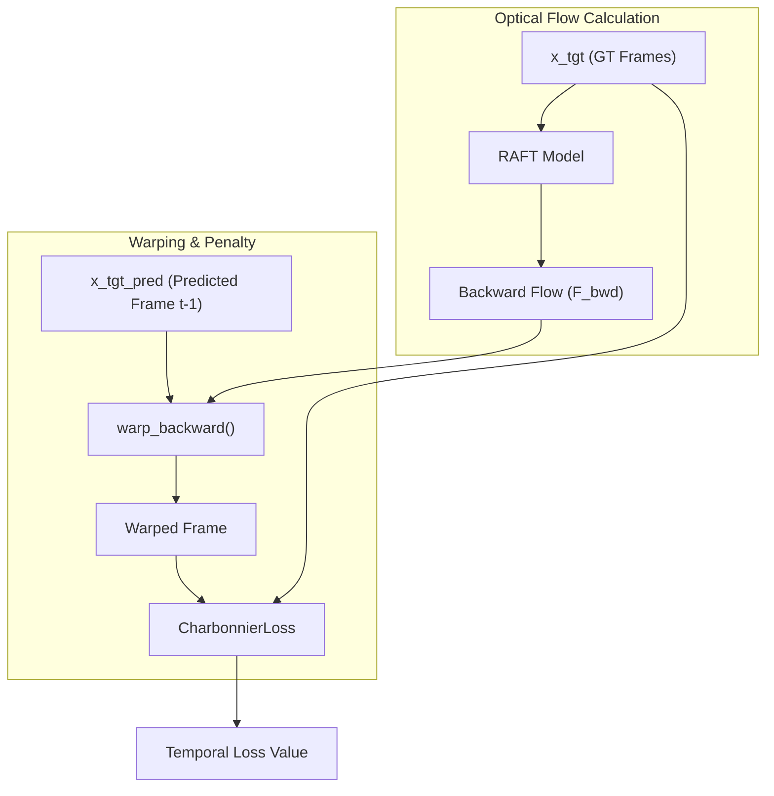
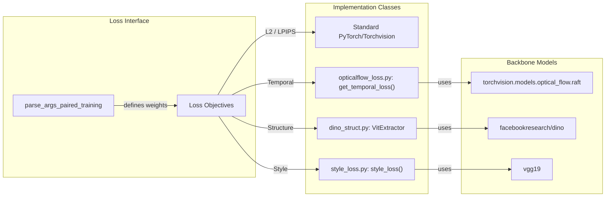
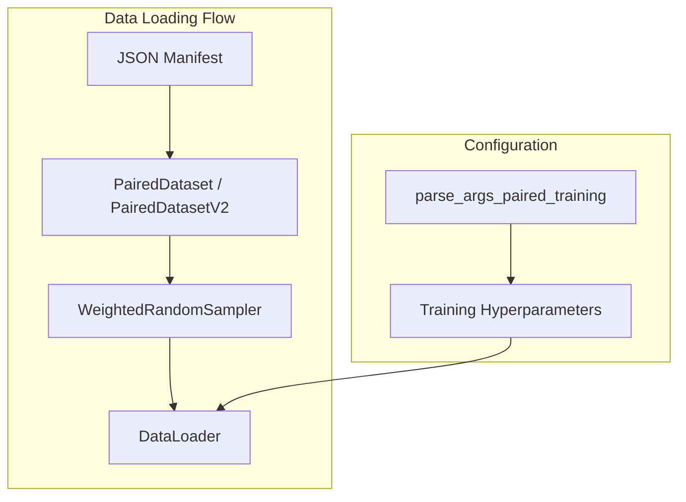

<!-- source: DeepWiki mcp.deepwiki.com · repo NVIDIA/harmonizer · page 3.2 Loss Functions & Training Utilities · fetched 2026-10-26 -->

# Loss Functions & Training Utilities

Relevant source files

The following files were used as context for generating this wiki page:

- [src/opticalflow_loss.py](src/opticalflow_loss.py)
- [src/utils/__init__.py](src/utils/__init__.py)
- [src/utils/dino_struct.py](src/utils/dino_struct.py)
- [src/utils/style_loss.py](src/utils/style_loss.py)
- [src/utils/training_utils.py](src/utils/training_utils.py)

This page documents the loss components and data utilities used to train the Harmonizer model. The training pipeline utilizes a multi-objective loss strategy combining reconstruction, perceptual, adversarial, structural, and temporal constraints to ensure high-fidelity image harmonization.

## Loss Function Components

Harmonizer employs a hybrid loss function to optimize the Pix2Pix-Turbo architecture. The total loss is a weighted sum of several components, controlled by hyperparameters defined in the training configuration.

### Reconstruction and Perceptual Losses
*   **L2 Loss**: Measures the pixel-wise mean squared error between the predicted harmonized frame and the ground truth.
*   **LPIPS Loss**: A perceptual loss that uses deep features to ensure the output is visually similar to the target beyond pixel-level alignment.
*   **GAN Loss**: Vision-aided adversarial loss using a discriminator (typically `vagan_clip`) to improve realism [src/utils/training_utils.py:37-39]().

### Style and Structural Losses
*   **Gram/Style Loss**: Implemented in `src/utils/style_loss.py`, this calculates the correlation between feature maps of a VGG network to match the style of the target image [src/utils/style_loss.py:65-89]().
*   **DINO Structural Loss**: Implemented in `src/utils/dino_struct.py`, this uses a Vision Transformer (ViT) from the DINO framework to extract self-similarity matrices. It ensures that the spatial structure of the input is preserved in the harmonized output [src/utils/dino_struct.py:29-104]().

### Temporal Loss (Optical Flow)
To ensure temporal consistency in video sequences, Harmonizer uses an optical-flow-based loss. It employs the **RAFT** (Recurrent All-Pairs Field-Iterative Network) model to compute backward flow between frames and penalizes discrepancies in warped coordinates.

*   **RAFT Integration**: The `TorchvisionRAFT` class wraps the `torchvision` implementation of RAFT [src/opticalflow_loss.py:46-65]().
*   **Warping**: The `warp_backward` function uses the backward flow $F_{t \to t-1}$ to warp the source at $t-1$ into $t$ coordinates [src/opticalflow_loss.py:24-34]().
*   **Charbonnier Loss**: A robust loss function used to compare the warped frame with the target, defined as $\sqrt{x^2 + \epsilon^2}$ [src/opticalflow_loss.py:37-43]().

**Temporal Loss Data Flow**

Sources: [src/opticalflow_loss.py:78-114](), [src/utils/style_loss.py:65-89](), [src/utils/dino_struct.py:29-104]()

---

## Training Utilities

The training process is supported by specialized dataset classes and argument parsers found in `src/utils/training_utils.py`.

### Dataset Classes
The repository provides two primary dataset implementations for paired training:
1.  **PairedDataset**: Standard implementation for loading pairs of (source, target) images.
2.  **PairedDatasetV2**: An optimized version for large-scale training.

### Sampling and Weighting
*   **WeightedRandomSampler**: Used to handle data imbalance across different harmonization tasks (e.g., relighting vs. artifact correction).
*   **Fixing Data Weight**: The training utility allows prioritizing specific data types via the `--fixing_data_weight` argument during argument parsing [src/utils/training_utils.py:180-184]().

### Argument Parsing
The function `parse_args_paired_training` defines the command-line interface for the training script, covering loss weights, model architecture (LoRA ranks), and training hyperparameters.

| Argument | Default | Description |
| :--- | :--- | :--- |
| `--lambda_l2` | 1.0 | Weight for pixel-wise L2 loss [src/utils/training_utils.py:42]() |
| `--lambda_lpips` | 5.0 | Weight for LPIPS perceptual loss [src/utils/training_utils.py:40]() |
| `--lambda_gan` | 0.5 | Weight for adversarial loss [src/utils/training_utils.py:39]() |
| `--lambda_gram` | 1.0 | Weight for style loss [src/utils/training_utils.py:44]() |
| `--lambda_opticalflow` | 0.0 | Weight for temporal consistency loss [src/utils/training_utils.py:46]() |
| `--lora_rank_unet` | 8 | Rank for U-Net LoRA adapters [src/utils/training_utils.py:83]() |

Sources: [src/utils/training_utils.py:27-184]()

---

## Code Entity Mapping

The following diagram bridges the mathematical loss concepts to their specific class and function implementations within the codebase.

**Loss Entity Relationship**

**Training Data Utilities**

Sources: [src/utils/training_utils.py:27-50](), [src/opticalflow_loss.py:46-55](), [src/utils/dino_struct.py:38-40]()

---

