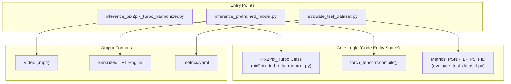
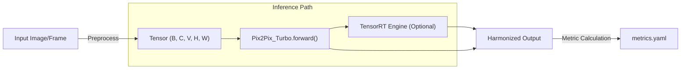

<!-- source: DeepWiki mcp.deepwiki.com · repo NVIDIA/harmonizer · page 4 Inference · fetched 2026-10-26 -->

# Inference

Relevant source files

The following files were used as context for generating this wiki page:

- [src/inference_exported_model.py](src/inference_exported_model.py)
- [src/inference_pix2pix_turbo_harmonizer.py](src/inference_pix2pix_turbo_harmonizer.py)
- [src/inference_pretrained_model.py](src/inference_pretrained_model.py)

The Harmonizer repository provides three distinct inference paths designed for different use cases: autoregressive temporal video processing, high-performance TensorRT-accelerated deployment, and standardized metric evaluation. 

All inference modes utilize the `Pix2Pix_Turbo` architecture, which leverages a single-step diffusion paradigm for image-to-image translation.

### Inference Pathways Overview

The following diagram illustrates the relationship between the different inference scripts and the underlying code entities they utilize.

**Inference Architecture & Code Entity Map**

Sources: [src/inference_pix2pix_turbo_harmonizer.py:1-14](), [src/inference_pretrained_model.py:10-21](), [src/inference_exported_model.py:38-56]()

---

### 4.1 Temporal Inference with the Pretrained Harmonizer
The primary script for processing image sequences or videos is `inference_pix2pix_turbo_harmonizer.py`. It implements **autoregressive temporal conditioning**, where the model exploits temporal context by receiving the current frame alongside previously predicted frames.

- **Autoregressive Mechanism**: Frames are fed into the model with an `offset_list` (defaulting to `[-1, -2, -3, -4]`) representing indices of past predictions [src/inference_pix2pix_turbo_harmonizer.py:78-83]().
- **Resolution Mapping**: Supports specific aspect ratios (e.g., 1024x576) via a `RESOLUTION_MAP` to ensure compatibility with the underlying DiT backbone [src/inference_pix2pix_turbo_harmonizer.py:50-54]().
- **Fallback Mode**: If insufficient history exists (e.g., at the start of a video), the script falls back to a non-temporal pass where the temporal dimension $V=1$ [src/inference_pix2pix_turbo_harmonizer.py:133-141]().

For details, see [Temporal Inference with the Pretrained Harmonizer](#4.1).

Sources: [src/inference_pix2pix_turbo_harmonizer.py:9-14](), [src/inference_pix2pix_turbo_harmonizer.py:112-115]()

---

### 4.2 TensorRT-Accelerated Inference
For production environments requiring low latency, Harmonizer supports acceleration via **NVIDIA TensorRT**. This path is managed by `inference_pretrained_model.py` (for compilation and benchmarking) and `inference_exported_model.py` (for loading pre-compiled engines).

- **Speed Benchmarking**: The pipeline can achieve significant throughput on H100 GPUs, with latencies as low as ~23ms for large batches [src/inference_pretrained_model.py:4-8]().
- **Compilation**: The `load_and_compile_model` function uses `torch_tensorrt` to optimize the UNet/DiT and VAE components for a specific batch size and resolution [src/inference_pretrained_model.py:144-153]().
- **Exported Models**: Compiled models are stored with a `meta.json` file to ensure consistency in `dtype`, `batch_size`, and `image_size` during deployment [src/inference_exported_model.py:70-71](), [src/inference_exported_model.py:105-109]().

For details, see [TensorRT-Accelerated Inference](#4.2).

Sources: [src/inference_pretrained_model.py:109-137](), [src/inference_exported_model.py:59-67]()

---

### 4.3 Evaluation: Metrics & Test Dataset
The `evaluate_test_dataset.py` script provides a standardized way to measure the performance of a Harmonizer checkpoint against a ground-truth dataset.

- **Metrics Suite**: Calculates Peak Signal-to-Noise Ratio (PSNR), Learned Perceptual Image Patch Similarity (LPIPS), and Fréchet Inception Distance (FID).
- **Data Structure**: Expects a specific directory hierarchy containing scenes with subfolders for renders (inputs) and ground truth (GT).
- **Reporting**: Outputs results to a `metrics.yaml` file for easy comparison between different training runs or model iterations.

For details, see [Evaluation: Metrics & Test Dataset](#4.3).

---

### Summary of Inference Modes

| Feature | Temporal Inference | TensorRT Inference | Evaluation Mode |
| :--- | :--- | :--- | :--- |
| **Script** | `inference_pix2pix_turbo_harmonizer.py` | `inference_pretrained_model.py` | `evaluate_test_dataset.py` |
| **Primary Goal** | Temporal consistency in videos | Maximum throughput / Low latency | Quantitative benchmarking |
| **Input** | Image directory / Video frames | Tensors / Batched images | Scene-based test dataset |
| **Key Tech** | Autoregressive conditioning | `torch_tensorrt` compilation | PSNR / LPIPS / FID |

**Data Flow from Input to Optimized Output**

Sources: [src/inference_pix2pix_turbo_harmonizer.py:138-144](), [src/inference_exported_model.py:45-56](), [src/inference_pretrained_model.py:77-81]()

---

