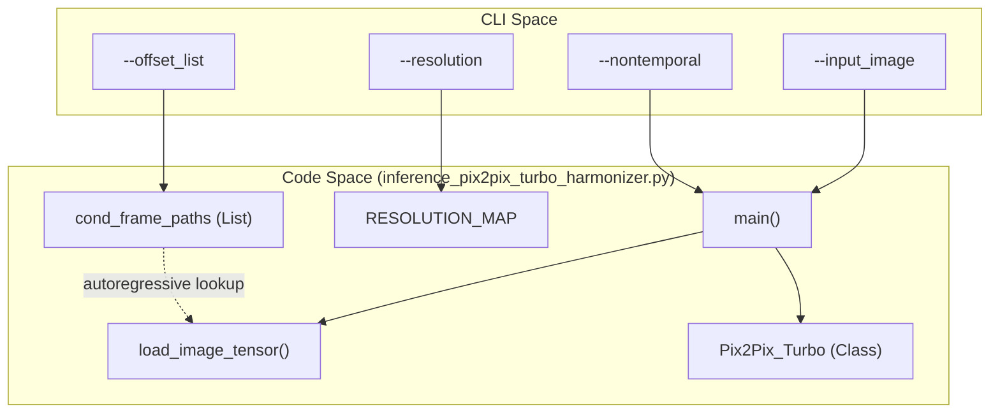
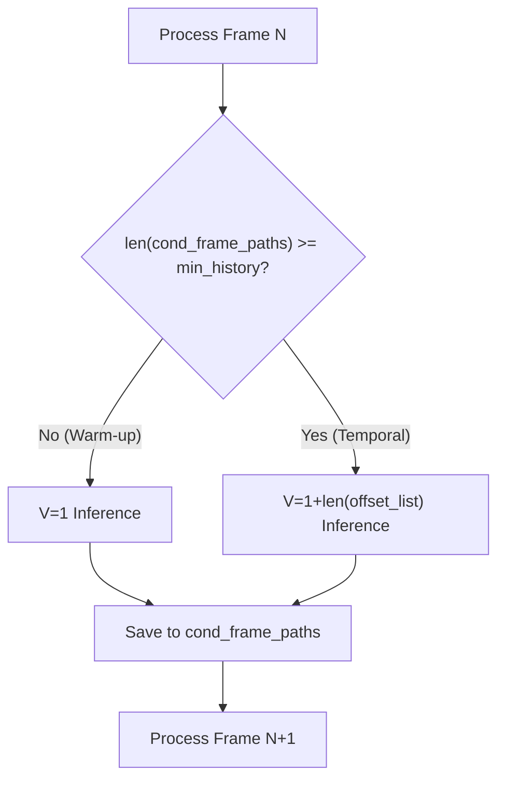

<!-- source: DeepWiki mcp.deepwiki.com · repo NVIDIA/harmonizer · page 4.1 Temporal Inference with the Pretrained Harmonizer · fetched 2026-10-26 -->

# Temporal Inference with the Pretrained Harmonizer

<details>
<summary>Relevant source files</summary>

The following files were used as context for generating this wiki page:

- [examples/0.png](examples/0.png)
- [examples/1.png](examples/1.png)
- [examples/2.png](examples/2.png)
- [src/inference_pix2pix_turbo_harmonizer.py](src/inference_pix2pix_turbo_harmonizer.py)

</details>


The Harmonizer provides a specialized inference script designed for video harmonization and image-to-image translation with temporal consistency. The primary entry point for this functionality is `src/inference_pix2pix_turbo_harmonizer.py`, which implements an autoregressive conditioning strategy to ensure visual stability across frames.

## Purpose and Scope

The temporal inference pipeline is designed to process sequences of images (video frames) by leveraging previously generated outputs as context for the current frame [src/inference_pix2pix_turbo_harmonizer.py:9-14](). It supports:
*   **Autoregressive Conditioning**: Using a sliding window of past predictions to guide the current generation.
*   **Non-temporal Fallback**: Automatically switching to single-frame inference when insufficient history is available.
*   **Resolution Management**: Mapping standard input resolutions to model-compatible aspect ratios.
*   **Video Assembly**: Automated conversion of processed image sequences into `.mp4` files.

## Implementation Details

### Data Flow and Temporal Conditioning
The inference logic uses an autoregressive loop. For each frame in the input directory, the script checks if enough prior frames have been processed to satisfy the `offset_list` requirement [src/inference_pix2pix_turbo_harmonizer.py:133-135]().

1.  **Input Loading**: The current frame is resized according to the `RESOLUTION_MAP` [src/inference_pix2pix_turbo_harmonizer.py:50-54]() and normalized to the range $[-1, 1]$ [src/inference_pix2pix_turbo_harmonizer.py:130-131]().
2.  **Context Selection**: If `have_history` is true, the script retrieves paths from `cond_frame_paths` using the negative indices provided in `--offset_list` (defaulting to `[-1, -2, -3, -4]`) [src/inference_pix2pix_turbo_harmonizer.py:78-83]().
3.  **Tensor Stacking**: The current frame and reference frames are stacked into a 5D tensor of shape $(B, C, V, H, W)$ where $V = 1 + \text{len(offset\_list)}$ [src/inference_pix2pix_turbo_harmonizer.py:136-139]().
4.  **Model Forward**: The `Pix2Pix_Turbo` model processes the video tensor [src/inference_pix2pix_turbo_harmonizer.py:143-144]().
5.  **Output Persistence**: The resulting frame is saved to disk and its path is appended to `cond_frame_paths` for future iterations [src/inference_pix2pix_turbo_harmonizer.py:150-152]().

### Code Entity Space: Inference Logic
The following diagram illustrates the relationship between the command-line arguments and the internal execution flow.

**Inference Execution Map**

Sources: [src/inference_pix2pix_turbo_harmonizer.py:50-54](), [src/inference_pix2pix_turbo_harmonizer.py:65-89](), [src/inference_pix2pix_turbo_harmonizer.py:99-108](), [src/inference_pix2pix_turbo_harmonizer.py:123-125]()

## Key Functions and Classes

### Resolution Map
The model requires specific dimensions to maintain performance and aspect ratio consistency. The `RESOLUTION_MAP` defines these targets:
| Target Width | Target Height | Choice Key |
| :--- | :--- | :--- |
| 1024 | 576 | 1024 |
| 960 | 544 | 960 |
| 1360 | 768 | 1360 |

Sources: [src/inference_pix2pix_turbo_harmonizer.py:50-54]()

### Autoregressive Handling
The logic distinguishes between the first few frames of a sequence and the steady-state temporal processing:

**Temporal Transition Logic**

Sources: [src/inference_pix2pix_turbo_harmonizer.py:133-142]()

### Video Assembly
If the `--save_video` flag is provided, the script invokes `save_folder2video`. This function:
1.  Gathers all processed `.png` and `.jpg` files using `natsorted` [src/inference_pix2pix_turbo_harmonizer.py:34]().
2.  Ensures frame dimensions are even (required by many video codecs) by cropping a single pixel if necessary [src/inference_pix2pix_turbo_harmonizer.py:36-40]().
3.  Writes the final video at 30 FPS using `imageio.v2.mimwrite` [src/inference_pix2pix_turbo_harmonizer.py:41]().

## Usage Examples

### Docker Execution
Inference should be performed within the Harmonizer Docker environment to ensure all dependencies (like `cosmos-predict2`) are correctly patched.

**Standard Temporal Inference**
```bash
docker run --gpus all -v /path/to/data:/data harmonizer_container \
    python src/inference_pix2pix_turbo_harmonizer.py \
    --input_image /data/input_sequence \
    --model_path /data/checkpoints/harmonizer.pkl \
    --resolution 1024 \
    --offset_list -1 -2 -3 -4 \
    --save_video
```

**Non-Temporal (Frame-by-Frame) Mode**
To disable temporal conditioning and process frames in isolation, use the `--nontemporal` flag [src/inference_pix2pix_turbo_harmonizer.py:85-88]().
```bash
docker run --gpus all -v /path/to/data:/data harmonizer_container \
    python src/inference_pix2pix_turbo_harmonizer.py \
    --input_image /data/input_sequence \
    --model_path /data/checkpoints/harmonizer.pkl \
    --nontemporal
```

Sources: [src/inference_pix2pix_turbo_harmonizer.py:65-89](), [src/inference_pix2pix_turbo_harmonizer.py:154-155]()

---

