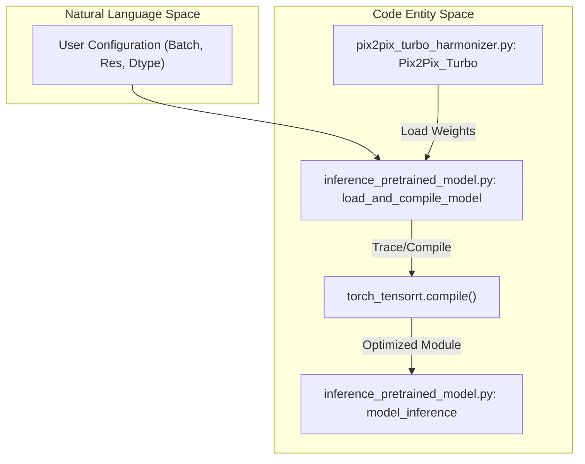
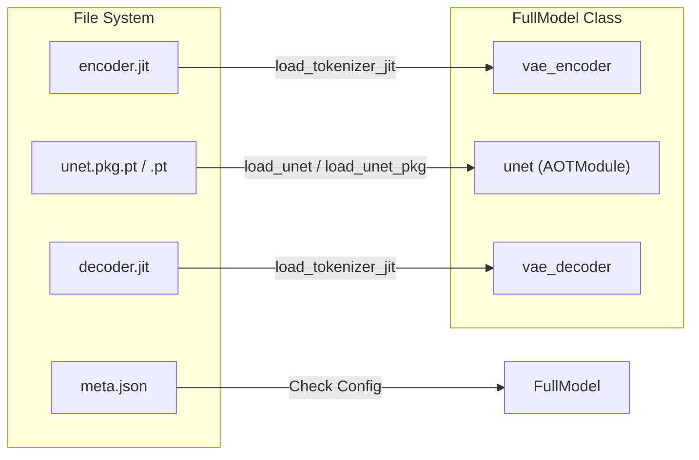

<!-- source: DeepWiki mcp.deepwiki.com · repo NVIDIA/harmonizer · page 4.2 TensorRT-Accelerated Inference · fetched 2026-10-26 -->

# TensorRT-Accelerated Inference

Relevant source files

The following files were used as context for generating this wiki page:

- [src/inference_exported_model.py](src/inference_exported_model.py)
- [src/inference_pretrained_model.py](src/inference_pretrained_model.py)
- [src/utils/profiling.py](src/utils/profiling.py)

This page documents the high-performance inference paths for Harmonizer using **NVIDIA TensorRT**. It covers the compilation of pretrained models into optimized engines, the benchmarking utilities for measuring latency on hardware like the H100, and the handling of exported artifacts for production deployment.

## Overview of Inference Paths

Harmonizer provides two primary scripts for TensorRT-accelerated execution:
1.  **`inference_pretrained_model.py`**: A JIT (Just-In-Time) path that loads a standard PyTorch checkpoint, compiles it using `torch_tensorrt`, and runs benchmarks or image-to-video inference.
2.  **`inference_exported_model.py`**: An AOT (Ahead-Of-Time) path designed to load pre-compiled model packages (e.g., `.pkg.pt` or TorchScript files) and execute them within a unified `FullModel` wrapper.

### Latency Performance (H100)
The following figures represent typical performance on an NVIDIA H100 GPU using half-precision (`float16`/`bfloat16`):
*   **Batch 1**: 38ms
*   **Batch 8**: 24ms per sample
*   **Batch 64**: 23ms per sample

Sources: `[src/inference_pretrained_model.py:4-8]()`

---

## The Compilation Pipeline

The core of the acceleration logic resides in the `load_and_compile_model` function. This function wraps the `Pix2Pix_Turbo` model and utilizes `torch_tensorrt` to optimize the compute graph for a specific batch size and resolution.

### System Flow: Compilation to Execution
The diagram below illustrates how a standard checkpoint is transformed into an optimized engine.

**Pretrained Model Compilation Flow**

Sources: `[src/inference_pretrained_model.py:144-153]()`, `[src/inference_pretrained_model.py:33-33]()`

### Key Functions
*   **`load_and_compile_model`**: Loads the `Pix2Pix_Turbo` model, sets it to evaluation mode, and applies `torch_tensorrt.compile`. It supports dynamic or static shapes based on the `image_size` and `batch_size` arguments.
*   **`warmup_model`**: Executes dummy inference runs (default `n=10`) to ensure the GPU kernels are initialized before benchmarking begins. `[src/inference_pretrained_model.py:84-107]()`
*   **`speed_measure`**: A benchmarking utility that uses `torch.cuda.Event` to measure precise execution time, calculating latency per sample and peak memory usage. `[src/inference_pretrained_model.py:109-193]()`

---

## Exported Model Inference

For production environments where re-compilation at runtime is undesirable, Harmonizer supports loading exported artifacts. The `FullModel` class provides a unified interface for the VAE Encoder, UNet (DiT), and VAE Decoder.

### Model Loading Logic
The `load_exported_model` function performs strict validation to ensure the environment matches the export-time settings.

**Exported Model Components**

Sources: `[src/inference_exported_model.py:38-57]()`, `[src/inference_exported_model.py:59-116]()`

### Compatibility Checks
The loader verifies several parameters against the `meta.json` file:
*   **TensorRT Version**: Checks the major version of `torch_tensorrt` to prevent serialization errors. `[src/inference_exported_model.py:89-103]()`
*   **Hardware Consistency**: Ensures the target CUDA device index matches the current torch device. `[src/inference_exported_model.py:79-84]()`
*   **Static Shapes**: Validates that `batch_size` and `image_size` match the compiled engine's fixed dimensions. `[src/inference_exported_model.py:106-109]()`

---

## TRT Version Compatibility Shim

To handle variations in `torch_tensorrt` behavior across versions (specifically regarding NVTX profiling and graph breaks), Harmonizer implements a compatibility shim in `src/utils/profiling.py`.

### NVTX Range Decoration
The `NVTXRangeDecorator` allows for profiling specific code blocks in NVIDIA Nsight Systems.
*   **Versions < 2.9.0**: Uses `NullContextDecoratorCompat`, a class-based implementation that avoids `torch.dynamo` graph breaks. `[src/utils/profiling.py:23-49]()`
*   **Versions >= 2.9.0**: Uses a standard `@contextmanager` decorator. `[src/utils/profiling.py:17-20]()`

Sources: `[src/utils/profiling.py:9-14]()`, `[src/utils/profiling.py:53-58]()`

---

## Batch-Size and Resolution Tuning

Inference performance is highly dependent on the input dimensions. The repository provides a standard mapping for video resolutions.

| Resolution (Short Side) | Dimensions (W x H) |
| :--- | :--- |
| 256 | 256 x 144 |
| 512 | 512 x 288 |
| 704 | 704 x 384 |
| 960 | 960 x 544 |
| 1024 | 1024 x 576 |
| 1360 | 1360 x 768 |
| 1920 | 1920 x 1072 |

Sources: `[src/inference_pretrained_model.py:196-210]()`

### Implementation Details
*   **`sample_input_image`**: Generates random noise tensors for benchmarking. `[src/inference_pretrained_model.py:73-74]()`
*   **`save_folder2video`**: After inference, frames are processed (ensuring dimensions are divisible by 2 for FFMPEG compatibility) and compiled into `.mp4` files at 10, 15, and 30 FPS. `[src/inference_pretrained_model.py:48-71]()`

Sources:
- `src/inference_pretrained_model.py`
- `src/inference_exported_model.py`
- `src/utils/profiling.py`

---

