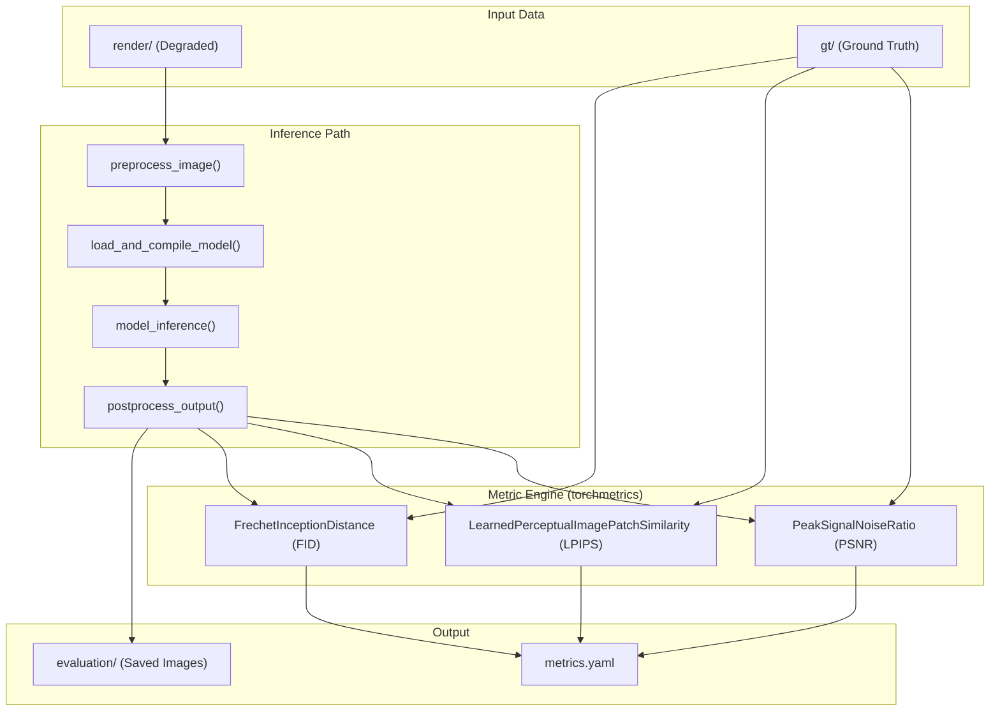
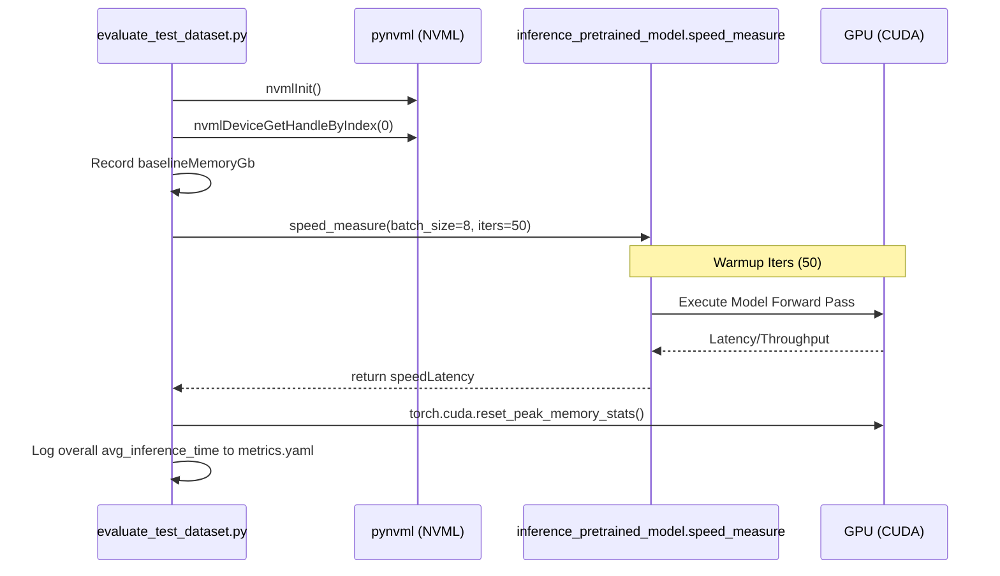

<!-- source: DeepWiki mcp.deepwiki.com · repo NVIDIA/harmonizer · page 4.3 Evaluation: Metrics & Test Dataset · fetched 2026-10-26 -->

# Evaluation: Metrics & Test Dataset

<details>
<summary>Relevant source files</summary>

The following files were used as context for generating this wiki page:

- [doc/test_dataset_preparation_tutorial.md](doc/test_dataset_preparation_tutorial.md)
- [src/evaluate_test_dataset.py](src/evaluate_test_dataset.py)

</details>


This page documents the evaluation pipeline for the Harmonizer model, centered around the `evaluate_test_dataset.py` script. It covers the quantitative metrics used (PSNR, LPIPS, FID), the required directory structure for test datasets, and the methodology for generating these datasets using NuRec-based techniques.

## Overview of Evaluation Pipeline

The evaluation pipeline is designed to provide a rigorous quantitative assessment of the Harmonizer's ability to restore degraded or mismatched renderings. It leverages standard image quality metrics and benchmarks the model's performance in terms of both visual fidelity and computational efficiency (latency and memory).

### Key Components
- **`evaluate_test_dataset.py`**: The primary execution script that handles model loading, inference on the test set, and metric calculation [src/evaluate_test_dataset.py:42-43]().
- **`torchmetrics` Integration**: Uses standardized implementations for Peak Signal-to-Noise Ratio (PSNR), Learned Perceptual Image Patch Similarity (LPIPS), and Fréchet Inception Distance (FID) [src/evaluate_test_dataset.py:27-28]().
- **Performance Benchmarking**: Includes automated speed measurements and GPU memory tracking using `pynvml` [src/evaluate_test_dataset.py:75-86](), [src/evaluate_test_dataset.py:97-105]().

Sources: [src/evaluate_test_dataset.py:1-125]()

## Metrics and Implementation

The evaluation script calculates three primary metrics to evaluate different aspects of image harmonization:

| Metric | Code Entity | Description |
| :--- | :--- | :--- |
| **PSNR** | `PeakSignalNoiseRatio` | Measures pixel-level accuracy. Higher is better. [src/evaluate_test_dataset.py:122]() |
| **LPIPS** | `LearnedPerceptualImagePatchSimilarity` | Measures perceptual similarity using a deep network (AlexNet backbone). Lower is better. [src/evaluate_test_dataset.py:123]() |
| **FID** | `FrechetInceptionDistance` | Measures the statistical similarity between the distribution of generated images and ground truth. Lower is better. [src/evaluate_test_dataset.py:124]() |

### Evaluation Data Flow

The following diagram illustrates how data flows from the test dataset through the model and into the metrics calculation engine.

**Figure 1: Evaluation Logic and Metric Calculation**

Sources: [src/evaluate_test_dataset.py:32-39](), [src/evaluate_test_dataset.py:120-125](), [doc/test_dataset_preparation_tutorial.md:71-83]()

## Test Dataset Structure

For the evaluation script to function correctly, the dataset must follow a strict hierarchical structure organized by scene and camera.

### Directory Layout
The script expects the `--input` directory to be organized as follows:
- **`{scene_id}/`**: A unique folder for each test scene [doc/test_dataset_preparation_tutorial.md:36]().
    - **`render/`**: Input images containing artifacts or degradations [doc/test_dataset_preparation_tutorial.md:37]().
    - **`gt/`**: High-quality ground truth reference images [doc/test_dataset_preparation_tutorial.md:38]().
        - **`{camera_id}/`**: Sub-folders for specific camera viewpoints (e.g., `camera_front`) [doc/test_dataset_preparation_tutorial.md:39]().
            - **`{timestamp}.png`**: Individual frames. Filenames must match exactly between `render` and `gt` [doc/test_dataset_preparation_tutorial.md:44-46]().

Sources: [doc/test_dataset_preparation_tutorial.md:9-47]()

## Preparation using NuRec

Test datasets are typically generated using the **NuRec (Neural Reconstruction)** framework. This ensures that the evaluation data reflects the same types of degradations the model was trained to handle.

### Generation Methods
1.  **Sparse Reconstruction**: Generating ground truth from high-density data and "render" inputs from sparse, lower-quality neural reconstructions [doc/test_dataset_preparation_tutorial.md:51]().
2.  **Model Underfitting**: Using early-checkpoint neural reconstructions as the "render" input to simulate blur and geometry artifacts.
3.  **Cross-Reference**: Using different sensor data or lighting conditions to create the input/GT pair.

Sources: [doc/test_dataset_preparation_tutorial.md:49-51](), [doc/dataset_preparation_tutorial.md]()

## Execution and Output

### Running the Evaluation
The script is executed via the command line, requiring the path to the pretrained model and the input dataset:

```bash
python /work/src/evaluate_test_dataset.py \
  --model /work/models/diffusion_harmonizer.pkl \
  --input /work/test_dataset \
  --output /work/evaluation
```
[doc/test_dataset_preparation_tutorial.md:63-67]()

### Output: metrics.yaml
The script generates a `metrics.yaml` file containing comprehensive results. This includes overall dataset averages and per-scene breakdowns [doc/test_dataset_preparation_tutorial.md:78-83]().

| Section | Key | Description |
| :--- | :--- | :--- |
| **overall** | `psnr_mean` | Average PSNR across all processed images. |
| | `lpips_mean` | Average LPIPS across all processed images. |
| | `avg_inference_time` | Latency per image in seconds. |
| **per_scene** | `{scene_id}` | Specific metrics for that scene to identify edge-case failures. |

Sources: [doc/test_dataset_preparation_tutorial.md:86-101](), [src/evaluate_test_dataset.py:43-51]()

## Hardware Benchmarking Logic

Before evaluating image quality, the script performs a speed benchmark to ensure the model meets deployment latency requirements.

**Figure 2: System Resource and Latency Monitoring**

Sources: [src/evaluate_test_dataset.py:75-86](), [src/evaluate_test_dataset.py:93-105](), [src/evaluate_test_dataset.py:38]()

---

