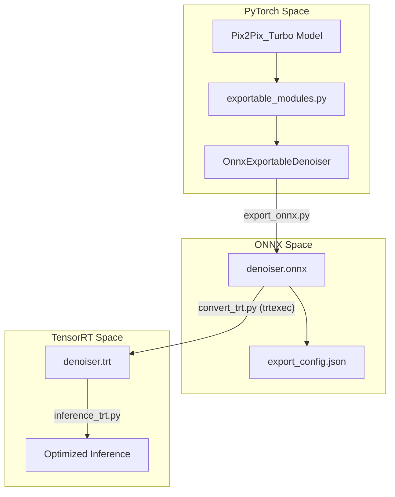
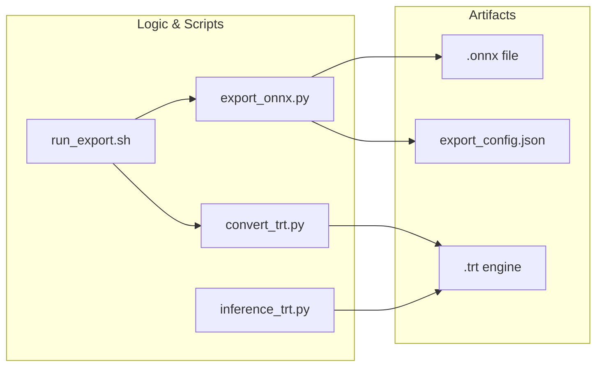

<!-- source: DeepWiki mcp.deepwiki.com · repo NVIDIA/harmonizer · page 5 ONNX Export & TensorRT Deployment · fetched 2026-10-26 -->

# ONNX Export & TensorRT Deployment

Relevant source files

The following files were used as context for generating this wiki page:

- [src/onnx_export/README.md](src/onnx_export/README.md)
- [src/onnx_export/__init__.py](src/onnx_export/__init__.py)

The `onnx_export/` sub-package provides a specialized pipeline for transitioning Harmonizer models from PyTorch research environments to production-ready inference engines. This module facilitates the conversion of core model components into ONNX format and subsequent optimization into TensorRT engines, enabling high-performance deployment on NVIDIA GPUs [src/onnx_export/README.md:1-11]().

## Overview of the Export Pipeline

The deployment workflow is structured into three primary stages: exporting the PyTorch modules, converting the resulting ONNX graphs into optimized TensorRT engines, and executing inference via specialized runners [src/onnx_export/README.md:7-11]().

The following diagram illustrates the transition from the training environment to the deployment artifacts:

### Export Pipeline Flow

**Sources:** [src/onnx_export/README.md:5-11](), [src/onnx_export/exportable_modules.py:1-22](), [src/onnx_export/export_onnx.py:1-55]()

## Component Architecture

The `onnx_export` module encapsulates the complexity of the Harmonizer architecture into export-friendly wrappers. While the current implementation focuses primarily on the **Denoiser**, the infrastructure is designed to handle the VAE components as well.

| Class Name | Source File | Responsibility |
| :--- | :--- | :--- |
| `OnnxExportableDenoiser` | [src/onnx_export/exportable_modules.py:14-14]() | Wraps the DiT backbone for ONNX compatibility. |
| `OnnxExportableVAEEncoder` | [src/onnx_export/exportable_modules.py:12-12]() | Prepares the VAE Encoder for graph export. |
| `OnnxExportableVAEDecoder` | [src/onnx_export/exportable_modules.py:13-13]() | Prepares the VAE Decoder for graph export. |

**Sources:** [src/onnx_export/__init__.py:11-21](), [src/onnx_export/exportable_modules.py:1-22]()

## Exporting to ONNX

The first step in the deployment process is converting the PyTorch weights into a static computational graph. This process requires defining fixed dimensions for the model inputs, including batch size and image resolution [src/onnx_export/README.md:108-111]().

Key characteristics of the export process:
* **Fixed Batch Size:** Unlike the dynamic PyTorch training loop, ONNX exports are optimized for a specific batch size [src/onnx_export/README.md:108-111]().
* **Precision:** Supports `bfloat16` and `float32` exports [src/onnx_export/README.md:48-48]().
* **Automation:** The `run_export.sh` script provides a unified entry point for both ONNX export and TensorRT conversion [src/onnx_export/README.md:15-33]().

For detailed configuration of the export pipeline, including opset versions and the `dynamo` flag, see **[Exporting to ONNX](#5.1)**.

**Sources:** [src/onnx_export/README.md:37-55](), [src/onnx_export/run_export.sh:1-33]()

## TensorRT Conversion & Inference

Once the ONNX graph is generated, it is compiled into a TensorRT engine. This step performs hardware-specific optimizations such as layer fusion and kernel auto-tuning for the target NVIDIA GPU [src/onnx_export/README.md:66-75]().

### Deployment Considerations
* **Skip Connection Limitation:** A critical architectural note is that **VAE skip connections are NOT supported** in the ONNX export mode. Because the encoder and decoder are treated as separate graphs, intermediate activations cannot be shared, which may lead to slight output variations compared to the native PyTorch model [src/onnx_export/README.md:102-107]().
* **Inference Runner:** The `inference_trt.py` script manages the loading of engines and handles data movement between the CPU and GPU [src/onnx_export/README.md:80-98]().

For details on `trtexec` flags, precision settings, and benchmarking, see **[TensorRT Conversion & Inference](#5.2)**.

### System Mapping: Code to Deployment

**Sources:** [src/onnx_export/README.md:127-138](), [src/onnx_export/run_export.sh:1-33]()

**Sources:**
* [src/onnx_export/README.md:1-142]()
* [src/onnx_export/__init__.py:1-22]()
* [src/onnx_export/exportable_modules.py:1-22]()

---

