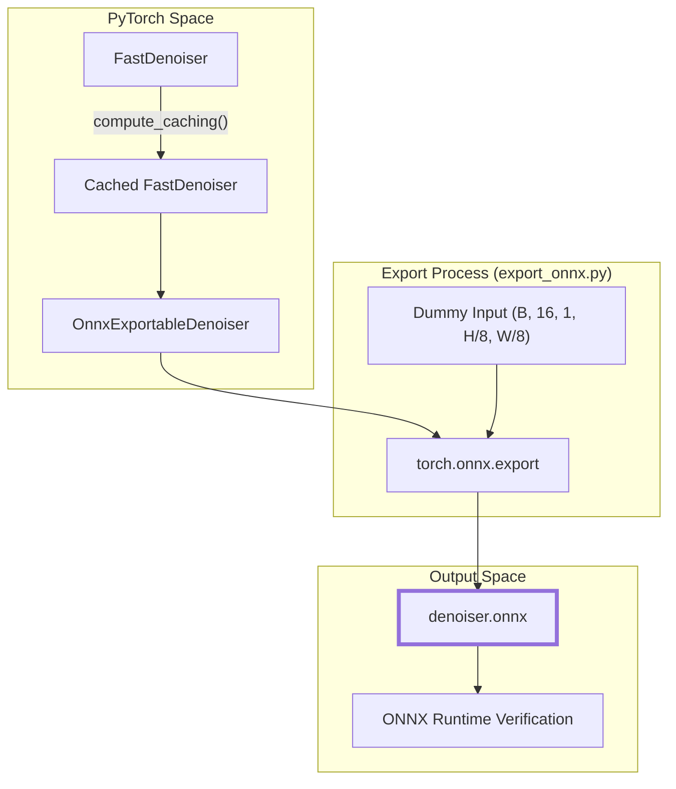

<!-- source: DeepWiki mcp.deepwiki.com · repo NVIDIA/harmonizer · page 5.1 Exporting to ONNX · fetched 2026-10-26 -->

# Exporting to ONNX

Relevant source files

The following files were used as context for generating this wiki page:

- [src/onnx_export/export_and_benchmark.sh](src/onnx_export/export_and_benchmark.sh)
- [src/onnx_export/export_onnx.py](src/onnx_export/export_onnx.py)
- [src/onnx_export/exportable_modules.py](src/onnx_export/exportable_modules.py)
- [src/onnx_export/run_export.sh](src/onnx_export/run_export.sh)

This page documents the pipeline for exporting Harmonizer model components into ONNX format. This process is a prerequisite for TensorRT acceleration and production deployment. The export logic is designed to convert the dynamic PyTorch modules into static computational graphs by baking in cached parameters and removing control flow that is incompatible with ONNX.

## Export Architecture

The export pipeline transitions the model from a dynamic PyTorch environment to a static ONNX graph. Because the Harmonizer (based on Cosmos-Predict2) uses complex conditioning and temporal caching, the export process utilizes wrapper classes to "freeze" these dynamic aspects for a specific inference configuration (fixed batch size, resolution, and timestep).

### Entity Mapping: Natural Language to Code

The following diagram maps high-level export concepts to their corresponding implementation entities in the `src/onnx_export/` directory.

| System Concept | Code Entity | File |
| :--- | :--- | :--- |
| **Export Wrapper** | `OnnxExportableDenoiser` | [src/onnx_export/exportable_modules.py:86-96]() |
| **Module Factory** | `create_exportable_modules` | [src/onnx_export/exportable_modules.py:49-50]() |
| **Export Logic** | `export_denoiser` | [src/onnx_export/export_onnx.py:129-139]() |
| **Verification** | `verify_onnx` | [src/onnx_export/export_onnx.py:166-167]() |
| **CLI Entry** | `main` | [src/onnx_export/export_onnx.py:201-202]() |

### Data Flow: PyTorch to ONNX

**Sources:** [src/onnx_export/exportable_modules.py:86-173](), [src/onnx_export/export_onnx.py:129-164]()

## Exportable Modules

The `exportable_modules.py` file contains wrapper classes that modify the original model behavior to satisfy ONNX constraints.

### OnnxExportableDenoiser
The `OnnxExportableDenoiser` is the primary wrapper for the DiT (Diffusion Transformer) backbone. It handles several critical conversions:
1.  **Parameter Baking**: It takes the dynamically calculated scaling coefficients (`c_skip`, `c_out`, `c_in`) from `FastDenoiser` and registers them as buffers [src/onnx_export/exportable_modules.py:122-124]().
2.  **Static Forward Pass**: The `forward` method is simplified to a linear combination of the skip connection and the DiT output: `x0 = c_skip * xt + c_out * net_output` [src/onnx_export/exportable_modules.py:170-171]().
3.  **Graph Stabilization**: It disables `use_cuda_graphs` and ensures the output is cast to float for consistency [src/onnx_export/exportable_modules.py:167-168]().

### VAE Encoder and Decoder
*   **OnnxExportableVAEEncoder**: Wraps the VAE's `encode` method, adding the necessary time dimension `[B, 3, H, W] -> [B, 3, 1, H, W]` required by the underlying Cosmos tokenizer [src/onnx_export/exportable_modules.py:21-47]().
*   **OnnxExportableVAEDecoder**: Wraps the `decode` method. **Note**: Skip connections between the encoder and decoder are explicitly unsupported in ONNX mode because they represent separate graphs [src/onnx_export/exportable_modules.py:65-69]().

**Sources:** [src/onnx_export/exportable_modules.py:21-84](), [src/onnx_export/exportable_modules.py:86-173]()

## The Export Script (`export_onnx.py`)

The `export_onnx.py` script orchestrates the conversion process. It requires specific environment parameters to generate a valid static graph.

### Key Configuration Parameters
| Parameter | Default | Description |
| :--- | :--- | :--- |
| `--batch_size` | 8 | Fixed batch size for the ONNX graph [src/onnx_export/export_onnx.py:209]() |
| `--height` / `--width` | 544 / 960 | Input resolution (must be multiples of 8) [src/onnx_export/export_onnx.py:211-214]() |
| `--timestep` | 400 | The diffusion timestep to bake into the denoiser [src/onnx_export/export_onnx.py:215]() |
| `--opset_version` | 17 | ONNX opset version (17 is recommended for modern TRT) [src/onnx_export/export_onnx.py:219]() |
| `--use_dynamo` | False | Whether to use the Torch Dynamo export path [src/onnx_export/export_onnx.py:221]() |

### Verification Logic
After export, the script optionally performs verification using `onnxruntime` [src/onnx_export/export_onnx.py:166-198](). It compares the output of the exported ONNX model against the original PyTorch model using the same dummy input. A warning is issued if the `max_diff` exceeds a tolerance of `1e-2` [src/onnx_export/export_onnx.py:185-191]().

**Sources:** [src/onnx_export/export_onnx.py:1-25](), [src/onnx_export/export_onnx.py:166-198](), [src/onnx_export/export_onnx.py:201-225]()

## Automation Scripts

The repository provides two shell scripts to streamline the export and optimization process.

### `run_export.sh`
A convenience wrapper for `export_onnx.py` and `convert_trt.py`. It manages directory creation and sequential execution of the export and conversion steps.
*   **Default Behavior**: Exports only the `denoiser` component in `bfloat16` [src/onnx_export/run_export.sh:14-23]().
*   **Component Selection**: The `--export_components` flag allows choosing between `all`, `encoder`, `denoiser`, or `decoder` [src/onnx_export/run_export.sh:77]().

### `export_and_benchmark.sh`
Extends the export process by automatically running a performance benchmark after the TensorRT engine is created.
*   **Benchmark Setup**: Runs 10 warmup iterations followed by 100 benchmark iterations [src/onnx_export/export_and_benchmark.sh:160-161]().
*   **Fallback**: If TensorRT engines are not found, it attempts to benchmark the raw ONNX models [src/onnx_export/export_and_benchmark.sh:148-155]().

**Sources:** [src/onnx_export/run_export.sh:1-174](), [src/onnx_export/export_and_benchmark.sh:1-175]()

---

