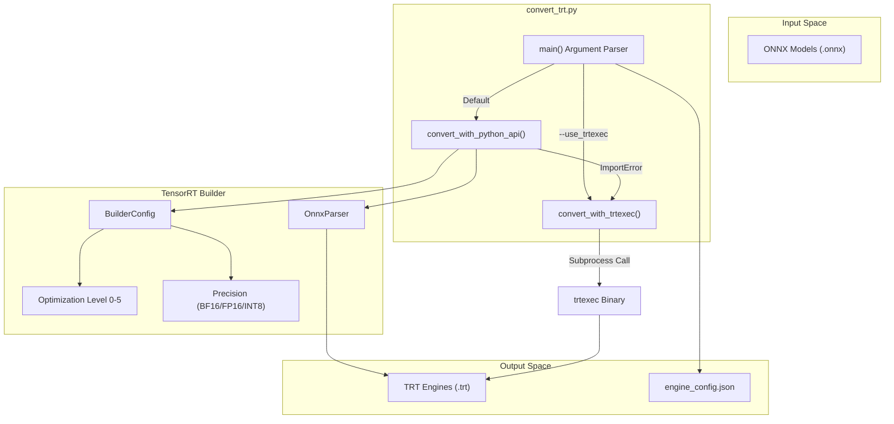
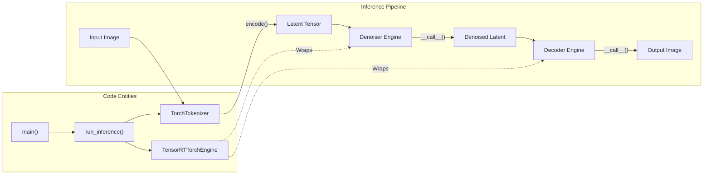

<!-- source: DeepWiki mcp.deepwiki.com · repo NVIDIA/harmonizer · page 5.2 TensorRT Conversion & Inference · fetched 2026-10-26 -->

# TensorRT Conversion & Inference

Relevant source files

The following files were used as context for generating this wiki page:

- [src/onnx_export/convert_trt.py](src/onnx_export/convert_trt.py)
- [src/onnx_export/inference_trt.py](src/onnx_export/inference_trt.py)

This page documents the deployment pipeline for Harmonizer models using NVIDIA TensorRT. The process involves converting exported ONNX models into optimized TensorRT engines and executing high-performance inference using a specialized PyTorch-compatible engine wrapper.

## TensorRT Conversion with `convert_trt.py`

The `convert_trt.py` script serves as a wrapper for both the TensorRT Python API and the `trtexec` command-line utility. It is designed to transform the three primary components of the Harmonizer pipeline—VAE Encoder, Denoiser, and VAE Decoder—into serialized engines [src/onnx_export/convert_trt.py:18-21]().

### Conversion Mechanisms
The script implements two primary paths for engine generation:
1.  **Python API (`convert_with_python_api`)**: Utilizes `tensorrt.Builder` and `tensorrt.OnnxParser` to create an explicit batch network [src/onnx_export/convert_trt.py:126-128](). It allows for fine-grained control over memory pool limits and optimization levels [src/onnx_export/convert_trt.py:139-141]().
2.  **trtexec (`convert_with_trtexec`)**: A subprocess-based fallback that invokes the `trtexec` binary. This is often more robust for complex model graphs [src/onnx_export/convert_trt.py:39-46]().

### Key Parameters & Flags
| Parameter | Flag | Description |
| :--- | :--- | :--- |
| **Precision** | `--precision` | Supports `fp32`, `fp16`, `bf16`, and `int8`. `bf16` is the default for high-performance Ampere+ GPUs [src/onnx_export/convert_trt.py:193-195](). |
| **Workspace** | `--workspace` | Sets the GPU memory limit (in MB) for builder tactics. Default is 8192MB [src/onnx_export/convert_trt.py:196-197](). |
| **Optimization** | `--optimization_level` | Range 0-5. Higher levels increase build time to find faster kernels [src/onnx_export/convert_trt.py:198-200](). |

### Conversion Data Flow
The following diagram illustrates how `convert_trt.py` orchestrates the transformation from ONNX assets to TensorRT engines.

**Conversion Logic Flow**

Sources: [src/onnx_export/convert_trt.py:39-183](), [src/onnx_export/convert_trt.py:186-205]()

---

## TensorRT Inference with `inference_trt.py`

The `inference_trt.py` script provides a production-ready inference path. It manages the loading of serialized engines and handles the data flow between the VAE and the DiT denoiser.

### The `TensorRTTorchEngine` Class
A critical component of the inference pipeline is the `TensorRTTorchEngine` class. It allows TensorRT to execute directly on PyTorch CUDA tensors without requiring expensive host-to-device (H2D) or device-to-host (D2H) memory copies [src/onnx_export/inference_trt.py:63-64]().

-   **Zero-Copy Execution**: It uses `context.set_tensor_address` with `tensor.data_ptr()` to point TensorRT directly to PyTorch-allocated memory [src/onnx_export/inference_trt.py:120-121]().
-   **Stream Management**: It supports running on a dedicated non-default `torch.cuda.Stream` to prevent synchronization bottlenecks in the `enqueueV3` path [src/onnx_export/inference_trt.py:81-84]().
-   **Asynchronous Dependencies**: It utilizes `wait_stream` to ensure the execution stream waits for the caller's data and the caller waits for the engine's output [src/onnx_export/inference_trt.py:127-135]().

### Inference Modes
1.  **Single Image**: Processes a single file via `--input` and `--output` [src/onnx_export/inference_trt.py:12-14]().
2.  **Batch Processing**: Iterates through a directory using `--input_dir` and `--output_dir` [src/onnx_export/inference_trt.py:17-20]().
3.  **Benchmark Mode**: Executes a specified number of warmup and benchmark iterations to measure average latency [src/onnx_export/inference_trt.py:23-27]().

### VAE Skip-Connection Limitation
In the ONNX/TensorRT export path, the VAE skip-connection mechanism (often used in Pix2Pix-Turbo for high-frequency detail preservation) is restricted. The exported `OnnxExportableVAEDecoder` typically operates in a simplified mode compared to the full PyTorch implementation to ensure compatibility with TensorRT's static graph requirements.

**Inference Code Entity Association**

Sources: [src/onnx_export/inference_trt.py:63-140](), [src/onnx_export/inference_trt.py:160-186](), [src/onnx_export/inference_trt.py:423-450]()

---

## Implementation Details

### Data Flow and Tensor Handling
The inference script ensures that all tensors remain on the GPU throughout the pipeline.

| Step | Operation | Entity | File Reference |
| :--- | :--- | :--- | :--- |
| 1 | Image Loading | `PIL.Image` to `torch.Tensor` | [src/onnx_export/inference_trt.py:433-435]() |
| 2 | VAE Encoding | `CosmosImageTokenizer.encode` | [src/onnx_export/inference_trt.py:177-182]() |
| 3 | Latent Scaling | Multiply by `sigma_data` (1.0) | [src/onnx_export/inference_trt.py:181]() |
| 4 | Denoising | `TensorRTTorchEngine.__call__` | [src/onnx_export/inference_trt.py:102-139]() |
| 5 | VAE Decoding | `TensorRTTorchEngine` (Decoder) | [src/onnx_export/inference_trt.py:133-134]() |

### Error Handling
-   **Dtype Validation**: `_trt_dtype_to_torch` maps TensorRT data types to PyTorch types, throwing errors for unsupported formats [src/onnx_export/inference_trt.py:50-60]().
-   **Shape Mismatch**: The engine wrapper validates that input tensor shapes exactly match the engine's expected `input_shape` before execution [src/onnx_export/inference_trt.py:109-110]().
-   **Contiguity**: Tensors are automatically converted to contiguous memory layout if necessary to satisfy TensorRT requirements [src/onnx_export/inference_trt.py:105-106]().

Sources: [src/onnx_export/inference_trt.py:50-139](), [src/onnx_export/inference_trt.py:177-182]()

---

