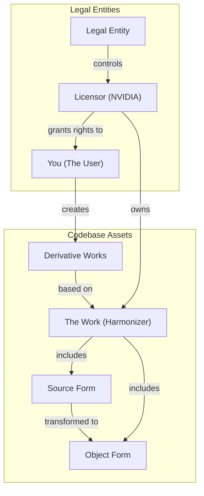
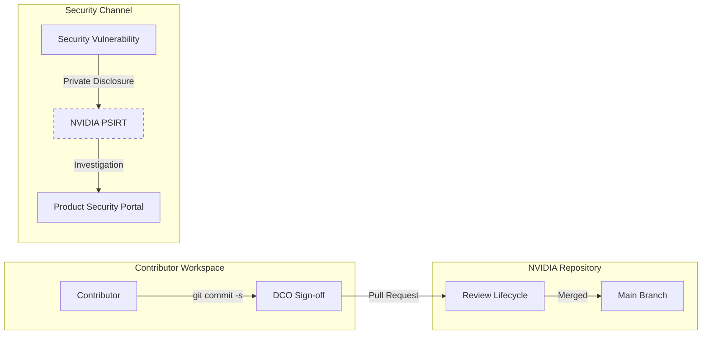

<!-- source: DeepWiki mcp.deepwiki.com · repo NVIDIA/harmonizer · page 6 Project Governance & Legal · fetched 2026-10-26 -->

# Project Governance & Legal

Relevant source files

The following files were used as context for generating this wiki page:

- [CONTRIBUTING.md](CONTRIBUTING.md)
- [LICENSE](LICENSE)
- [SECURITY.md](SECURITY.md)
- [THIRD_PARTY_LICENSE.txt](THIRD_PARTY_LICENSE.txt)

This section outlines the legal framework, licensing requirements, and community contribution protocols for the Harmonizer project. It ensures that the software remains open-source under the Apache 2.0 license while maintaining high standards for security and intellectual property.

## Licensing & Third-Party Attributions

Harmonizer is distributed under the **Apache License, Version 2.0** [LICENSE:2-3](). This license provides a perpetual, worldwide, non-exclusive, and royalty-free copyright and patent grant to users [LICENSE:67-82](). 

As a complex deep learning project, Harmonizer bundles and depends on numerous third-party libraries. These dependencies are governed by various permissive licenses including MIT, BSD, and Apache 2.0. A comprehensive catalog of these packages and their respective licenses is maintained to ensure compliance.

For details, see [Licensing & Third-Party Attributions](#6.1).

### Legal Entity Relationship
The following diagram illustrates the relationship between the legal entities defined in the license and the codebase assets.

**Legal Framework Overview**

**Sources:** [LICENSE:8-47]()

## Contributing & Security Reporting

NVIDIA welcomes contributions to Harmonizer but requires adherence to strict governance rules to protect the project's integrity. All contributors must certify their work via the **Developer Certificate of Origin (DCO) Version 1.1** [CONTRIBUTING.md:29-38](). This is enforced through mandatory "sign-offs" on every git commit (`git commit -s`) [CONTRIBUTING.md:17-20]().

Security is a primary concern. Harmonizer follows NVIDIA's global security policies. Vulnerabilities must not be reported via public GitHub issues; instead, they should be routed through the **NVIDIA Product Security Incident Response Team (PSIRT)** [SECURITY.md:5-11]().

For details, see [Contributing & Security Reporting](#6.2).

### Contribution & Security Workflow
The following diagram maps the contribution process and the secure reporting path for vulnerabilities.

**Contribution and Security Pipeline**

**Sources:** [CONTRIBUTING.md:11-24](), [SECURITY.md:1-12]()

### Summary Table of Governance Assets

| Asset | Description | Code Reference |
| :--- | :--- | :--- |
| **Main License** | Apache 2.0 terms and conditions. | [LICENSE:1-200]() |
| **Third-Party Catalog** | List of MIT/BSD/Apache dependencies like `attrs` and `boto3`. | [THIRD_PARTY_LICENSE.txt:1-100]() |
| **DCO 1.1** | Certification of original work or rights to contribute. | [CONTRIBUTING.md:41-52]() |
| **Security Policy** | Instructions for reporting via `psirt@nvidia.com`. | [SECURITY.md:9-20]() |

**Sources:** [LICENSE:1-200](), [THIRD_PARTY_LICENSE.txt:1-100](), [CONTRIBUTING.md:41-52](), [SECURITY.md:9-20]()

---

