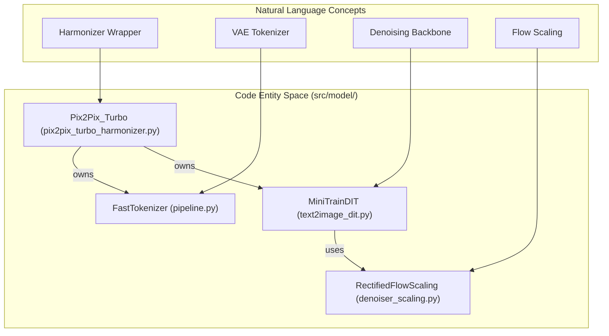
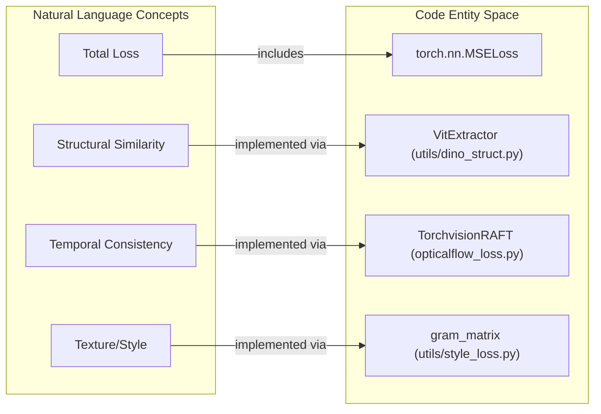

<!-- source: DeepWiki mcp.deepwiki.com · repo NVIDIA/harmonizer · page 7 Glossary · fetched 2026-10-26 -->

# Glossary

Relevant source files

The following files were used as context for generating this wiki page:

- [Dockerfile.cosmos](Dockerfile.cosmos)
- [README.md](README.md)
- [src/model/denoiser_scaling.py](src/model/denoiser_scaling.py)
- [src/model/pipeline.py](src/model/pipeline.py)
- [src/model/text2image_dit.py](src/model/text2image_dit.py)
- [src/onnx_export/exportable_modules.py](src/onnx_export/exportable_modules.py)
- [src/opticalflow_loss.py](src/opticalflow_loss.py)
- [src/pix2pix_turbo_harmonizer.py](src/pix2pix_turbo_harmonizer.py)
- [src/utils/dino_struct.py](src/utils/dino_struct.py)
- [src/utils/profiling.py](src/utils/profiling.py)
- [src/utils/style_loss.py](src/utils/style_loss.py)
- [text2image_dit.patch](text2image_dit.patch)
- [tokenizer.patch](tokenizer.patch)

This page provides definitions for codebase-specific terms, domain concepts, and implementation details used within the Harmonizer project. It serves as a technical reference for onboarding engineers to bridge the gap between high-level generative AI concepts and their specific realization in the `harmonizer` repository.

## 1. Architecture & Model Components

### Pix2Pix-Turbo
A generative paradigm that distills a multi-step diffusion model into a single-step image-to-image translator. In Harmonizer, this is implemented by the `Pix2Pix_Turbo` class, which wraps a VAE and a Diffusion Transformer (DiT) to perform one-step denoising.
*   **Implementation:** [src/pix2pix_turbo_harmonizer.py:177-210]()
*   **Data Flow:** Input Image $\rightarrow$ VAE Encoder $\rightarrow$ Noisy Latent $\rightarrow$ DiT Denoiser $\rightarrow$ Denoised Latent $\rightarrow$ VAE Decoder $\rightarrow$ Harmonized Image.

### Cosmos-Predict2
The underlying foundation model family used by Harmonizer. Specifically, Harmonizer builds upon the `Cosmos-Predict2-0.6B-Text2Image` model.
*   **Integration:** The codebase applies patches to the upstream library to enable gradient flow through the tokenizer and fix versioning issues.
*   **Sources:** [Dockerfile.cosmos:65-70](), [tokenizer.patch:1-5](), [text2image_dit.patch:1-26]()

### MiniTrainDIT
A specialized version of the Diffusion Transformer (DiT) optimized for the Harmonizer training and inference loop. It handles the processing of latent tensors and integrates with the scaling logic.
*   **Implementation:** [src/model/text2image_dit.py:1-200]() (and used in [src/pix2pix_turbo_harmonizer.py:35]())

### FastTokenizer / FastDenoiser
Wrapper classes designed to provide a high-performance interface for the VAE and DiT, respectively. They include mechanisms for pre-calculating constant parameters (like timestep embeddings) to speed up inference.
*   **Implementation:** [src/model/pipeline.py:70-141]() (FastTokenizer), [src/model/pipeline.py:144-250]() (FastDenoiser).

### Rectified Flow Scaling
The mathematical framework used to scale inputs and outputs during the diffusion process. It maps the noise level ($\sigma$) to scaling coefficients ($c_{in}, c_{out}, c_{skip}, c_{noise}$) that govern how the network prediction is combined with the noisy input.
*   **Implementation:** [src/model/denoiser_scaling.py:22-55]()

### Diagram: Natural Language Space to Code Entity Space (Architecture)

**Sources:** [src/pix2pix_turbo_harmonizer.py:177-210](), [src/model/pipeline.py:70-250](), [src/model/denoiser_scaling.py:22-55]()

---

## 2. Temporal & Performance Concepts

### Temporal Caching (feat_cache)
A mechanism to maintain temporal consistency across video frames during inference. The VAE's causal 3D convolutions use a cache (`feat_cache`) of size `CACHE_T` to store features from previous frames, allowing the model to "remember" the temporal context.
*   **Implementation:** [src/pix2pix_turbo_harmonizer.py:72-174]()
*   **Key Constant:** `CACHE_T = 2` [src/pix2pix_turbo_harmonizer.py:72]()

### ONNX Exportable Modules
Specialized wrappers that strip dynamic behaviors (like `feat_cache` or conditional branching) to make the model compatible with static graph execution in TensorRT.
*   **Implementation:** [src/onnx_export/exportable_modules.py:21-210]()
*   **Key Classes:** `OnnxExportableVAEEncoder`, `OnnxExportableVAEDecoder`, `OnnxExportableDenoiser`.

### NVTXRangeDecorator
A utility for instrumenting code with NVIDIA Tools Extension (NVTX) markers. This allows engineers to see named blocks (e.g., "encode", "decode") in profiling tools like NVIDIA Nsight Systems.
*   **Implementation:** [src/utils/profiling.py:51-59]()
*   **Usage Example:** [src/model/pipeline.py:83-84]()

---

## 3. Training & Loss Domain Concepts

### DINO Structural Loss
A loss function that uses features from a pretrained DINO ViT (Vision Transformer) model to ensure the structural integrity of the harmonized image matches the original input.
*   **Implementation:** [src/utils/dino_struct.py:29-179]()
*   **Key Class:** `VitExtractor` [src/utils/dino_struct.py:29]()

### RAFT (Optical Flow) Loss
A temporal consistency loss that uses the RAFT model to calculate optical flow between frames. It ensures that the changes made by Harmonizer are consistent with the motion in the video.
*   **Implementation:** [src/opticalflow_loss.py:46-75]()
*   **Key Class:** `TorchvisionRAFT` [src/opticalflow_loss.py:46]()

### Gram Matrix (Style Loss)
A method for calculating style loss by comparing the correlations between feature maps in a VGG network. It helps Harmonizer match the "texture" and "feel" of the target scene.
*   **Implementation:** [src/utils/style_loss.py:48-62]()
*   **Function:** `gram_matrix` [src/utils/style_loss.py:48]()

### Diagram: Natural Language Space to Code Entity Space (Training)

**Sources:** [src/utils/dino_struct.py:29-104](), [src/opticalflow_loss.py:46-75](), [src/utils/style_loss.py:48-62]()

---

## 4. Glossary Table

| Term | Definition | Code Pointer |
| :--- | :--- | :--- |
| **Latent Space** | The compressed representation of an image (1/8th spatial resolution) where denoising occurs. | [src/model/pipeline.py:115-121]() |
| **Rotary Positional Embedding (RoPE)** | A method for encoding spatial/temporal positions in the DiT transformer blocks. | [src/model/text2image_dit.py:62-98]() |
| **CausalConv3d** | A 3D convolution that only looks at current and past frames, essential for online simulation. | [src/pix2pix_turbo_harmonizer.py:19]() |
| **Sigma ($\sigma$)** | The noise level parameter in the diffusion process, ranging from $\sigma_{max}$ to 0. | [src/model/denoiser_scaling.py:36-42]() |
| **Skip Connection** | An optional path in the VAE that passes encoder activations directly to the decoder to preserve high-frequency detail. | [src/model/pipeline.py:89-91]() |
| **Conditioning** | External data (like text prompts or FPS) that guides the generative process. | [src/model/pipeline.py:150-185]() |

**Sources:** [src/model/pipeline.py:115-121](), [src/model/text2image_dit.py:62-98](), [src/pix2pix_turbo_harmonizer.py:19](), [src/model/denoiser_scaling.py:36-42](), [src/model/pipeline.py:89-91](), [src/model/pipeline.py:150-185]()