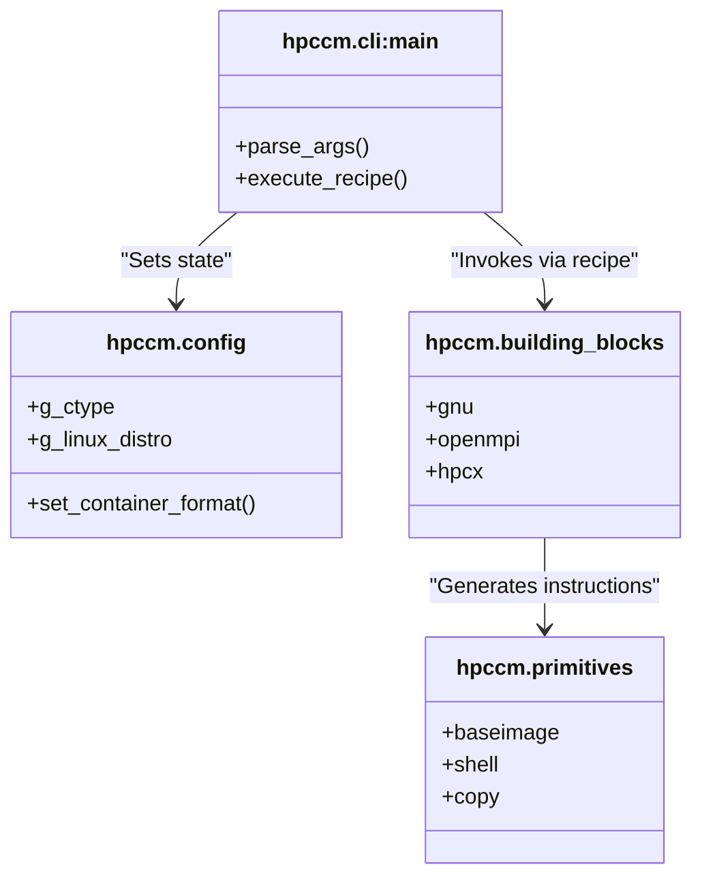

<!-- source: DeepWiki mcp.deepwiki.com · repo NVIDIA/hpc-container-maker · page 1 Overview · fetched 2026-10-26 -->

# Overview

<details>
<summary>Relevant source files</summary>

The following files were used as context for generating this wiki page:

- [.github/workflows/python3.yml](.github/workflows/python3.yml)
- [CHANGELOG.md](CHANGELOG.md)
- [README.md](README.md)
- [docs/README.md](docs/README.md)
- [docs/citation.md](docs/citation.md)
- [docs/getting_started.md](docs/getting_started.md)
- [hpccm/version.py](hpccm/version.py)
- [setup.py](setup.py)
- [test/test_user.py](test/test_user.py)

</details>


HPC Container Maker (HPCCM - pronounced H-P-see-M) is an open-source Python-based tool designed to simplify the generation of container specification files, specifically targeting High-Performance Computing (HPC) environments [README.md:8-9](). It abstracts the complexities of container syntax (Docker and Singularity) into high-level Python components, allowing developers to focus on the software stack rather than the underlying specification format [README.md:29-32]().

### Purpose and Value Proposition

HPCCM addresses several challenges in the HPC container ecosystem:
*   **Format Agnosticism**: Generate either `Dockerfiles` or Singularity definition files (`.def`) from a single Python recipe [README.md:39-41]().
*   **Best Practices**: Encapsulates expert knowledge for installing complex HPC components (like MPI, OFED, and Math libraries) into reusable "Building Blocks" [README.md:29-32]().
*   **Flexibility**: Leverages Python to provide dynamic recipe logic, such as input validation, branching based on user arguments, and modular includes [README.md:34-37]().

### System Architecture

The HPCCM codebase is organized into a hierarchical structure that bridges high-level intent with low-level container instructions.

#### Core Subsystems

| Subsystem | Responsibility | Key Code Entities |
| :--- | :--- | :--- |
| **CLI / Engine** | Entry point and recipe execution. | `hpccm.cli` [setup.py:46](), `hpccm.config` |
| **Primitives** | Low-level mapping to Docker/Singularity syntax. | `hpccm.primitives` |
| **Building Blocks** | High-level software installation logic. | `hpccm.building_blocks` |
| **Templates** | Reusable logic for build systems (CMake, Autotools). | `hpccm.templates` |

#### Data Flow: Recipe to Specification
The following diagram illustrates how a recipe is processed by the CLI and converted into a container specification.

**HPCCM Execution Flow**
```mermaid
graph TD
    Recipe["Recipe (.py)"] --> CLI["hpccm.cli:main"]
    CLI --> Config["hpccm.config"]
    CLI --> Engine["Recipe Execution (exec)"]
    Engine --> BB["Building Blocks (hpccm.building_blocks)"]
    BB --> Prim["Primitives (hpccm.primitives)"]
    Prim --> Output["Dockerfile / Singularity.def"]

    subgraph "Natural Language Space"
    "I want to install OpenMPI"
    end

    subgraph "Code Entity Space"
    BB_OMPI["hpccm.building_blocks.openmpi"]
    PRIM_SHELL["hpccm.primitives.shell"]
    end

    "I want to install OpenMPI" -.-> BB_OMPI
    BB_OMPI --> PRIM_SHELL
```
Sources: [README.md:25-41](), [setup.py:44-46](), [docs/getting_started.md:18-53]()

### Key Concepts

HPCCM operates on a "Stage" model where container layers are accumulated. 

*   **Stages**: Representing a multi-stage build, recipes typically append components to `Stage0`, `Stage1`, etc. [docs/getting_started.md:47-50]().
*   **Building Blocks**: High-level classes that handle the installation of specific software packages (e.g., `gnu()`, `openmpi()`). They automatically handle dependencies and environment variables [README.md:29-32]().
*   **Primitives**: Direct mappings to container instructions like `baseimage` (FROM), `shell` (RUN), and `copy` (COPY) [docs/getting_started.md:35]().
*   **Toolchains**: Objects used to pass compiler and flag information between different building blocks.

For a deep dive into these terms and the architectural layers, see [Key Concepts and Terminology](#1.2).

### Getting Started

HPCCM can be installed via `pip` or `conda` [docs/getting_started.md:8-14](). It can be used as a standalone command-line tool to process recipes or imported as a Python module for advanced workflows [docs/getting_started.md:18-24]().

**Basic CLI Usage:**
```bash
hpccm --recipe recipe.py --format docker > Dockerfile
hpccm --recipe recipe.py --format singularity > Singularity.def
```
Sources: [docs/getting_started.md:54-60]()

For installation instructions and your first recipe walkthrough, see [Getting Started](#1.1).

### Code Entity Mapping

The relationship between user-facing commands and internal Python modules is mapped below:

**Command to Module Mapping**

Sources: [setup.py:44-46](), [hpccm/version.py:16](), [docs/getting_started.md:33-37]()

---

