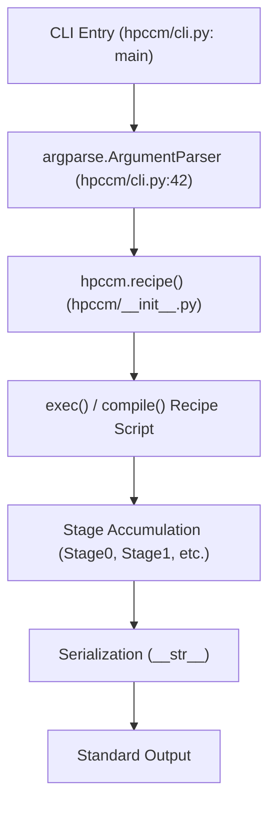
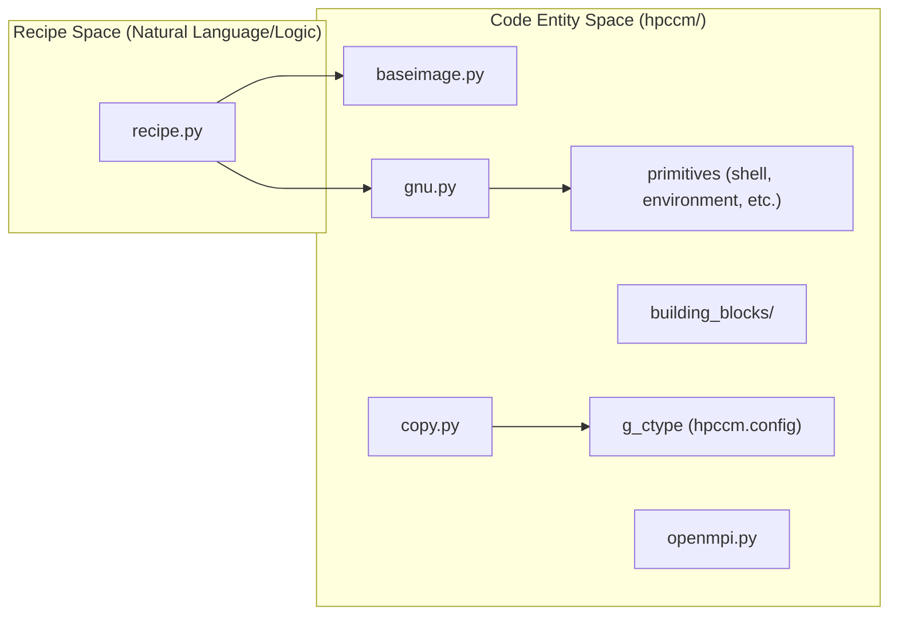

<!-- source: DeepWiki mcp.deepwiki.com · repo NVIDIA/hpc-container-maker · page 1.1 Getting Started · fetched 2026-10-26 -->

# Getting Started

<details>
<summary>Relevant source files</summary>

The following files were used as context for generating this wiki page:

- [.github/workflows/python3.yml](.github/workflows/python3.yml)
- [README.md](README.md)
- [docs/README.md](docs/README.md)
- [docs/getting_started.md](docs/getting_started.md)
- [hpccm/cli.py](hpccm/cli.py)
- [hpccm/primitives/copy.py](hpccm/primitives/copy.py)
- [test/test_copy.py](test/test_copy.py)

</details>


HPC Container Maker (HPCCM) is an open-source tool designed to simplify the generation of container specification files, such as Dockerfiles and Singularity definition files, using high-level Python recipes [README.md:8-9](). By leveraging Python, HPCCM allows for programmable logic, input validation, and the reuse of optimized HPC "building blocks" that encapsulate best practices for scientific software stacks [README.md:25-37]().

## Installation

HPCCM is compatible with Python 3.8 through 3.12 [.github/workflows/python3.yml:11]() and can be installed via standard Python package managers.

### Using pip
To install from [PyPI](https://pypi.org/project/hpccm/):
```bash
pip install hpccm
```
Sources: [docs/getting_started.md:5-10](), [.github/workflows/python3.yml:28]()

### Using conda
To install from [Conda-forge](https://anaconda.org/conda-forge/hpccm):
```bash
conda install -c conda-forge hpccm
```
Sources: [docs/getting_started.md:12-14]()

---

## Usage Modes

HPCCM can be utilized either as a standalone Command Line Interface (CLI) tool or as a Python module integrated into larger workflows.

### 1. Command Line Interface (CLI)
The `hpccm` command processes a recipe file and prints the resulting container specification to standard output.

**Basic Syntax:**
```bash
hpccm --recipe <recipe.py> --format <docker|singularity|bash>
```

**Common Arguments:**
| Argument | Description |
| :--- | :--- |
| `--recipe` | Path to the Python recipe file [hpccm/cli.py:52-53](). |
| `--format` | Output format: `docker` (default), `singularity`, or `bash` [hpccm/cli.py:46-48](). |
| `--userarg` | Pass key-value pairs to the recipe for parameterization [hpccm/cli.py:59-60](). |
| `--cpu-target` | Optimize for specific CPU microarchitectures via `archspec` [hpccm/cli.py:43-45](). |
| `--single-stage` | Process only the first stage of a multi-stage recipe [hpccm/cli.py:54-56](). |

Sources: [hpccm/cli.py:42-71](), [docs/getting_started.md:44-60]()

### 2. Python Module
Using HPCCM as a module provides maximum control. You manually configure the global state and call primitives or building blocks.

```python
import hpccm

# Configure global output format
hpccm.config.set_container_format('docker')

# Generate primitives
print(hpccm.primitives.baseimage(image='ubuntu:22.04'))

# Generate building blocks
print(hpccm.building_blocks.gnu(version='11'))
```
Sources: [docs/getting_started.md:23-37]()

---

## Generating and Building Images

The output of HPCCM is the **specification**, not the image itself. Users must pipe the output to a file and use the respective container engine to build the image.

### Docker Workflow
```bash
hpccm --recipe recipe.py --format docker > Dockerfile
docker build -t my_hpc_image:latest -f Dockerfile .
```
Sources: [docs/getting_started.md:73-78]()

### Singularity Workflow
```bash
hpccm --recipe recipe.py --format singularity > Singularity.def
singularity build my_hpc_image.sif Singularity.def
```
Sources: [docs/getting_started.md:80-84]()

---

## Technical Implementation Overview

### Data Flow: From Recipe to Specification
The following diagram illustrates how the `hpccm` CLI coordinates the transformation of a Python recipe into a formatted specification.

**CLI Execution Flow**

Sources: [hpccm/cli.py:41-88](), [docs/getting_started.md:44-56]()

### Entity Mapping: Primitives and Building Blocks
HPCCM abstracts container instructions into `primitives` and high-level software installations into `building_blocks`.

**Code Entity Mapping**

Sources: [hpccm/primitives/copy.py:24-29](), [docs/getting_started.md:35-36](), [hpccm/cli.py:76-84]()

---

## First Steps for New Users

1.  **Explore Examples**: The `recipes/` directory contains complete application recipes for GROMACS, MILC, and MPI Bandwidth [docs/getting_started.md:113-115]().
2.  **Use "hpcbase" Recipes**: Start with the bundled `hpcbase` recipes which provide a validated stack of compilers (GNU, NVHPC) and MPI libraries (OpenMPI, HPC-X) [docs/getting_started.md:106-111]().
3.  **Understand Primitives**: Familiarize yourself with how HPCCM handles standard operations like `copy`. For instance, the `copy` primitive automatically handles differences between Docker's `COPY` and Singularity's `%files` or `%setup` blocks [hpccm/primitives/copy.py:159-216]().

### Example: The `copy` Primitive
The `copy` primitive demonstrates HPCCM's translation logic. It accepts standard Python arguments and renders format-specific syntax based on the global `hpccm.config.g_ctype` [hpccm/primitives/copy.py:159]().

| Feature | Docker Output | Singularity Output |
| :--- | :--- | :--- |
| **Single File** | `COPY a b` | `%files \n a b` |
| **Stage Transfer** | `COPY --from=stage a b` | `%files from stage \n a b` |
| **Directory Creation** | N/A (Automatic) | `%setup \n mkdir -p ...` (if `_mkdir=True`) |

Sources: [hpccm/primitives/copy.py:29-111](), [test/test_copy.py:48-159]()

---

