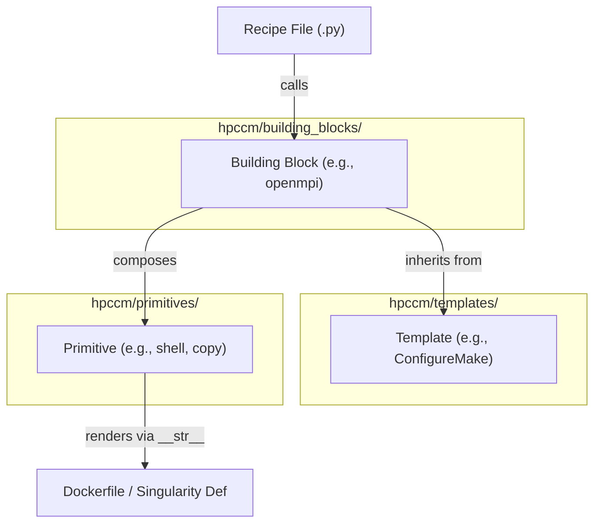
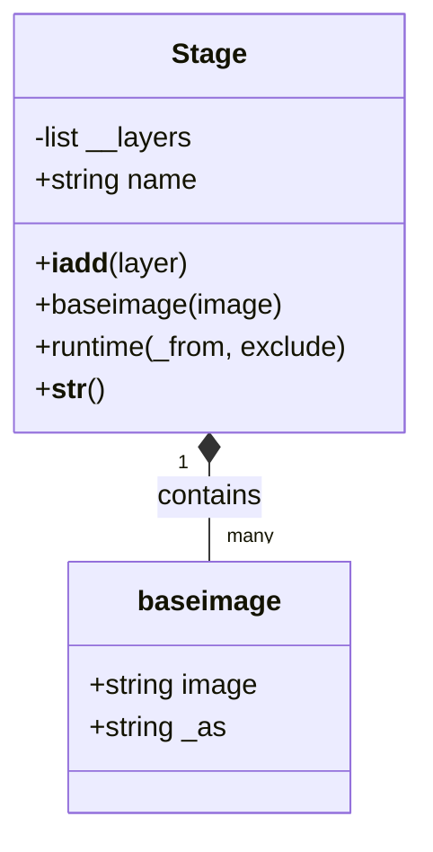

<!-- source: DeepWiki mcp.deepwiki.com · repo NVIDIA/hpc-container-maker · page 1.2 Key Concepts and Terminology · fetched 2026-10-26 -->

# Key Concepts and Terminology

Relevant source files

The following files were used as context for generating this wiki page:

- [CHANGELOG.md](CHANGELOG.md)
- [hpccm/Stage.py](hpccm/Stage.py)
- [hpccm/__init__.py](hpccm/__init__.py)
- [hpccm/recipe.py](hpccm/recipe.py)
- [hpccm/templates/ConfigureMake.py](hpccm/templates/ConfigureMake.py)
- [hpccm/toolchain.py](hpccm/toolchain.py)
- [hpccm/version.py](hpccm/version.py)
- [setup.py](setup.py)
- [test/test_ConfigureMake.py](test/test_ConfigureMake.py)
- [test/test_Stage.py](test/test_Stage.py)
- [test/test_toolchain.py](test/test_toolchain.py)
- [test/test_user.py](test/test_user.py)

This page explains the fundamental architectural patterns, domain concepts, and terminology used throughout the HPC Container Maker (HPCCM) codebase. HPCCM is designed to abstract the complexities of container specification formats (Docker and Singularity/Apptainer) into a modular, Python-based framework.

## Three-Layer Architecture

HPCCM is organized into three distinct layers of abstraction that facilitate code reuse and cross-format compatibility.

| Layer | Code Path | Description |
| :--- | :--- | :--- |
| **Primitives** | `hpccm/primitives/` | Low-level building blocks that map directly to container instructions (e.g., `RUN`, `COPY`, `ENV`). |
| **Building Blocks** | `hpccm/building_blocks/` | High-level components that install software (e.g., `openmpi`, `gnu`). They encapsulate best practices and multi-step installation logic. |
| **Templates** | `hpccm/templates/` | Python mixins that provide common behaviors (e.g., `git` cloning, `wget` downloading, `ConfigureMake` workflows) to Building Blocks. |

### Data Flow and Interaction
The following diagram illustrates how a Recipe interacts with these layers to produce a container specification.

**Recipe Processing Flow**

Sources: [hpccm/__init__.py:29-31](), [hpccm/recipe.py:33-35]()

## The Stage Model

A `Stage` represents a discrete phase in a container build. In Docker, this corresponds to a build stage starting with `FROM`. In Singularity (3.2+), this corresponds to a multi-stage definition.

*   **Accumulation**: Layers (Primitives or Building Blocks) are added to a stage using the `+=` operator, implemented via `Stage.__iadd__` [hpccm/Stage.py:50-63]().
*   **Serialization**: When a `Stage` is converted to a string (`__str__`), it iterates through its internal `__layers` list and calls `str()` on each, joining them with a separator [hpccm/Stage.py:69-71]().
*   **Multi-stage Builds**: Recipes typically define `Stage0` (build stage) and `Stage1` (deployment stage). The `Stage.runtime()` method is the key mechanism for extracting only the necessary runtime artifacts from a build stage to a deployment stage [hpccm/Stage.py:88-136]().

### Stage Implementation Detail

Sources: [hpccm/Stage.py:27-49](), [hpccm/primitives/baseimage.py:1-20]() (implied by [hpccm/Stage.py:25]())

## Toolchain

The `toolchain` class is a data structure used to pass compiler and linker information between building blocks. It ensures that if you install a specific version of GCC, subsequent libraries (like OpenMPI or FFTW) use that exact compiler and the appropriate optimization flags.

*   **Attributes**: Includes standard environment variables like `CC`, `CXX`, `FC`, `CFLAGS`, and `LDFLAGS` [hpccm/toolchain.py:25-27]().
*   **Propagation**: Building blocks often accept a `toolchain` object in their constructor and return a modified version of it to be used by the next block.
*   **Serialization**: The `__dict__` property is overridden to return only non-null values, allowing it to be easily converted into container environment variables [hpccm/toolchain.py:65-70]().

Sources: [hpccm/toolchain.py:20-46]()

## Container Types

HPCCM supports multiple output formats defined in `hpccm.common.container_type`:
1.  **DOCKER**: Generates a `Dockerfile`.
2.  **SINGULARITY**: Generates a Singularity/Apptainer definition file.
3.  **BASH**: Generates a shell script for "bare metal" installation.

The global state for the target format is stored in `hpccm.config.g_ctype` [hpccm/recipe.py:141](). Primitives use this global variable to determine which syntax to render in their `__str__` methods. For example, the `user` primitive renders `USER` for Docker but returns an empty string for Singularity and Bash [test/test_user.py:47-63]().

## Build System Templates

Templates provide the logic for common software installation patterns. The `ConfigureMake` template, for example, automates the `./configure && make && make install` workflow.

*   **Logic Encapsulation**: It handles the generation of the shell commands for building, including directory management (`mkdir -p` and `cd`) [hpccm/templates/ConfigureMake.py:75-83]().
*   **Toolchain Integration**: It automatically injects `toolchain` attributes into the configure environment [hpccm/templates/ConfigureMake.py:86-137]().
*   **Option Management**: It provides a standardized way to handle `--enable-feature` and `--with-package` flags via keyword arguments [hpccm/templates/ConfigureMake.py:45-56]().

Sources: [hpccm/templates/ConfigureMake.py:25-57](), [test/test_ConfigureMake.py:53-65]()

## Recipe Execution Engine

A "Recipe" is a Python script that describes the container. The `hpccm.recipe.recipe()` function is the entry point for processing these files.

1.  **Context Injection**: It sets up `Stage0` and `Stage1` objects and makes them available to the recipe [hpccm/recipe.py:133-135]().
2.  **USERARG**: It injects user-provided arguments into a `USERARG` dictionary, allowing recipes to be parameterized [hpccm/recipe.py:128-130]().
3.  **Execution**: It uses Python's `exec(compile(...))` to run the recipe code within a specific global and local scope [hpccm/recipe.py:75-78]().
4.  **Serialization**: Finally, it joins the string representations of all stages to produce the final output [hpccm/recipe.py:187-192]().

Sources: [hpccm/recipe.py:86-125](), [hpccm/recipe.py:158-159]()

---

