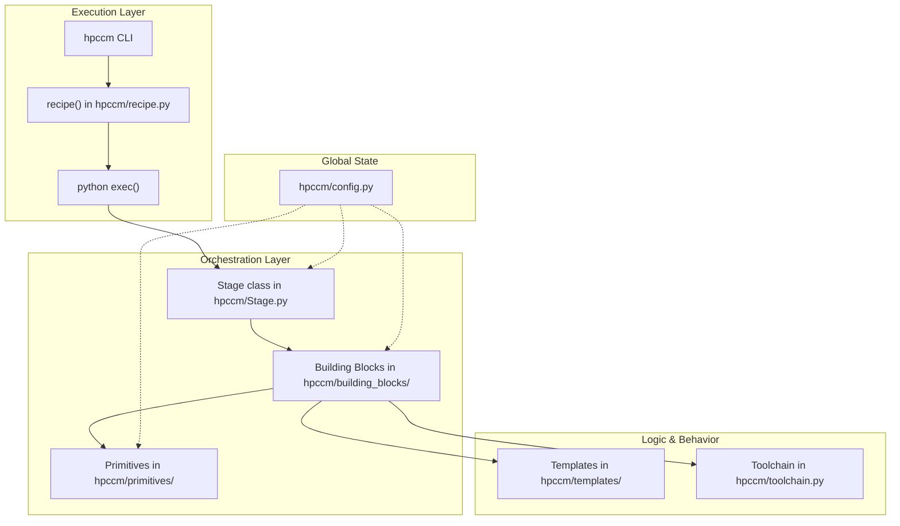
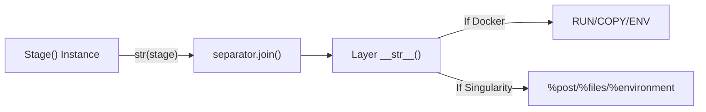

<!-- source: DeepWiki mcp.deepwiki.com · repo NVIDIA/hpc-container-maker · page 2 Core Architecture · fetched 2026-10-26 -->

# Core Architecture

Relevant source files

The following files were used as context for generating this wiki page:

- [docs/misc_api.md](docs/misc_api.md)
- [hpccm/Stage.py](hpccm/Stage.py)
- [hpccm/__init__.py](hpccm/__init__.py)
- [hpccm/base_object.py](hpccm/base_object.py)
- [hpccm/building_blocks/base.py](hpccm/building_blocks/base.py)
- [hpccm/config.py](hpccm/config.py)
- [hpccm/recipe.py](hpccm/recipe.py)
- [test/test_Stage.py](test/test_Stage.py)

HPC Container Maker (HPCCM) is organized into a hierarchical structure that translates high-level Python descriptions into low-level container specifications (Dockerfiles, Singularity definition files, or Bash scripts). The architecture is designed to decouple the intent of a software installation (e.g., "install OpenMPI with GCC") from the specific syntax of the container format or the package manager of the underlying Linux distribution.

### System Overview

The following diagram illustrates the relationship between the core components, from the CLI entry point down to the primitive instructions.

**HPCCM Component Relationship**

**Sources:** [hpccm/recipe.py:86-192](), [hpccm/Stage.py:27-136](), [hpccm/config.py:35-46]().

---

### Recipe Engine and CLI
The engine is responsible for executing the user's recipe file. It utilizes Python's `exec` and `compile` functions to process recipes as live Python code [hpccm/recipe.py:75-78]().

*   **`recipe()` function**: The primary entry point that sets global state (container type, CPU target) and executes the recipe [hpccm/recipe.py:86-192]().
*   **USERARG**: A mechanism to pass command-line arguments directly into the recipe's Python scope [hpccm/recipe.py:127-130]().
*   **Modular Recipes**: The `include()` function allows recipes to be composed of other recipe files [hpccm/recipe.py:36-84]().

For details, see [Recipe Engine and CLI](#2.1).

---

### Global Configuration (`hpccm.config`)
HPCCM maintains a global state that influences how primitives and building blocks render their output. This state is managed in `hpccm/config.py`.

| Variable | Purpose | Default |
| :--- | :--- | :--- |
| `g_ctype` | The output format (Docker, Singularity, Bash) | `container_type.DOCKER` |
| `g_cpu_arch` | Target processor architecture (x86_64, aarch64, etc.) | Detected from host |
| `g_linux_distro` | The Linux distribution of the container | `linux_distro.UBUNTU` |
| `g_cpu_target` | Specific microarchitecture (via `archspec`) | `None` |

**Sources:** [hpccm/config.py:35-46](), [hpccm/config.py:110-130]().

For details, see [Global Configuration (hpccm.config)](#2.2).

---

### Stage and Multi-Stage Builds
The `Stage` class represents a single stage in a container build. In Docker, this corresponds to a `FROM` instruction and its subsequent layers. In Singularity, it represents the primary definition blocks.

*   **Layer Accumulation**: Layers (primitives or building blocks) are added to a stage using the `+=` operator [hpccm/Stage.py:50-63]().
*   **Runtime Propagation**: The `Stage.runtime()` method is the core of HPCCM's multi-stage support. It iterates through all building blocks in a "build" stage and extracts only the components (libraries, environment variables) necessary for the "deployment" stage [hpccm/Stage.py:88-136]().

**Stage Serialization Flow**

**Sources:** [hpccm/Stage.py:69-71](), [hpccm/Stage.py:88-136]().

For details, see [Stage and Multi-Stage Builds](#2.3).

---

### Base Class Hierarchy
HPCCM uses a strict class hierarchy to ensure that building blocks can inherit complex behaviors from templates using Method Resolution Order (MRO).

*   **`base_object`**: The root class in `hpccm/base_object.py`. It provides a `**kwargs` compatible `__init__` that terminates the `super()` chain, allowing multiple inheritance from templates [hpccm/base_object.py:20-36]().
*   **`bb_instructions`**: A base class for managing lists of container instructions [hpccm/building_blocks/base.py:22-53]().
*   **`bb_base`**: The standard base for all building blocks, which separates "build-time" instructions from "runtime" instructions (`self.rt`) [hpccm/building_blocks/base.py:54-62]().

For details, see [Building Blocks](#4).

---

### Toolchain
The `toolchain` class (`hpccm/toolchain.py`) acts as a messenger between building blocks. It carries information about compilers (`CC`, `CXX`, `FC`) and flags (`CFLAGS`, `LDFLAGS`).

*   **Optimization**: It integrates with `archspec` to automatically provide CPU-specific optimization flags based on the `g_cpu_target` [hpccm/config.py:67-93]().
*   **Consumption**: A building block (like OpenMPI) can consume a toolchain object produced by a compiler building block (like GNU) to ensure it is built with the correct compiler and flags.

For details, see [Toolchain](#2.4).

---

