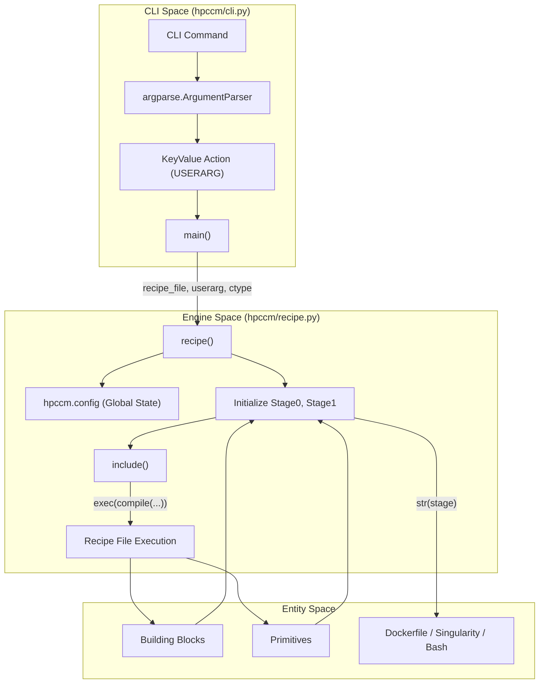
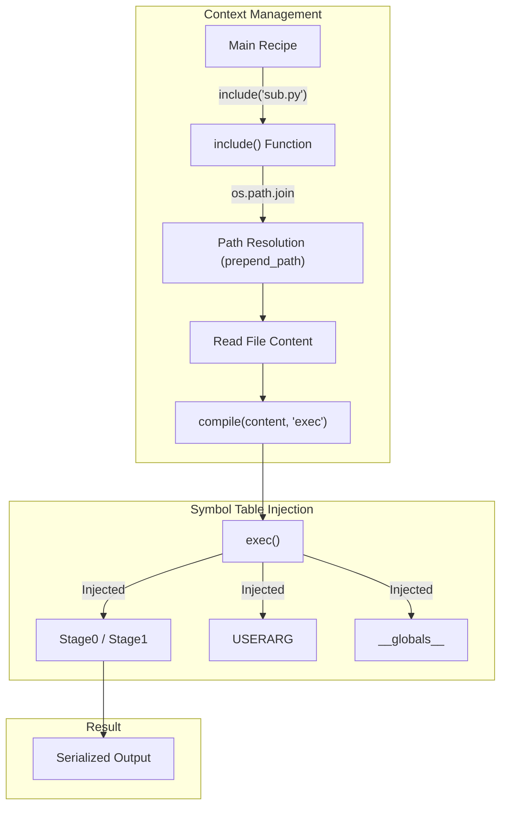

<!-- source: DeepWiki mcp.deepwiki.com · repo NVIDIA/hpc-container-maker · page 2.1 Recipe Engine and CLI · fetched 2026-10-26 -->

# Recipe Engine and CLI

<details>
<summary>Relevant source files</summary>

The following files were used as context for generating this wiki page:

- [MANIFEST.in](MANIFEST.in)
- [hpccm/__init__.py](hpccm/__init__.py)
- [hpccm/cli.py](hpccm/cli.py)
- [hpccm/primitives/copy.py](hpccm/primitives/copy.py)
- [hpccm/recipe.py](hpccm/recipe.py)
- [recipes/examples/cloverleaf.py](recipes/examples/cloverleaf.py)
- [recipes/examples/gnu-devel.py](recipes/examples/gnu-devel.py)
- [test/include1.py](test/include1.py)
- [test/include2.py](test/include2.py)
- [test/include3.py](test/include3.py)
- [test/test_copy.py](test/test_copy.py)
- [test/test_openmpi.py](test/test_openmpi.py)
- [test/test_recipe.py](test/test_recipe.py)

</details>


The Recipe Engine is the core execution environment of HPCCM. It is responsible for parsing command-line arguments, configuring the global state, and executing Python-based recipe files to generate container specifications.

## CLI Entry Point and Argument Parsing

The `hpccm` command-line interface is implemented in `hpccm/cli.py`. It uses the standard `argparse` library to handle user input [hpccm/cli.py:42-71]().

### Custom Argument Handling
A specialized `KeyValue` class extends `argparse.Action` to process the `--userarg` flag [hpccm/cli.py:27-40](). This allows users to pass arbitrary key-value pairs (e.g., `--userarg version=1.2.3`) which are converted into a Python dictionary and injected into the recipe's execution context [hpccm/cli.py:33-39]().

### Data Flow: CLI to Recipe
The `main()` function in `hpccm/cli.py` acts as a bridge, collecting arguments and passing them to the `hpccm.recipe()` function [hpccm/cli.py:76-84]().

**CLI Argument Mapping**
| CLI Flag | `recipe()` Argument | Internal Config Impact |
| :--- | :--- | :--- |
| `--cpu-target` | `cpu_target` | `hpccm.config.set_cpu_target()` |
| `--format` | `ctype` | `hpccm.config.g_ctype` |
| `--singularity-version` | `singularity_version` | `hpccm.config.g_singularity_version` |
| `--userarg` | `userarg` | Local `USERARG` dict in recipe |
| `--wd` | `working_directory` | `hpccm.config.g_wd` |

**Sources:** [hpccm/cli.py:27-84](), [hpccm/recipe.py:137-150]()

## The `recipe()` Function

The `recipe()` function in `hpccm/recipe.py` is the primary orchestrator for building container specifications [hpccm/recipe.py:86-125]().

### Execution Lifecycle
1.  **State Initialization**: It initializes two `Stage` objects, `Stage0` and `Stage1`, and makes them available as local variables [hpccm/recipe.py:133-135]().
2.  **Global Configuration**: It updates `hpccm.config` variables based on the arguments provided (e.g., container type, CPU architecture) [hpccm/recipe.py:138-150]().
3.  **USERARG Injection**: The `userarg` dictionary is assigned to a local variable `USERARG`, allowing recipes to access parameters via `USERARG.get('key')` [hpccm/recipe.py:128-130]().
4.  **Recipe Execution**: It calls `include()` to execute the recipe file [hpccm/recipe.py:158-159]().
5.  **Serialization**: It iterates through the stages and calls `str(stage)` on each to generate the final output string [hpccm/recipe.py:187-190]().

**Sources:** [hpccm/recipe.py:86-192]()

## Recipe Execution and `include()`

HPCCM treats recipes as Python scripts. The `include()` function is used to load and execute these scripts within a controlled scope [hpccm/recipe.py:36-55]().

### Execution Mechanism
The engine uses Python's `compile()` and `exec()` functions to execute recipe code [hpccm/recipe.py:78]().
*   **Globals/Locals**: By default, `include()` inherits the caller's symbol table, allowing nested recipes to share variables like `Stage0` or `compiler` [hpccm/recipe.py:57-62]().
*   **Path Resolution**: To support relative paths in modular recipes, the engine maintains `include.prepend_path` [hpccm/recipe.py:71-73](). This ensures that if `recipe_A.py` includes `subdir/recipe_B.py`, any further includes inside `recipe_B.py` are resolved relative to `subdir/` [hpccm/recipe.py:155]().

### Modular Recipes
Recipes can be split into multiple files. For example, a main recipe can include a base configuration:
```python
# main_recipe.py
include('base_image.py')
Stage0 += packages(ospackages=['vim'])
```

**Sources:** [hpccm/recipe.py:36-85](), [test/include2.py:1-2](), [test/include3.py:1-2]()

## Output Modes and Multi-stage Handling

HPCCM supports different output behaviors based on the requested container type and stage configuration.

### Multi-stage Output
If a recipe populates `Stage1`, the engine treats it as a multi-stage build [hpccm/recipe.py:164](). 
*   **Docker**: Always supports multi-stage.
*   **Singularity**: Requires version >= 3.2. If a lower version is specified, the engine logs a warning and truncates the output to only `Stage0` [hpccm/recipe.py:165-178]().
*   **Bash**: Does not support multi-stage; only `Stage0` is processed [hpccm/recipe.py:179-184]().

### Single-stage Override
The `--single-stage` CLI flag (or `single_stage=True` argument) forces the engine to ignore everything except `Stage0`, which is useful for debugging or generating simplified builds [hpccm/recipe.py:162-163]().

**Sources:** [hpccm/recipe.py:161-185](), [hpccm/cli.py:54-56]()

## Architectural Diagrams

### CLI to Recipe Execution Flow
This diagram illustrates how a CLI command moves through the parsing logic into the Python execution engine.

Title: HPCCM Execution Data Flow

**Sources:** [hpccm/cli.py:41-85](), [hpccm/recipe.py:86-192]()

### Recipe Modularization Logic
This diagram shows how the `include()` function manages symbol tables and path resolution for nested recipes.

Title: Recursive Recipe Inclusion Logic

**Sources:** [hpccm/recipe.py:36-85](), [test/include3.py:1-2]()

---

