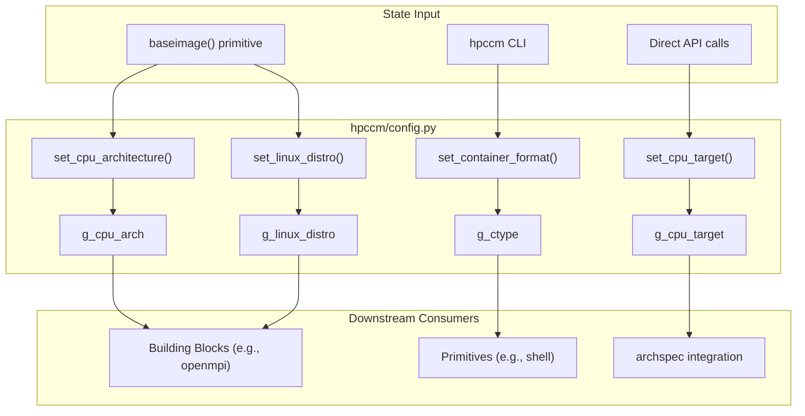
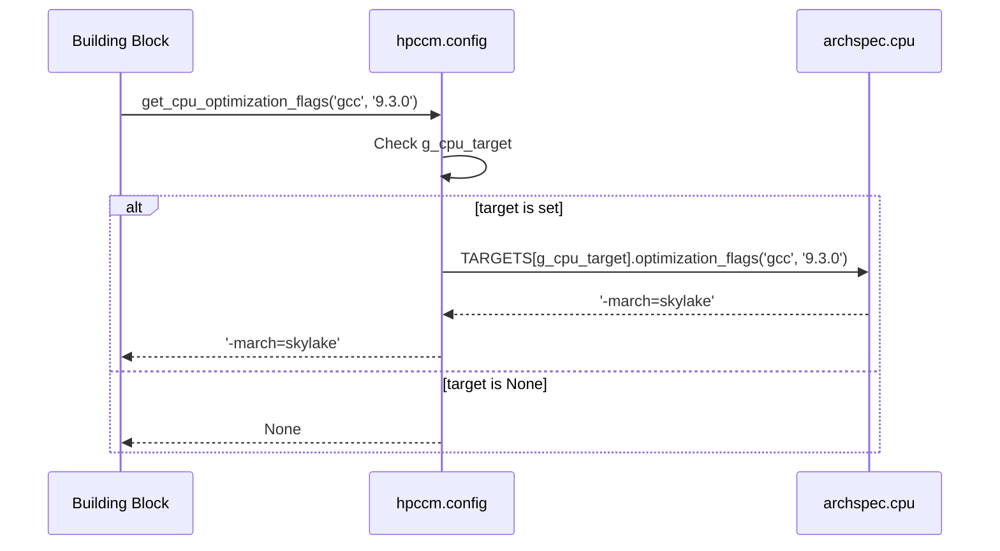

<!-- source: DeepWiki mcp.deepwiki.com · repo NVIDIA/hpc-container-maker · page 2.2 Global Configuration (hpccm.config) · fetched 2026-10-26 -->

# Global Configuration (hpccm.config)

Relevant source files

The following files were used as context for generating this wiki page:

- [docs/misc_api.md](docs/misc_api.md)
- [hpccm/common.py](hpccm/common.py)
- [hpccm/config.py](hpccm/config.py)
- [hpccm/primitives/baseimage.py](hpccm/primitives/baseimage.py)
- [test/test_baseimage.py](test/test_baseimage.py)
- [test/test_blob.py](test/test_blob.py)
- [test/test_config.py](test/test_config.py)
- [test/test_raw.py](test/test_raw.py)

The `hpccm.config` module serves as the central authority for global state within HPC Container Maker. It manages environment-wide settings that influence how primitives and building blocks generate their output, including target CPU architectures, Linux distributions, and container formats.

## Global State Variables

The module defines several internal global variables (prefixed with `g_`) that store the current configuration state. These are initialized based on the host system's properties but can be overridden via setter functions or the `baseimage` primitive.

| Variable | Type | Default Value | Description |
| :--- | :--- | :--- | :--- |
| `g_cpu_arch` | `cpu_arch` | Host Arch | The target instruction set (e.g., `X86_64`, `AARCH64`). [hpccm/config.py:35-39]() |
| `g_cpu_target` | `string` | `None` | Specific microarchitecture for `archspec` (e.g., `broadwell`, `zen2`). [hpccm/config.py:40]() |
| `g_ctype` | `container_type` | `DOCKER` | The output format: Docker, Singularity, or Bash. [hpccm/config.py:41]() |
| `g_linux_distro` | `linux_distro` | `UBUNTU` | The target Linux distribution family. [hpccm/config.py:42]() |
| `g_linux_version` | `Version` | `16.04` | The specific version of the Linux distribution. [hpccm/config.py:43]() |
| `g_singularity_version`| `Version` | `2.6` | Target Singularity version (affects multi-stage support). [hpccm/config.py:44]() |
| `g_wd` | `string` | `/var/tmp` | The default working directory for build stages. [hpccm/config.py:45]() |

**Sources:** [hpccm/config.py:34-47](), [hpccm/common.py:21-39]()

## Configuration Flow and Code Entities

The following diagram illustrates how the `hpccm.config` module mediates between the high-level recipe requirements and the low-level output generation.

### Configuration State Management

**Sources:** [hpccm/config.py:110-220](), [hpccm/primitives/baseimage.py:87-185]()

## Automatic Detection via `baseimage`

The `baseimage` primitive is the primary mechanism for updating `hpccm.config`. When a `baseimage` is instantiated in a recipe, it parses the `image` string using regular expressions to automatically detect the architecture and distribution.

1.  **Architecture Detection**: Searches for patterns like `aarch64`, `arm64`, or `ppc64le` in the image name. [hpccm/primitives/baseimage.py:90-105]()
2.  **Distro Detection**: Searches for keywords like `ubuntu`, `centos`, `rhel`, `ubi`, or `rockylinux`, including version tags (e.g., `ubuntu:22.04`). [hpccm/primitives/baseimage.py:110-185]()

If detection fails, it defaults to the host's architecture and `ubuntu16`.

**Sources:** [hpccm/primitives/baseimage.py:74-185](), [test/test_baseimage.py:143-205]()

## Archspec Integration

HPCCM integrates with the `archspec` library to provide compiler-specific optimization flags based on a microarchitecture target.

### `get_cpu_optimization_flags`
This function bridges HPCCM's global state with `archspec`. It takes a compiler name (e.g., `gcc`, `clang`) and version, looks up the `g_cpu_target` in `archspec.cpu.TARGETS`, and returns the appropriate flag string (e.g., `-march=broadwell`).

[hpccm/config.py:67-93]()

**Sources:** [hpccm/config.py:67-93](), [docs/misc_api.md:11-26]()

## Key Setter Functions

While `baseimage` handles most configuration, the following functions allow manual control:

*   **`set_container_format(ctype)`**: Accepts `'docker'`, `'singularity'`, or `'bash'`. It updates `g_ctype`, which dictates whether `str(primitive)` returns Dockerfile syntax or Singularity `%post` blocks. [hpccm/config.py:110-129]()
*   **`set_cpu_architecture(arch)`**: Sets `g_cpu_arch`. It supports aliases (e.g., `amd64` maps to `x86_64`, `arm` maps to `aarch64`). [hpccm/config.py:131-154]()
*   **`set_linux_distro(distro)`**: Sets both `g_linux_distro` and `g_linux_version`. For example, `set_linux_distro('ubuntu20')` sets the distro to `UBUNTU` and version to `20.04`. [hpccm/config.py:166-220]()
*   **`set_singularity_version(ver)`**: Updates `g_singularity_version`. If the version is `< 3.2`, multi-stage build features are disabled or rendered in a legacy-compatible way. [hpccm/config.py:222-234]()

**Sources:** [hpccm/config.py:110-234](), [docs/misc_api.md:33-114]()

---

