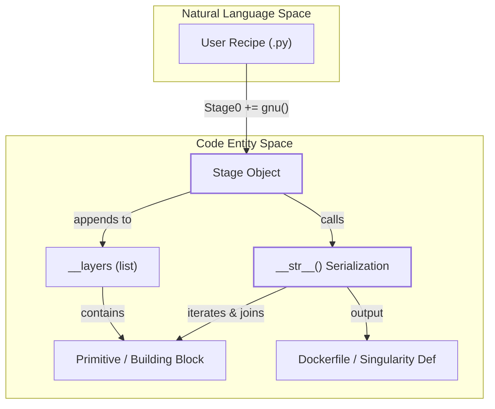
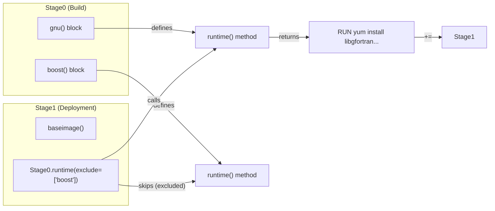

<!-- source: DeepWiki mcp.deepwiki.com · repo NVIDIA/hpc-container-maker · page 2.3 Stage and Multi-Stage Builds · fetched 2026-10-26 -->

# Stage and Multi-Stage Builds

Relevant source files

The following files were used as context for generating this wiki page:

- [docs/misc_api.md](docs/misc_api.md)
- [hpccm/Stage.py](hpccm/Stage.py)
- [hpccm/config.py](hpccm/config.py)
- [test/test_Stage.py](test/test_Stage.py)

The `Stage` class is the primary container for layers (primitives and building blocks) in HPCCM. It facilitates the construction of both single-stage and multi-stage container specifications by managing the accumulation of instructions and providing mechanisms to propagate runtime artifacts between stages.

## The Stage Class

The `Stage` class [hpccm/Stage.py:27-41]() acts as an ordered collection of container layers. While Docker supports multiple stages in a single Dockerfile, HPCCM represents each as a discrete `Stage` object. For Singularity, which traditionally has a single stage, HPCCM uses the `Stage` model to manage the translation of multi-stage logic into compatible formats (e.g., using `%files from` in Singularity 3.2+).

### Layer Accumulation
Layers are added to a stage using the `+=` operator, implemented via the `__iadd__` method [hpccm/Stage.py:50-63](). This method accepts either a single layer object or a list of objects.

- **Naming Logic**: If a `baseimage` primitive is added to a stage and the stage does not yet have a name, the stage inherits the name specified in the `baseimage`'s `_as` parameter [hpccm/Stage.py:56-57]().
- **Base Image Placement**: The `baseimage()` method [hpccm/Stage.py:73-86]() ensures that the `FROM` (Docker) or `Bootstrap` (Singularity) instruction is inserted at index 0 of the layer list, even if other layers were added previously [test/test_Stage.py:61-67]().

### Serialization
The `__str__` method [hpccm/Stage.py:69-71]() handles the serialization of the stage into the final container specification. It iterates through all stored layers, calls their respective `__str__` methods (which dispatch to Docker or Singularity syntax based on `hpccm.config.g_ctype`), and joins them using a configurable separator (defaulting to `\n\n`) [hpccm/Stage.py:48]().

### Data Flow: Recipe to Serialization

**Sources:** [hpccm/Stage.py:46-71](), [test/test_Stage.py:38-59]()

## Multi-Stage Builds and `runtime()`

Multi-stage builds allow users to separate the build environment (compilers, source code, build tools) from the deployment environment (runtime libraries, binaries). The `Stage.runtime()` method [hpccm/Stage.py:88-136]() is the core mechanism for this transition.

### The `runtime()` Method
When `Stage.runtime()` is called on a "build stage" (e.g., `Stage0`), it iterates through every layer in that stage. If a layer (typically a Building Block) has a defined `runtime()` method, it is invoked to generate the instructions necessary to include that component in a subsequent "deployment stage" [hpccm/Stage.py:129-134]().

- **`_from` Argument**: Specifies the source stage for artifacts. In Docker, this populates `COPY --from=...`. In Singularity 3.2+, this populates `%files from ...` [test/test_Stage.py:101-159]().
- **`exclude` Argument**: A list of class names to skip. This is useful if a specific library from the build stage is not desired in the final image [hpccm/Stage.py:101-102]().
- **Default Naming**: If `_from` is not provided, HPCCM uses the `Stage.name`. If no name exists, it defaults to `0` (Docker's default index) [hpccm/Stage.py:121-126]().

### Runtime Propagation Logic

**Sources:** [hpccm/Stage.py:88-136](), [test/test_Stage.py:87-99]()

## Implementation Details

### Stage Class Summary
| Attribute / Method | Purpose | Source |
| :--- | :--- | :--- |
| `self.__layers` | Internal list storing primitives and building blocks. | [hpccm/Stage.py:46]() |
| `__iadd__(layer)` | Overloads `+=` to append layers or extend lists. | [hpccm/Stage.py:50]() |
| `baseimage(image)` | Forces a base image primitive to the start of the stage. | [hpccm/Stage.py:73]() |
| `runtime(_from, exclude)` | Collects runtime instructions from all layers in the stage. | [hpccm/Stage.py:88]() |
| `__str__()` | Serializes the stage based on `hpccm.config.g_ctype`. | [hpccm/Stage.py:69]() |

### Multi-Stage Example Comparison
The following table illustrates how `Stage.runtime()` translates to different formats based on global configuration.

| Format | Stage 0 (Build) | Stage 1 (Runtime) Output |
| :--- | :--- | :--- |
| **Docker** | `Stage0 += boost()` | `COPY --from=0 /usr/local/boost /usr/local/boost` [test/test_Stage.py:111]() |
| **Singularity** | `Stage0 += boost()` | `%files from 0`   `    /usr/local/boost /usr/local/boost` [test/test_Stage.py:124-125]() |

**Sources:** [hpccm/Stage.py:1-136](), [test/test_Stage.py:1-189](), [docs/misc_api.md:191-258]()

---

