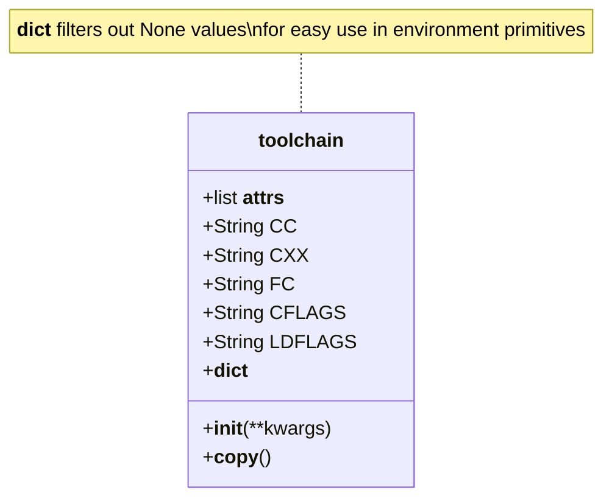
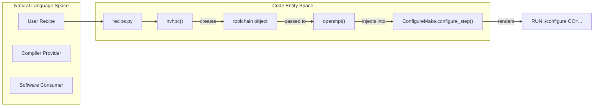

<!-- source: DeepWiki mcp.deepwiki.com · repo NVIDIA/hpc-container-maker · page 2.4 Toolchain · fetched 2026-10-26 -->

# Toolchain

<details>
<summary>Relevant source files</summary>

The following files were used as context for generating this wiki page:

- [docs/building_blocks.md](docs/building_blocks.md)
- [docs/misc_api.md](docs/misc_api.md)
- [hpccm/building_blocks/nvhpc.py](hpccm/building_blocks/nvhpc.py)
- [hpccm/config.py](hpccm/config.py)
- [hpccm/templates/ConfigureMake.py](hpccm/templates/ConfigureMake.py)
- [hpccm/toolchain.py](hpccm/toolchain.py)
- [test/test_ConfigureMake.py](test/test_ConfigureMake.py)
- [test/test_nvhpc.py](test/test_nvhpc.py)
- [test/test_toolchain.py](test/test_toolchain.py)

</details>


The `toolchain` class in HPCCM provides a standardized way to manage and propagate compiler information, linker flags, and library paths throughout a container recipe. It acts as a data transport object between building blocks that provide compilers (e.g., `gnu`, `nvhpc`) and building blocks that consume them to build software (e.g., `openmpi`, `fftw`).

## The toolchain Class

The `toolchain` class, defined in `hpccm/toolchain.py`, encapsulates commonly used environment variables for building HPC software. [hpccm/toolchain.py:20-23]().

### Attributes
The class supports a specific set of attributes defined in `__attrs__`. [hpccm/toolchain.py:25-27](). These attributes are initialized via keyword arguments in the constructor. [hpccm/toolchain.py:29-46]().

| Attribute | Description |
| :--- | :--- |
| `CC` | C compiler executable |
| `CXX` | C++ compiler executable |
| `FC`, `F77`, `F90` | Fortran compiler executables |
| `CFLAGS` | C compiler flags |
| `CXXFLAGS` | C++ compiler flags |
| `FCFLAGS`, `FFLAGS` | Fortran compiler flags |
| `CPPFLAGS` | C preprocessor flags |
| `LDFLAGS` | Linker flags |
| `LD_LIBRARY_PATH` | Shared library search path |
| `LIBS` | Libraries to link against |
| `FLIBS` | Fortran-specific libraries |
| `CUDA_HOME` | Path to the CUDA installation |

### Implementation Details
*   **Dictionary Conversion**: The class overrides the `__dict__` property to return only attributes with non-null values. This allows the toolchain to be passed directly to the `environment` primitive using `vars(toolchain_object)`. [hpccm/toolchain.py:65-70]().
*   **Copying**: The class implements `__copy__` and `__deepcopy__` to ensure that toolchain states can be duplicated without maintaining references to the original object, which is critical when one building block needs to modify a toolchain without affecting others. [hpccm/toolchain.py:48-63]().

### Code Entity Space: Toolchain Structure
This diagram shows how the `toolchain` class is structured and how it exposes its internal state.


Sources: [hpccm/toolchain.py:20-70]()

---

## Toolchain Flow in Building Blocks

Building blocks typically interact with toolchains in two ways:
1.  **Providers**: Compilers building blocks (like `nvhpc` or `gnu`) create a `toolchain` object as a member variable (`self.toolchain`) that reflects the compilers they just installed. [hpccm/building_blocks/nvhpc.py:51-53]().
2.  **Consumers**: Software building blocks (like `openmpi` or `amgx`) accept a `toolchain` object as a parameter to know which compilers to use during their configuration phase. [docs/building_blocks.md:45-48]().

### Data Flow Diagram
The following diagram illustrates the flow of compiler information from an installer block to a consumer block via the `toolchain` object.


Sources: [hpccm/building_blocks/nvhpc.py:141-143](), [hpccm/templates/ConfigureMake.py:86-137](), [docs/building_blocks.md:45-48]()

---

## CPU Optimization Integration

HPCCM integrates with `archspec` to automatically provide CPU-specific optimization flags through the toolchain.

### Global Configuration
The `hpccm.config` module provides functions to set and retrieve optimization targets:
*   `set_cpu_target(target)`: Sets the microarchitecture (e.g., `zen2`, `skylake`). [hpccm/config.py:155-164]().
*   `get_cpu_optimization_flags(compiler, version)`: Queries `archspec` for the appropriate flags for the current `g_cpu_target`. [hpccm/config.py:67-93]().

### Integration with Build Templates
The `ConfigureMake` template consumes the `toolchain` object during the `configure_step`. If the toolchain contains flags (like `CFLAGS`), they are appended to the environment string of the generated shell command. [hpccm/templates/ConfigureMake.py:90-93]().

### Example: Toolchain with Archspec
When a user sets a CPU target in a recipe, building blocks can use the toolchain to propagate those flags:

```python
# In a recipe
hpccm.config.set_cpu_target('zen2')
compiler = gnu()
# compiler.toolchain.CFLAGS will now include archspec flags for zen2
Stage0 += compiler
Stage0 += openmpi(toolchain=compiler.toolchain)
```

Sources: [hpccm/config.py:67-93](), [hpccm/templates/ConfigureMake.py:86-137](), [docs/misc_api.md:11-26]()

---

## Usage in Templates

The `ConfigureMake` template demonstrates how the toolchain attributes are mapped to shell environment variables during the build process.

```python
# hpccm/templates/ConfigureMake.py
if toolchain:
    if toolchain.CC and self.toolchain_control.get('CC'):
        e.append('CC={}'.format(toolchain.CC))
    if toolchain.CFLAGS:
        e.append('CFLAGS={}'.format(shlex_quote(toolchain.CFLAGS)))
    # ... mapping continues for CXX, FC, LDFLAGS, etc.
```
Sources: [hpccm/templates/ConfigureMake.py:87-132]()

---

