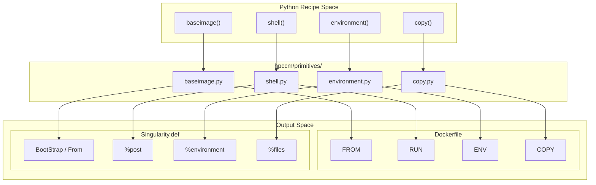
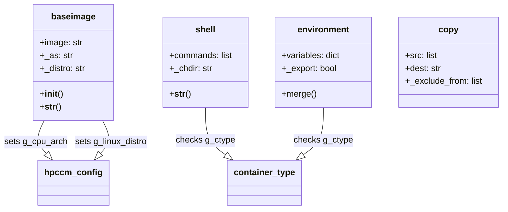

<!-- source: DeepWiki mcp.deepwiki.com · repo NVIDIA/hpc-container-maker · page 3 Primitives · fetched 2026-10-26 -->

# Primitives

Relevant source files

The following files were used as context for generating this wiki page:

- [docs/primitives.md](docs/primitives.md)
- [hpccm/primitives/baseimage.py](hpccm/primitives/baseimage.py)
- [hpccm/primitives/comment.py](hpccm/primitives/comment.py)
- [hpccm/primitives/environment.py](hpccm/primitives/environment.py)
- [hpccm/primitives/label.py](hpccm/primitives/label.py)
- [hpccm/primitives/runscript.py](hpccm/primitives/runscript.py)
- [hpccm/primitives/user.py](hpccm/primitives/user.py)
- [hpccm/primitives/workdir.py](hpccm/primitives/workdir.py)
- [test/test_baseimage.py](test/test_baseimage.py)

The **Primitives** layer in HPCCM (found in `hpccm/primitives/`) represents the lowest level of the container abstraction [docs/primitives.md:1-12](). These Python classes map directly to native container specification instructions, such as Dockerfile commands (`RUN`, `COPY`, `ENV`) or Singularity/Apptainer definition file sections (`%post`, `%files`, `%environment`) [hpccm/primitives/environment.py:81-114]().

Primitives are responsible for the "translation" logic that ensures a single Python recipe can generate valid syntax for multiple container runtimes or even shell scripts [hpccm/primitives/baseimage.py:195-208]().

### Primitive Translation Architecture

The following diagram illustrates how Primitives bridge the gap between Pythonic definitions and the generated output for different container engines.

**Primitive to Specification Mapping**

Sources: [hpccm/primitives/baseimage.py:30-72](), [hpccm/primitives/environment.py:74-118](), [hpccm/primitives/runscript.py:72-116]()

---

## 3.1. baseimage Primitive

The `baseimage` primitive is the starting point of every container stage [hpccm/primitives/baseimage.py:30-31](). It manages the `FROM` instruction in Docker and the `BootStrap`/`From` headers in Singularity [test/test_baseimage.py:57-71]().

Beyond simple syntax generation, `baseimage` performs critical environment detection:
*   **Architecture Detection**: It uses regex to inspect the image name (e.g., searching for `aarch64` or `ppc64le`) to automatically set the global `hpccm.config.g_cpu_arch` [hpccm/primitives/baseimage.py:87-105]().
*   **Distro Detection**: It identifies the Linux distribution (Ubuntu, CentOS, RHEL, Rocky Linux) and version to configure package managers in higher-level building blocks [hpccm/primitives/baseimage.py:107-190]().
*   **Multi-stage Support**: It handles stage naming via the `_as` parameter, which translates to `FROM ... AS name` in Docker and `Stage: name` in Singularity 3.2+ [test/test_baseimage.py:103-130]().

For details, see [baseimage Primitive](#3.1).

**Sources**: [hpccm/primitives/baseimage.py:30-190](), [test/test_baseimage.py:57-130]()

---

## 3.2. Shell, Copy, and Environment Primitives

These primitives handle the core operations of modifying a container's filesystem and runtime environment.

### Core Primitives Table

| Primitive | Docker Equivalent | Singularity Equivalent | Key Role |
| :--- | :--- | :--- | :--- |
| `shell` | `RUN` | `%post` | Executes commands during build [docs/primitives.md:237-240]() |
| `copy` | `COPY` | `%files` / `rsync` | Transfers files from host to image [hpccm/primitives/copy.py:109-112]() |
| `environment`| `ENV` | `%environment` | Sets runtime environment variables [hpccm/primitives/environment.py:27-32]() |
| `label` | `LABEL` | `%labels` | Adds metadata to the image [hpccm/primitives/label.py:27-28]() |
| `workdir` | `WORKDIR` | `mkdir && cd` | Sets the current working directory [hpccm/primitives/workdir.py:28-30]() |
| `runscript` | `ENTRYPOINT` | `%runscript` | Defines default container execution [hpccm/primitives/runscript.py:29-31]() |

### Implementation Details
*   **`shell`**: Provides the foundation for building blocks to install software [docs/primitives.md:237]().
*   **`copy`**: Includes specialized logic for Singularity to work around destination directory limitations using `%setup` and `rsync` with `_exclude_from` [docs/primitives.md:126-155]().
*   **`environment`**: For Singularity, it can optionally generate a `%post` section (via `_export=True`) to ensure variables are available during the build itself, not just at runtime [hpccm/primitives/environment.py:40-48]().
*   **`user`**: Sets the active user in Docker (`USER`); however, it is a null operation in Singularity as Singularity containers typically run as the host user [hpccm/primitives/user.py:27-31]().

**Entity Association Diagram**

Sources: [hpccm/primitives/baseimage.py:30-190](), [hpccm/primitives/environment.py:26-58](), [hpccm/primitives/shell.py:27-50](), [hpccm/primitives/copy.py:109-155]()

For details, see [Shell, Copy, and Environment Primitives](#3.2).

**Sources**: [docs/primitives.md:108-235](), [hpccm/primitives/environment.py:74-118](), [hpccm/primitives/runscript.py:72-116](), [hpccm/primitives/workdir.py:51-64](), [hpccm/primitives/user.py:48-61]()

---

