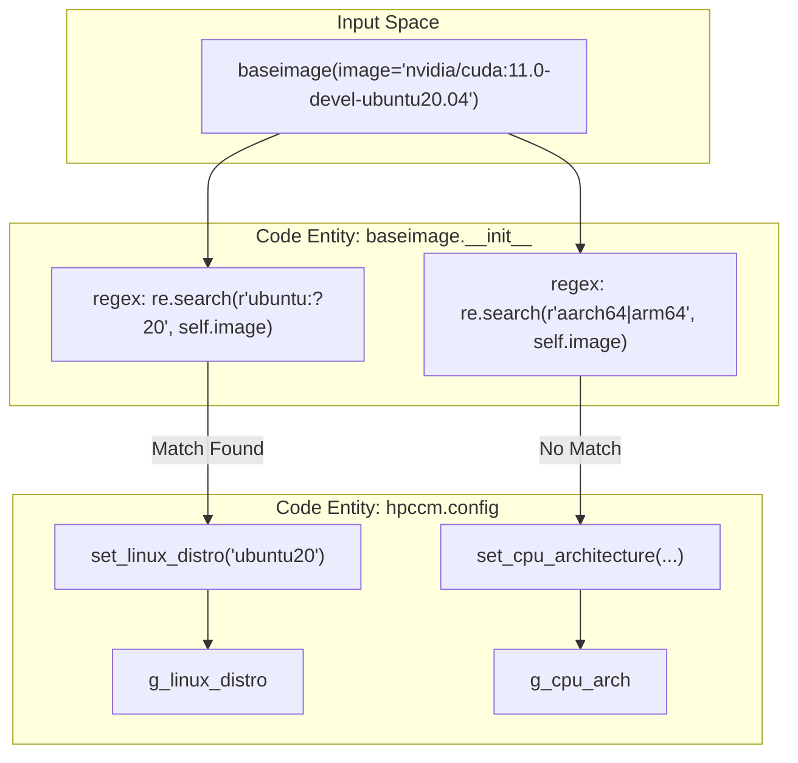
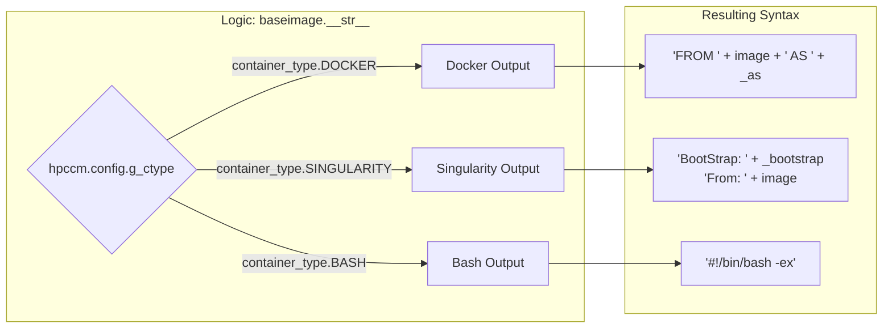

<!-- source: DeepWiki mcp.deepwiki.com · repo NVIDIA/hpc-container-maker · page 3.1 baseimage Primitive · fetched 2026-10-26 -->

# baseimage Primitive

Relevant source files

The following files were used as context for generating this wiki page:

- [hpccm/primitives/baseimage.py](hpccm/primitives/baseimage.py)
- [test/test_baseimage.py](test/test_baseimage.py)

The `baseimage` primitive is a foundational component of HPC Container Maker (HPCCM). It defines the starting point of a container stage, translating to the `FROM` instruction in Dockerfiles or the `BootStrap` and `From` headers in Singularity definition files [hpccm/primitives/baseimage.py:30-31](). Beyond simple string generation, it serves as the primary mechanism for automatic environment discovery, using regex patterns to detect CPU architectures and Linux distributions from image identifiers to configure global state [hpccm/primitives/baseimage.py:87-109]().

### Core Implementation and Logic Flow

The `baseimage` class handles initialization of the container environment. When instantiated, it updates the global configuration in `hpccm.config`, which subsequently influences the behavior of downstream building blocks (e.g., determining whether to use `apt-get` or `yum`) [hpccm/primitives/baseimage.py:110-185]().

#### Data Flow: Detection to Global Config

The following diagram illustrates how the `baseimage` primitive processes input parameters to set global state variables.

**System Discovery Data Flow**

Sources: [hpccm/primitives/baseimage.py:74-185](), [hpccm/primitives/baseimage.py:24-24]()

### Parameter Mapping and Translation

The primitive supports parameters that bridge the syntax differences between Docker and Singularity.

| Parameter | Type | Default | Description |
| :--- | :--- | :--- | :--- |
| `image` | `str` | `ubuntu:18.04` | The base image identifier [hpccm/primitives/baseimage.py:83-83](). |
| `_as` | `str` | `''` | Name for the stage. Maps to `AS` in Docker and `Stage` in Singularity (3.2+) [hpccm/primitives/baseimage.py:81-81](). |
| `_arch` | `str` | `''` | Explicit CPU architecture override (`aarch64`, `ppc64le`, `x86_64`) [hpccm/primitives/baseimage.py:79-79](). |
| `_distro` | `str` | `''` | Explicit Linux distribution override [hpccm/primitives/baseimage.py:84-84](). |
| `_bootstrap` | `str` | `docker` | Singularity-specific bootstrap agent (e.g., `localimage`, `library`) [hpccm/primitives/baseimage.py:82-82](). |
| `_docker_env` | `bool` | `True` | Singularity-specific: source Docker environment scripts in `%post` [hpccm/primitives/baseimage.py:85-85](). |

Sources: [hpccm/primitives/baseimage.py:79-86]()

### Output Generation (`__str__`)

The `__str__` method performs the translation from Python state to container engine syntax based on `hpccm.config.g_ctype` [hpccm/primitives/baseimage.py:202-205]().

#### Docker Translation
For Docker, it produces a standard `FROM` instruction. If `_as` is provided, it appends `AS <name>` [hpccm/primitives/baseimage.py:207-208]().

#### Singularity Translation
Singularity output is more complex:
1.  **Headers**: Generates `BootStrap` and `From` lines [hpccm/primitives/baseimage.py:208]().
2.  **Multi-stage**: If `_as` is used and Singularity version is $\ge$ 3.2, it adds a `Stage: <name>` header [hpccm/primitives/baseimage.py:208]().
3.  **Docker Bridge**: If `_docker_env` is True, it adds a `%post` section to source `/.singularity.d/env/10-docker*.sh`, ensuring environment variables defined in the Docker base image are available during the Singularity build [hpccm/primitives/baseimage.py:208]().

**Code Entity Mapping: Output Generation**

Sources: [hpccm/primitives/baseimage.py:202-208](), [test/test_baseimage.py:58-78]()

### Automatic Detection Logic

The primitive uses extensive regex matching on the `image` string to infer the operating system and version. This is critical for building blocks that rely on specific package managers.

*   **Ubuntu Detection**: Recognizes versions like `16.04`, `18.04`, `20.04`, `22.04`, `24.04`, and `26.04` via patterns like `ubuntu:?20` [hpccm/primitives/baseimage.py:163-176]().
*   **RHEL/CentOS/Rocky Detection**: Recognizes `centos:?7`, `rockylinux:?8`, and Red Hat Universal Base Images `ubi:?8` [hpccm/primitives/baseimage.py:143-158]().
*   **Architecture Detection**: Searches for `aarch64`, `arm64`, or `ppc64le` in the image name [hpccm/primitives/baseimage.py:97-100]().

Sources: [hpccm/primitives/baseimage.py:97-185](), [test/test_baseimage.py:143-205]()

---

