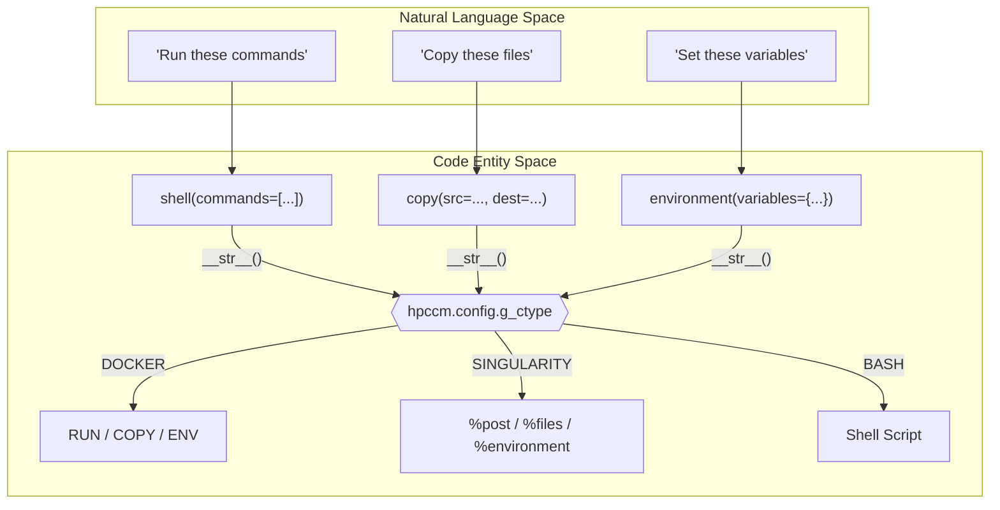
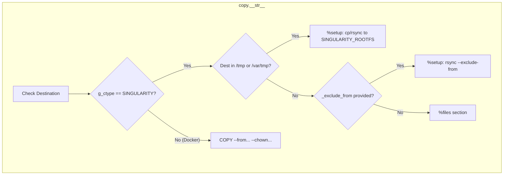

<!-- source: DeepWiki mcp.deepwiki.com · repo NVIDIA/hpc-container-maker · page 3.2 Shell, Copy, and Environment Primitives · fetched 2026-10-26 -->

# Shell, Copy, and Environment Primitives

Relevant source files

The following files were used as context for generating this wiki page:

- [CHANGELOG.md](CHANGELOG.md)
- [hpccm/building_blocks/scif.py](hpccm/building_blocks/scif.py)
- [hpccm/cli.py](hpccm/cli.py)
- [hpccm/primitives/blob.py](hpccm/primitives/blob.py)
- [hpccm/primitives/comment.py](hpccm/primitives/comment.py)
- [hpccm/primitives/copy.py](hpccm/primitives/copy.py)
- [hpccm/primitives/environment.py](hpccm/primitives/environment.py)
- [hpccm/primitives/label.py](hpccm/primitives/label.py)
- [hpccm/primitives/raw.py](hpccm/primitives/raw.py)
- [hpccm/primitives/runscript.py](hpccm/primitives/runscript.py)
- [hpccm/primitives/shell.py](hpccm/primitives/shell.py)
- [hpccm/primitives/user.py](hpccm/primitives/user.py)
- [hpccm/primitives/workdir.py](hpccm/primitives/workdir.py)
- [hpccm/version.py](hpccm/version.py)
- [setup.py](setup.py)
- [test/test_copy.py](test/test_copy.py)
- [test/test_environment.py](test/test_environment.py)
- [test/test_label.py](test/test_label.py)
- [test/test_runscript.py](test/test_runscript.py)
- [test/test_scif.py](test/test_scif.py)
- [test/test_shell.py](test/test_shell.py)
- [test/test_user.py](test/test_user.py)
- [test/test_workdir.py](test/test_workdir.py)

This section covers the low-level primitives in `hpccm/primitives/` that represent individual container instructions. These classes are responsible for translating Pythonic definitions into specific Dockerfile or Singularity definition file syntax based on the global `hpccm.config.g_ctype` setting.

## Architecture and Data Flow

Primitives are the most basic units of a container recipe. Unlike Building Blocks, which encapsulate complex installation logic, primitives map almost one-to-one with container engine instructions.

### Primitive Transformation Flow
The following diagram illustrates how a primitive object (e.g., `shell`) is transformed into target-specific syntax through its `__str__` method.

**Instruction Generation Logic**

**Sources:** [hpccm/primitives/shell.py:82-154](), [hpccm/primitives/copy.py:142-284](), [hpccm/primitives/environment.py:74-120]()

---

## Shell Primitive (`shell.py`)

The `shell` class [hpccm/primitives/shell.py:26-173]() handles the execution of commands.

| Feature | Docker Mapping | Singularity Mapping | Bash Mapping |
| :--- | :--- | :--- | :--- |
| **Basic Commands** | `RUN cmd1 && cmd2` | `%post` block | Sequential commands |
| **Working Dir** | Ignored (Docker resets) | `cd /` (if `chdir=True`) | `cd /` (if `chdir=True`) |
| **SCI-F Support** | Regular `RUN` | `%appinstall` or `%apptest` | N/A |
| **Arguments** | `_arguments` (e.g. `--mount`) | Ignored | Ignored |

### Key Implementation Details
- **Chdir Behavior**: By default, `shell` includes `cd /` in Singularity and Bash to mimic Docker's behavior where each `RUN` starts from the root [hpccm/primitives/shell.py:139-141]().
- **Merging**: Multiple `shell` instances can be merged into a single layer to reduce image layers in Docker [hpccm/primitives/shell.py:155-173]().
- **App Environment**: In Singularity, `%appinstall` does not automatically load the container environment. The `_appenv=True` flag injects a loop to source environment files from `/.singularity.d/env/*` [hpccm/primitives/shell.py:125-127]().

**Sources:** [hpccm/primitives/shell.py:70-81](), [hpccm/primitives/shell.py:101-106](), [hpccm/primitives/shell.py:116-143]()

---

## Copy Primitive (`copy.py`)

The `copy` class [hpccm/primitives/copy.py:29-338]() handles file transfers from the host or other stages.

### Singularity Fallback Logic
Singularity (3.6+) restricts staging files directly to `/tmp` or `/var/tmp` via `%files`. HPCCM automatically detects these destinations and redirects the operation to a `%setup` block using `rsync` or `cp` [hpccm/primitives/copy.py:79-86]().

**Copy Execution Path**

**Sources:** [hpccm/primitives/copy.py:159-284](), [hpccm/primitives/copy.py:228-250](), [CHANGELOG.md:15-16]()

---

## Environment and Metadata Primitives

### Environment (`environment.py`)
Sets variables via `ENV` (Docker) or `%environment` (Singularity).
- **Exporting**: Singularity's `%environment` section variables are only available at runtime. HPCCM's `_export=True` (default) also generates a `%post` block to `export` them for subsequent build steps [hpccm/primitives/environment.py:40-48]().
- **Merging**: Merges dictionary updates deterministicly by sorting keys [hpccm/primitives/environment.py:78-79]().

### Label (`label.py`)
Sets metadata via `LABEL` (Docker) or `%labels` (Singularity).
- **Mapping**: Does not map to Bash output (logs a warning) [hpccm/primitives/label.py:90-92]().

**Sources:** [hpccm/primitives/environment.py:26-58](), [hpccm/primitives/environment.py:104-114](), [hpccm/primitives/label.py:26-43]()

---

## Miscellaneous Primitives

| Primitive | Purpose | Key Implementation |
| :--- | :--- | :--- |
| **`workdir`** | Sets the working directory. | Docker: `WORKDIR`. Singularity: `cd` in `%post` (simulated). |
| **`user`** | Sets the active user. | Docker: `USER`. Singularity: Ignored (runs as host user). |
| **`runscript`** | Defines the default execution command. | Docker: `ENTRYPOINT`. Singularity: `%runscript`. |
| **`comment`** | Injects comments into the spec file. | Docker: `#`. Singularity: `%help` or `#`. |
| **`raw`** | Escape hatch for arbitrary text. | Injects string directly into output without modification. |
| **`blob`** | Injects multi-line content into a file. | Typically used for creating configuration files via heredocs. |

**Sources:** [hpccm/primitives/workdir.py](), [hpccm/primitives/user.py](), [hpccm/primitives/runscript.py](), [hpccm/primitives/comment.py](), [hpccm/primitives/raw.py](), [hpccm/primitives/blob.py]()

---

## SCI-F Integration

Primitives include an `_app` parameter [hpccm/primitives/shell.py:75](), [hpccm/primitives/copy.py:118]() to support the **Scientific Filesystem (SCI-F)**. When `_app` is set, Singularity output switches to app-specific sections:

- `shell` -> `%appinstall <name>` or `%apptest <name>` [hpccm/primitives/shell.py:117-119]()
- `copy` -> `%appfiles <name>` [hpccm/primitives/copy.py:217]()
- `environment` -> `%appenv <name>` [hpccm/primitives/environment.py:105]()
- `label` -> `%applabels <name>` [hpccm/primitives/label.py:85]()

**Sources:** [hpccm/building_blocks/scif.py:112-130](), [hpccm/building_blocks/scif.py:132-175]()

---

