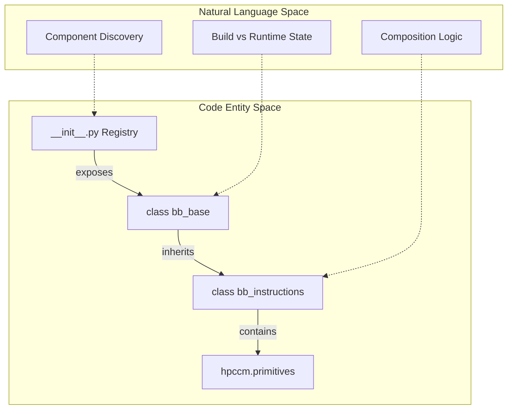
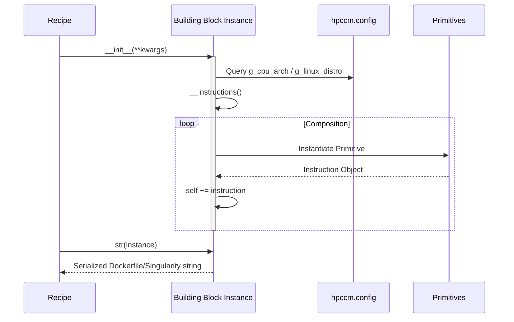

<!-- source: DeepWiki mcp.deepwiki.com · repo NVIDIA/hpc-container-maker · page 4 Building Blocks · fetched 2026-10-26 -->

# Building Blocks

Relevant source files

The following files were used as context for generating this wiki page:

- [docs/building_blocks.md](docs/building_blocks.md)
- [hpccm/building_blocks/__init__.py](hpccm/building_blocks/__init__.py)
- [hpccm/building_blocks/base.py](hpccm/building_blocks/base.py)
- [hpccm/building_blocks/doca_ofed.py](hpccm/building_blocks/doca_ofed.py)
- [hpccm/building_blocks/nvhpc.py](hpccm/building_blocks/nvhpc.py)
- [pydocmd.yml](pydocmd.yml)
- [test/test_doca_ofed.py](test/test_doca_ofed.py)
- [test/test_nvhpc.py](test/test_nvhpc.py)

Building blocks are the mid-level abstraction layer in HPCCM, residing between low-level [Primitives](#3) and high-level [Recipes and Examples](#6). They represent complete software components (e.g., a specific MPI implementation or a compiler suite) and encapsulate the domain expertise required to install them across different Linux distributions and CPU architectures.

### The `bb_base` Class and Registry

All building blocks inherit from the `bb_base` class [hpccm/building_blocks/base.py:54-62](), which provides a container for both build-time and runtime instructions. The `bb_instructions` parent class [hpccm/building_blocks/base.py:22-53]() implements the `+=` operator, allowing building blocks to compose multiple primitives into a single logical unit.

All available building blocks are registered in `hpccm/building_blocks/__init__.py` [hpccm/building_blocks/__init__.py:16-126](), making them accessible to recipes via simple function calls.

**Building Block Architecture**

**Sources:** [hpccm/building_blocks/base.py:22-62](), [hpccm/building_blocks/__init__.py:16-126]()

---

### Building Block Lifecycle

A building block follows a standard internal lifecycle during instantiation to transform user parameters into container instructions.

1.  **`__init__`**: The entry point where user arguments (`**kwargs`) are processed [hpccm/building_blocks/nvhpc.py:147-150]().
2.  **`__setup` (Internal Logic)**: Blocks typically perform internal environment detection, such as identifying the CPU architecture via `hpccm.config.g_cpu_arch` [hpccm/building_blocks/doca_ofed.py:118-129]() or Linux distribution via `hpccm.config.g_linux_distro` [hpccm/building_blocks/doca_ofed.py:130-148]().
3.  **`__instructions`**: The block populates its internal list by appending primitives (like `shell`, `copy`, or `environment`) using the `self +=` syntax [hpccm/building_blocks/doca_ofed.py:101-116]().
4.  **`runtime()`**: A specialized method that returns only the instructions necessary for a deployment stage, typically leveraging `copy --from` to pull binaries from a build stage [docs/building_blocks.md:58-62]().

**Lifecycle Sequence**

**Sources:** [hpccm/building_blocks/nvhpc.py:147-175](), [hpccm/building_blocks/doca_ofed.py:101-160](), [hpccm/building_blocks/base.py:32-40]()

---

### Building Block Categories

Building blocks are organized by their functional role in an HPC environment.

#### Compiler Building Blocks
These blocks handle the installation of compiler suites and automatically generate `toolchain` objects [hpccm/building_blocks/nvhpc.py:51-53](). Supported suites include GNU (GCC), LLVM, NVIDIA HPC SDK, and Arm Allinea Studio.
For details, see [Compiler Building Blocks](#4.1).

#### MPI and Communication Libraries
Covers the complex configuration of MPI stacks (OpenMPI, MPICH, MVAPICH2, Intel MPI) and their underlying transport layers like UCX, NCCL, and NVSHMEM.
For details, see [MPI and Communication Libraries](#4.2).

#### OFED and Networking Building Blocks
Handles RDMA and interconnect drivers, including Mellanox/NVIDIA OFED and DOCA. These blocks often involve complex GPG key management and repository configuration [hpccm/building_blocks/doca_ofed.py:81-87]().
For details, see [OFED and Networking Building Blocks](#4.3).

#### Math and Science Libraries
Encapsulates the build logic for standard HPC libraries such as FFTW, HDF5, NetCDF, Boost, and MKL. Many of these blocks use templates to handle standard `CMake` or `Autotools` workflows.
For details, see [Math and Science Libraries](#4.4).

#### Package Managers and Utilities
Provides abstractions for system package managers (`apt_get`, `yum`, and the cross-distro `packages` block) as well as language-specific managers like `pip` and `conda`.
For details, see [Package Managers and Utilities](#4.5).

#### Generic Build System Building Blocks
The "escape hatches" for software not covered by a dedicated block. `generic_cmake` and `generic_autotools` allow users to build arbitrary source code by simply providing a URL and configuration options.
For details, see [Generic Build System Building Blocks](#4.6).

**Sources:** [hpccm/building_blocks/__init__.py:16-70](), [docs/building_blocks.md:1-123]()

---

