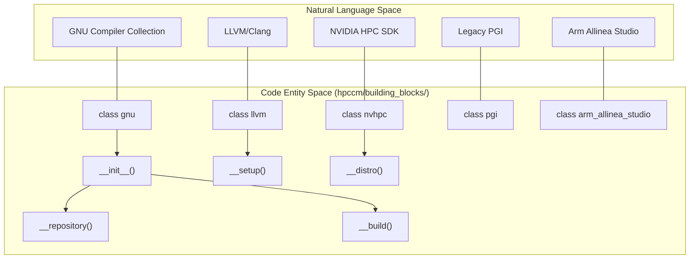
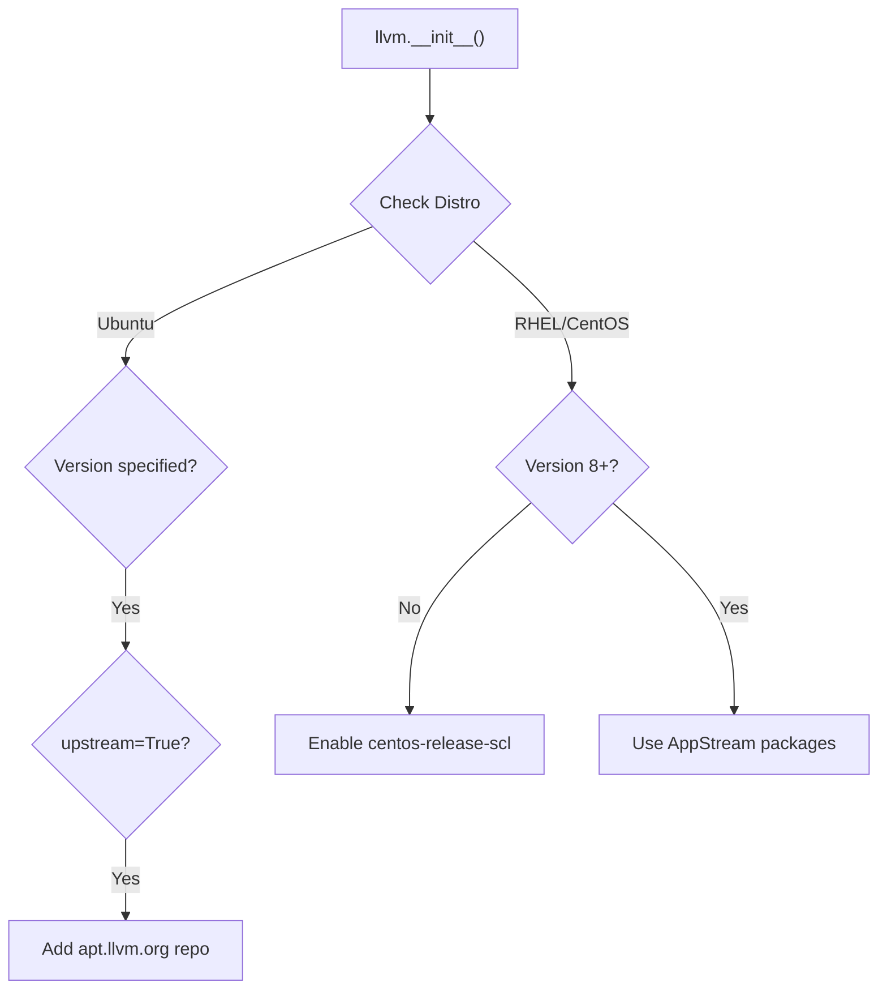

<!-- source: DeepWiki mcp.deepwiki.com · repo NVIDIA/hpc-container-maker · page 4.1 Compiler Building Blocks · fetched 2026-10-26 -->

# Compiler Building Blocks

Relevant source files

The following files were used as context for generating this wiki page:

- [docs/building_blocks.md](docs/building_blocks.md)
- [hpccm/building_blocks/arm_allinea_studio.py](hpccm/building_blocks/arm_allinea_studio.py)
- [hpccm/building_blocks/conda.py](hpccm/building_blocks/conda.py)
- [hpccm/building_blocks/gnu.py](hpccm/building_blocks/gnu.py)
- [hpccm/building_blocks/llvm.py](hpccm/building_blocks/llvm.py)
- [hpccm/building_blocks/nvhpc.py](hpccm/building_blocks/nvhpc.py)
- [hpccm/building_blocks/pgi.py](hpccm/building_blocks/pgi.py)
- [test/test_arm_allinea_studio.py](test/test_arm_allinea_studio.py)
- [test/test_catalyst.py](test/test_catalyst.py)
- [test/test_conda.py](test/test_conda.py)
- [test/test_gnu.py](test/test_gnu.py)
- [test/test_julia.py](test/test_julia.py)
- [test/test_libsim.py](test/test_libsim.py)
- [test/test_llvm.py](test/test_llvm.py)
- [test/test_mvapich2_gdr.py](test/test_mvapich2_gdr.py)
- [test/test_nvhpc.py](test/test_nvhpc.py)
- [test/test_pgi.py](test/test_pgi.py)

Compiler building blocks in HPCCM automate the installation and configuration of toolchains required for HPC application development. These blocks not only install the compiler binaries but also manage system dependencies, configure environment variables (e.g., `PATH`, `LD_LIBRARY_PATH`), and produce `toolchain` objects that can be passed to subsequent building blocks (like MPI or math libraries) to ensure consistent build environments.

## Architecture and Data Flow

Compiler building blocks follow a standardized lifecycle within the HPCCM framework. They typically inherit from `bb_base` and various templates (e.g., `envvars`, `rm`, `downloader`) to handle common tasks.

### Code Entity Mapping
The following diagram illustrates how the logical compiler types map to specific Python classes and their internal setup methods.

**Compiler Class and Setup Mapping**

Sources: `[hpccm/building_blocks/gnu.py:41-43]()`, `[hpccm/building_blocks/llvm.py:34-34]()`, `[hpccm/building_blocks/nvhpc.py:39-40]()`, `[hpccm/building_blocks/arm_allinea_studio.py:41-42]()`.

---

## GNU (gnu)
The `gnu` building block installs the GCC suite. It supports two primary modes: installation from OS repositories (including SCL/PPA) and building from source.

### Key Features
*   **Repository Support**: On Ubuntu, it can enable `ppa:ubuntu-toolchain-r/test` `[hpccm/building_blocks/gnu.py:69-70]()`. On RHEL-based systems, it supports Software Collections (SCL) via `devtoolset` or `gcc-toolset` `[hpccm/building_blocks/gnu.py:109-112]()`.
*   **Source Builds**: When `source=True` is passed, it handles downloading prerequisites, configuring with `--disable-multilib`, and compiling using `make -j$(nproc)` `[hpccm/building_blocks/gnu.py:148-151]()`.
*   **Toolchain Integration**: Automatically populates a `toolchain` object with `gcc`, `g++`, and `gfortran` paths `[hpccm/building_blocks/gnu.py:182-195]()`.

Sources: `[hpccm/building_blocks/gnu.py:41-195]()`, `[test/test_gnu.py:38-116]()`.

---

## LLVM (llvm)
The `llvm` building block manages Clang and related tools. It is highly configurable for different Linux distributions and upstream repository access.

### Implementation Details
*   **Upstream Support**: Can be configured to use `apt.llvm.org` for the latest LLVM versions on Ubuntu by setting `upstream=True` `[hpccm/building_blocks/llvm.py:155-161]()`.
*   **Toolsets**: Supports installing `clang-format`, `clang-tidy`, and `lldb` via the `extra_tools` or `toolset` parameters `[hpccm/building_blocks/llvm.py:178-182]()`.
*   **RHEL SCL**: On CentOS 7, it utilizes the `llvm-toolset` from SCL `[hpccm/building_blocks/llvm.py:223-228]()`.

**LLVM Setup Logic**

Sources: `[hpccm/building_blocks/llvm.py:122-260]()`.

---

## NVIDIA HPC SDK (nvhpc)
The `nvhpc` building block installs the NVIDIA HPC SDK, which includes C, C++, and Fortran compilers with support for GPU acceleration (OpenACC, OpenMP, CUDA).

### Key Features
*   **Installation Methods**: Supports network repository (default), local `package`, or `tarball` download `[hpccm/building_blocks/nvhpc.py:41-46]()`.
*   **CUDA Mapping**: Handles multi-CUDA installations and environment configuration for specific CUDA versions `[hpccm/building_blocks/nvhpc.py:57-64]()`.
*   **HPC-X Integration**: Can optionally include Mellanox HPC-X environment settings if requested `[hpccm/building_blocks/nvhpc.py:164-165]()`.
*   **Runtime Support**: The `runtime()` method extracts redistributable libraries (e.g., `libnvidia-ml.so`) for deployment stages `[hpccm/building_blocks/nvhpc.py:465-515]()`.

Sources: `[hpccm/building_blocks/nvhpc.py:39-175]()`, `[test/test_nvhpc.py:38-110]()`.

---

## Arm Allinea Studio (arm_allinea_studio)
Tailored for AArch64 architectures, this block installs the Arm compiler suite (armclang, armflang).

### Technical Detail
*   **Microarchitecture Tuning**: Allows specifying targets like `generic`, `neoverse-n1`, or `thunderx2t99` for optimized binary installation `[hpccm/building_blocks/arm_allinea_studio.py:67-73]()`.
*   **Environment Modules**: Unlike other blocks that use `environment` primitives directly, Arm Allinea Studio often relies on `Lmod` or `Environment Modules` to manage the compiler environment `[hpccm/building_blocks/arm_allinea_studio.py:53-56]()`.
*   **EULA Requirement**: Explicitly requires `eula=True` to proceed with installation `[hpccm/building_blocks/arm_allinea_studio.py:136-137]()`.

Sources: `[hpccm/building_blocks/arm_allinea_studio.py:41-137]()`, `[docs/building_blocks.md:123-175]()`.

---

## Legacy PGI (pgi)
The `pgi` building block provides support for legacy PGI compilers. Users are generally encouraged to migrate to `nvhpc`.

### Implementation
*   **Local Context**: Requires a manually downloaded tarball via the `tarball` parameter `[hpccm/building_blocks/pgi.py:97-99]()`.
*   **Configuration**: Includes a unique `siterc` modification step to ensure `LIBRARY_PATH` environment variables are correctly handled by the PGI driver `[hpccm/building_blocks/pgi.py:277-282]()`.

Sources: `[hpccm/building_blocks/pgi.py:40-142]()`, `[test/test_pgi.py:46-68]()`.

---

## Summary of Compiler Toolchains

The building blocks define the following toolchain attributes which are consumed by downstream blocks:

| Building Block | CC | CXX | FC | Default Prefix |
| :--- | :--- | :--- | :--- | :--- |
| `gnu` | `gcc` | `g++` | `gfortran` | `/usr/local/gnu` (source) |
| `llvm` | `clang` | `clang++` | N/A | System Path |
| `nvhpc` | `nvc` | `nvc++` | `nvfortran` | `/opt/nvidia/hpc_sdk` |
| `pgi` | `pgcc` | `pgc++` | `pgfortran` | `/opt/pgi` |
| `arm_allinea_studio` | `armclang` | `armclang++` | `armflang` | `/opt/arm` |

Sources: `[hpccm/building_blocks/gnu.py:169-170]()`, `[hpccm/building_blocks/llvm.py:109-114]()`, `[hpccm/building_blocks/nvhpc.py:372-385]()`, `[hpccm/building_blocks/pgi.py:136-137]()`, `[hpccm/building_blocks/arm_allinea_studio.py:127-129]()`.

---

