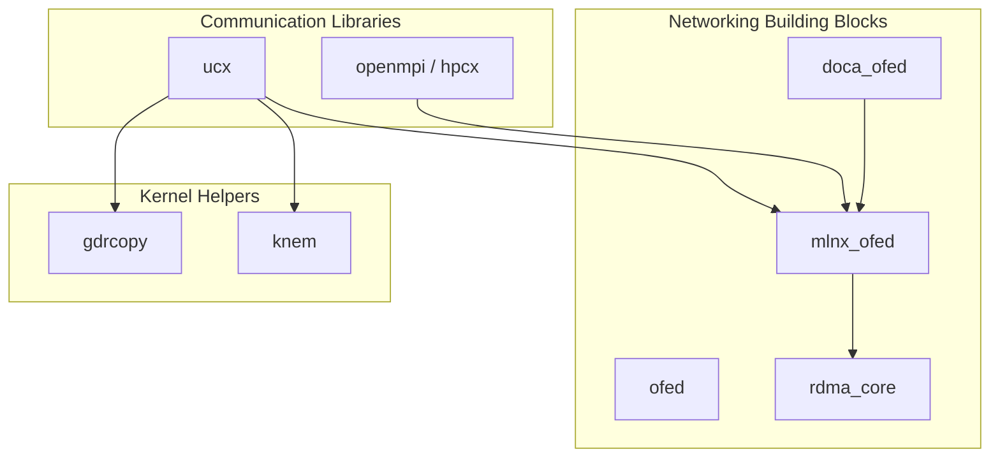
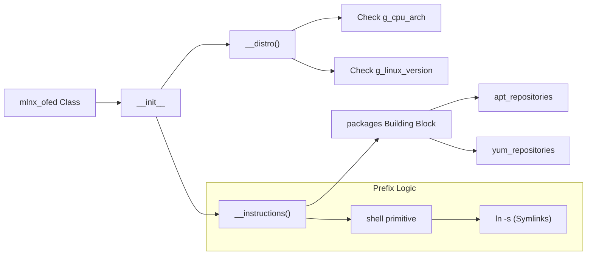

<!-- source: DeepWiki mcp.deepwiki.com · repo NVIDIA/hpc-container-maker · page 4.3 OFED and Networking Building Blocks · fetched 2026-10-26 -->

# OFED and Networking Building Blocks

Relevant source files

The following files were used as context for generating this wiki page:

- [hpccm/building_blocks/__init__.py](hpccm/building_blocks/__init__.py)
- [hpccm/building_blocks/doca_ofed.py](hpccm/building_blocks/doca_ofed.py)
- [hpccm/building_blocks/gdrcopy.py](hpccm/building_blocks/gdrcopy.py)
- [hpccm/building_blocks/knem.py](hpccm/building_blocks/knem.py)
- [hpccm/building_blocks/mlnx_ofed.py](hpccm/building_blocks/mlnx_ofed.py)
- [hpccm/building_blocks/multi_ofed.py](hpccm/building_blocks/multi_ofed.py)
- [hpccm/building_blocks/ofed.py](hpccm/building_blocks/ofed.py)
- [hpccm/building_blocks/rdma_core.py](hpccm/building_blocks/rdma_core.py)
- [hpccm/building_blocks/ucx.py](hpccm/building_blocks/ucx.py)
- [pydocmd.yml](pydocmd.yml)
- [test/helpers.py](test/helpers.py)
- [test/test_doca_ofed.py](test/test_doca_ofed.py)
- [test/test_gdrcopy.py](test/test_gdrcopy.py)
- [test/test_kokkos.py](test/test_kokkos.py)
- [test/test_mlnx_ofed.py](test/test_mlnx_ofed.py)
- [test/test_multi_ofed.py](test/test_multi_ofed.py)
- [test/test_ofed.py](test/test_ofed.py)
- [test/test_ucx.py](test/test_ucx.py)

This section covers building blocks responsible for InfiniBand, RDMA, and specialized networking technologies. These components provide the low-level communication interface required by high-performance messaging layers like MPI and UCX.

## Overview of Networking Architecture

HPCCM provides several ways to install the OpenFabrics Enterprise Distribution (OFED). The choice depends on whether the user requires vendor-specific features (Mellanox/NVIDIA), generic distribution-provided stacks, or side-by-side installations of multiple versions.

### Networking Component Relationship
The following diagram illustrates how networking building blocks relate to the underlying OS and higher-level communication libraries.

**Diagram: Networking Stack Integration**

**Sources:** [hpccm/building_blocks/ucx.py:42-46](), [hpccm/building_blocks/doca_ofed.py:34-35]()

---

## mlnx_ofed (Mellanox OFED)

The `mlnx_ofed` building block installs the Mellanox OpenFabrics Enterprise Distribution. It is highly configurable, supporting standard package manager installations or prefix-based installations for multi-stage builds.

### Key Implementation Details
- **Distribution Detection**: The class automatically maps the global Linux distribution (`g_linux_distro`) and version (`g_linux_version`) to Mellanox-specific repository labels (e.g., `ubuntu18.04`, `rhel7.2`) [hpccm/building_blocks/mlnx_ofed.py:160-170]().
- **Prefix Installation**: If a `prefix` is provided, the block downloads packages via `apt-get download` or `yumdownloader` and extracts them into the specified directory instead of installing them to `/usr` [hpccm/building_blocks/mlnx_ofed.py:127-140]().
- **Symlinking**: When using a `prefix`, the `symlink` parameter (default `False`) can be used to create a standard directory structure (`bin`, `include`, `lib`) within the prefix to facilitate toolchain integration [hpccm/building_blocks/mlnx_ofed.py:144-152]().

### Code Entity Mapping
**Diagram: mlnx_ofed Implementation Flow**

**Sources:** [hpccm/building_blocks/mlnx_ofed.py:98-159]()

---

## doca_ofed (NVIDIA DOCA)

The `doca_ofed` building block installs the NVIDIA DOCA (Data Center Infrastructure-on-a-Chip Architecture) software framework, which includes modern OFED support for NVIDIA BlueField DPUs and ConnectX adapters [hpccm/building_blocks/doca_ofed.py:34-35]().

### Features
- **GPG Handling**: Includes specific logic to handle GPG key security policies for newer distributions like Rocky Linux 9 and 10, where the Mellanox GPG key might be rejected by default system policies [hpccm/building_blocks/doca_ofed.py:150-170]().
- **Architecture Mapping**: Maps architectures to DOCA-specific labels, such as `arm64-sbsa` for aarch64 [hpccm/building_blocks/doca_ofed.py:123-126]().

**Sources:** [hpccm/building_blocks/doca_ofed.py:74-117]()

---

## ofed (Generic)

The `ofed` building block installs the standard OpenFabrics Enterprise Distribution packages provided by the Linux distribution's official repositories (e.g., Ubuntu Main or RHEL BaseOS) [hpccm/building_blocks/ofed.py:33-34]().

### Distribution-Specific Package Sets
| Distro | Key Packages |
| :--- | :--- |
| **Ubuntu 18.04+** | `ibverbs-providers`, `ibverbs-utils`, `librdmacm1`, `rdmacm-utils` |
| **RHEL 7.x** | `dapl`, `libibcm`, `libibverbs`, `rdma-core` |
| **RHEL 8.x+** | `libibverbs`, `libibverbs-utils`, `rdma-core` |

**Sources:** [hpccm/building_blocks/ofed.py:48-63]()

---

## gdrcopy

`gdrcopy` is a low-latency GPU-Direct RDMA copy library. The building block compiles the user-space library from source [hpccm/building_blocks/gdrcopy.py:35-37]().

### Implementation Highlights
- **Build System**: Unlike many blocks, `gdrcopy` uses a raw `Makefile`. The building block translates the `toolchain` object into `make` variables (e.g., mapping `CFLAGS` to `COMMONCFLAGS`) [hpccm/building_blocks/gdrcopy.py:93-108]().
- **Multi-stage Support**: Implements the `runtime()` method to allow copying the compiled library and headers from a build stage to a deployment stage [hpccm/building_blocks/gdrcopy.py:141-155]().

**Sources:** [hpccm/building_blocks/gdrcopy.py:77-139]()

---

## Specialized Networking Blocks

### multi_ofed
Allows side-by-side installation of multiple Mellanox OFED versions. This is achieved by leveraging the `prefix` support in the `mlnx_ofed` building block for each version requested.

### rdma_core
Provides the core userspace RDMA components. This is typically a dependency of `ofed` or `mlnx_ofed` but can be installed independently if only the core infrastructure is required.

### knem and xpmem
- **knem**: A kernel module and userspace library for efficient intra-node MPI communication [hpccm/building_blocks/knem.py]().
- **xpmem**: A Linux kernel module that allows a process to map the memory of another process into its own address space, used for high-speed cross-process communication.

**Sources:** [hpccm/building_blocks/__init__.py:16-70](), [hpccm/building_blocks/ucx.py:44-46]()

---

