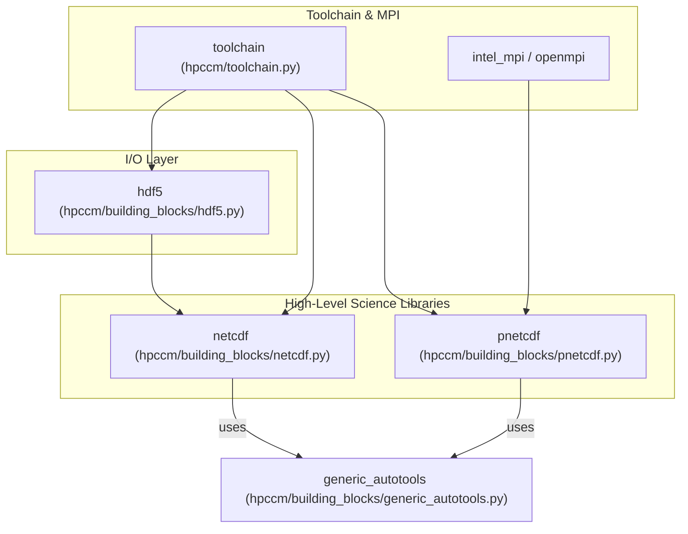
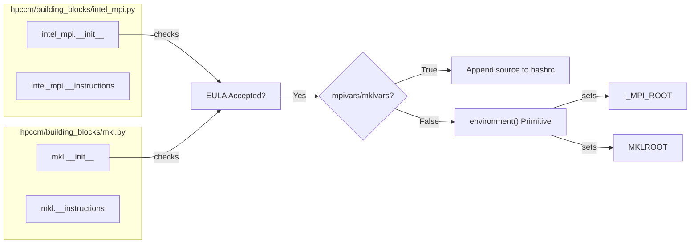

<!-- source: DeepWiki mcp.deepwiki.com · repo NVIDIA/hpc-container-maker · page 4.4 Math and Science Libraries · fetched 2026-10-26 -->

# Math and Science Libraries

Relevant source files

The following files were used as context for generating this wiki page:

- [hpccm/building_blocks/boost.py](hpccm/building_blocks/boost.py)
- [hpccm/building_blocks/charm.py](hpccm/building_blocks/charm.py)
- [hpccm/building_blocks/fftw.py](hpccm/building_blocks/fftw.py)
- [hpccm/building_blocks/hdf5.py](hpccm/building_blocks/hdf5.py)
- [hpccm/building_blocks/intel_mpi.py](hpccm/building_blocks/intel_mpi.py)
- [hpccm/building_blocks/intel_psxe.py](hpccm/building_blocks/intel_psxe.py)
- [hpccm/building_blocks/intel_psxe_runtime.py](hpccm/building_blocks/intel_psxe_runtime.py)
- [hpccm/building_blocks/kokkos.py](hpccm/building_blocks/kokkos.py)
- [hpccm/building_blocks/magma.py](hpccm/building_blocks/magma.py)
- [hpccm/building_blocks/mkl.py](hpccm/building_blocks/mkl.py)
- [hpccm/building_blocks/netcdf.py](hpccm/building_blocks/netcdf.py)
- [hpccm/building_blocks/openblas.py](hpccm/building_blocks/openblas.py)
- [hpccm/building_blocks/pnetcdf.py](hpccm/building_blocks/pnetcdf.py)
- [hpccm/building_blocks/sensei.py](hpccm/building_blocks/sensei.py)
- [hpccm/building_blocks/xpmem.py](hpccm/building_blocks/xpmem.py)
- [test/test_boost.py](test/test_boost.py)
- [test/test_cgns.py](test/test_cgns.py)
- [test/test_charm.py](test/test_charm.py)
- [test/test_hdf5.py](test/test_hdf5.py)
- [test/test_intel_mpi.py](test/test_intel_mpi.py)
- [test/test_intel_psxe.py](test/test_intel_psxe.py)
- [test/test_intel_psxe_runtime.py](test/test_intel_psxe_runtime.py)
- [test/test_mkl.py](test/test_mkl.py)
- [test/test_netcdf.py](test/test_netcdf.py)
- [test/test_openblas.py](test/test_openblas.py)
- [test/test_pnetcdf.py](test/test_pnetcdf.py)

This section covers the building blocks responsible for installing high-performance math and science libraries. These libraries provide the computational foundation for HPC applications, ranging from linear algebra and FFTs to I/O and data management frameworks.

The building blocks in this category typically leverage the `ConfigureMake` or `CMakeBuild` templates, but often require specialized logic for handling toolchain-specific optimizations, such as MKL's environment scripts or NetCDF's multi-language library dependencies.

## Architecture Overview

Math and science libraries in HPCCM follow a pattern where they consume a `toolchain` object to ensure consistent compilation across the software stack. Many of these blocks (like `hdf5`, `netcdf`, and `pnetcdf`) are inter-dependent, requiring specific installation orders to satisfy linker requirements.

### Library Dependency and Data Flow

The following diagram illustrates how science libraries like `netcdf` and `pnetcdf` interact with underlying I/O libraries and toolchains.

**Science Library Dependency Graph**

**Sources:** [hpccm/building_blocks/netcdf.py:37-43](), [hpccm/building_blocks/pnetcdf.py:78-80]()

---

## Core Math Libraries

### OpenBLAS
The `openblas` building block builds and installs the OpenBLAS linear algebra library [hpccm/building_blocks/openblas.py:34-36](). It automatically detects the CPU architecture (`AARCH64`, `PPC64LE`, or `X86_64`) to set appropriate `TARGET` and `USE_OPENMP` flags for the build [hpccm/building_blocks/openblas.py:129-136]().

*   **Implementation:** It uses `generic_build` to handle the `make` and `make install` workflow [hpccm/building_blocks/openblas.py:101-112]().
*   **Environment:** Sets `LD_LIBRARY_PATH` and `LIBRARY_PATH` to include the prefix `lib` directory [hpccm/building_blocks/openblas.py:97-98]().

### Boost
The `boost` building block manages the installation of the Boost C++ libraries [hpccm/building_blocks/boost.py:39-42](). Unlike most Autotools-based blocks, it uses Boost's custom `bootstrap.sh` and `b2` build system [hpccm/building_blocks/boost.py:180-185]().

*   **Key Feature:** Support for Python headers via the `python` parameter [hpccm/building_blocks/boost.py:108]().
*   **Legacy Support:** The `sourceforge` flag allows downloading versions older than 1.63.0 from SourceForge [hpccm/building_blocks/boost.py:115-116]().

**Sources:** [hpccm/building_blocks/openblas.py:1-153](), [hpccm/building_blocks/boost.py:1-185]()

---

## I/O and Data Libraries

### HDF5
The `hdf5` building block installs the Hierarchical Data Format library [hpccm/building_blocks/hdf5.py:38-43](). It is often a prerequisite for NetCDF.

*   **Toolchain Integration:** It includes a specific workaround for NVIDIA compilers, adding `-fpic -DPIC` to `FCFLAGS` if `nvfortran` is detected [hpccm/building_blocks/hdf5.py:171-175]().
*   **Multi-stage Support:** The `runtime()` method copies the installation prefix and installs only the necessary runtime OS packages (e.g., `zlib1g`) [hpccm/building_blocks/hdf5.py:118-131]().

### NetCDF and PnetCDF
These blocks handle the Network Common Data Form libraries.
*   **`netcdf`**: Installs C, C++, and Fortran interfaces sequentially using `generic_autotools` [hpccm/building_blocks/netcdf.py:162-180]().
*   **`pnetcdf`**: Specifically for parallel I/O, requiring an MPI-enabled toolchain [hpccm/building_blocks/pnetcdf.py:121-124](). It includes a `sed` post-configure step to ensure `pic_flag` is correctly set in the generated `libtool` [hpccm/building_blocks/pnetcdf.py:151-156]().

**Sources:** [hpccm/building_blocks/hdf5.py:1-180](), [hpccm/building_blocks/netcdf.py:1-180](), [hpccm/building_blocks/pnetcdf.py:1-167]()

---

## Intel Library Suite

HPCCM provides deep integration for Intel's math and science stack, handling complex environment scripts and EULA requirements.

### MKL and Intel MPI
The `mkl` and `intel_mpi` blocks share a similar pattern for environment management:
*   **`mpivars` / `mklvars`**: If set to `True`, the block modifies `/etc/bash.bashrc` (or equivalent) to source Intel's environment scripts [hpccm/building_blocks/intel_mpi.py:134-138](), [hpccm/building_blocks/mkl.py:126-130]().
*   **Manual Environment**: If `False`, HPCCM manually defines `CPATH`, `LD_LIBRARY_PATH`, and `PATH` so they are available during subsequent container build stages [hpccm/building_blocks/mkl.py:136-141]().

### Intel Parallel Studio XE (PSXE)
The `intel_psxe` block is a comprehensive installer that requires a local tarball and license [hpccm/building_blocks/intel_psxe.py:42-46](). It can install specific components like `intel-icc__x86_64` or `intel-ifort__x86_64` [hpccm/building_blocks/intel_psxe.py:50-55]().

**Intel Environment Management Flow**

**Sources:** [hpccm/building_blocks/intel_mpi.py:122-156](), [hpccm/building_blocks/mkl.py:114-141]()

---

## Summary of Math and Science Blocks

| Building Block | Base Class | Build System | Key Dependencies |
| :--- | :--- | :--- | :--- |
| `fftw` | `bb_base` | Autotools | Toolchain |
| `hdf5` | `bb_base` | Autotools | `zlib` |
| `netcdf` | `bb_base` | Autotools | `hdf5` |
| `pnetcdf` | `bb_base` | Autotools | MPI Toolchain |
| `openblas` | `bb_base` | Make | Toolchain |
| `boost` | `bb_base` | `b2` | Python (optional) |
| `kokkos` | `bb_base` | CMake | Toolchain, CUDA (optional) |
| `mkl` | `bb_base` | Apt/Yum | Intel EULA |
| `intel_psxe` | `bb_base` | Tarball/Installer | License file |

**Sources:** [hpccm/building_blocks/netcdf.py:37](), [hpccm/building_blocks/hdf5.py:38](), [hpccm/building_blocks/openblas.py:34](), [hpccm/building_blocks/intel_psxe.py:40]()

---

