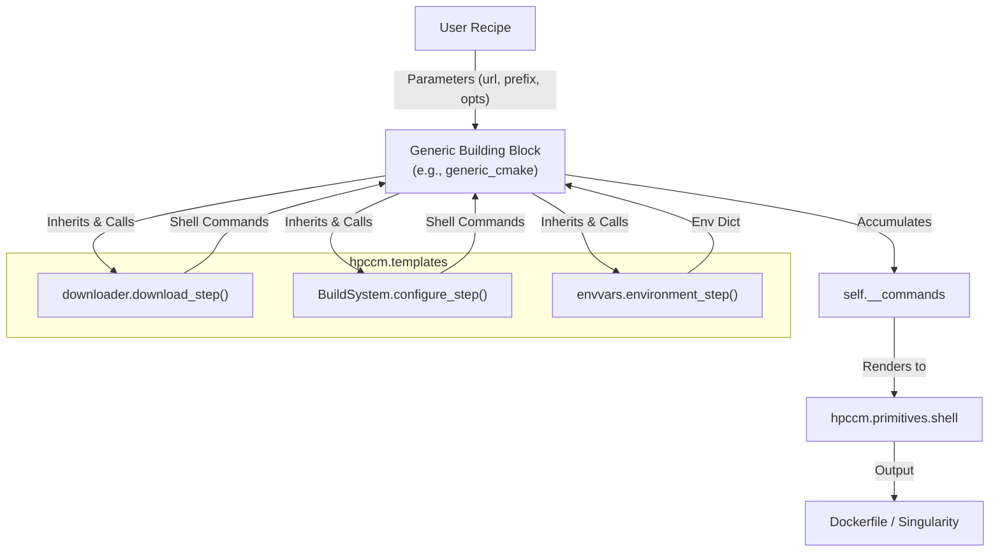
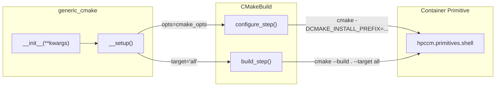

<!-- source: DeepWiki mcp.deepwiki.com · repo NVIDIA/hpc-container-maker · page 4.6 Generic Build System Building Blocks · fetched 2026-10-26 -->

# Generic Build System Building Blocks

<details>
<summary>Relevant source files</summary>

The following files were used as context for generating this wiki page:

- [.gitignore](.gitignore)
- [hpccm/building_blocks/catalyst.py](hpccm/building_blocks/catalyst.py)
- [hpccm/building_blocks/generic_autotools.py](hpccm/building_blocks/generic_autotools.py)
- [hpccm/building_blocks/generic_build.py](hpccm/building_blocks/generic_build.py)
- [hpccm/building_blocks/generic_cmake.py](hpccm/building_blocks/generic_cmake.py)
- [hpccm/building_blocks/libsim.py](hpccm/building_blocks/libsim.py)
- [hpccm/templates/CMakeBuild.py](hpccm/templates/CMakeBuild.py)
- [hpccm/templates/ConfigureMake.py](hpccm/templates/ConfigureMake.py)
- [hpccm/toolchain.py](hpccm/toolchain.py)
- [test/test_CMakeBuild.py](test/test_CMakeBuild.py)
- [test/test_ConfigureMake.py](test/test_ConfigureMake.py)
- [test/test_generic_autotools.py](test/test_generic_autotools.py)
- [test/test_generic_build.py](test/test_generic_build.py)
- [test/test_generic_cmake.py](test/test_generic_cmake.py)
- [test/test_toolchain.py](test/test_toolchain.py)

</details>


The generic build system building blocks serve as "escape hatches" within HPCCM. They provide a standardized way to build and install software packages that do not have a dedicated building block (like `openmpi` or `hdf5`) by wrapping common build patterns. These blocks leverage the `hpccm.templates` system to handle source acquisition, environment configuration, and multi-stage build logic.

## Overview of Generic Blocks

HPCCM provides three primary generic building blocks, each targeting a specific build methodology:

| Building Block | Primary Use Case | Underlying Template |
| :--- | :--- | :--- |
| `generic_autotools` | Software using `./configure && make && make install` | `ConfigureMake` |
| `generic_cmake` | Software using `cmake && make && make install` | `CMakeBuild` |
| `generic_build` | Software with arbitrary or custom shell commands | N/A (Direct `shell` usage) |

All three blocks inherit from `bb_base` and common templates such as `downloader`, `envvars`, `ldconfig`, and `rm` to provide a consistent interface for source handling and container optimization [hpccm/building_blocks/generic_autotools.py:39-42](), [hpccm/building_blocks/generic_cmake.py:39-42](), [hpccm/building_blocks/generic_build.py:37-39]().

### Data Flow and Template Integration

The following diagram illustrates how user-provided parameters flow through the generic building blocks into the template system to generate container instructions.

**Diagram: Generic Build Data Flow**

Sources: [hpccm/building_blocks/generic_autotools.py:174-205](), [hpccm/building_blocks/generic_cmake.py:177-208](), [hpccm/building_blocks/generic_build.py:174-203]()

---

## generic_autotools

The `generic_autotools` block is designed for GNU Autotools projects. It wraps the `ConfigureMake` template to manage the standard configuration and compilation workflow [hpccm/building_blocks/generic_autotools.py:39-44]().

### Key Features
*   **Option Generation**: Automatically converts keyword arguments like `enable_foo=True` into `--enable-foo` or `with_lib='/path'` into `--with-lib=/path` [hpccm/templates/ConfigureMake.py:47-56]().
*   **Toolchain Integration**: Passes compilers (`CC`, `CXX`, `FC`) and flags (`CFLAGS`, `LDFLAGS`) from a `toolchain` object directly into the `configure` environment [hpccm/templates/ConfigureMake.py:86-137]().
*   **Build Control**: Supports `preconfigure` and `postinstall` hooks for custom logic like running `./autogen.sh` [hpccm/building_blocks/generic_autotools.py:121-125]().

### Implementation Detail
The `__setup()` method orchestrates the sequence of commands:
1.  `download_step()`: Fetches and unpacks source [hpccm/building_blocks/generic_autotools.py:179]().
2.  `preconfigure`: Executes custom shell commands [hpccm/building_blocks/generic_autotools.py:186]().
3.  `configure_step()`: Generates the `./configure` string with prefix and options [hpccm/building_blocks/generic_autotools.py:192]().
4.  `build_step()`: Generates `make -j$(nproc)` [hpccm/building_blocks/generic_autotools.py:196]().
5.  `install_step()`: Generates `make install` [hpccm/building_blocks/generic_autotools.py:202]().

Sources: [hpccm/building_blocks/generic_autotools.py:39-205](), [hpccm/templates/ConfigureMake.py:25-177]()

---

## generic_cmake

The `generic_cmake` block wraps the `CMakeBuild` template. It is functionally similar to the autotools block but specialized for the CMake workflow, including out-of-source builds [hpccm/building_blocks/generic_cmake.py:39-44]().

### Key Features
*   **Out-of-Source Builds**: Defaults to creating a `build` directory within the source tree [hpccm/templates/CMakeBuild.py:55-68]().
*   **Build Targets**: Allows specifying specific targets for the build and install phases (defaulting to `all` and `install`) [hpccm/templates/CMakeBuild.py:48-53]().
*   **CMake Options**: Passes a list of `-D` definitions via the `cmake_opts` parameter [hpccm/building_blocks/generic_cmake.py:68-69]().

**Diagram: CMake Template Mapping**

Sources: [hpccm/building_blocks/generic_cmake.py:177-208](), [hpccm/templates/CMakeBuild.py:27-143]()

---

## generic_build

The `generic_build` block is the most flexible "escape hatch." It does not assume a specific build system but provides the structure for downloading, building, and installing using arbitrary shell commands [hpccm/building_blocks/generic_build.py:40-42]().

### Parameters
*   **build**: A list of strings representing shell commands to compile the software [hpccm/building_blocks/generic_build.py:51-53]().
*   **install**: A list of strings representing shell commands to install the software [hpccm/building_blocks/generic_build.py:76-79]().
*   **prefix**: If defined, the block ensures the directory exists before running `install` commands and handles multi-stage copying [hpccm/building_blocks/generic_build.py:91-93]().

### Usage Example
```python
generic_build(build=['make ARCH=sm_70'],
              install=['cp stream /usr/local/bin/cuda-stream'],
              repository='https://github.com/bcumming/cuda-stream')
```
*Source: [hpccm/building_blocks/generic_build.py:120-123]()*

---

## Multi-Stage Support and Runtime Methods

All generic building blocks implement a `runtime()` method, enabling the "Build-and-Copy" pattern common in multi-stage Dockerfiles.

1.  **Build Stage**: The block installs the software into a specific `prefix`.
2.  **Runtime Stage**: The `runtime()` method generates a `copy` primitive to transfer the `prefix` from the build stage to the deployment stage [hpccm/building_blocks/generic_autotools.py:217-226]().
3.  **Environment Propagation**: Variables defined in `runtime_environment` are automatically added to the deployment stage via the `envvars` template [hpccm/building_blocks/generic_build.py:108-111]().

### Runtime Logic Implementation
The blocks check if a `prefix` is defined. If so, they generate a `copy` instruction using `self.prefix` as the source from the build stage [hpccm/building_blocks/generic_autotools.py:221-223](). They also include `ldconfig` updates and environment variable settings in the runtime stage if configured [hpccm/building_blocks/generic_cmake.py:225-233]().

Sources: [hpccm/building_blocks/generic_autotools.py:207-235](), [hpccm/building_blocks/generic_cmake.py:210-238](), [hpccm/building_blocks/generic_build.py:205-233]()

---

