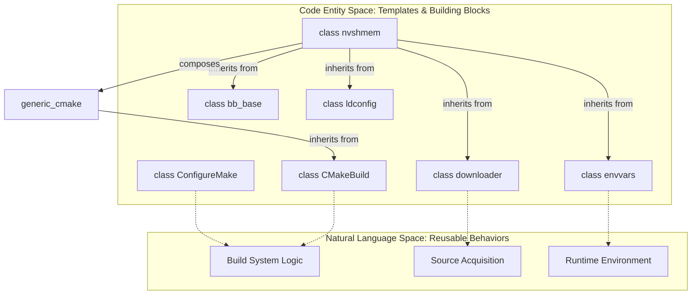
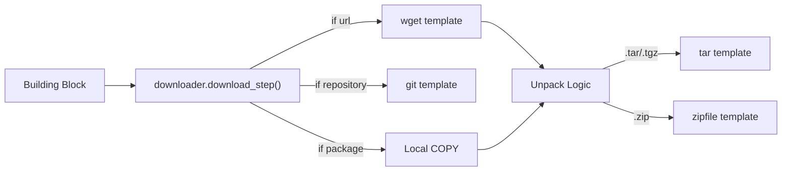

<!-- source: DeepWiki mcp.deepwiki.com · repo NVIDIA/hpc-container-maker · page 5 Templates · fetched 2026-10-26 -->

# Templates

Relevant source files

The following files were used as context for generating this wiki page:

- [.gitignore](.gitignore)
- [hpccm/building_blocks/catalyst.py](hpccm/building_blocks/catalyst.py)
- [hpccm/building_blocks/libsim.py](hpccm/building_blocks/libsim.py)
- [hpccm/building_blocks/nvshmem.py](hpccm/building_blocks/nvshmem.py)
- [hpccm/primitives/__init__.py](hpccm/primitives/__init__.py)
- [hpccm/templates/CMakeBuild.py](hpccm/templates/CMakeBuild.py)
- [hpccm/templates/ConfigureMake.py](hpccm/templates/ConfigureMake.py)
- [hpccm/templates/__init__.py](hpccm/templates/__init__.py)
- [hpccm/templates/annotate.py](hpccm/templates/annotate.py)
- [hpccm/templates/downloader.py](hpccm/templates/downloader.py)
- [hpccm/templates/envvars.py](hpccm/templates/envvars.py)
- [hpccm/templates/ldconfig.py](hpccm/templates/ldconfig.py)
- [hpccm/templates/rm.py](hpccm/templates/rm.py)
- [hpccm/templates/sed.py](hpccm/templates/sed.py)
- [hpccm/templates/tar.py](hpccm/templates/tar.py)
- [hpccm/templates/wget.py](hpccm/templates/wget.py)
- [hpccm/toolchain.py](hpccm/toolchain.py)
- [test/test_CMakeBuild.py](test/test_CMakeBuild.py)
- [test/test_ConfigureMake.py](test/test_ConfigureMake.py)
- [test/test_downloader.py](test/test_downloader.py)
- [test/test_nvshmem.py](test/test_nvshmem.py)
- [test/test_tar.py](test/test_tar.py)
- [test/test_toolchain.py](test/test_toolchain.py)

Templates in HPCCM provide a mixin layer that encapsulates reusable behaviors and logic common to many building blocks. By leveraging Python's Multiple Inheritance and Method Resolution Order (MRO), building blocks can inherit complex capabilities—such as build system workflows, download management, and environment variable manipulation—without duplicating code.

### Inheritance and Composition

Building blocks typically inherit from `bb_base` and one or more templates found in the `hpccm/templates/` directory [[hpccm/building_blocks/nvshmem.py:40-42](), [hpccm/building_blocks/libsim.py:37-38]()]. This structure allows a building block to "mix in" specific functionalities. For example, the `nvshmem` building block inherits from `downloader`, `envvars`, `ldconfig`, `rm`, and `tar` to manage its entire lifecycle from source acquisition to environment setup [[hpccm/building_blocks/nvshmem.py:40-42]()].

#### Template Interaction Diagram

This diagram illustrates how a specific building block (`nvshmem`) bridges the gap between high-level behaviors and the underlying template implementations.

**Sources:** [hpccm/building_blocks/nvshmem.py:40-42](), [hpccm/templates/__init__.py:16-27](), [hpccm/building_blocks/nvshmem.py:159-166]()

---

### Build System Templates

The build system templates encapsulate the logic for standard software compilation workflows. They handle the translation of toolchain information (compilers, flags) into shell commands compatible with the target build system.

| Template | Purpose | Key Methods |
| :--- | :--- | :--- |
| `ConfigureMake` | Autotools (`./configure && make`) | `configure_step()`, `build_step()`, `install_step()` |
| `CMakeBuild` | CMake workflow | `configure_step()`, `build_step()` |

These templates are often used via composition (where a building block creates an internal instance of `generic_cmake` or `generic_autotools`) or direct inheritance [[hpccm/building_blocks/nvshmem.py:159-166](), [hpccm/building_blocks/catalyst.py:42-44]()].

For details, see [Build System Templates (ConfigureMake and CMakeBuild)](#5.1).

**Sources:** [hpccm/templates/ConfigureMake.py:25-26](), [hpccm/templates/CMakeBuild.py:27-28]()

---

### Download and Extraction Templates

The `downloader` template acts as a high-level dispatcher for acquiring source code or binaries [[hpccm/templates/downloader.py:29-30]()]. It coordinates specialized templates to handle different protocols and archive formats.

#### Source Acquisition Workflow

The `downloader` automatically detects the appropriate tool based on the provided parameters (`url`, `repository`, or `package`) and handles the directory structure for subsequent build steps [[hpccm/templates/downloader.py:62-90]()].

For details, see [Download and Extraction Templates](#5.2).

**Sources:** [hpccm/templates/downloader.py:46-55](), [hpccm/templates/tar.py:33-67]()

---

### Environment and Runtime Templates

These templates manage how the building block affects the final container's runtime state. They ensure that libraries are discoverable and that the container remains efficient by cleaning up temporary files.

*   **`envvars`**: Manages the accumulation of `PATH`, `LD_LIBRARY_PATH`, and other environment variables [[hpccm/building_blocks/nvshmem.py:129-136]()].
*   **`ldconfig`**: Provides logic to update the dynamic linker cache, often used as an alternative to setting `LD_LIBRARY_PATH` [[hpccm/templates/ldconfig.py:1-20]()].
*   **`rm`**: Handles the removal of temporary build directories and source archives to reduce image size [[hpccm/building_blocks/nvshmem.py:51]()].
*   **`annotate`**: Allows building blocks to inject metadata (labels or comments) describing how the software was configured [[hpccm/templates/ConfigureMake.py:165-171]()].

For details, see [Environment and Runtime Templates](#5.3).

**Sources:** [hpccm/templates/envvars.py:1-20](), [hpccm/templates/rm.py:1-20](), [hpccm/templates/annotate.py:1-20]()

---

