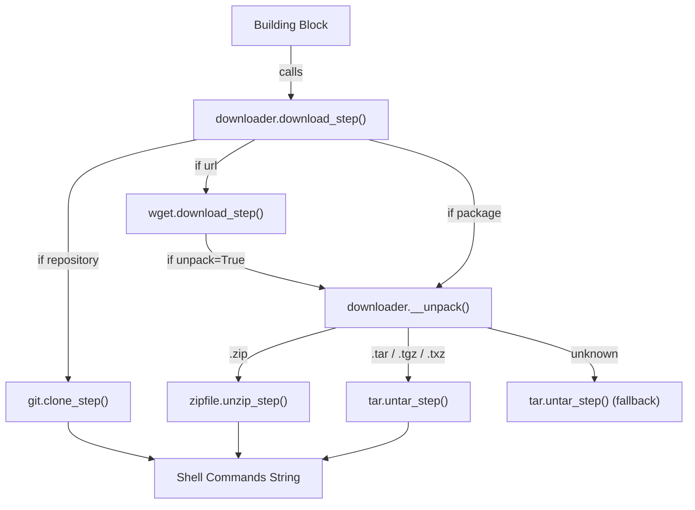
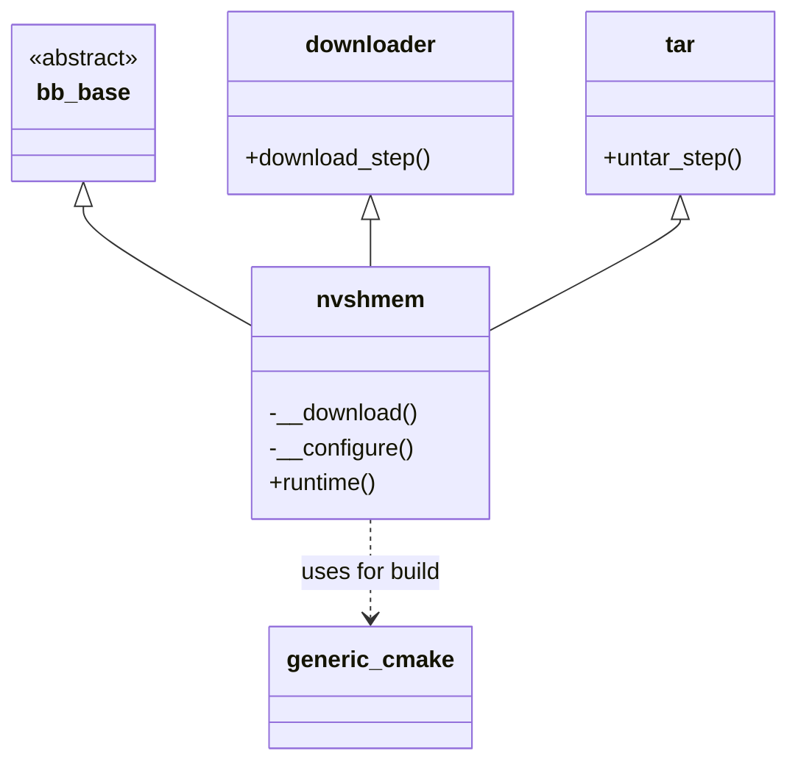

<!-- source: DeepWiki mcp.deepwiki.com · repo NVIDIA/hpc-container-maker · page 5.2 Download and Extraction Templates · fetched 2026-10-26 -->

# Download and Extraction Templates

Relevant source files

The following files were used as context for generating this wiki page:

- [hpccm/building_blocks/nvshmem.py](hpccm/building_blocks/nvshmem.py)
- [hpccm/primitives/__init__.py](hpccm/primitives/__init__.py)
- [hpccm/templates/__init__.py](hpccm/templates/__init__.py)
- [hpccm/templates/downloader.py](hpccm/templates/downloader.py)
- [hpccm/templates/git.py](hpccm/templates/git.py)
- [hpccm/templates/tar.py](hpccm/templates/tar.py)
- [hpccm/templates/wget.py](hpccm/templates/wget.py)
- [hpccm/templates/zipfile.py](hpccm/templates/zipfile.py)
- [test/test_downloader.py](test/test_downloader.py)
- [test/test_git.py](test/test_git.py)
- [test/test_nvshmem.py](test/test_nvshmem.py)
- [test/test_tar.py](test/test_tar.py)
- [test/test_wget.py](test/test_wget.py)

The download and extraction templates in HPCCM provide a standardized mechanism for building blocks to acquire source code or binaries and prepare them for compilation within a container image. These templates abstract the differences between tools like `wget` and `git`, and handle various archive formats such as `.tar.gz`, `.tar.xz`, and `.zip`.

## The Downloader Template

The `downloader` class acts as a high-level orchestrator that chooses the appropriate acquisition method based on the provided parameters. It supports three primary modes: downloading via a URL, cloning a Git repository, or using a local package already present in the build context.

### Logic Flow
The `download_step` method [hpccm/templates/downloader.py:46-112]() enforces that exactly one of `url`, `repository`, or `package` is provided. Depending on the input, it delegates to specific sub-templates:

1.  **URL Mode**: Calls `wget.download_step()` [hpccm/templates/downloader.py:64-66]() and then performs an extraction step if `unpack=True`.
2.  **Repository Mode**: Calls `git.clone_step()` [hpccm/templates/downloader.py:88-90]() and sets the `src_directory` based on the repository name.
3.  **Package Mode**: Assumes the file is already available (e.g., via a `copy` primitive) and proceeds directly to extraction [hpccm/templates/downloader.py:78-81]().

### Source Acquisition Logic
Title: Downloader Delegation and Unpacking Logic

**Sources:** [hpccm/templates/downloader.py:46-112](), [hpccm/templates/downloader.py:113-145]()

## Git Template

The `git` template manages repository cloning. It defaults to shallow clones (`--depth=1`) to minimize container layer size [hpccm/templates/git.py:35]().

### Key Capabilities
*   **Branch vs. Commit**: If a `commit` is specified, the template removes the `--depth` flag to ensure the commit is reachable and performs a `git checkout` after cloning [hpccm/templates/git.py:85-88]().
*   **Verification**: The `__verify` method [hpccm/templates/git.py:37-51]() uses `ls-remote` to check if a repository or branch exists on the host before generating container instructions. This can be set to `fatal` to stop the build early if the source is missing [hpccm/templates/git.py:91-97]().
*   **LFS Support**: If `lfs=True`, it uses `git lfs clone` [hpccm/templates/git.py:101-102]().

**Sources:** [hpccm/templates/git.py:27-126]()

## Wget Template

The `wget` template generates commands to download files. By default, it uses `-q` (quiet) and `-nc` (no-clobber) flags [hpccm/templates/wget.py:32]().

*   **Instruction Generation**: The `download_step` ensures the target directory exists (`mkdir -p`) before executing `wget` [hpccm/templates/wget.py:61-62]().
*   **SSL/TLS**: Supports `--no-check-certificate` for environments with internal CA issues [hpccm/templates/wget.py:45-46]().

**Sources:** [hpccm/templates/wget.py:24-62]()

## Extraction Templates (`tar` and `zipfile`)

These templates handle the decompression of archives into the filesystem.

### Tar Template
The `tar` template automatically detects compression formats by inspecting file extensions:
*   `.tar.gz` / `.tgz`: Adds `-z` [hpccm/templates/tar.py:46-49]().
*   `.tar.bz2` / `.tbz`: Adds `-j` [hpccm/templates/tar.py:44-45]().
*   `.tar.xz` / `.txz`: Adds `-J` [hpccm/templates/tar.py:50-53]().

If the extension is unrecognized, it logs a warning but attempts a standard `tar -x` [hpccm/templates/tar.py:58-60]().

### Zipfile Template
A simpler template that generates `unzip` commands. It uses the `-d` flag to specify the output directory [hpccm/templates/zipfile.py:39-41]().

**Sources:** [hpccm/templates/tar.py:25-67](), [hpccm/templates/zipfile.py:24-43]()

## Implementation in Building Blocks

Building blocks typically inherit from these templates to gain download capabilities. A prominent example is the `nvshmem` building block.

### nvshmem Integration Example
The `nvshmem` block inherits from `downloader` and `tar` [hpccm/building_blocks/nvshmem.py:40-42](). During initialization, it constructs the download URL based on the version and passes it to the `downloader` logic.

Title: Building Block Integration with Templates

**Sources:** [hpccm/building_blocks/nvshmem.py:40-42](), [hpccm/building_blocks/nvshmem.py:159-166]()

### Data Flow Table

| Input Parameter | Template Used | Key Function | Output Action |
| :--- | :--- | :--- | :--- |
| `repository` | `git` | `clone_step` | `git clone ...` |
| `url` | `wget` | `download_step` | `wget ...` |
| `.tar.gz` | `tar` | `untar_step` | `tar -xzvf ...` |
| `.zip` | `zipfile` | `unzip_step` | `unzip ...` |

**Sources:** [hpccm/templates/downloader.py:62-90](), [hpccm/templates/downloader.py:113-131]()

---

