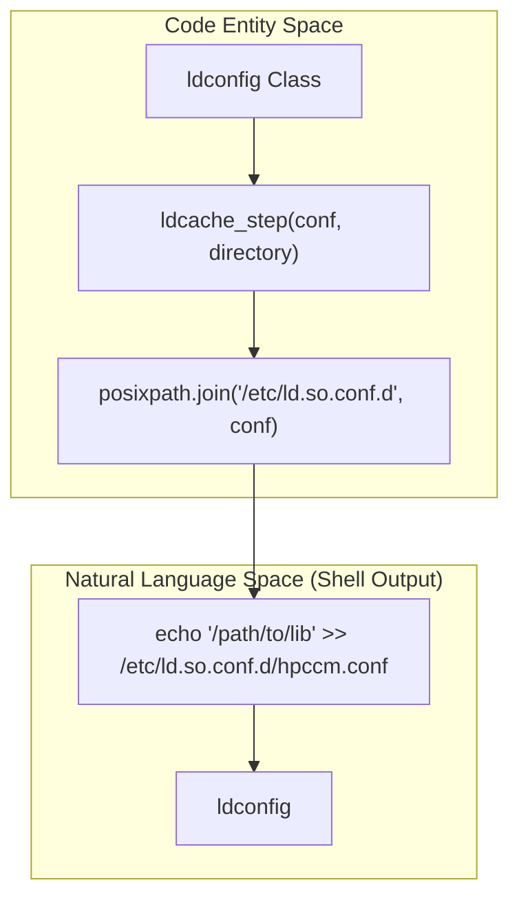
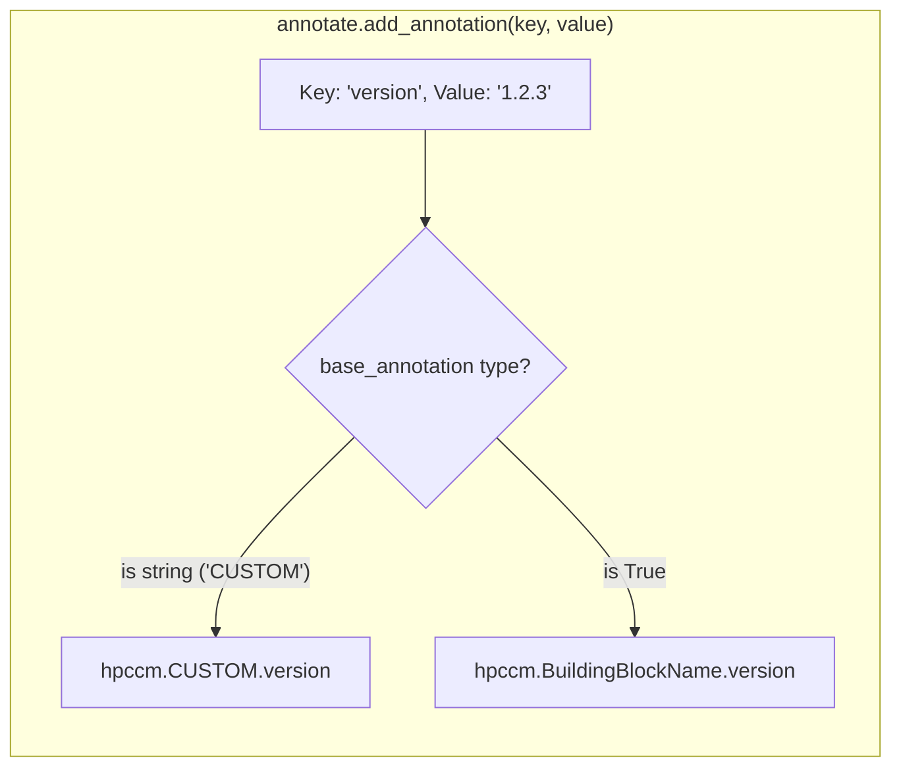

<!-- source: DeepWiki mcp.deepwiki.com · repo NVIDIA/hpc-container-maker · page 5.3 Environment and Runtime Templates · fetched 2026-10-26 -->

# Environment and Runtime Templates

Relevant source files

The following files were used as context for generating this wiki page:

- [hpccm/templates/annotate.py](hpccm/templates/annotate.py)
- [hpccm/templates/envvars.py](hpccm/templates/envvars.py)
- [hpccm/templates/ldconfig.py](hpccm/templates/ldconfig.py)
- [hpccm/templates/rm.py](hpccm/templates/rm.py)
- [hpccm/templates/sed.py](hpccm/templates/sed.py)
- [test/test_envvars.py](test/test_envvars.py)

The Environment and Runtime templates provide reusable behaviors for managing container state beyond simple package installation. These templates handle environment variable accumulation, shared library configuration, file system cleanup, in-place text editing, and metadata annotation. Building blocks inherit these templates via Python's Multiple Inheritance (MRO) to provide consistent interfaces for generating complex container instructions.

## Environment Variables (`envvars`)

The `envvars` template manages the collection and filtering of environment variables. It distinguishes between build-time and runtime environments, allowing building blocks to specify different variables depending on whether the block is in a build stage or a deployment stage [hpccm/templates/envvars.py:22-35]().

### Data Flow and Filtering
The template stores variables in two dictionaries: `environment_variables` and `runtime_environment_variables` [hpccm/templates/envvars.py:31-35](). When `environment_step()` is called, it can return the full set or a filtered subset based on inclusion or exclusion lists [hpccm/templates/envvars.py:46-51]().

| Attribute | Type | Description |
| :--- | :--- | :--- |
| `environment` | bool | Global toggle to enable/disable environment generation (default: `True`) [hpccm/templates/envvars.py:30]() |
| `environment_variables` | dict | Standard environment variables for the current stage [hpccm/templates/envvars.py:31]() |
| `runtime_environment_variables` | dict | Variables intended specifically for runtime stages [hpccm/templates/envvars.py:35]() |

**Sources:** [hpccm/templates/envvars.py:22-53](), [test/test_envvars.py:38-70]()

## Shared Library Management (`ldconfig`)

The `ldconfig` template provides a mechanism to update the dynamic linker cache. This is critical for HPC software installed in non-standard prefixes (e.g., `/usr/local/openmpi`).

The `ldcache_step()` method generates a shell command that appends a directory path to a configuration file in `/etc/ld.so.conf.d/` and then executes the `ldconfig` binary [hpccm/templates/ldconfig.py:35-43]().

### Dynamic Linker Logic

**Sources:** [hpccm/templates/ldconfig.py:25-43]()

## Cleanup and File Editing (`rm` and `sed`)

These templates provide utility functions for common shell-based file manipulations during the container build process.

### The `rm` Template
Used primarily for reducing image size by removing source code or temporary build artifacts after installation is complete. The `cleanup_step()` method takes a list of items and returns a `rm -rf` command [hpccm/templates/rm.py:32-39]().

### The `sed` Template
Provides a wrapper for the `sed` stream editor to perform in-place file editing. It handles proper shell quoting of patterns using `shlex.quote` to ensure complex regular expressions do not break the container specification [hpccm/templates/sed.py:19, 54-56]().

| Method | Argument | Description |
| :--- | :--- | :--- |
| `sed_step` | `file` | The target file to edit [hpccm/templates/sed.py:35]() |
| `sed_step` | `in_place` | If `True`, adds the `-i` flag (default: `True`) [hpccm/templates/sed.py:49-51]() |
| `sed_step` | `patterns` | A list of sed expressions (e.g., `'s/old/new/g'`) [hpccm/templates/sed.py:54-56]() |

**Sources:** [hpccm/templates/rm.py:24-39](), [hpccm/templates/sed.py:25-58]()

## Metadata Annotation (`annotate`)

The `annotate` template allows building blocks to inject metadata (labels) into the container image. This is often used to track which versions of building blocks were used to construct the image.

### Annotation Namespace Logic
The template automatically prefixes keys to prevent collisions between different building blocks. If `base_annotation` is `True`, it uses the class name of the building block as the namespace [hpccm/templates/annotate.py:38-39]().

**Sources:** [hpccm/templates/annotate.py:23-49]()

## Implementation Summary

| Template | Primary Function | Key Method |
| :--- | :--- | :--- |
| `envvars` | Accumulate and filter ENV variables | `environment_step()` |
| `ldconfig` | Update dynamic linker cache | `ldcache_step()` |
| `rm` | Remove files/directories | `cleanup_step()` |
| `sed` | In-place file string replacement | `sed_step()` |
| `annotate` | Inject metadata labels | `annotate_step()` |

**Sources:** [hpccm/templates/envvars.py:22-53](), [hpccm/templates/ldconfig.py:25-43](), [hpccm/templates/rm.py:24-39](), [hpccm/templates/sed.py:25-58](), [hpccm/templates/annotate.py:23-49]()

---

