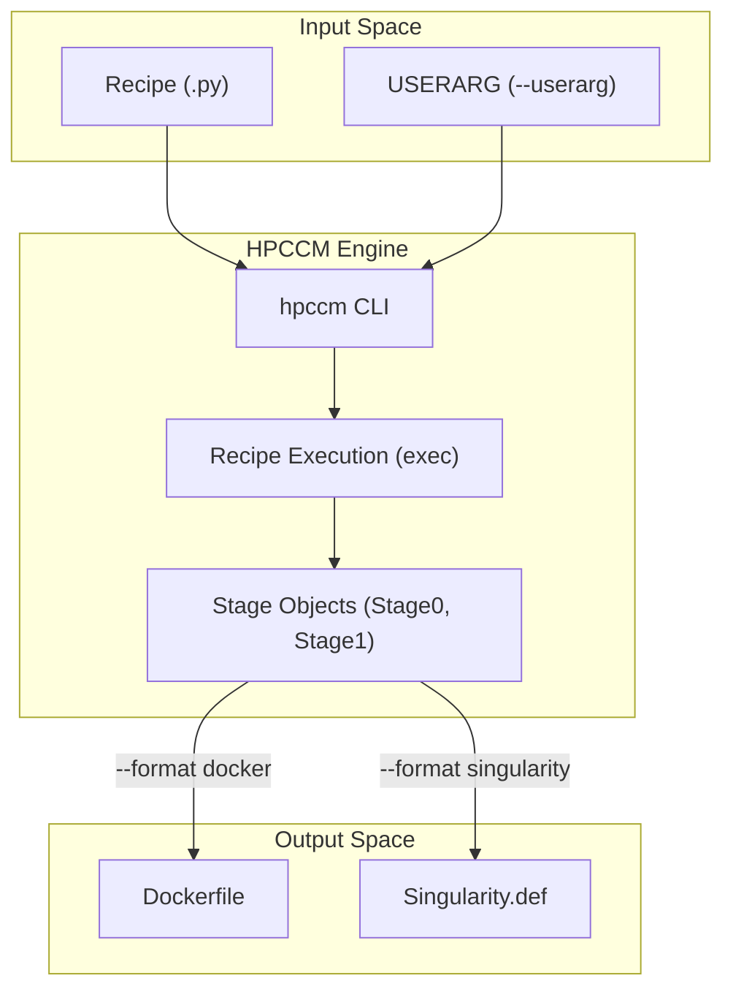
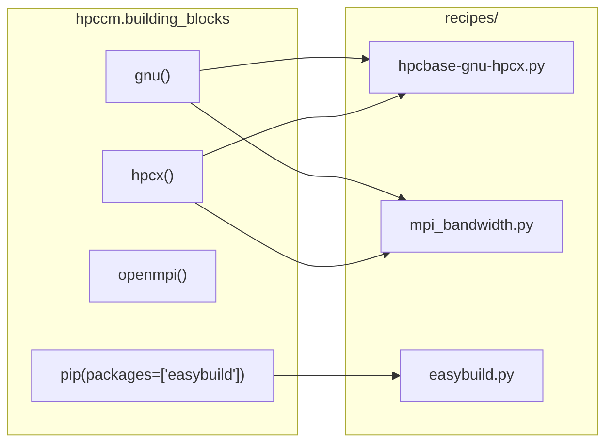

<!-- source: DeepWiki mcp.deepwiki.com · repo NVIDIA/hpc-container-maker · page 6 Recipes and Examples · fetched 2026-10-26 -->

# Recipes and Examples

Relevant source files

The following files were used as context for generating this wiki page:

- [.github/workflows/docker_build.yml](.github/workflows/docker_build.yml)
- [.github/workflows/singularity_build.yml](.github/workflows/singularity_build.yml)
- [docs/recipes.md](docs/recipes.md)
- [docs/tutorial.md](docs/tutorial.md)
- [docs/workflows.md](docs/workflows.md)
- [recipes/easybuild.py](recipes/easybuild.py)
- [recipes/examples/basic.py](recipes/examples/basic.py)
- [recipes/examples/multistage.py](recipes/examples/multistage.py)
- [recipes/examples/userargs.py](recipes/examples/userargs.py)
- [recipes/hpcbase-gnu-hpcx.py](recipes/hpcbase-gnu-hpcx.py)
- [recipes/hpcbase-nvhpc-hpcx.py](recipes/hpcbase-nvhpc-hpcx.py)
- [recipes/jupyter/.gitignore](recipes/jupyter/.gitignore)
- [recipes/jupyter/README.md](recipes/jupyter/README.md)
- [recipes/jupyter/environment.yml](recipes/jupyter/environment.yml)
- [recipes/jupyter/jupyter.py](recipes/jupyter/jupyter.py)
- [recipes/jupyter/notebook.ipynb](recipes/jupyter/notebook.ipynb)
- [recipes/jupyter/requirements.txt](recipes/jupyter/requirements.txt)
- [recipes/mpi_bandwidth.py](recipes/mpi_bandwidth.py)

HPCCM recipes are Python scripts that define the construction of container images in a format-neutral way. By using a single recipe, users can generate both Dockerfiles and Singularity definition files [docs/recipes.md:3-6](). The `recipes/` directory contains a collection of reference implementations, ranging from minimal examples to complex HPC application stacks.

### Recipe Structure and Concepts

A recipe typically consists of one or more **Stages** (e.g., `Stage0`, `Stage1`). These stages represent steps in a multi-stage build, a technique used to minimize the final container size by separating the build environment from the runtime environment [docs/recipes.md:25-31]().

*   **Primitives**: Low-level wrappers for container instructions like `baseimage`, `shell`, and `copy` [docs/recipes.md:138-149]().
*   **Building Blocks**: High-level abstractions for HPC software (e.g., `gnu()`, `openmpi()`) that handle complex configuration and Linux distribution differences automatically [docs/recipes.md:86-100]().
*   **USERARG**: A mechanism to parameterize recipes at runtime via the CLI [recipes/examples/userargs.py:13-20]().

For detailed guidance on syntax and multi-stage patterns, see **[Writing Recipes](#6.1)**.

### The HPC Base Recipes

HPCCM provides "HPC Base" recipes that serve as production-ready starting points for HPC environments. These recipes include common libraries like FFTW, HDF5, and NetCDF, paired with specific compiler and MPI stacks.

| Recipe | Compiler Stack | MPI / Communication | Distro Support |
| :--- | :--- | :--- | :--- |
| `hpcbase-gnu-hpcx.py` | GNU (`gnu`) | HPC-X (`hpcx`) | Ubuntu, Rocky Linux [recipes/hpcbase-gnu-hpcx.py:1-15]() |
| `hpcbase-nvhpc-hpcx.py` | NVIDIA HPC (`nvhpc`) | HPC-X (`hpcx`) | Ubuntu, Rocky Linux [recipes/hpcbase-nvhpc-hpcx.py:1-14]() |

These recipes extensively use `USERARG` to allow users to toggle between development and runtime-only images [recipes/hpcbase-gnu-hpcx.py:20-74]().

### Application Examples

The codebase includes several application-specific recipes that demonstrate how to containerize real-world HPC workloads.

*   **MPI Bandwidth**: A proxy application demonstrating multi-stage builds and runtime optimization [recipes/mpi_bandwidth.py:33-56]().
*   **Scientific Workflows**: Examples for GROMACS, MILC, and LAMMPS demonstrate complex dependency management [docs/workflows.md:8-28]().
*   **Package Managers**: Integration with `EasyBuild` and `Spack` for automated software installation [recipes/easybuild.py:1-49]().
*   **Interactive Environments**: The `jupyter/` directory provides a specialized recipe for notebook environments using `pip` or `conda` [recipes/jupyter/README.md:1-54]().

For a walkthrough of these bundled examples, see **[Example Recipes](#6.2)**.

### Logic Flow: From Recipe to Image

The following diagram illustrates how a recipe is processed by the HPCCM engine to produce different container formats.

**Recipe Processing Workflow**

**Sources:** [docs/recipes.md:33-68](), [recipes/examples/userargs.py:9-10]()

### Entity Mapping: Building Blocks to Recipes

This diagram maps specific code entities (Building Blocks) to their usage in reference recipes.

**Code Entity Association**

**Sources:** [recipes/hpcbase-gnu-hpcx.py:44-54](), [recipes/mpi_bandwidth.py:39-45](), [recipes/easybuild.py:34]()

---
**Sources:**
- [.github/workflows/docker_build.yml:13-58]()
- [.github/workflows/singularity_build.yml:13-59]()
- [docs/recipes.md:1-158]()
- [docs/tutorial.md:1-195]()
- [docs/workflows.md:1-89]()
- [recipes/easybuild.py:1-49]()
- [recipes/hpcbase-gnu-hpcx.py:1-74]()
- [recipes/hpcbase-nvhpc-hpcx.py:1-38]()
- [recipes/jupyter/README.md:1-54]()
- [recipes/mpi_bandwidth.py:1-56]()
- [recipes/examples/multistage.py:1-31]()
- [recipes/examples/userargs.py:1-20]()

---

