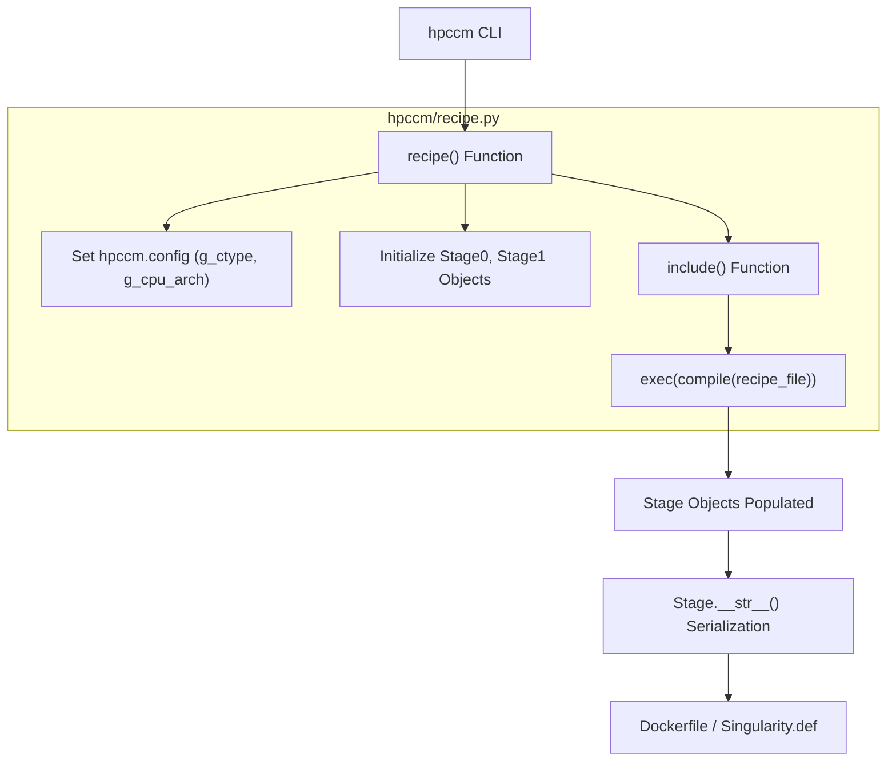
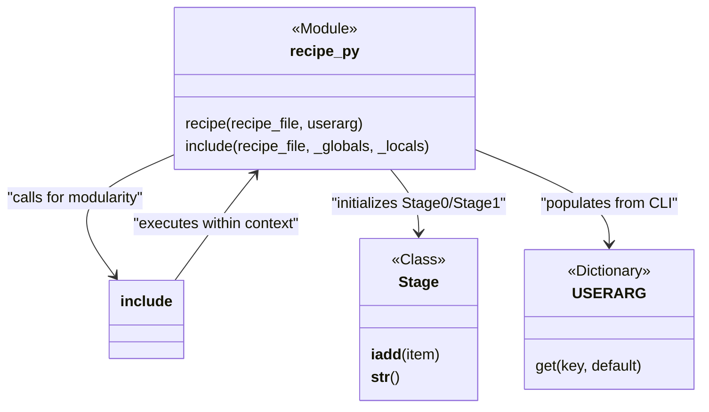

<!-- source: DeepWiki mcp.deepwiki.com · repo NVIDIA/hpc-container-maker · page 6.1 Writing Recipes · fetched 2026-10-26 -->

# Writing Recipes

<details>
<summary>Relevant source files</summary>

The following files were used as context for generating this wiki page:

- [MANIFEST.in](MANIFEST.in)
- [docs/tutorial.md](docs/tutorial.md)
- [hpccm/__init__.py](hpccm/__init__.py)
- [hpccm/recipe.py](hpccm/recipe.py)
- [recipes/examples/cloverleaf.py](recipes/examples/cloverleaf.py)
- [recipes/examples/gnu-devel.py](recipes/examples/gnu-devel.py)
- [recipes/examples/script.py](recipes/examples/script.py)
- [recipes/jupyter/.gitignore](recipes/jupyter/.gitignore)
- [recipes/jupyter/README.md](recipes/jupyter/README.md)
- [recipes/jupyter/environment.yml](recipes/jupyter/environment.yml)
- [recipes/jupyter/jupyter.py](recipes/jupyter/jupyter.py)
- [recipes/jupyter/notebook.ipynb](recipes/jupyter/notebook.ipynb)
- [recipes/jupyter/requirements.txt](recipes/jupyter/requirements.txt)
- [test/global_vars_recipe.py](test/global_vars_recipe.py)
- [test/include1.py](test/include1.py)
- [test/include2.py](test/include2.py)
- [test/include3.py](test/include3.py)
- [test/test_global_vars.py](test/test_global_vars.py)

</details>


HPC Container Maker (HPCCM) recipes are Python scripts that describe the steps to build a container image. Unlike standard Dockerfiles or Singularity definition files, HPCCM recipes are programmable, modular, and format-agnostic. This page details the technical implementation of the recipe engine, the conventions for structuring recipes, and the mechanisms for parameterization and modularity.

## Recipe Execution Engine

The core of the recipe system is the `recipe()` function in `hpccm/recipe.py`. This function acts as the entry point when using the `hpccm` CLI tool. It initializes the build environment, sets global configuration states, and executes the recipe file within a controlled Python environment.

### Data Flow and Execution
When a recipe is processed, the engine follows these steps:
1.  **Context Initialization**: It creates a list of `Stage` objects (typically `Stage0` and `Stage1`) [hpccm/recipe.py:133-135]().
2.  **Argument Injection**: If user arguments are provided via the CLI (`--userarg`), they are injected into a `USERARG` dictionary available to the recipe [hpccm/recipe.py:128-130]().
3.  **Global Configuration**: It updates `hpccm.config` with the target container format, CPU architecture, and working directory [hpccm/recipe.py:138-150]().
4.  **Compilation and Execution**: The recipe file is read, compiled into bytecode, and executed using the `exec()` function [hpccm/recipe.py:76-78]().

### Recipe Execution Logic
The following diagram illustrates how the `recipe()` function orchestrates the transformation from a Python recipe to a container specification.

**Diagram: Recipe Engine Workflow**

Sources: [hpccm/recipe.py:86-192](), [hpccm/recipe.py:36-85]()

## Stage Conventions and Multi-Stage Builds

HPCCM uses the concept of "Stages" to manage container layers. By default, the `recipe()` function provides `Stage0` and `Stage1` as predefined symbols [hpccm/recipe.py:133-135]().

### Single-Stage vs. Multi-Stage
*   **Single-Stage**: Most simple recipes only use `Stage0`. Instructions are added to the stage using the `+=` operator, which appends primitives or building blocks to the stage's internal list [docs/tutorial.md:44-45]().
*   **Multi-Stage**: Used to create smaller production images by separating the build environment from the runtime environment. Tools are installed in `Stage0`, and only the resulting binaries and runtime libraries are copied to `Stage1`.

### Implementation of Multi-Stage Logic
The engine handles the transition between stages by iterating through the `stages` list and calling `str()` on each stage [hpccm/recipe.py:187-190](). If the output format is `BASH` or an older version of `Singularity` (< 3.2), the engine automatically collapses the build to a single stage and issues a warning [hpccm/recipe.py:164-184]().

| Feature | Docker | Singularity (>= 3.2) | Bash |
| :--- | :--- | :--- | :--- |
| **Multi-stage Support** | Full | Full | Not supported (Stage0 only) |
| **Stage Reference** | `AS stage_name` | `stage_name` | N/A |
| **Copy from Stage** | `COPY --from=...` | `%files from ...` | N/A |

Sources: [hpccm/recipe.py:162-185](), [hpccm/Stage.py:24-24]()

## Parameterization with USERARG

The `USERARG` dictionary is the primary mechanism for making recipes dynamic. It allows users to pass variables from the command line into the recipe execution context.

### Usage Pattern
1.  **CLI**: `hpccm --recipe my_recipe.py --userarg version='1.2.3' --userarg compiler='gnu'`
2.  **Recipe**: The recipe accesses these values via the `USERARG` variable.

```python
# Example Recipe snippet
version = USERARG.get('version', '1.0.0') # Default to 1.0.0
if USERARG.get('compiler') == 'gnu':
    Stage0 += gnu()
```

The `recipe()` function explicitly initializes `USERARG` as an empty dictionary if no arguments are provided, ensuring the recipe does not throw a `NameError` [hpccm/recipe.py:128-130]().

Sources: [hpccm/recipe.py:112-114](), [hpccm/recipe.py:127-130]()

## Modular Recipes with include()

HPCCM supports modularity through the `include()` function, which allows one recipe to execute another. This is useful for sharing common base configurations (e.g., a standard development environment) across multiple application recipes.

### Functionality
*   **Symbol Sharing**: By default, `include()` passes the caller's `_globals` and `_locals` to the included script, allowing the included file to modify `Stage0` or access `USERARG` [hpccm/recipe.py:57-62]().
*   **Path Resolution**: The engine tracks the path of the main recipe and can prepend it to relative paths in `include()` calls, making it easier to organize sub-recipes in directories [hpccm/recipe.py:71-73]().

**Example Implementation in Code:**
[hpccm/recipe.py:36-55]() defines the `include` function. It uses `sys._getframe(1).f_locals` to automatically capture the environment of the recipe calling it [hpccm/recipe.py:59]().

**Diagram: Code Entity Mapping for Modularity**
This diagram maps the natural language concept of "Modular Inclusion" to the specific code entities in the `hpccm` package.


Sources: [hpccm/recipe.py:36-85](), [hpccm/recipe.py:127-135]()

## Generating Docker vs. Singularity Output

A key strength of HPCCM is the ability to generate different container formats from the same recipe logic. This is achieved through the `hpccm.config.g_ctype` global variable.

### Configuration and Primitives
When a recipe calls a primitive like `shell()` or `baseimage()`, the primitive checks `hpccm.config.g_ctype` to decide which string representation to return.

1.  **Docker**: Generates `RUN`, `FROM`, `ENV`, etc.
2.  **Singularity**: Generates `%post`, `Bootstrap:`, `%environment`, etc.
3.  **Bash**: Generates standard shell scripts.

The `recipe()` function sets this global state based on the `--format` argument before executing the recipe [hpccm/recipe.py:141]().

### Example Comparison
| Recipe Code | Docker Output | Singularity Output |
| :--- | :--- | :--- |
| `Stage0 += baseimage(image='ubuntu:18.04')` | `FROM ubuntu:18.04` | `Bootstrap: docker`, `From: ubuntu:18.04` |
| `Stage0 += shell(commands=['ls'])` | `RUN ls` | `%post`, `    ls` |

Sources: [hpccm/recipe.py:86-101](), [hpccm/recipe.py:141](), [hpccm/common.py:21-21]()

---

