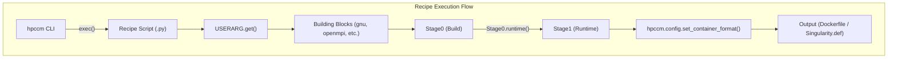
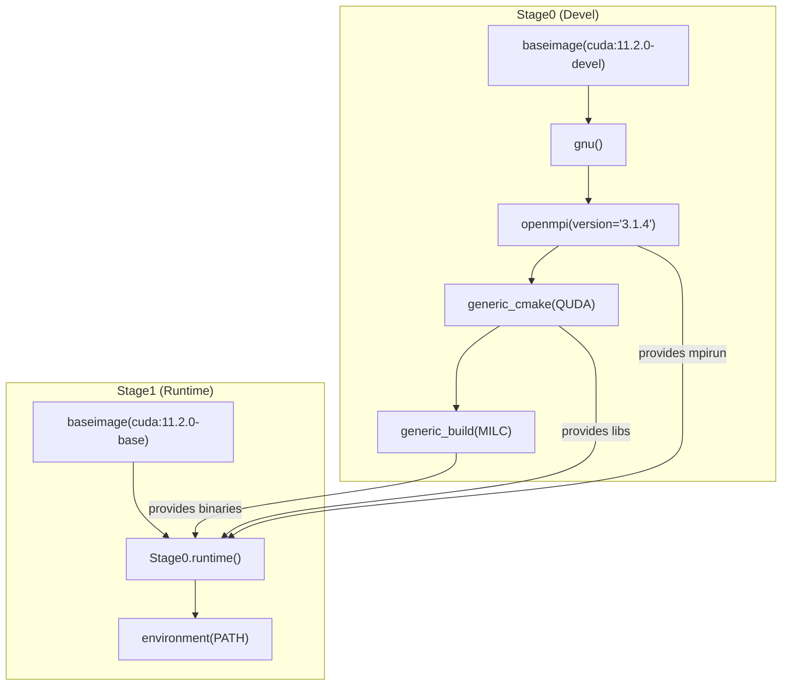

<!-- source: DeepWiki mcp.deepwiki.com · repo NVIDIA/hpc-container-maker · page 6.2 Example Recipes · fetched 2026-10-26 -->

# Example Recipes

Relevant source files

The following files were used as context for generating this wiki page:

- [.github/workflows/docker_build.yml](.github/workflows/docker_build.yml)
- [.github/workflows/singularity_build.yml](.github/workflows/singularity_build.yml)
- [docs/tutorial.md](docs/tutorial.md)
- [docs/workflows.md](docs/workflows.md)
- [recipes/easybuild.py](recipes/easybuild.py)
- [recipes/examples/basic.py](recipes/examples/basic.py)
- [recipes/examples/multistage.py](recipes/examples/multistage.py)
- [recipes/examples/scif.py](recipes/examples/scif.py)
- [recipes/examples/userargs.py](recipes/examples/userargs.py)
- [recipes/gromacs/gromacs.py](recipes/gromacs/gromacs.py)
- [recipes/hpcbase-gnu-hpcx.py](recipes/hpcbase-gnu-hpcx.py)
- [recipes/hpcbase-nvhpc-hpcx.py](recipes/hpcbase-nvhpc-hpcx.py)
- [recipes/hpccm/Dockerfile](recipes/hpccm/Dockerfile)
- [recipes/hpccm/README.md](recipes/hpccm/README.md)
- [recipes/hpccm/Singularity.def](recipes/hpccm/Singularity.def)
- [recipes/hpccm/bootstrap.py](recipes/hpccm/bootstrap.py)
- [recipes/jupyter/.gitignore](recipes/jupyter/.gitignore)
- [recipes/jupyter/README.md](recipes/jupyter/README.md)
- [recipes/jupyter/environment.yml](recipes/jupyter/environment.yml)
- [recipes/jupyter/jupyter.py](recipes/jupyter/jupyter.py)
- [recipes/jupyter/notebook.ipynb](recipes/jupyter/notebook.ipynb)
- [recipes/jupyter/requirements.txt](recipes/jupyter/requirements.txt)
- [recipes/lammps/lammps.py](recipes/lammps/lammps.py)
- [recipes/milc/milc.py](recipes/milc/milc.py)
- [recipes/mpi_bandwidth.py](recipes/mpi_bandwidth.py)
- [recipes/osu_benchmarks/README.md](recipes/osu_benchmarks/README.md)
- [recipes/osu_benchmarks/entrypoint.sh](recipes/osu_benchmarks/entrypoint.sh)
- [recipes/osu_benchmarks/osu_benchmarks.py](recipes/osu_benchmarks/osu_benchmarks.py)
- [recipes/spack.py](recipes/spack.py)
- [test/test_yum.py](test/test_yum.py)

This page provides a technical walkthrough of the example recipes bundled with HPC Container Maker (HPCCM). These recipes serve as both functional templates for high-performance computing (HPC) applications and demonstrations of advanced HPCCM features such as multi-stage builds, user argument parameterization, and cross-recipe inclusion.

## Overview of Bundled Recipes

The `recipes/` directory contains a variety of examples ranging from simple building block demonstrations to complex, production-ready HPC application stacks.

### Recipe Structure and Flow
HPCCM recipes are Python scripts that manipulate `Stage` objects. The standard convention uses `Stage0` for building and `Stage1` for the final runtime image [docs/tutorial.md:47-52]().

**Sources:** [recipes/milc/milc.py:15-88](), [docs/tutorial.md:158-172]()

---

## Basic and Multi-stage Patterns

### Basic Recipe
The `recipes/examples/basic.py` demonstrates the simplest usage of HPCCM: defining a base image and adding a compiler and MPI stack. This pattern mimics the `module load` workflow found on bare-metal HPC systems [docs/tutorial.md:9-24]().

### Multi-stage Deployment
Multi-stage recipes, such as `recipes/examples/multistage.py`, utilize the `runtime()` method of building blocks and the `Stage.runtime()` method to separate build-time dependencies (compilers, development headers) from runtime artifacts (shared libraries, binaries).

**Example: MPI Bandwidth**
The `recipes/mpi_bandwidth.py` recipe builds a sample program and then creates a slim runtime image by copying only the resulting binary [recipes/mpi_bandwidth.py:33-56]().

| Stage | Components | Key Action |
| :--- | :--- | :--- |
| **Stage0** | `gnu()`, `ofed()`, `hpcx()`, `shell()` | Compiles `mpi_bandwidth.c` [recipes/mpi_bandwidth.py:36-50]() |
| **Stage1** | `baseimage()`, `Stage0.runtime()` | Copies binary from `Stage0` [recipes/mpi_bandwidth.py:53-56]() |

**Sources:** [recipes/mpi_bandwidth.py:1-56](), [docs/tutorial.md:47-52]()

---

## Parameterized Recipes (USERARG)

Recipes often use the `USERARG` object to allow users to modify the build at generation time via the `--userarg` CLI flag.

### GROMACS Example
The GROMACS recipe [recipes/gromacs/gromacs.py]() uses `USERARG` to specify the software version.
*   **Implementation:** `gromacs_version = USERARG.get('gromacs', '2020')` [recipes/gromacs/gromacs.py:12]()
*   **Usage:** The version is then passed to the `url` parameter of `generic_cmake` [recipes/gromacs/gromacs.py:37]() and used in `label` metadata [recipes/gromacs/gromacs.py:41]().

### MILC Example
The MILC recipe uses `USERARG` to target specific GPU architectures.
*   **Implementation:** `gpu_arch = USERARG.get('GPU_ARCH', 'sm_60')` [recipes/milc/milc.py:15]()
*   **Usage:** Injected into `QUDA_GPU_ARCH` CMake options [recipes/milc/milc.py:43]().

**Sources:** [recipes/gromacs/gromacs.py:12-41](), [recipes/milc/milc.py:15-43]()

---

## Application-Specific Recipes

### OSU Benchmarks (Modular Recipes)
The OSU Benchmarks recipe demonstrates modularity using `hpccm.include()`.
1.  **common.py**: Contains the base environment (OFED, UCX, OpenMPI).
2.  **osu_benchmarks.py**: Includes the common base and adds the application-specific build [recipes/osu_benchmarks/osu_benchmarks.py:2-10]().

It also features a portable OFED entrypoint (`entrypoint.sh`) that detects the host kernel's Mellanox OFED version and adjusts `LD_LIBRARY_PATH` at runtime to ensure InfiniBand compatibility [recipes/osu_benchmarks/entrypoint.sh:23-67]().

### EasyBuild and Spack
These recipes provide base images for popular HPC package managers.
*   **EasyBuild**: Installs `Lmod` and `easybuild` via `pip`. It can optionally build a specific "easyconfig" if provided via `USERARG` [recipes/easybuild.py:34-49]().
*   **Spack**: Clones the Spack repository and configures the environment. It uses the `git` template for cloning [recipes/spack.py:33-37]().

### Jupyter
The Jupyter example (`recipes/jupyter/jupyter.py`) is a specialized script rather than a standard recipe. It provides a CLI to generate containers for notebooks, supporting both `pip` and `anaconda` as backend packagers [recipes/jupyter/README.md:15-25]().

---

## Technical Data Flow: Building MILC

The following diagram illustrates the data flow within the MILC recipe, showing how multiple building blocks interact to form the final multi-stage image.

**Sources:** [recipes/milc/milc.py:23-88]()

---

## Summary of Example Recipes

| Recipe File | Focus Area | Key Features Used |
| :--- | :--- | :--- |
| `basic.py` | Getting Started | Simple `Stage0` building blocks |
| `multistage.py` | Optimization | `Stage.runtime()` propagation |
| `userargs.py` | Flexibility | `USERARG.get()` for CUDA/MPI versions |
| `cloverleaf.py` | Mini-app | `generic_build` with Makefiles |
| `scif.py` | Interoperability | `scif` (Scientific Filesystem) block |
| `mpi_bandwidth.py` | Networking | `hpcx()`, `ofed()`, `copy(_from='build')` |
| `gromacs.py` | Production App | `generic_cmake()`, `label()` metadata |
| `osu_benchmarks.py` | Portability | `hpccm.include()`, dynamic OFED entrypoint |
| `easybuild.py` | Package Mgmt | `yum`, `pip`, `Lmod` integration |
| `spack.py` | Package Mgmt | `git` template, `apt_get` dependencies |

**Sources:** [recipes/mpi_bandwidth.py:1-56](), [recipes/gromacs/gromacs.py:1-54](), [recipes/osu_benchmarks/osu_benchmarks.py:1-17](), [recipes/easybuild.py:1-49](), [recipes/spack.py:1-44]()

---

