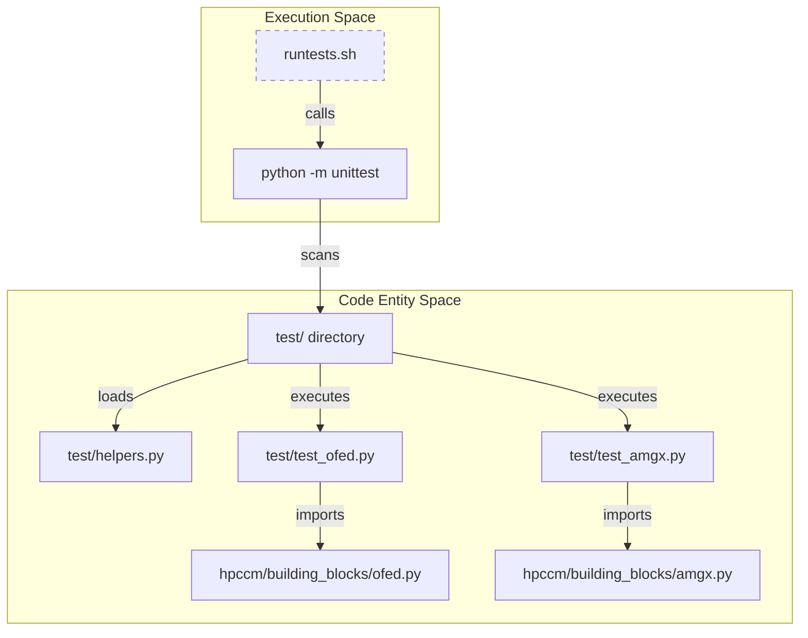
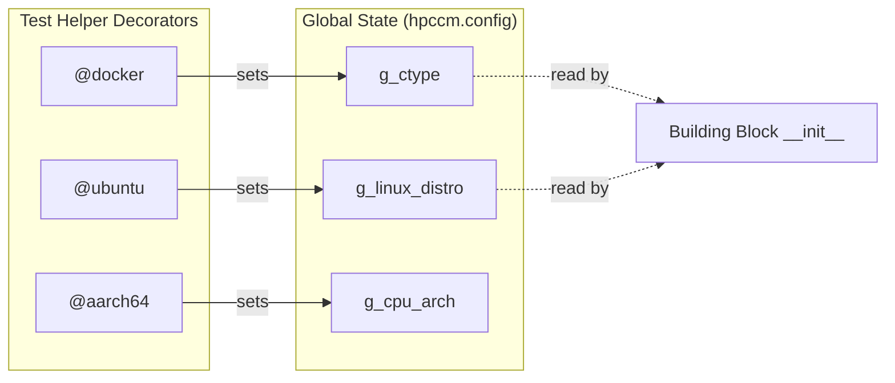

<!-- source: DeepWiki mcp.deepwiki.com · repo NVIDIA/hpc-container-maker · page 7 Testing Infrastructure · fetched 2026-10-26 -->

# Testing Infrastructure

Relevant source files

The following files were used as context for generating this wiki page:

- [.github/workflows/python3.yml](.github/workflows/python3.yml)
- [README.md](README.md)
- [docs/README.md](docs/README.md)
- [hpccm/building_blocks/amgx.py](hpccm/building_blocks/amgx.py)
- [hpccm/building_blocks/ofed.py](hpccm/building_blocks/ofed.py)
- [runtests.sh](runtests.sh)
- [test/helpers.py](test/helpers.py)
- [test/test_amgx.py](test/test_amgx.py)
- [test/test_cli.py](test/test_cli.py)
- [test/test_ofed.py](test/test_ofed.py)

The HPC Container Maker (HPCCM) testing infrastructure is designed to ensure cross-platform compatibility and correct generation of container specifications (Docker and Singularity) without requiring the actual container runtimes to be installed on the host. The suite primarily consists of unit tests that validate the string output of primitives and building blocks against expected values.

## Test Suite Organization

The test suite is located in the `test/` directory. Each major component (primitive, building block, or CLI module) typically has a corresponding test file prefixed with `test_`.

*   **Unit Tests**: Individual tests for building blocks (e.g., `test/test_ofed.py` [test/test_ofed.py:17-29]()) and primitives.
*   **CLI Tests**: Tests for command-line argument parsing and recipe execution (e.g., `test/test_cli.py` [test/test_cli.py:17-28]()).
*   **Helpers**: A shared utility module `test/helpers.py` that provides the simulation environment [test/helpers.py:17-27]().

### Code Entity Mapping: Test Discovery
The following diagram illustrates how the testing tools interact with the codebase to discover and execute tests.

Test Discovery and Execution Flow

Sources: [runtests.sh:31-41](), [test/test_ofed.py:25-27](), [test/test_amgx.py:25-27]()

## Environment Simulation (Helpers)

A critical part of the infrastructure is the decorator-based system in `test/helpers.py`. Because HPCCM relies on global state in `hpccm.config` (such as the target Linux distribution or container format), these decorators allow tests to "mock" an environment by setting these global variables before a test function runs.

Commonly used decorators include:
*   **Container Types**: `@docker`, `@singularity` [test/helpers.py:79-85, 145-151]().
*   **Distributions**: `@ubuntu`, `@centos`, `@rockylinux9` [test/helpers.py:188-195, 53-60, 127-134]().
*   **Architectures**: `@x86_64`, `@aarch64`, `@ppc64le` [test/helpers.py:228-234, 29-35, 119-125]().

For details on implementing new environment mocks, see [Test Helpers and Decorator Pattern](#7.1).

### Code Entity Mapping: Decorator Pattern
This diagram shows how decorators in `test/helpers.py` manipulate the global `hpccm.config` state to simulate different build environments.

Environment Mocking Mechanism

Sources: [test/helpers.py:32](), [test/helpers.py:82](), [test/helpers.py:191](), [hpccm/building_blocks/ofed.py:106-160]()

## Test Execution (runtests.sh)

The `runtests.sh` script is the primary entry point for running the test suite locally. It wraps `unittest` discovery and provides options for coverage and specific test filtering.

| Argument | Description |
| :--- | :--- |
| `--coverage` | Runs tests with the `coverage` tool and generates a report [runtests.sh:10-12, 33-35](). |
| `--python3` | Forces the use of `python3` and `coverage3` [runtests.sh:17-20](). |
| `--test=<name>` | Filters tests by pattern (e.g., `--test=ofed` runs only OFED tests) [runtests.sh:24-26, 36-38](). |
| `--verbose` | Enables verbose output from `unittest` [runtests.sh:21-23](). |

Sources: [runtests.sh:8-31]()

## CI/CD Workflows

HPCCM uses GitHub Actions for continuous integration. The workflows ensure that changes do not break the generation logic across different Python versions and host operating systems.

*   **Python 3 Workflow**: Runs the unit test suite via `runtests.sh` on Ubuntu, macOS, and Windows for Python versions 3.8 through 3.12 [.github/workflows/python3.yml:5-11, 31-32]().
*   **Build Workflows**: Periodically attempt to build actual container images from example recipes to ensure the generated code remains functional in real-world environments.

For details on the CI configuration, see [CI/CD Workflows](#7.2).

Sources: [.github/workflows/python3.yml:1-32](), [README.md:1]()

---

