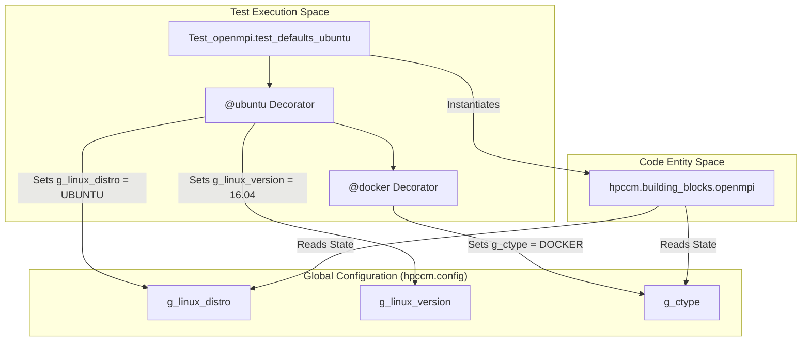
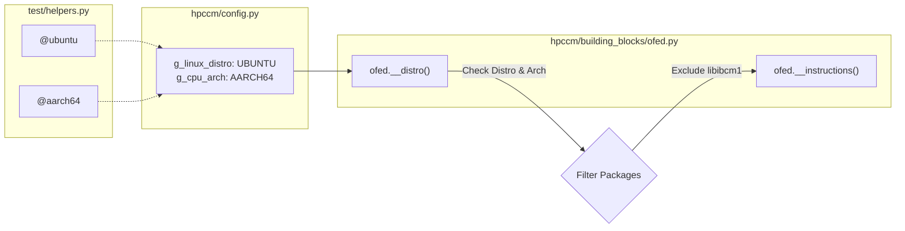

<!-- source: DeepWiki mcp.deepwiki.com · repo NVIDIA/hpc-container-maker · page 7.1 Test Helpers and Decorator Pattern · fetched 2026-10-26 -->

# Test Helpers and Decorator Pattern

<details>
<summary>Relevant source files</summary>

The following files were used as context for generating this wiki page:

- [hpccm/building_blocks/ofed.py](hpccm/building_blocks/ofed.py)
- [hpccm/common.py](hpccm/common.py)
- [test/helpers.py](test/helpers.py)
- [test/test_bb_base.py](test/test_bb_base.py)
- [test/test_blob.py](test/test_blob.py)
- [test/test_config.py](test/test_config.py)
- [test/test_ofed.py](test/test_ofed.py)
- [test/test_openmpi.py](test/test_openmpi.py)
- [test/test_raw.py](test/test_raw.py)
- [test/test_recipe.py](test/test_recipe.py)

</details>


The HPCCM test suite utilizes a sophisticated decorator-based environment simulation system defined in `test/helpers.py`. This system allows unit tests to validate the generation of container instructions for various operating systems, CPU architectures, and container formats without requiring a live container runtime or a specific host environment.

## Overview and Purpose

The primary role of these helpers is to manipulate the global state stored in `hpccm.config` [test/helpers.py:25](). By wrapping test methods with these decorators, the testing framework ensures that when a building block or primitive is instantiated, it "sees" the environment specified by the decorator rather than the actual host system's configuration.

This approach enables:
*   **Cross-platform validation**: Testing `aarch64` or `ppc64le` logic on an `x86_64` CI runner.
*   **Distro-specific logic**: Verifying that the `ofed` building block correctly switches between `apt-get` for Ubuntu and `yum` for CentOS [hpccm/building_blocks/ofed.py:106-160]().
*   **Format parity**: Ensuring the same recipe produces valid `Dockerfile` and Singularity `%post` sections [test/test_recipe.py:56-89]().

## Decorator Implementation Pattern

Every helper follows a standard Python decorator pattern. They intercept the test function call, modify the `hpccm.config` global variables, and then execute the original function.

### Data Flow Diagram
This diagram illustrates how a decorator mediates between the Test Case and the Global Configuration.

**Environment Simulation Flow**

**Sources:** [test/helpers.py:79-85](), [test/helpers.py:188-195](), [test/test_openmpi.py:35-39]()

## Available Decorators

The helpers are categorized by the configuration axis they control.

### Container Formats
These decorators set `hpccm.config.g_ctype` using the `container_type` enum [hpccm/common.py:21-25]().

| Decorator | Effect on `hpccm.config` | Source |
| :--- | :--- | :--- |
| `@docker` | `g_ctype = container_type.DOCKER` | [test/helpers.py:79-85]() |
| `@singularity` | `g_ctype = container_type.SINGULARITY` | [test/helpers.py:145-151]() |
| `@bash` | `g_ctype = container_type.BASH` | [test/helpers.py:37-43]() |
| `@singularity32` | `g_ctype = SINGULARITY`, `g_singularity_version = Version('3.2')` | [test/helpers.py:162-169]() |

### Linux Distributions
These decorators set both `g_linux_distro` and `g_linux_version` [test/helpers.py:53-70]().

| Decorator | Distro Enum | Version | Source |
| :--- | :--- | :--- | :--- |
| `@ubuntu` | `linux_distro.UBUNTU` | `16.04` | [test/helpers.py:188-195]() |
| `@ubuntu22` | `linux_distro.UBUNTU` | `22.04` | [test/helpers.py:215-222]() |
| `@centos` | `linux_distro.CENTOS` | `7.0` | [test/helpers.py:53-60]() |
| `@centos8` | `linux_distro.CENTOS` | `8.0` | [test/helpers.py:62-69]() |
| `@rockylinux9` | `linux_distro.CENTOS` | `9.0` | [test/helpers.py:127-134]() |

### CPU Architectures and Targets
These decorators simulate different hardware environments, influencing compiler flags and package availability [test/helpers.py:29-35]().

| Decorator | Effect | Source |
| :--- | :--- | :--- |
| `@x86_64` | `g_cpu_arch = cpu_arch.X86_64` | [test/helpers.py:224-230]() |
| `@aarch64` | `g_cpu_arch = cpu_arch.AARCH64` | [test/helpers.py:29-35]() |
| `@ppc64le` | `g_cpu_arch = cpu_arch.PPC64LE` | [test/helpers.py:119-125]() |
| `@broadwell` | `g_cpu_target = 'broadwell'` | [test/helpers.py:45-51]() |

## Usage in Unit Tests

A typical test case stacks multiple decorators to define a specific environment. For example, testing the `ofed` building block for Ubuntu 18.04 on x86_64 requires three decorators [test/test_ofed.py:65-68]().

```python
@x86_64
@ubuntu18
@docker
def test_defaults_ubuntu18(self):
    o = ofed()
    self.assertIn('apt-get install', str(o))
```

### Component Interaction Diagram
This diagram shows how the `ofed` building block consumes the configuration set by the helpers to decide which packages to install.

**Building Block Decision Logic**

**Sources:** [hpccm/building_blocks/ofed.py:102-158](), [test/helpers.py:29-35](), [test/helpers.py:188-195]()

## Error Simulation
The helper module also includes "invalid" decorators like `@invalid_ctype` [test/helpers.py:103-109]() and `@invalid_distro` [test/helpers.py:111-117](). These are used to verify that HPCCM components correctly raise `RuntimeError` or `TypeError` when the configuration is corrupted or unsupported [test/test_raw.py:40-45]().

**Sources:**
*   `test/helpers.py`: [29-230]()
*   `test/test_config.py`: [35-175]()
*   `hpccm/common.py`: [21-40]()
*   `hpccm/building_blocks/ofed.py`: [102-160]()

---

