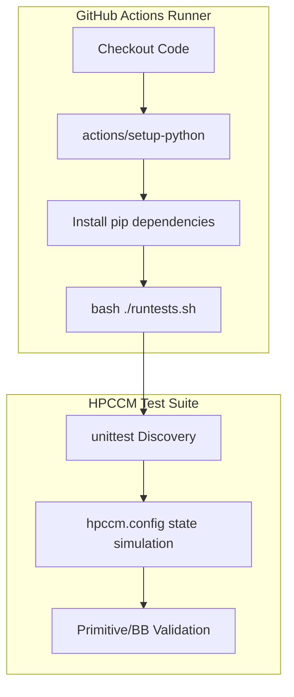

<!-- source: DeepWiki mcp.deepwiki.com · repo NVIDIA/hpc-container-maker · page 7.2 CI/CD Workflows · fetched 2026-10-26 -->

# CI/CD Workflows

<details>
<summary>Relevant source files</summary>

The following files were used as context for generating this wiki page:

- [.github/pull_request_template.md](.github/pull_request_template.md)
- [.github/workflows/docker_build.yml](.github/workflows/docker_build.yml)
- [.github/workflows/python3.yml](.github/workflows/python3.yml)
- [.github/workflows/singularity_build.yml](.github/workflows/singularity_build.yml)
- [README.md](README.md)
- [docs/README.md](docs/README.md)
- [docs/workflows.md](docs/workflows.md)
- [recipes/hpcbase-gnu-hpcx.py](recipes/hpcbase-gnu-hpcx.py)
- [recipes/hpcbase-nvhpc-hpcx.py](recipes/hpcbase-nvhpc-hpcx.py)
- [recipes/mpi_bandwidth.py](recipes/mpi_bandwidth.py)

</details>


HPC Container Maker (HPCCM) utilizes GitHub Actions to ensure cross-platform compatibility, functional correctness of generated container specifications, and the viability of example recipes. The CI infrastructure is divided into unit testing across multiple Python environments and automated weekly builds of container images.

## 1. Unit Testing (python3.yml)

The `Python 3` workflow is the primary gatekeeper for code quality, triggered on every `push` and `pull_request` [ .github/workflows/python3.yml:1-3 ](). It validates the core engine, building blocks, and primitives across a diverse matrix of operating systems and Python versions.

### Implementation Details
- **Platform Matrix**: The workflow executes on `ubuntu-latest`, `macos-latest`, and `windows-latest` [ .github/workflows/python3.yml:10-10 ]().
- **Python Versions**: It tests compatibility for Python 3.8 through 3.12 [ .github/workflows/python3.yml:11-11 ]().
- **Dependencies**: The workflow installs core requirements including `six`, `archspec`, and `packaging` [ .github/workflows/python3.yml:28-28 ]().
- **Execution**: Tests are triggered via the `runtests.sh` script [ .github/workflows/python3.yml:32-32 ]().

### Data Flow: Unit Test Execution
The following diagram illustrates how the GitHub Action environment prepares the system to run the HPCCM test suite.


**Sources:** [ .github/workflows/python3.yml:13-32 ]()

## 2. Automated Container Builds

To ensure that the recipes provided in the repository remain functional as upstream dependencies (like Mellanox OFED or NVIDIA HPC SDK) change, HPCCM runs weekly scheduled builds. These workflows test the end-to-end process: Recipe -> Specification -> Image Build.

### 2.1 Docker Build Workflow (docker_build.yml)
This workflow runs every Wednesday at 12:00 UTC [ .github/workflows/docker_build.yml:5-5 ](). It uses a build matrix to iterate through significant example recipes.

| Feature | Implementation |
| :--- | :--- |
| **Trigger** | `cron: '0 12 * * 3'` [ .github/workflows/docker_build.yml:5-5 ]() |
| **Build Engine** | `docker build` [ .github/workflows/docker_build.yml:74-74 ]() |
| **CLI Usage** | `./hpccm.sh --recipe <file> --userarg <args>` [ .github/workflows/docker_build.yml:73-73 ]() |

**Sources:** [ .github/workflows/docker_build.yml:1-75 ]()

### 2.2 Singularity Build Workflow (singularity_build.yml)
Scheduled for Wednesdays at 13:00 UTC [ .github/workflows/singularity_build.yml:5-5 ](), this workflow handles the complexities of installing Singularity within a GitHub Runner before attempting image builds.

- **Environment Setup**: The runner installs `build-essential`, `libseccomp-dev`, and `squashfs-tools` [ .github/workflows/singularity_build.yml:75-75 ]().
- **Singularity Installation**: It compiles Singularity v3.7.4 from source [ .github/workflows/singularity_build.yml:77-83 ]().
- **HPCCM Integration**: The CLI is invoked with `--format singularity` and specific `--singularity-version` flags [ .github/workflows/singularity_build.yml:87-87 ]().

**Sources:** [ .github/workflows/singularity_build.yml:71-89 ]()

## 3. Workflow Logic and Matrix Strategy

The build workflows use a `strategy: matrix` to define which recipes are tested. This ensures that complex scenarios like multi-stage builds and user-defined arguments (`USERARG`) are exercised.

### Mapping Code Entities to CI Logic
This diagram bridges the YAML configuration to the HPCCM execution components.

```mermaid
graph LR
    subgraph "CI Matrix Configuration"
        M1["matrix.recipe"] 
        M2["matrix.userargs"]
    end

    subgraph "HPCCM Execution Engine"
        CLI["hpccm.sh (CLI)"]
        UA["USERARG.get()"]
        ST0["Stage0"]
        ST1["Stage1"]
    end

    M1 -->|Input to| CLI
    M2 -->|Injected into| UA
    CLI -->|Executes| ST0
    ST0 -->|runtime()| ST1
    ST1 -->|Output| OUT[".def or Dockerfile"]
```
**Sources:** [ .github/workflows/docker_build.yml:17-58 ](), [ recipes/mpi_bandwidth.py:33-57 ](), [ recipes/hpcbase-gnu-hpcx.py:18-75 ]()

### Tested Recipes
The following table highlights key recipes included in the CI matrix to ensure coverage of specific HPCCM features:

| Recipe Path | Feature Tested | Source |
| :--- | :--- | :--- |
| `recipes/examples/multistage.py` | Multi-stage build logic | [ .github/workflows/docker_build.yml:23-25 ]() |
| `recipes/mpi_bandwidth.py` | MPI, OFED, and UCX integration | [ .github/workflows/docker_build.yml:50-52 ]() |
| `recipes/hpcbase-gnu-hpcx.py` | Complex toolchain and `packages` abstraction | [ .github/workflows/docker_build.yml:38-40 ]() |
| `recipes/hpccm/bootstrap.py` | Self-hosting HPCCM in a container | [ .github/workflows/docker_build.yml:41-43 ]() |

**Sources:** [ .github/workflows/docker_build.yml:13-58 ](), [ recipes/mpi_bandwidth.py:1-57 ]()

## 4. Maintenance and Contributions
The `pull_request_template.md` enforces that contributors verify their changes against these workflows before submission:
1. **Documentation**: Updates via `pydocmd generate` [ .github/pull_request_template.md:4-4 ]().
2. **Unit Tests**: Requirement to pass the `python3.yml` suite [ .github/pull_request_template.md:5-5 ]().

**Sources:** [ .github/pull_request_template.md:1-6 ]()

---

